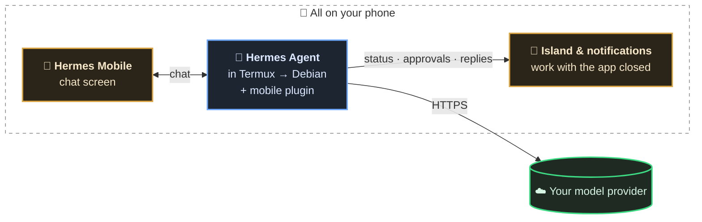

<p align="center">
  
</p>

<p align="center">
  <b>A native-feeling Android app for <a href="https://github.com/NousResearch/hermes-agent">Hermes Agent</a>, running entirely on your phone.</b><br>
  No laptop. No server.
</p>

<p align="center">
  
  
  
  
  
</p>

<p align="center">
  <a href="https://x.com/markkeeper2/status/2106873833978540280"></a><br>
  <a href="https://x.com/markkeeper2/status/2106873833978540280"><b>𝕏 See the demo release post</b></a>
</p>

> Unofficial community project. Not affiliated with or endorsed by Nous Research.

Hermes Agent is a powerful agent, but it lives in a terminal. Hermes Mobile gives it a proper phone interface: streaming chat,
live tool cards, approvals you can answer from the status bar, a canvas for building things together, and notifications that work
while the app is closed. Hermes runs in Termux on the same phone, so the whole thing is self-contained.

**[Install](#install)** · **[Full install guide](docs/install.md)** · **[What's new](CHANGELOG.md)**

## Highlights

### Answer from the island

Approvals and questions show up on the status chip (an Android 16 Live Update; older versions get a normal notification).
One tap, pick an answer, done. The app does not need to be open.

<p align="center"></p>

### Renders everything, natively

KaTeX equations, sortable tables with "Copy table", tick-able task lists, Obsidian-style callouts, Mermaid diagrams (full screen,
pinch to zoom), coloured diffs, long code that collapses, inline SVG and HTML cards.

<p align="center"></p>

### A canvas you and Hermes share

Ask for an interactive page or a 3D scene and Hermes builds it live in a document beside the chat. HTML runs in a sandbox that is offline
unless you allow it. Every change is a version with a diff you can restore.

<p align="center"></p>

### Your phone's assistant

Pick Hermes as your *Digital assistant app* (under Default apps) and long-pressing the power button opens it in hands-free
Live mode.

<p align="center"></p>

### Uses your apps without taking your screen

Ask Hermes to do something in an app ("add milk to my Keep list") and it opens that app on a hidden screen, reads it, taps and
types, while you keep using your phone. The status chip says **Using <app>** and **Take over** brings the app to your screen.
It asks once per app per chat; banking, payment, password and 2FA apps stay off unless you allow them. Needs Android 14+ and Shizuku.

### Your chats, your memory, your look

Search inside every message, pin, archive, link chats to chats. Every memory write is shown as a diff, and there is a screen to see
what Hermes remembers. Dark, OLED black or light.

<p align="center"></p>

### And more

| | |
|---|---|
| **Chat** | Stop or steer a running reply; edit, retry or branch any turn; `/btw` side questions; `/` autocomplete for every skill and command; per-chat drafts |
| **See the work** | Reasoning, live tool cards, sub-agents, the to-do list, speed and context use per reply, and file checkpoints to undo Hermes's file changes |
| **Cards in replies** | Hermes can answer with interactive cards (tables, charts, tabs, buttons, forms) drawn by OpenUI; a card can show live, read-only data. Off switch in Settings → Replies |
| **Voice** | Read replies aloud with a player (pause, seek, speed, any installed speech engine), dictation and hands-free Live mode |
| **Models & profiles** | Sign in with ChatGPT, Claude, Grok or Nous Portal, or use API keys; switch model and reasoning level per chat; profiles with their own default model, keys and SOUL.md |
| **Notifications** | Reply, answer questions and allow commands right from the notification; cron results; a "failed" note when a model call fails |
| **Screens** | Skills, memory, cron jobs, files, projects, a canvas gallery, and every Hermes setting |
| **Share** | "Share to Hermes" from any app; attach photos, camera shots and files; share a chat as Markdown |
| **Offline-friendly** | Messages typed offline send on reconnect; the last chat list is cached |
| **Shortcuts & big screens** | Launcher shortcuts (New chat, Live mode, last chat); a two-column layout on tablets and foldables |
| **Setup check** | One screen that checks Termux, permissions, the plugin and battery settings, with a fix button for each |
| **Battery** | No permanent wake lock: the phone sleeps while Hermes is idle |

## Install

**No root needed.** You need an arm64 Android phone (Android 8+) with about 6 GB free, and a model: a subscription you already
have (ChatGPT, Claude, SuperGrok, Nous Portal) or an API key (for example [OpenRouter](https://openrouter.ai/keys), or Gemini's
free tier). It takes 15-40 minutes, mostly waiting.

**On the phone (Android 11+):**

1. Download **hermes-mobile.apk** from the [latest release](https://github.com/omarqaterge/hermes-mobile-app/releases/latest),
   install it and open it.
2. Tap **Install all** to get Termux, Termux:API, Termux:Boot (from F-Droid) and Shizuku.
3. Start Shizuku with Wireless debugging (needed: it gives Hermes the screen and apps; the app shows how). After that,
   Hermes Mobile starts Shizuku again by itself after a restart, on Wi-Fi.
4. Tap **Copy the command**, then **Open Termux**, paste it and press Enter. Allow what Termux asks and keep the screen on.
5. Back in the app, sign in with your subscription or paste an API key.

The app follows each step and picks up wherever you stopped.

**From a computer** (also for Android 8-10): turn on USB debugging, plug the phone in and run

```bash
# Mac / Linux
curl -fsSL https://raw.githubusercontent.com/omarqaterge/hermes-mobile-app/main/tools/setup-phone.sh -o setup-phone.sh && bash setup-phone.sh
```

```powershell
# Windows (PowerShell)
irm https://raw.githubusercontent.com/omarqaterge/hermes-mobile-app/main/tools/setup-phone.ps1 | iex
```

Or let your AI coding agent (Claude Code, Codex, Cursor…) do it, with this prompt:

```text
Read https://raw.githubusercontent.com/omarqaterge/hermes-mobile-app/main/AGENT_INSTALL.md and follow it to set up Hermes on my Android phone.
```

**Afterwards:** set battery to *Unrestricted* for Hermes Mobile, Termux and Shizuku, or Android may stop them. If something
doesn't work, open **Settings → Setup check** in the app.

The [full install guide](docs/install.md) has every step in detail, the by-hand route, rooted phones (chroot-distro),
a troubleshooting table and uninstalling.

> Tested end to end on a clean Android 15 emulator and piece by piece on a real phone, but not yet on a brand-new real phone.
> If something fails, please [open an issue](https://github.com/omarqaterge/hermes-mobile-app/issues).

### Uninstall

**Settings → Danger zone → Uninstall Hermes** removes Hermes and its data, then the helper apps, after an optional backup to
`Download/hermes-backup-<date>.tar.gz` (API keys and sign-ins are left out unless you include them). To restore it on a new
install, run this in Termux and restart Hermes:

```bash
~/bin/hermes-debian bash -c 'tar -xzf /sdcard/Download/hermes-backup-<date>.tar.gz -C /root/.hermes'
```

What is kept and how to uninstall by hand: [docs/install.md](docs/install.md#uninstall).

## How it works



Hermes's dashboard runs on the phone at `127.0.0.1:9119`, and the app talks to it over the same `tui_gateway` JSON-RPC connection
Hermes Desktop uses (it also starts Hermes when it isn't running). A small Hermes plugin sends status, approvals and replies to
the app's background service, so the island chip and notifications work even when the app is closed.

| Folder | What it is |
|---|---|
| `web/` | The interface (React + TypeScript), using Hermes's own client from `apps/shared`, copied into `web/vendor/hermes-shared` |
| `android/` | A thin Java shell around a WebView for what a web page can't do: notifications, starting Hermes through Termux, photo picker and camera, shares, media |
| `hermes-plugin/` | Sends events to the app and serves the canvas and media |
| `phone/` | The installer and the scripts that keep Hermes running |
| `hermes/patches` | A few fixes to Hermes itself, applied by the installer and offered upstream ([hermes/README.md](hermes/README.md)) |

Full specification (architecture, every feature, every screen): [docs/SPEC.md](docs/SPEC.md).

## Build the app yourself

You need **Node 20+**, **JDK 17** and the [Android command-line tools](https://developer.android.com/studio#command-line-tools-only)
(`sdkmanager "platforms;android-36" "build-tools;35.0.0"`). No Gradle:

```bash
git clone https://github.com/omarqaterge/hermes-mobile-app.git && cd hermes-mobile-app
(cd web && npm ci)
ANDROID_HOME=/path/to/android-sdk JAVA_HOME=/path/to/jdk-17 VERSION_NAME=1.0.0 VERSION_CODE=1 android/build.sh
adb install -r android/build/hermes-mobile.apk
```

The first build creates a signing key in `~/.android/hermes-mobile.keystore` (never commit it). A self-built app can't update the
downloaded one, because the keys differ: uninstall that first.

To work on the interface in a desktop browser: `adb forward tcp:9119 tcp:9119`, `python3 web/devserver.py`, open http://127.0.0.1:5180.

Tests, project rules and what to do after a Hermes update: [CONTRIBUTING.md](CONTRIBUTING.md).

## License and credits

MIT, see [LICENSE](LICENSE). `web/vendor/hermes-shared` is copied from [NousResearch/hermes-agent](https://github.com/NousResearch/hermes-agent)
(MIT, Copyright Nous Research), see [THIRD_PARTY.md](THIRD_PARTY.md). "Hermes" and the Hermes Agent name belong to their owners.
Contributions and bug reports are welcome, see [CONTRIBUTING.md](CONTRIBUTING.md).
