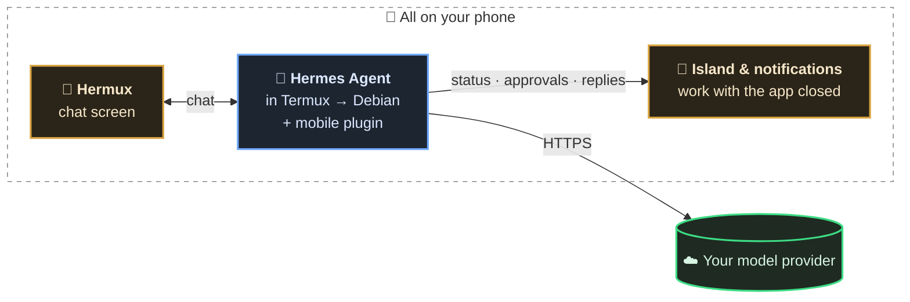

<p align="center">
  
</p>

<p align="center">
  <b>An agent that evolves with you. **running natively on your phone**</b><br>
  It learns, adapts and gets things done: it chats, codes, builds with you and uses your apps.<br>
  Securely on your phone. No laptop, no server, no root.
</p>

<p align="center">
  
  
  
  
  
</p>

<p align="center">
  <a href="https://x.com/markkeeper2/status/2106873833978540280"></a><br>
  <a href="https://x.com/markkeeper2/status/2106873833978540280"><b>𝕏 See the demo release post</b></a>
</p>

**[Install](#install)** · **[What you can do](#what-you-can-do)** · **[Privacy and security](#privacy-and-security)** · **[Full install guide](docs/install.md)** · **[What's new](CHANGELOG.md)**

Hermux puts the open-source [Hermes Agent](https://github.com/NousResearch/hermes-agent) in your pocket, and then gives it
hands. Hermes is a powerful agent with a real Linux computer behind it, but it lives in a terminal. Hermux turns it into a
proper Android app: it streams its work as it goes, asks before it acts, reaches you in notifications while the app is
closed, talks and listens, builds pages and apps beside the chat, and opens your other apps to get things done for you.
Hermes runs in Termux on the same phone, so the whole thing is yours and self-contained.

## Why Hermux

- **On your phone, for real.** The agent, your chats, its memory and your files stay on the phone. Only the calls to the
  model you picked leave it ([privacy](docs/privacy.md)).
- **It acts, not just answers.** It uses your apps on a hidden screen, reads your phone's state, runs code in a full
  Linux system and is your phone's assistant on a long-press of the power button.
- **Always with you.** Approvals, questions, replies and scheduled results arrive as notifications and the status chip,
  with the app closed.
- **You stay in charge.** By default it asks before risky commands and before it opens an app, your fingerprint or
  screen lock confirms the first Allow in a chat, and banking, payment, password and 2FA apps are off until you say
  otherwise. What it can and cannot
  protect you from is written down in [Privacy and security](#privacy-and-security).
- **Kind to the phone.** No permanent wake lock: the phone sleeps while Hermux is idle. Android 8 and newer, on any
  maker's phone.

| | Hermes in a terminal | Hermes in Hermux |
|---|---|---|
| Talking to it | Typing in Termux | A chat app with voice, dictation and hands-free Live mode |
| Seeing the work | Scrolling text | Live tool cards, reasoning, sub-agents, to-do list, file diffs |
| Approvals | Only while the terminal is open | From the status chip or a notification, app closed |
| Replies | Plain text | Equations, tables, diagrams, interactive cards and a shared canvas |
| Your phone | Termux commands you type | It opens and uses your apps, and reads battery, storage, files and settings |
| Coming back later | Scroll back | Searchable chats, pins, links between chats, a memory screen |

## How Hermux compares

Other open-source projects tackle the same idea from different sides. Grouped by kind (from their public READMEs, checked
2026-11-04, not tested by us), here is where each kind stops and Hermux does not:

| | Hermes packaged for Termux | Termux script agents | Screen-tapping phone agents | Phone apps for desktop coding agents | Companion apps for a self-hosted gateway | **Hermux** |
|---|---|---|---|---|---|---|
| The agent runs on the phone | ✅ | ✅ | ✅ or a PC over ADB | ❌ laptop or server | ❌ computer | ✅ |
| Real chat app (history, search, edit, branch) | ❌ terminal | ❌ terminal | Mostly a task box | ✅ | ✅ | ✅ |
| Approvals and replies with the app closed | ❌ | ❌ | ❌ | Alerts only | In the app | ✅ chip and notifications, fingerprint-confirmed |
| Uses other apps without taking your screen | ❌ | ❌ | ❌ takes the screen | ❌ | ❌ | ✅ hidden screen, Take over |
| Sensitive apps (banking, passwords, 2FA) blocked by default | ❌ | ❌ | Rarely | n/a | n/a | ✅ |
| Canvas, interactive cards, equations, diagrams | ❌ | ❌ | ❌ | Code views | Basic canvas, foreground only | ✅ versions, diffs, gallery |
| Voice: offline dictation, Live mode, power-button assistant | ❌ | ❌ | Basic dictation | Some | Talk mode | ✅ |
| Subscription sign-in and fallback models | ❌ | Keys only | Keys only | Via the desktop agent | Via the gateway | ✅ ChatGPT, Claude, Grok, Nous, any Hermes provider |
| No computer, relay or gateway needed | ✅ | ✅ | ❌ often | ❌ | ❌ | ✅ |
| Spec and tests kept in step by CI | ❌ | ❌ | Rarely | Varies | Varies | ✅ |

**What no other project here does in one app:** a full agent on your phone *and* a proper chat app *and* answers from the
lock screen *and* apps used out of sight *and* a shared canvas. Pick any one of those elsewhere; Hermux has all five,
and the guard rails (per-chat access levels, fingerprint on the first Allow, sandboxed pages) that an agent with this
much reach needs.

**Where others go further, and what we want next** ([the full list](docs/research/phone-agent-landscape.md)): a home-screen widget and Quick Settings tile, opt-in notification
summaries, a wake word, and an offline local model. Hermux does not do encrypted
multi-device sync or multiplayer sessions: your data stays on one phone on purpose.

## What you can do

Anything you can describe in words, Hermux can try: it has a Linux computer, the web, your apps and your phone to work
with. A few ideas, from one-liners to whole projects.

**Quick things**

- *"How much battery and storage do I have left, and what's taking the space?"*
- *"Add milk, eggs and coffee to my Keep shopping list."*
- *"Find the chat where I sent the receipt photo."*
- *"Read this article to me"*, shared from your browser, while you walk.
- *"What does this error mean?"* with a screenshot attached.

**Everyday help**

- *"Every morning at 8, check the weather and the news I care about and send me a short summary."* It runs as a cron job
  and the result lands in your notifications.
- *"Open my notes app and copy today's to-do list into a checklist here."*
- *"Turn off the living room lights"*, once Home Assistant is connected in Settings → Connectors.
- *"Sort my Downloads folder into folders by type. Show me what you'll move first."* File checkpoints let you undo it.
- Long-press the power button and just talk: Live mode listens, answers aloud and can take approvals by voice.

**Big projects**

- *"Build me a 3D model of the solar system I can spin and zoom."* It appears in the canvas beside the chat, and every
  change is a version you can compare and restore.
- *"Turn the bank export CSV in my Downloads into an interactive spending dashboard, by category and month."*
- *"Write a Python script that renames my photos by the date they were taken, test it on five of them, then run it."*
- *"Compare the price of these headphones in two shopping apps and put the results in a table."* It opens both apps on
  a hidden screen, one after the other, while you keep using your phone.
- *"Plan a three-day trip to Lisbon with a map page, a day-by-day schedule and a packing checklist."*
- Give each job its own bot: a coding bot on one model, a writing bot on another, each with its own keys and SOUL.md.

Hermux remembers what you tell it, learns notes about each app it uses, and can connect to any MCP server, so the list
grows with you.

## Highlights

### Uses your apps without taking your screen

Ask Hermux to do something in an app and it opens that app on a hidden screen, reads it, taps, scrolls and types,
while you keep using your phone. The status chip says **Using <app>**, a card in the chat shows a live thumbnail, and
**Take over** brings the app to your screen. It asks once per app per chat; banking, payment, password and 2FA apps stay
off unless you allow them. It keeps its own notes about each app, so it gets better at the apps you use most. Needs
Android 14+ and Shizuku.

### Answer from the island

Approvals and questions show up on the status chip (an Android 16 Live Update; older versions get a normal notification).
Pick an answer or tap Deny, and the app does not need to be open. The first Allow in a chat opens the app to ask for your fingerprint.

<p align="center"></p>

### A canvas you and Hermux share

Ask for an interactive page, a game, a chart or a 3D scene and Hermux builds it live in a document beside the chat. You
can edit it too, and Hermux reads your edits. HTML runs in a sandbox that is offline unless you allow it. Every change
is a version with a diff you can restore, and the gallery keeps every document from every chat.

<p align="center"></p>

### Renders everything, natively

KaTeX equations, sortable tables with "Copy table", tick-able task lists, Obsidian-style callouts, Mermaid diagrams (full screen,
pinch to zoom), coloured diffs, long code that collapses, inline SVG and HTML cards. Hermux can also answer with
interactive cards (tables, charts, tabs, buttons, forms) that show live data.

<p align="center"></p>

### Your phone's assistant

Pick Hermux as your *Digital assistant app* (under Default apps) and long-pressing the power button opens it in hands-free
Live mode. Replies can be read aloud with a full player, and dictation can run on the phone, offline.

<p align="center"></p>

### Knows your phone

Hermux runs on the phone it talks about, so you can just ask: battery, storage, files in Downloads, what's installed. It uses
Termux's phone commands, and with Shizuku it gets system-level access (settings, apps, logs) through `rish`. If Shizuku has
stopped, it tells you instead of guessing.

If you switch it on in Settings → "Phone data for the agent", it can also read your contacts, calendar, call log,
messages, approximate location and the date and size of your latest photos, read-only. It is off by default, each kind
has its own switch, and every read asks first. [Privacy](docs/privacy.md) says what this does and does not protect.

### Connects to everything

Add MCP servers by address or command, or pick them from Hermes's catalog, test them and sign in to their accounts in
the browser. Switch on tools that need a key (web search, Home Assistant, image generation and more) and paste the key
once. Sign in with ChatGPT, Claude, Grok or Nous Portal, or use any provider Hermes supports; set fallback models and
several keys per provider, so a rate limit doesn't stop the chat.

### Your chats, your memory, your look

Search inside every message, pin, archive, link chats to chats, or ask Hermux to find "the chat where I sent the receipt photo". Every memory write is shown as a diff, and there is a screen to see
what Hermux remembers. Dark, OLED black or light.

<p align="center"></p>

### Built to be safe

An agent that can run commands and use your apps needs guard rails, and Hermux has them built in:

- **You choose how much it may do, per chat:** Off (it asks before risky commands and before opening an app), Auto
  access (it runs everything except a list of dangerous commands, which are blocked) or Full access (it asks for
  nothing). Your fingerprint or screen lock confirms the first Allow in a chat (a setting, on by default), and a locked phone asks you to unlock before anything
  is allowed.
- **Sensitive apps are off by default:** banking, payment, password and 2FA apps can't be opened until you allow them.
- **Pages it builds can't reach the app:** canvas pages run in a sandbox with no access to the app, its keys or your
  chats, and offline unless you switch them online; a link a page tries to open by itself asks first. Cards in replies
  can only call read-only tools.
- **The app's own controls are locked to the app:** every call into Android needs a secret key that changes on each page
  load, so content Hermux shows can't call them.
- **No debugging back door:** remote debugging is off by default; turning it on needs Android's Developer options and
  your screen lock, and it switches itself off after an hour.

More, including what Hermux cannot protect you from, in [Privacy and security](#privacy-and-security).

### And more

**Everyday use**

| | |
|---|---|
| **Chat** | Stop or steer a running reply, or queue follow-ups that send when it ends; edit, retry or branch any turn; quote part of a reply or ask to explain it; `/btw` side questions (pull up past the last message); per-chat drafts and stashed drafts |
| **Long chats** | A rail on the right edge to jump between your messages; a "New Messages" line where unread messages start; several questions asked one at a time |
| **Voice** | Read replies aloud with a player (pause, seek, speed, any installed speech engine), dictation and hands-free Live mode, optionally over the lock screen. Dictation can run on the phone, offline: built-in English models (Moonshine, NeMo, Zipformer) or your own sherpa-onnx model |
| **Notifications** | Reply, answer questions and allow commands right from the notification (a locked phone asks you to unlock first); a Done chip and app-icon badge for chats that finished while you were away; cron results; a "failed" note when a model call fails |
| **Share** | "Share to Hermux" from any app; attach photos, camera shots and files; share a chat as Markdown |
| **Offline-friendly** | Messages typed offline send on reconnect; the last chat list is cached |
| **Shortcuts & big screens** | Launcher shortcuts (New chat, Live mode, last chat); a two-column layout on tablets and foldables |

**For power users**

| | |
|---|---|
| **See the work** | Reasoning, live tool cards, sub-agents, the to-do list, how long the turn has run and the chat's `/goal`; a card with the files a turn changed and their diffs; file checkpoints to undo them; a ring showing how full the context is, with Compress |
| **Commands** | `/` autocomplete for every skill and command; `/yolo` and `/fast` switch the chat at once |
| **Models & bots** | Switch model and reasoning level per chat, star favourites; bots (Hermes profiles) with their own default model, keys and SOUL.md |
| **Cards in replies** | Interactive cards drawn by OpenUI, with live, read-only data (off switch: Settings → Replies → Dynamic UI). HTML and SVG code blocks get a Preview button |
| **Screens** | Skills, memory, cron jobs, projects, a canvas gallery, every Hermux setting in plain words, and files with previews (tables for CSV, code, JSON, Mermaid, HTML, audio and video) |
| **Setup check** | One screen that checks Termux, permissions, the plugin and battery settings, with a fix button for each |
| **Battery** | No permanent wake lock: the phone sleeps while Hermux is idle |
| **Updates** | A notification when a new release is out; one tap in Settings → About installs it |

## Privacy and security

An agent with a Linux shell, your apps and, if you allow it, your messages deserves hard questions. This section answers
them in plain words first and then in detail for people who want to check. It also lists what Hermux does **not**
protect you from, because a safety claim with no limits is not one. Everything here comes from the code and the
[spec](docs/SPEC.md); CI fails when the code has a name the spec doesn't mention.

### The short version

| You might ask | The answer |
|---|---|
| Where is my data? | On your phone. Hermes keeps your chats, memory, files and keys inside Termux's private storage, and the app keeps its own data in the app's private storage; other apps can't read either. There is no Hermux account and no Hermux server that sees your chats. Android's cloud backup is off for the app (`allowBackup="false"`); Termux has its own backup setting, which Hermux doesn't control. |
| What leaves the phone? | Your messages, and whatever the agent reads in that chat, go to **the model provider you chose**. A few other things connect to the internet too: [the full list is below](#everything-the-phone-connects-to). |
| Does it track me? | The app has no analytics or crash-reporting library. The one stats call (to Aptabase) is off until you say yes and never carries chats, prompts, files, names or phone numbers; you can read it in `web/src/stats.ts`. |
| Can it read my messages, contacts or location? | Not unless you switch it on in Settings → Phone data for the agent. Everything starts off, turning a kind on asks for your fingerprint or screen lock, and every read asks first (not in Full access, and Auto access refuses to read). [More below](#phone-data-off-until-you-switch-it-on). |
| Can other apps on my phone talk to it? | Hermes, the app's event port and the Shizuku helper listen on the phone's loopback address (`127.0.0.1`) only, but any app can connect to loopback, so each needs a secret. Hermes's dashboard gives out its token only to a caller holding the key in `~/.hermes-mobile/key`, a file only Termux's user can read; the app's event port takes the same key; the Shizuku helper has its own token. The limits of this are listed [below](#what-hermux-cannot-protect-you-from). |
| Can I check this? | Yes. The source is MIT-licensed, and the spec lists every permission, port, bridge call and route. [Check it yourself](#check-it-yourself). |

### Everything the phone connects to

- **Your model provider,** over HTTPS (unless you add a plain-`http` custom endpoint yourself, such as a model on your
  own network). Hermes inside Termux makes these calls, and they carry your messages and what the agent reads in that chat.
- **Tools you switch on:** web search, MCP servers and other connectors talk to their own services. The agent's
  terminal and web tools can reach any host if you let them.
- **GitHub:** a check for a new release, and the update download if you tap install. Like any web request, it shows your
  IP address.
- **Setup downloads:** the helper apps from F-Droid and GitHub, the Debian system, Python and npm packages, and the
  speech models if you choose offline dictation (from Hugging Face).
- **What replies point to:** an image or video a reply links to is fetched from wherever the reply says; YouTube
  thumbnails load before you tap play. In a chat that has read phone data, web images need a tap first.
- **Dictation** can use Android's own speech recogniser, which may be cloud-based, if you don't use the offline models.
- **Usage stats,** only if you opt in, to Aptabase. **A problem report,** only when you send one; reports are public GitHub
  issues.

[docs/privacy.md](docs/privacy.md) has the wording for each.

### What the agent can do on your phone

| | What it means | Who decides |
|---|---|---|
| **Run commands** | Hermes works in a Linux (Debian) system inside Termux, as the Termux user. It can read and change what Termux can: its own files and keys, and shared storage if you gave Termux that. | You, per chat: **Off** holds commands Hermes recognises as risky (recursive deletes, overwriting system or config files, force-killing processes, piping downloads into a shell…) for your approval; **Auto access** blocks that list and runs the rest; **Full access** asks nothing. New chats start in Off unless you changed "Auto for all chats". |
| **Use your other apps** | It opens an app on a hidden screen, reads it, taps and types, and you can watch or take over. Needs Android 14+ and Shizuku. | In Off mode it asks once per app per chat. Apps whose names look like banking, payment, password or 2FA apps are blocked until you allow them (a best-effort name match), and changing that setting asks for your fingerprint or screen lock each time. |
| **Read phone data** | Contacts, calendar, call log, messages, approximate location, photo details. Read only. | You: every kind is off until you switch it on, and every read asks first (not in Full access). |
| **Act as `adb shell`** | With Shizuku it can capture the screen, tap in any app, change settings, install and inspect apps, grant permissions and read logs, as `adb shell` can. That is not root, but it is far more than a normal app. **Shizuku is required** by Hermux. | You, when you set Shizuku up; after that Hermux keeps it running, restarting it after a reboot by switching Wireless debugging on. It is the largest thing you are trusting. |

### Phone data (off until you switch it on)

- **Off by default,** one switch per kind (contacts, calendar, call log, messages, approximate location, latest photos)
  and a master switch. Turning one on asks for your fingerprint or screen lock, then for the Android permission, which
  Hermux asks for only at that moment. A phone with no screen lock can't turn it on. Turning it off is instant.
- **Read only.** The app declares no permission to send messages, write contacts or calendar, or use precise location.
  Photos give date, size and dimensions, never the picture. Location is about 1 km coarse.
- **Every read asks.** A card says in the app's own words what will be read, with only **Allow once** or **Deny**. The
  agent can't write that wording. The first Allow in a chat asks for your fingerprint or screen lock (a setting that is
  on by default). A locked phone is refused. **Full access skips the question by design,** and Auto access refuses to read.
- **Capped and labelled.** At most 50 rows and 16 KB per read; the result is marked as data, not instructions.
- **Extra care after a read.** In a chat that has read your data, web images need a tap, links show their full address
  first, and the agent's commands and tools that could send data out ask first (not in Full or Auto access, where
  Hermes's own gate approves without asking).
- **Where it goes.** What the agent reads becomes part of the chat: it goes to your model provider, and stays in the
  chat history and in Hermes's own session files on the phone. Hermux never writes names, numbers, message text or
  coordinates to its own logs or reports.

[Privacy](docs/privacy.md) has the full text and its limits.

### Guard rails, and where to see them

- **Content can't call the app.** Every call from the page into Android needs a key that changes on each page load.
  Canvas pages run in a sandboxed frame with no access to the app, offline unless you switch them online. Cards are
  drawn by the app and can only call read-only tools ([security model](docs/spec/02-03-security-model.md)).
- **Chat text is sanitised.** Markdown from the model passes `rehype-sanitize`.
- **Remote debugging is off by default.** Turning it on needs Android's Developer options and your screen lock, and it
  switches itself off after an hour.
- **Approvals follow you.** A locked phone asks you to unlock before it allows anything, and, by default, the first Allow
  in a chat asks for your fingerprint or screen lock.
- **Updates are checked.** Release APKs are built by the public workflow in `.github/workflows/release.yml` and signed
  with a key held as a repository secret. Android asks you to confirm each install. The plugin that updates with the app
  is checked against a SHA-256 inside the signed APK before anything is unpacked.
- **Its own logs stay clean.** The diagnostic log is checked against a fixed shape when written, so messages, tool data,
  paths and chat IDs can't get in; it leaves the phone only in a report you submit.
- **Few permissions, all explained.** The app declares no accessibility service, no device admin, no "draw over other
  apps" permission, and no permission to send SMS, write contacts, use the camera or use precise location:

| What | Permissions | Why |
|---|---|---|
| Notifications and the service | `POST_NOTIFICATIONS`, `POST_PROMOTED_NOTIFICATIONS`, `FOREGROUND_SERVICE`, `FOREGROUND_SERVICE_SPECIAL_USE`, `RECEIVE_BOOT_COMPLETED`, `VIBRATE` | Approvals, questions and replies with the app closed; the service restarts after a reboot. |
| Talk to Termux | `com.termux.permission.RUN_COMMAND` | Start Hermes in Termux. Termux must also allow external apps. |
| Fingerprint | `USE_BIOMETRIC` | Confirm the first Allow in a chat. |
| Voice | `RECORD_AUDIO` | Dictation and Live mode; asked on first use. |
| Battery | `WAKE_LOCK` (held only while it works, while an approval waits and around a due job), `REQUEST_IGNORE_BATTERY_OPTIMIZATIONS`, `USE_EXACT_ALARM` | Scheduled jobs and the setup prompt for background running. |
| Install and remove | `REQUEST_INSTALL_PACKAGES`, `REQUEST_DELETE_PACKAGES` | Updates and the helper apps; Android shows its own dialog each time. |
| Shizuku support | `ACCESS_NETWORK_STATE`, `WRITE_SECURE_SETTINGS`, `moe.shizuku.manager.permission.API_V23` | Restart Shizuku after a reboot by switching Wireless debugging on. `WRITE_SECURE_SETTINGS` is never asked for in a dialog: only adb or Shizuku can grant it. `API_V23` is only listed so Shizuku can find the app. |
| Network | `INTERNET` | Loopback to Hermes and everything in [the list above](#everything-the-phone-connects-to) that the app itself does. Model calls are made by Hermes inside Termux. |
| Phone data | `READ_CONTACTS`, `READ_CALENDAR`, `READ_CALL_LOG`, `READ_SMS`, `ACCESS_COARSE_LOCATION`, `READ_MEDIA_IMAGES` (`READ_EXTERNAL_STORAGE` before Android 13) | Only when you switch the matching kind on, never at start-up. |

The full table, with the code that uses each one, is in [spec 4.2](docs/spec/04-02-manifest-components-and-permissions.md).

### What Hermux cannot protect you from

- **Your model provider sees what you send it,** including anything the agent reads in that chat. Choose a provider you
  trust. Hermux can't make that call private, and it has no offline model yet.
- **Approvals guard against a careless agent, not against code already running as Termux.** The agent runs as the
  Termux user, so it can read the keys Hermes uses, including the app's event key, and edit Hermes's settings, including
  its approval mode. Even in Off mode only commands Hermes recognises as risky are held for approval; the rest run. In
  Full access nothing asks.
- **Text it reads can try to steer it.** A web page, a file or a message from a stranger can contain instructions
  (prompt injection). Hermux marks phone data as untrusted, limits it and adds extra care after a read, but no one can
  make a model immune.
- **Shizuku is a wide door.** The switches and questions protect the phone data tool; they can't stop an agent that
  uses its Shizuku access to read, tap Allow or change settings on its own. To restart Shizuku, Hermux keeps Wireless
  debugging paired with `adb` on the phone, which the phone itself can reach.
- **Termux:API acts under its own permissions.** Setup installs it. What its commands can do (send an SMS, take a
  photo, read the location) depends on the Android permissions you give *Termux:API*, which Hermux's switches don't
  control. Give it only what you want the agent to have.
- **The sensitive-app block is a list,** a best-effort match on app names for the tool that drives apps, kept in a
  file the agent could edit.
- **Some protections are speed bumps.** The plugin's checks of commands are patterns, and the agent can rewrite plugin
  files; for phone data, the app's own record, filter and dialogs are what enforce the rules.
- **Other apps on the phone.** The token and key protections above can be missing on an old plugin (it still hands out the
  token until it is updated). If you install OpenSSH in Termux, its server listens on all interfaces
  ([decision](docs/decisions/ssh-on-all-interfaces.md)). Pictures you save to `Pictures/Hermux` can be seen by other apps that
  may read your photos, and files in `Download` (such as an uninstall backup) by apps you have allowed to see all files.
- **Notifications can show text on the lock screen.** Approval and reply notifications can, except approvals for phone
  data, which show nothing. Use Android's lock-screen notification setting to hide content.
- **The install command trusts what it downloads.** It fetches a script from this repository's `main` branch, which is
  not pinned or verified, and installs Debian, Python and npm packages. Read it before you run it
  ([install guide](docs/install.md)); you can also [build the app yourself](#build-the-app-yourself).
- **Hermes's own files are outside Hermux.** Chat history, session files and logs kept by Hermes hold chat text.
  They are protected by Android's app sandbox and your phone's storage encryption.
- **It is a community project.** Hermux is unofficial and has a single maintainer, and no independent security audit is
  published for it. The newest features have been tested on one real phone (Android 16); older Android is not yet
  tested (see [Android versions](#android-versions)).

### Check it yourself

```bash
# what the app asks Android for
aapt2 dump permissions hermux.apk
# what the installed app holds right now
adb shell dumpsys package com.omarqaterge.hermesmobile | grep -E "permission|granted"
```

- Every process, port and who may talk to it: [spec 2.1](docs/spec/02-01-processes-and-ports.md). The security model
  and its reasons: [spec 2.3](docs/spec/02-03-security-model.md). Where each decision came from:
  [docs/decisions](docs/decisions/README.md).
- Plain `http` is allowed to loopback only, for the app itself; it is one short file:
  `android/res/xml/network_security_config.xml`.
- Build it yourself instead of trusting the release: [Build the app yourself](#build-the-app-yourself).
- Found a vulnerability? Please read [SECURITY.md](SECURITY.md) before posting details in public.

## Install

**No root needed.** You need an arm64 Android phone (Android 8+) with about 6 GB free, and a model: a subscription you already
have (ChatGPT, Claude, SuperGrok, Nous Portal) or an API key (for example [OpenRouter](https://openrouter.ai/keys), or Gemini's
free tier). It takes about 15 minutes, mostly waiting.

**On the phone (Android 11+):**

1. Download **hermux.apk** (`hermes-mobile.apk` on older releases) from the [latest release](https://github.com/omarqaterge/hermes-mobile-app/releases/latest),
   install it and open it.
2. Tap **Install all** to get Termux, Termux:API, Termux:Boot (from F-Droid) and Shizuku.
3. Start Shizuku with Wireless debugging (needed: it gives Hermux the screen and apps; the app shows how). After that,
   Hermux starts Shizuku again by itself after a restart, on Wi-Fi.
4. Tap **Copy the command**, then **Open Termux**, paste it and press Enter. Allow what Termux asks and keep the screen on.
5. Back in the app, sign in with your subscription or paste an API key.

The app follows each step and picks up wherever you stopped.

**From a computer** (also for Android 8-10): turn on USB debugging, plug the phone in and run

```bash
# Mac / Linux
curl -fsSL https://raw.githubusercontent.com/omarqaterge/hermes-mobile-app/main/tools/setup-phone.sh -o setup-phone.sh && bash setup-phone.sh
```

```powershell
# Windows (PowerShell)
irm https://raw.githubusercontent.com/omarqaterge/hermes-mobile-app/main/tools/setup-phone.ps1 | iex
```

Or let your AI coding agent (Claude Code, Codex, Cursor…) do it, with this prompt:

```text
Read https://raw.githubusercontent.com/omarqaterge/hermes-mobile-app/main/AGENT_INSTALL.md and follow it to set up Hermux on my Android phone.
```

**Afterwards:** set battery to *Unrestricted* for Hermux, Termux and Shizuku, or Android may stop them. If something
doesn't work, open **Settings → Setup check** in the app.

The [full install guide](docs/install.md) has every step in detail, the by-hand route, rooted phones (chroot-distro),
a troubleshooting table and uninstalling.

> If something fails, please [open an issue](https://github.com/omarqaterge/hermes-mobile-app/issues), or use Settings → About →
> Report a problem in the app. Reports are public and carry only what you write, the versions, and a scrubbed log or a
> screenshot if you add them. The app sends no usage stats unless you opt in: [privacy](docs/privacy.md).

**Hermux was called Hermes Mobile.** Only the name changed: it is the same app, and Hermes is still the agent running inside it.

### Android versions

The app installs on Android 8.0 and newer (arm64). Some parts need a newer Android:

| Android | What you get |
|---|---|
| 8.0 - 10 | The app and the agent. Set up from a computer, and start Shizuku from a computer again after every restart (Wireless debugging, which lets the phone start it by itself, only exists from Android 11). |
| 10+ | Save pictures from a chat to Pictures/Hermux (on 8-9 only Share) |
| 11+ | Setup on the phone itself, no computer needed; Shizuku starts again by itself after a restart (on Wi-Fi); pictures saved before the rename move from Pictures/Hermes to Pictures/Hermux |
| 11+ | The diagnostic log also says why Android ended the app (memory, a crash, battery limits); on older Android it has everything else |
| 12+ | Allowing a command or answering Hermux from a notification on the lock screen asks for your unlock right there (on 8-11 the tap opens the app, which asks for the unlock) |
| 13+ | The app asks for the notification permission (older Android allows notifications from the start) |
| 10+ | The agent reading your location while the app isn't on screen can get an old position or none |
| 13+ | Letting the agent read your photo details asks for a different permission (older Android: storage); on 14+, if you only share selected photos, the agent sees just what Android allows |
| 14+ | Hermux using your apps in the background, without taking your screen |
| 16 | The status chip as an Android Live Update (on older Android it is a normal pinned notification) |

**Android System WebView must be up to date** (Chrome 100 or newer). The app draws its screens with it. Phones with the
Play Store update it by themselves. If it was never updated, the app says "Hermux can't start": update
*Android System WebView* (or *Chrome*) from your app store and reopen the app.

> Tested end to end on a clean Android 15 emulator and on a real Android 16 phone, but not yet on a brand-new real phone.
> On Android 8.0 (emulator) only the start-up was checked: the app opens and its background service runs. Android 9-14:
> not tested yet; reports are welcome.

### Uninstall

**Settings → Danger zone → Uninstall Hermux** removes the Hermux agent and its data, then the helper apps, after an optional backup to
`Download/hermux-backup-<date>.tar.gz` (API keys and sign-ins are left out unless you include them). To restore it on a new
install, run this in Termux and restart Hermux:

```bash
~/bin/hermes-debian bash -c 'tar -xzf /sdcard/Download/hermux-backup-<date>.tar.gz -C /root/.hermes'
```

A backup made by an older version is called `hermes-backup-<date>.tar.gz` and restores the same way.

What is kept and how to uninstall by hand: [docs/install.md](docs/install.md#uninstall).

## How it works



Hermes's dashboard runs on the phone at `127.0.0.1:9119`, and the app talks to it over the same `tui_gateway` JSON-RPC connection
Hermes Desktop uses (it also starts Hermes when it isn't running). A small Hermux plugin sends status, approvals and replies to
the app's background service, so the island chip and notifications work even when the app is closed.

| Folder | What it is |
|---|---|
| `web/` | The interface (React + TypeScript), using Hermes's own client from `apps/shared`, copied into `web/vendor/hermes-shared` |
| `android/` | A thin Java shell around a WebView for what a web page can't do: notifications, starting Hermes through Termux, photo picker and camera, shares, media |
| `hermes-plugin/` | Sends events to the app and serves the canvas and media |
| `phone/` | The installer and the scripts that keep Hermes running |
| `hermes/patches` | A few fixes to Hermes itself, applied by the installer and offered upstream ([hermes/README.md](hermes/README.md)) |

Full specification (architecture, every feature, every screen): [docs/SPEC.md](docs/SPEC.md).

### Under the hood

- **A full specification, kept current by CI.** Every screen, button, setting, notification, Android bridge method,
  plugin tool and phone script is described in [docs/SPEC.md](docs/SPEC.md); a check fails any change whose names the
  spec doesn't mention.
- **Over a thousand browser checks** across 29 feature files run the real interface against a mock Hermes on every
  pull request, next to unit tests for the interface, the plugin and the phone scripts.
- **Built for every Android phone.** Android lint fails any call newer than Android 8 without a version check, and
  maker-specific handling always has a generic fallback.
- **Small and direct.** The Android shell is plain Java built with no Gradle; the interface reuses Hermes's own client
  code, so it speaks the same protocol as Hermes Desktop.
- **Good for Hermes too.** Fixes the app needed in Hermes itself are kept as small patches and offered upstream.

## Build the app yourself

You need **Node 22+**, **JDK 17** and the [Android command-line tools](https://developer.android.com/studio#command-line-tools-only)
(`sdkmanager "platforms;android-36" "build-tools;35.0.0"`). No Gradle:

```bash
git clone https://github.com/omarqaterge/hermes-mobile-app.git && cd hermes-mobile-app
(cd web && npm ci)
ANDROID_HOME=/path/to/android-sdk JAVA_HOME=/path/to/jdk-17 VERSION_NAME=1.0.0 VERSION_CODE=1 android/build.sh
adb install -r android/build/hermes-mobile.apk
```

The first build creates a signing key in `~/.android/hermes-mobile.keystore` (never commit it). A self-built app can't update the
downloaded one, because the keys differ: uninstall that first.

For testing only, `HM_DEVTOOLS=1 android/build.sh` makes a build whose page can be inspected and driven from a computer over `adb`
(Chrome DevTools, Playwright). It shows a "Test build: remote debugging is on" strip, and the script refuses to combine it with
`KEYSTORE`, so a release can't carry it. Anything that can reach `adb` on the phone can read your chats in such a build: don't use it day to day. On a normal build,
**Settings → About → Remote debugging** (shown with Developer options on) does the same for 60 minutes after your screen lock.

To work on the interface in a desktop browser: `adb forward tcp:9119 tcp:9119`, `python3 web/devserver.py`, open http://127.0.0.1:5180.

Tests, project rules and what to do after a Hermes update: [CONTRIBUTING.md](CONTRIBUTING.md). Coding agents follow [AGENTS.md](AGENTS.md) (keep the spec, [docs/SPEC.md](docs/SPEC.md) and `docs/spec/`, current with every change).

## License and credits

MIT, see [LICENSE](LICENSE). `web/vendor/hermes-shared` is copied from [NousResearch/hermes-agent](https://github.com/NousResearch/hermes-agent)
(MIT, Copyright Nous Research), see [THIRD_PARTY.md](THIRD_PARTY.md). "Hermes" and the Hermes Agent name belong to their owners.
Contributions and bug reports are welcome, see [CONTRIBUTING.md](CONTRIBUTING.md).
