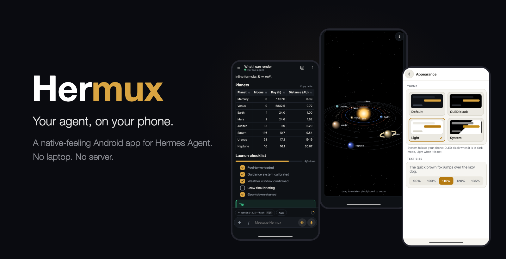
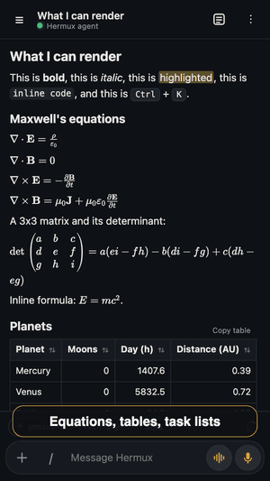
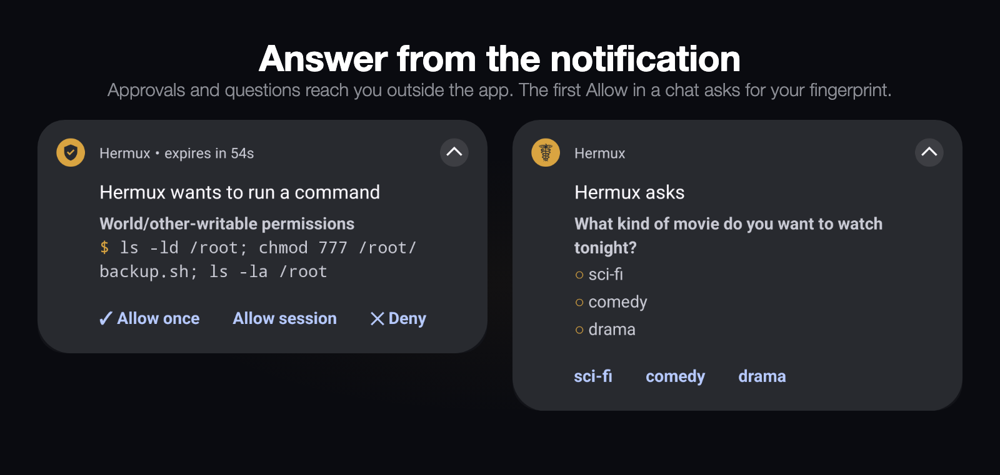
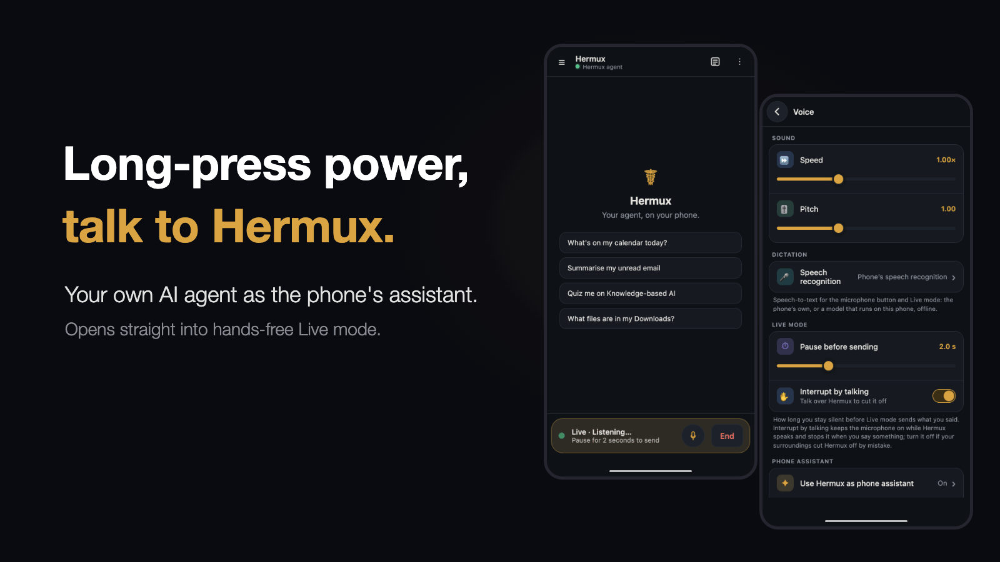
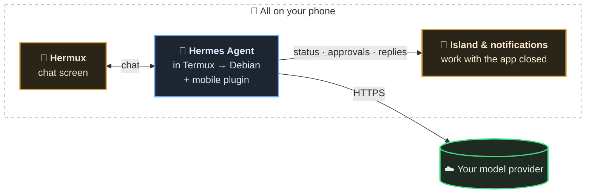

<p align="center">
  
</p>

<p align="center">
  <b>The Hermes agent, running natively on your Android phone.</b><br>
  It chats, codes, builds with you and uses your apps. No laptop, no server, no root.
</p>

<p align="center">
  <a href="https://github.com/omarqaterge/hermes-mobile-app/releases/latest"></a>
  <a href="https://github.com/omarqaterge/hermes-mobile-app/actions/workflows/ci.yml"></a>
  
  
  
</p>

<p align="center">
  <a href="#install"><b>Install</b></a> ·
  <a href="#what-it-does"><b>What it does</b></a> ·
  <a href="#privacy-and-security"><b>Privacy and security</b></a> ·
  <a href="#how-it-works"><b>How it works</b></a> ·
  <a href="#engineering"><b>Engineering</b></a> ·
  <a href="CHANGELOG.md"><b>What's new</b></a>
</p>

Hermux puts the open-source [Hermes Agent](https://github.com/NousResearch/hermes-agent) in your pocket and gives it
hands. Hermes is a capable agent with a real Linux computer behind it, but it lives in a terminal. Hermux makes it an
Android app: it streams its work as it goes, asks before it acts, reaches you in notifications while the app is closed,
talks and listens, builds pages and apps beside the chat, and opens your other apps to get things done. Hermes runs in
Termux on the same phone, so the whole thing is yours and self-contained.

<p align="center">
  <a href="https://x.com/markkeeper2/status/2106873833978540280"></a><br>
  <a href="https://x.com/markkeeper2/status/2106873833978540280">Watch the 2 minute demo</a>
</p>

## What it does

<table>
  <tr>
    <td width="50%"></td>
    <td width="50%"></td>
  </tr>
  <tr>
    <td width="50%"></td>
    <td width="50%"></td>
  </tr>
</table>

- **Uses your apps without taking your screen.** It opens an app on a hidden screen, reads it, taps and types while you
  keep using your phone. It reads the screen as a list of elements, not as a picture, so screens that block
  screenshots still work, and it refuses to tap something that has moved or changed since it last looked. You can watch a
  live thumbnail or take over. Needs Android 14+.
- **Reaches you with the app closed.** Approvals, questions, replies and scheduled results arrive as notifications and
  on the status chip, and you answer right there.
- **Builds beside the chat.** Pages, charts, games and 3D scenes appear in a canvas you both edit. Every change is a
  version you can compare and restore.
- **Shows the work, properly rendered.** Live tool cards, reasoning and file diffs while it runs; equations, sortable
  tables, diagrams and interactive cards in the reply.
- **Talks and listens.** Offline dictation, replies read aloud and a hands-free Live mode. As your phone's assistant, a
  long-press of the power button opens it.
- **Knows your phone.** It runs code in a full Linux system and can tell you about battery, storage, files and
  settings, because it lives on the phone it talks about.
- **Connects to what you use.** Sign in with ChatGPT, Claude, Grok or Nous Portal, or use any provider Hermes
  supports, with fallback models. Connect a Google account, MCP servers and tools.

### It evolves with you

Hermux gets better the longer you use it, and shows you what it learned:

- **Memory you can read.** It remembers what you tell it. Every memory write appears in the chat as a diff, and a
  Memory screen lets you see, edit and delete what it knows.
- **Notes about your apps.** It keeps its own notes on each app it uses, so it gets better at the apps you use most.
- **Skills.** Hermes reviews its own work in the background and keeps what worked as skills, which you can browse and
  call from the `/` menu.

A few things to ask it:

> *"How much storage do I have left, and what's taking the space?"*<br>
> *"Every morning at 8, check the weather and the news I care about and send me a short summary."*<br>
> *"Compare the price of these headphones in two shopping apps and put the results in a table."*<br>
> *"Turn the bank export CSV in my Downloads into an interactive spending dashboard."*<br>
> *"Build me a 3D model of the solar system I can spin and zoom."*

**[Every feature](docs/features.md)** · **[How Hermux compares with similar projects](docs/comparison.md)**

## Principles

- **It is yours.** The agent, your chats, its memory and your files stay on the phone. There is no Hermux account and
  no Hermux server. Only the calls to the model you picked leave it.
- **It asks before it acts.** You set how much it may do, per chat. An agent with this much reach comes with guard
  rails built in, not added later.
- **It says what it cannot do.** Every protection is listed next to its limits, because a safety claim with no limits
  is not one.
- **It is for every Android phone.** Android 8 and newer, any maker, no root, and no permanent wake lock: the phone
  sleeps while Hermux is idle.
- **It is written down and checked.** A [full specification](docs/SPEC.md) describes every screen, setting, permission
  and port, and CI fails any change the spec doesn't mention.

## Privacy and security

An agent with a Linux shell, your apps and, if you allow it, your messages deserves hard questions.

| You might ask | The answer |
|---|---|
| Where is my data? | On your phone, in Termux's and the app's private storage, which other apps can't read. Android's cloud backup is off for the app. |
| What leaves the phone? | Your messages, and whatever the agent reads in that chat, go to **the model provider you chose**. Tools you switch on talk to their own services. [Everything the phone connects to](docs/security.md#everything-the-phone-connects-to). |
| Does it track me? | No analytics or crash-reporting library. One usage-stats call is off until you say yes, and never carries chats, prompts, files, names or phone numbers. |
| What may it do without asking? | You choose per chat. **Off:** it asks before risky commands and before opening an app. **Auto access:** it runs everything except a blocked list of dangerous commands. **Full access:** it asks for nothing. Your fingerprint or screen lock confirms the first Allow in a chat, and banking, payment, password and 2FA apps are blocked until you allow them. |
| Can it read my messages, contacts or location? | Not unless you switch it on. Every kind starts off, has its own switch, is read-only, and every read asks first (not in Full access). |
| Can pages it builds reach the app? | No. Canvas pages run in a sandbox with no access to the app, its keys or your chats, offline unless you allow otherwise. Cards in replies can only call read-only tools. |

**What Hermux cannot protect you from.** The most important limits, in short:

- **Your model provider sees what you send it,** including anything the agent reads in that chat. There is no offline
  model yet.
- **Approvals guard against a careless agent, not against code already running as Termux.** The agent runs as the Termux
  user, so it can read the keys Hermes uses and edit Hermes's settings, including its approval mode. In Off mode only
  commands Hermes recognises as risky are held; in Full access nothing asks.
- **Text it reads can try to steer it.** A web page, a file or a message from a stranger can contain instructions
  (prompt injection). Hermux marks phone data as untrusted, limits it and adds extra care after a read, but no one can make a model
  immune.
- **Shizuku is a wide door.** Hermux requires it, and it lets the agent act as `adb shell`: capture the screen, tap in
  any app, change settings. That is not root, but it is the largest thing you are trusting.
- **The install command trusts what it downloads,** from this repository's `main` branch and from Debian, Python and
  npm. Read it before you run it, or [build the app yourself](#build-from-source).
- **It is a community project.** One maintainer, no independent security audit, and the newest features have been
  tested on one real phone.

**[Privacy and security in detail](docs/security.md)** has every connection, permission and guard rail, all twelve
limits, and how to check each claim yourself. · [Privacy](docs/privacy.md) ·
[Reporting a vulnerability](SECURITY.md)

## Install

You need an arm64 Android phone (Android 8+, about 6 GB free during setup, 3.5 GB once installed) and a model: a
subscription you already have (ChatGPT, Claude, SuperGrok, Nous Portal) or an API key (for example
[OpenRouter](https://openrouter.ai/keys), or Gemini's free tier). No root. About 15 minutes, mostly waiting.

**On the phone (Android 11+):**

1. Download **hermux.apk** from the [latest release](https://github.com/omarqaterge/hermes-mobile-app/releases/latest),
   install it and open it.
2. Tap **Install all** to get Termux, Termux:API, Termux:Boot (from F-Droid) and Shizuku.
3. Start Shizuku with Wireless debugging; the app shows how. After that, Hermux restarts it by itself, on Wi-Fi.
4. Tap **Copy the command**, then **Open Termux**, paste it and press Enter. Allow what Termux asks and keep the screen on.
5. Back in the app, sign in with your subscription or paste an API key.

The app follows each step and picks up wherever you stopped. If Google Play Protect says "App blocked" or "Unsafe app",
tap **More details** → **Install anyway**: Hermux isn't on Google Play, and Play Protect warns about apps it hasn't seen.

<details>
<summary><b>From a computer</b> (also the route for Android 8-10)</summary>

Turn on USB debugging, plug the phone in and run:

```bash
# Mac / Linux
curl -fsSL https://raw.githubusercontent.com/omarqaterge/hermes-mobile-app/main/tools/setup-phone.sh -o setup-phone.sh && bash setup-phone.sh
```

```powershell
# Windows (PowerShell)
irm https://raw.githubusercontent.com/omarqaterge/hermes-mobile-app/main/tools/setup-phone.ps1 | iex
```

</details>

<details>
<summary><b>Let your AI coding agent do it</b></summary>

Give Claude Code, Codex, Cursor or another coding agent this prompt:

```text
Read https://raw.githubusercontent.com/omarqaterge/hermes-mobile-app/main/AGENT_INSTALL.md and follow it to set up Hermux on my Android phone.
```

</details>

**Afterwards,** set battery to *Unrestricted* for Hermux, Termux and Shizuku, or Android may stop them. If something
doesn't work, open **Settings → Setup check** in the app, or [open an issue](https://github.com/omarqaterge/hermes-mobile-app/issues).

| | |
|---|---|
| [Full install guide](docs/install.md) | Every step in detail, the by-hand route, rooted phones, troubleshooting |
| [Android versions](docs/android-versions.md) | What needs which Android, the WebView requirement, and what has been tested where |
| [Uninstall](docs/install.md#uninstall) | **Settings → Danger zone → Uninstall Hermux**, with an optional backup you can restore |

Hermux was called Hermes Mobile. Only the name changed: it is the same app, and Hermes is still the agent inside it.

## How it works



Hermes's dashboard runs on the phone at `127.0.0.1:9119`, and the app talks to it over the same `tui_gateway` JSON-RPC
connection Hermes Desktop uses. A small Hermux plugin sends status, approvals and replies to the app's background
service, so the status chip and notifications work even when the app is closed.

| Folder | What it is |
|---|---|
| `web/` | The interface (React + TypeScript), using Hermes's own client code, copied into `web/vendor/hermes-shared` |
| `android/` | A thin Java shell around a WebView for what a web page can't do: notifications, starting Hermes through Termux, camera, shares, media. Built with no Gradle |
| `hermes-plugin/` | Sends events to the app and serves the canvas and media |
| `phone/` | The installer and the scripts that keep Hermes running |
| `hermes/patches` | A few fixes to Hermes itself, applied by the installer and offered upstream ([hermes/README.md](hermes/README.md)) |

Architecture, every feature and every screen: [docs/SPEC.md](docs/SPEC.md).

## Engineering

The work behind the app is measured and written down, so you can check it instead of taking it on trust.

| | What was done | Where to look |
|---|---|---|
| **Speed** | A usable chat **0.3 s** after launch, down from 4.5 s. A 146-message chat opens as fast as a short one. | [Performance history](docs/performance-history.md) |
| **Battery** | A chat turn uses **47% less CPU**, and the wake lock for a scheduled job is **84% shorter** (150 s to 24 s). No permanent wake lock: the phone sleeps while Hermux is idle. The measuring tools are in `tools/battery/`. | [Battery report](docs/battery-report.md) |
| **Tests** | About **1,600 browser checks** in 30 feature files run the real interface against a mock Hermes on every pull request, next to about 670 unit tests and 69 script tests for the plugin, the phone scripts and the tools. | [Spec 7.3](docs/spec/07-03-browser-e2e.md) |
| **Security review** | The protection around phone data went through **five review rounds**, and the findings of a second security review were fixed in November 2026. Each finding is written down with its fix. | [Security model](docs/spec/02-03-security-model.md) |
| **Every Android phone** | Android lint fails any call newer than Android 8 that has no version check, and maker-specific handling always has a generic fallback. | [Android versions](docs/android-versions.md) |
| **Given back to Hermes** | Four fixes to Hermes itself are kept as small patches and offered upstream. One cut the skill scan at start-up from 1.8 s to 0.5 s. | [hermes/README.md](hermes/README.md) |
| **How it is run** | Every owner decision is written down with its reason. A release is built only from a commit on `main` whose CI passed. The parts with the most state (the chat turn, the connection, Live mode, the player) are explicit state machines with a test for every step. | [Decisions](docs/decisions/README.md) · [Spec 7.5](docs/spec/07-05-versioning-and-releases.md) |

Speed and battery were measured on the maintainer's phone. The linked pages say how, so the numbers can be repeated.

## What's next

- A home-screen widget and a Quick Settings tile
- Opt-in notification summaries
- A wake word
- An offline local model

Hermux does not do encrypted multi-device sync or multiplayer sessions: your data stays on one phone on purpose. Work
in progress is listed, one file per workstream, in [docs/status](docs/status/README.md).

## Build from source

You need **Node 22+**, **JDK 17** and the [Android command-line tools](https://developer.android.com/studio#command-line-tools-only)
(`sdkmanager "platforms;android-36" "build-tools;35.0.0"`). No Gradle:

```bash
git clone https://github.com/omarqaterge/hermes-mobile-app.git && cd hermes-mobile-app
(cd web && npm ci)
ANDROID_HOME=/path/to/android-sdk JAVA_HOME=/path/to/jdk-17 VERSION_NAME=1.0.0 VERSION_CODE=1 android/build.sh
adb install -r android/build/hermes-mobile.apk
```

The first build creates a signing key in `~/.android/hermes-mobile.keystore` (never commit it). A self-built app can't
update the downloaded one, because the keys differ: uninstall that first.

## Contributing

Pull requests and bug reports are welcome. [CONTRIBUTING.md](CONTRIBUTING.md) has the checks, the project rules, test
builds and working on the interface in a desktop browser. Coding agents follow [AGENTS.md](AGENTS.md). Found a
vulnerability? Please read [SECURITY.md](SECURITY.md) before posting details in public.

## License and credits

MIT, see [LICENSE](LICENSE). `web/vendor/hermes-shared` is copied from [NousResearch/hermes-agent](https://github.com/NousResearch/hermes-agent)
(MIT, Copyright Nous Research), see [THIRD_PARTY.md](THIRD_PARTY.md). Hermux is an unofficial community project;
"Hermes" and the Hermes Agent name belong to their owners.
