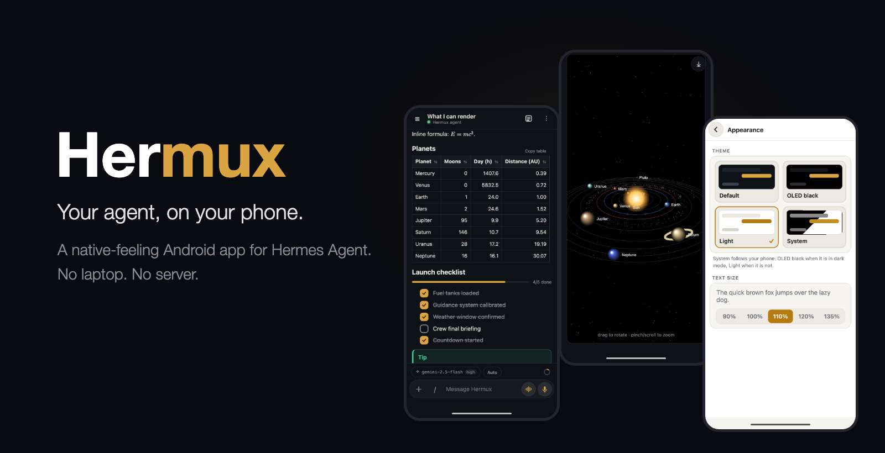
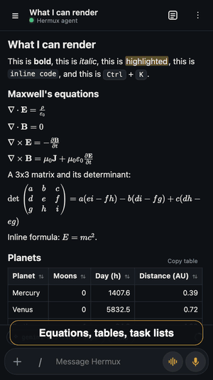
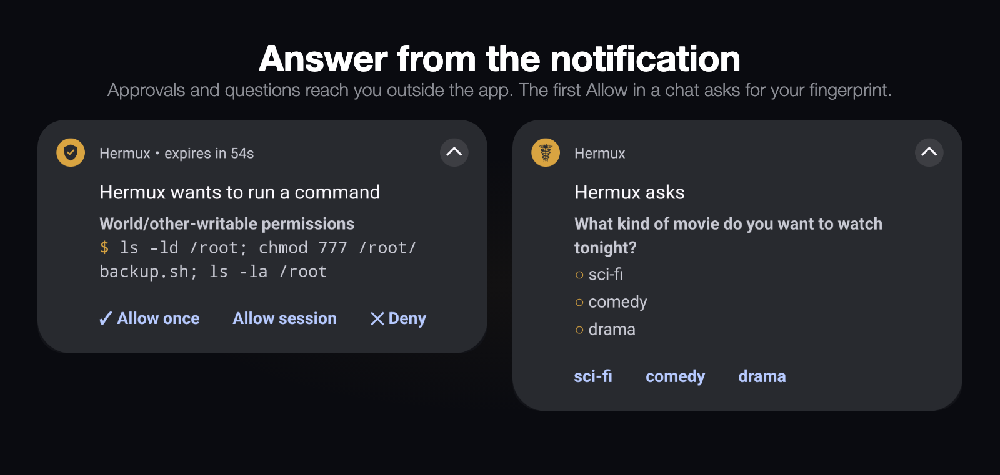
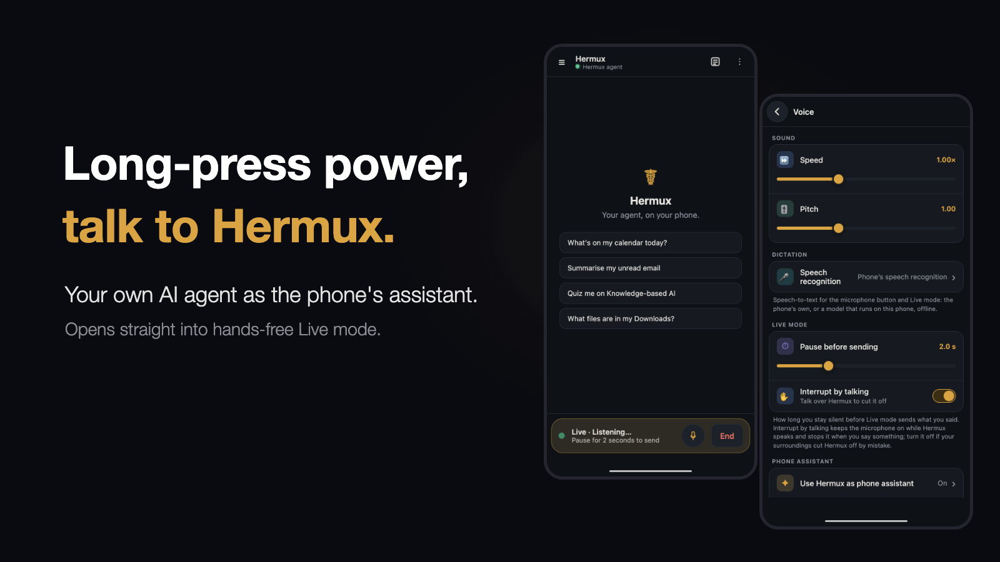
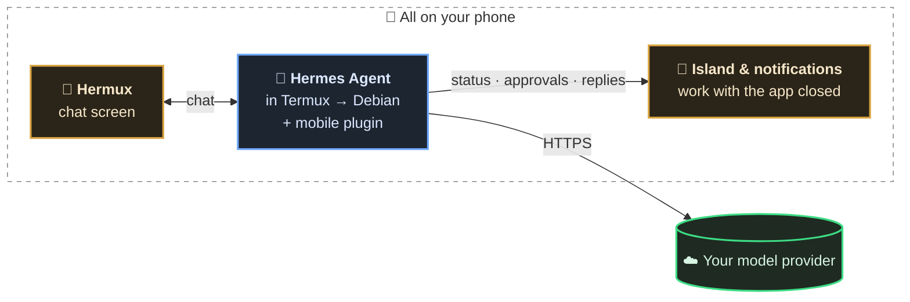

<p align="center">
  
</p>

<p align="center">
  <b>An agent that evolves with you.</b><br>
  It learns, adapts and gets things done: it chats, codes, builds with you and uses your apps.<br>
  Securely on your phone. No laptop, no server, no root.
</p>

<p align="center">
  
  
  
  
  
</p>

<p align="center">
  <a href="https://x.com/markkeeper2/status/2106873833978540280"></a><br>
  <a href="https://x.com/markkeeper2/status/2106873833978540280"><b>𝕏 See the demo release post</b></a>
</p>

**[Install](#install)** · **[What you can do](#what-you-can-do)** · **[Full install guide](docs/install.md)** · **[What's new](CHANGELOG.md)**

Hermux puts the open-source [Hermes Agent](https://github.com/NousResearch/hermes-agent) in your pocket, and then gives it
hands. Hermes is a powerful agent with a real Linux computer behind it, but it lives in a terminal. Hermux turns it into a
proper Android app: it streams its work as it goes, asks before it acts, reaches you in notifications while the app is
closed, talks and listens, builds pages and apps beside the chat, and opens your other apps to get things done for you.
Hermes runs in Termux on the same phone, so the whole thing is yours and self-contained.

## Why Hermux

- **On your phone, for real.** The agent, your chats, its memory and your files stay on the phone. Only the calls to the
  model you picked leave it ([privacy](docs/privacy.md)).
- **It acts, not just answers.** It uses your apps on a hidden screen, reads your phone's state, runs code in a full
  Linux system and is your phone's assistant on a long-press of the power button.
- **Always with you.** Approvals, questions, replies and scheduled results arrive as notifications and the status chip,
  with the app closed.
- **You stay in charge.** It asks before it runs a command or opens an app, your fingerprint confirms the first Allow,
  and banking, payment, password and 2FA apps are off until you say otherwise.
- **Kind to the phone.** No permanent wake lock: the phone sleeps while Hermux is idle. Android 8 and newer, on any
  maker's phone.

| | Hermes in a terminal | Hermes in Hermux |
|---|---|---|
| Talking to it | Typing in Termux | A chat app with voice, dictation and hands-free Live mode |
| Seeing the work | Scrolling text | Live tool cards, reasoning, sub-agents, to-do list, file diffs |
| Approvals | Only while the terminal is open | From the status chip or a notification, app closed |
| Replies | Plain text | Equations, tables, diagrams, interactive cards and a shared canvas |
| Your phone | Termux commands you type | It opens and uses your apps, and reads battery, storage, files and settings |
| Coming back later | Scroll back | Searchable chats, pins, links between chats, a memory screen |

## What you can do

Anything you can describe in words, Hermux can try: it has a Linux computer, the web, your apps and your phone to work
with. A few ideas, from one-liners to whole projects.

**Quick things**

- *"How much battery and storage do I have left, and what's taking the space?"*
- *"Add milk, eggs and coffee to my Keep shopping list."*
- *"Find the chat where I sent the receipt photo."*
- *"Read this article to me"*, shared from your browser, while you walk.
- *"What does this error mean?"* with a screenshot attached.

**Everyday help**

- *"Every morning at 8, check the weather and the news I care about and send me a short summary."* It runs as a cron job
  and the result lands in your notifications.
- *"Open my notes app and copy today's to-do list into a checklist here."*
- *"Turn off the living room lights"*, once Home Assistant is connected in Settings → Connectors.
- *"Sort my Downloads folder into folders by type. Show me what you'll move first."* File checkpoints let you undo it.
- Long-press the power button and just talk: Live mode listens, answers aloud and can take approvals by voice.

**Big projects**

- *"Build me a 3D model of the solar system I can spin and zoom."* It appears in the canvas beside the chat, and every
  change is a version you can compare and restore.
- *"Turn the bank export CSV in my Downloads into an interactive spending dashboard, by category and month."*
- *"Write a Python script that renames my photos by the date they were taken, test it on five of them, then run it."*
- *"Compare the price of these headphones in two shopping apps and put the results in a table."* It opens both apps on
  a hidden screen, one after the other, while you keep using your phone.
- *"Plan a three-day trip to Lisbon with a map page, a day-by-day schedule and a packing checklist."*
- Give each job its own bot: a coding bot on one model, a writing bot on another, each with its own keys and SOUL.md.

Hermux remembers what you tell it, learns notes about each app it uses, and can connect to any MCP server, so the list
grows with you.

## Highlights

### Uses your apps without taking your screen

Ask Hermux to do something in an app and it opens that app on a hidden screen, reads it, taps, scrolls and types,
while you keep using your phone. The status chip says **Using <app>**, a card in the chat shows a live thumbnail, and
**Take over** brings the app to your screen. It asks once per app per chat; banking, payment, password and 2FA apps stay
off unless you allow them. It keeps its own notes about each app, so it gets better at the apps you use most. Needs
Android 14+ and Shizuku.

### Answer from the island

Approvals and questions show up on the status chip (an Android 16 Live Update; older versions get a normal notification).
Pick an answer or tap Deny, and the app does not need to be open. The first Allow in a chat opens the app to ask for your fingerprint.

<p align="center"></p>

### A canvas you and Hermux share

Ask for an interactive page, a game, a chart or a 3D scene and Hermux builds it live in a document beside the chat. You
can edit it too, and Hermux reads your edits. HTML runs in a sandbox that is offline unless you allow it. Every change
is a version with a diff you can restore, and the gallery keeps every document from every chat.

<p align="center"></p>

### Renders everything, natively

KaTeX equations, sortable tables with "Copy table", tick-able task lists, Obsidian-style callouts, Mermaid diagrams (full screen,
pinch to zoom), coloured diffs, long code that collapses, inline SVG and HTML cards. Hermux can also answer with
interactive cards (tables, charts, tabs, buttons, forms) that show live data.

<p align="center"></p>

### Your phone's assistant

Pick Hermux as your *Digital assistant app* (under Default apps) and long-pressing the power button opens it in hands-free
Live mode. Replies can be read aloud with a full player, and dictation can run on the phone, offline.

<p align="center"></p>

### Knows your phone

Hermux runs on the phone it talks about, so you can just ask: battery, storage, files in Downloads, what's installed. It uses
Termux's phone commands, and with Shizuku it gets system-level access (settings, apps, logs) through `rish`. If Shizuku has
stopped, it tells you instead of guessing.

### Connects to everything

Add MCP servers by address or command, or pick them from Hermes's catalog, test them and sign in to their accounts in
the browser. Switch on tools that need a key (web search, Home Assistant, image generation and more) and paste the key
once. Sign in with ChatGPT, Claude, Grok or Nous Portal, or use any provider Hermes supports; set fallback models and
several keys per provider, so a rate limit doesn't stop the chat.

### Your chats, your memory, your look

Search inside every message, pin, archive, link chats to chats, or ask Hermux to find "the chat where I sent the receipt photo". Every memory write is shown as a diff, and there is a screen to see
what Hermux remembers. Dark, OLED black or light.

<p align="center"></p>

### Built to be safe

An agent that can run commands and use your apps needs guard rails, and Hermux has them built in:

- **You choose how much it may do, per chat:** Off (it asks for everything), Auto access or Full access. Your
  fingerprint confirms the first Allow in a chat, and a locked phone asks you to unlock before anything is allowed.
- **Sensitive apps are off by default:** banking, payment, password and 2FA apps can't be opened until you allow them.
- **Pages it builds can't reach the app:** canvas pages and cards run in a sandbox with no access to the app, its keys or
  your chats, and offline unless you switch them online. A link a page tries to open by itself asks first.
- **The app's own controls are locked to the app:** every call into Android needs a secret key that changes on each page
  load, so content Hermux shows can't call them.
- **No debugging back door:** remote debugging is off in release builds; turning it on needs your screen lock and it
  switches itself off after an hour.

### And more

**Everyday use**

| | |
|---|---|
| **Chat** | Stop or steer a running reply, or queue follow-ups that send when it ends; edit, retry or branch any turn; quote part of a reply or ask to explain it; `/btw` side questions (pull up past the last message); per-chat drafts and stashed drafts |
| **Long chats** | A rail on the right edge to jump between your messages; a "New Messages" line where unread messages start; several questions asked one at a time |
| **Voice** | Read replies aloud with a player (pause, seek, speed, any installed speech engine), dictation and hands-free Live mode, optionally over the lock screen. Dictation can run on the phone, offline: built-in English models (Moonshine, NeMo, Zipformer) or your own sherpa-onnx model |
| **Notifications** | Reply, answer questions and allow commands right from the notification (a locked phone asks you to unlock first); a Done chip and app-icon badge for chats that finished while you were away; cron results; a "failed" note when a model call fails |
| **Share** | "Share to Hermux" from any app; attach photos, camera shots and files; share a chat as Markdown |
| **Offline-friendly** | Messages typed offline send on reconnect; the last chat list is cached |
| **Shortcuts & big screens** | Launcher shortcuts (New chat, Live mode, last chat); a two-column layout on tablets and foldables |

**For power users**

| | |
|---|---|
| **See the work** | Reasoning, live tool cards, sub-agents, the to-do list, how long the turn has run and the chat's `/goal`; a card with the files a turn changed and their diffs; file checkpoints to undo them; a ring showing how full the context is, with Compress |
| **Commands** | `/` autocomplete for every skill and command; `/yolo` and `/fast` switch the chat at once |
| **Models & bots** | Switch model and reasoning level per chat, star favourites; bots (Hermes profiles) with their own default model, keys and SOUL.md |
| **Cards in replies** | Interactive cards drawn by OpenUI, with live, read-only data (off switch: Settings → Replies → Dynamic UI). HTML and SVG code blocks get a Preview button |
| **Screens** | Skills, memory, cron jobs, projects, a canvas gallery, every Hermux setting in plain words, and files with previews (tables for CSV, code, JSON, Mermaid, HTML, audio and video) |
| **Setup check** | One screen that checks Termux, permissions, the plugin and battery settings, with a fix button for each |
| **Battery** | No permanent wake lock: the phone sleeps while Hermux is idle |
| **Updates** | A notification when a new release is out; one tap in Settings → About installs it |

## Install

**No root needed.** You need an arm64 Android phone (Android 8+) with about 6 GB free, and a model: a subscription you already
have (ChatGPT, Claude, SuperGrok, Nous Portal) or an API key (for example [OpenRouter](https://openrouter.ai/keys), or Gemini's
free tier). It takes about 15 minutes, mostly waiting.

**On the phone (Android 11+):**

1. Download **hermux.apk** (`hermes-mobile.apk` on older releases) from the [latest release](https://github.com/omarqaterge/hermes-mobile-app/releases/latest),
   install it and open it.
2. Tap **Install all** to get Termux, Termux:API, Termux:Boot (from F-Droid) and Shizuku.
3. Start Shizuku with Wireless debugging (needed: it gives Hermux the screen and apps; the app shows how). After that,
   Hermux starts Shizuku again by itself after a restart, on Wi-Fi.
4. Tap **Copy the command**, then **Open Termux**, paste it and press Enter. Allow what Termux asks and keep the screen on.
5. Back in the app, sign in with your subscription or paste an API key.

The app follows each step and picks up wherever you stopped.

**From a computer** (also for Android 8-10): turn on USB debugging, plug the phone in and run

```bash
# Mac / Linux
curl -fsSL https://raw.githubusercontent.com/omarqaterge/hermes-mobile-app/main/tools/setup-phone.sh -o setup-phone.sh && bash setup-phone.sh
```

```powershell
# Windows (PowerShell)
irm https://raw.githubusercontent.com/omarqaterge/hermes-mobile-app/main/tools/setup-phone.ps1 | iex
```

Or let your AI coding agent (Claude Code, Codex, Cursor…) do it, with this prompt:

```text
Read https://raw.githubusercontent.com/omarqaterge/hermes-mobile-app/main/AGENT_INSTALL.md and follow it to set up Hermux on my Android phone.
```

**Afterwards:** set battery to *Unrestricted* for Hermux, Termux and Shizuku, or Android may stop them. If something
doesn't work, open **Settings → Setup check** in the app.

The [full install guide](docs/install.md) has every step in detail, the by-hand route, rooted phones (chroot-distro),
a troubleshooting table and uninstalling.

> If something fails, please [open an issue](https://github.com/omarqaterge/hermes-mobile-app/issues), or use Settings → About →
> Report a problem in the app. Reports are public and carry only what you write, the versions, and a scrubbed log or a
> screenshot if you add them. The app sends no usage stats unless you opt in: [privacy](docs/privacy.md).

**Hermux was called Hermes Mobile.** Only the name changed: it is the same app, and Hermes is still the agent running inside it.

### Android versions

The app installs on Android 8.0 and newer (arm64). Some parts need a newer Android:

| Android | What you get |
|---|---|
| 8.0 - 10 | The app and the agent. Set up from a computer, and start Shizuku from a computer again after every restart (Wireless debugging, which lets the phone start it by itself, only exists from Android 11). |
| 10+ | Save pictures from a chat to Pictures/Hermux (on 8-9 only Share) |
| 11+ | Setup on the phone itself, no computer needed; Shizuku starts again by itself after a restart (on Wi-Fi); pictures saved before the rename move from Pictures/Hermes to Pictures/Hermux |
| 11+ | The diagnostic log also says why Android ended the app (memory, a crash, battery limits); on older Android it has everything else |
| 12+ | Allowing a command or answering Hermux from a notification on the lock screen asks for your unlock right there (on 8-11 the tap opens the app, which asks for the unlock) |
| 13+ | The app asks for the notification permission (older Android allows notifications from the start) |
| 14+ | Hermux using your apps in the background, without taking your screen |
| 16 | The status chip as an Android Live Update (on older Android it is a normal pinned notification) |

**Android System WebView must be up to date** (Chrome 100 or newer). The app draws its screens with it. Phones with the
Play Store update it by themselves. If it was never updated, the app says "Hermux can't start": update
*Android System WebView* (or *Chrome*) from your app store and reopen the app.

> Tested end to end on a clean Android 15 emulator and on a real Android 16 phone, but not yet on a brand-new real phone.
> On Android 8.0 (emulator) only the start-up was checked: the app opens and its background service runs. Android 9-14:
> not tested yet; reports are welcome.

### Uninstall

**Settings → Danger zone → Uninstall Hermux** removes the Hermux agent and its data, then the helper apps, after an optional backup to
`Download/hermux-backup-<date>.tar.gz` (API keys and sign-ins are left out unless you include them). To restore it on a new
install, run this in Termux and restart Hermux:

```bash
~/bin/hermes-debian bash -c 'tar -xzf /sdcard/Download/hermux-backup-<date>.tar.gz -C /root/.hermes'
```

A backup made by an older version is called `hermes-backup-<date>.tar.gz` and restores the same way.

What is kept and how to uninstall by hand: [docs/install.md](docs/install.md#uninstall).

## How it works



Hermes's dashboard runs on the phone at `127.0.0.1:9119`, and the app talks to it over the same `tui_gateway` JSON-RPC connection
Hermes Desktop uses (it also starts Hermes when it isn't running). A small Hermux plugin sends status, approvals and replies to
the app's background service, so the island chip and notifications work even when the app is closed.

| Folder | What it is |
|---|---|
| `web/` | The interface (React + TypeScript), using Hermes's own client from `apps/shared`, copied into `web/vendor/hermes-shared` |
| `android/` | A thin Java shell around a WebView for what a web page can't do: notifications, starting Hermes through Termux, photo picker and camera, shares, media |
| `hermes-plugin/` | Sends events to the app and serves the canvas and media |
| `phone/` | The installer and the scripts that keep Hermes running |
| `hermes/patches` | A few fixes to Hermes itself, applied by the installer and offered upstream ([hermes/README.md](hermes/README.md)) |

Full specification (architecture, every feature, every screen): [docs/SPEC.md](docs/SPEC.md).

### Under the hood

- **A full specification, kept current by CI.** Every screen, button, setting, notification, Android bridge method,
  plugin tool and phone script is described in [docs/SPEC.md](docs/SPEC.md); a check fails any change whose names the
  spec doesn't mention.
- **Over a thousand browser checks** across 29 feature files run the real interface against a mock Hermes on every
  pull request, next to unit tests for the interface, the plugin and the phone scripts.
- **Built for every Android phone.** Android lint fails any call newer than Android 8 without a version check, and
  maker-specific handling always has a generic fallback.
- **Small and direct.** The Android shell is plain Java built with no Gradle; the interface reuses Hermes's own client
  code, so it speaks the same protocol as Hermes Desktop.
- **Good for Hermes too.** Fixes the app needed in Hermes itself are kept as small patches and offered upstream.

## Build the app yourself

You need **Node 22+**, **JDK 17** and the [Android command-line tools](https://developer.android.com/studio#command-line-tools-only)
(`sdkmanager "platforms;android-36" "build-tools;35.0.0"`). No Gradle:

```bash
git clone https://github.com/omarqaterge/hermes-mobile-app.git && cd hermes-mobile-app
(cd web && npm ci)
ANDROID_HOME=/path/to/android-sdk JAVA_HOME=/path/to/jdk-17 VERSION_NAME=1.0.0 VERSION_CODE=1 android/build.sh
adb install -r android/build/hermes-mobile.apk
```

The first build creates a signing key in `~/.android/hermes-mobile.keystore` (never commit it). A self-built app can't update the
downloaded one, because the keys differ: uninstall that first.

For testing only, `HM_DEVTOOLS=1 android/build.sh` makes a build whose page can be inspected and driven from a computer over `adb`
(Chrome DevTools, Playwright). It shows a "Test build: remote debugging is on" strip, and the script refuses to combine it with
`KEYSTORE`, so a release can't carry it. Anything that can reach `adb` on the phone can read your chats in such a build: don't use it day to day. On a normal build,
**Settings → About → Remote debugging** (shown with Developer options on) does the same for 60 minutes after your screen lock.

To work on the interface in a desktop browser: `adb forward tcp:9119 tcp:9119`, `python3 web/devserver.py`, open http://127.0.0.1:5180.

Tests, project rules and what to do after a Hermes update: [CONTRIBUTING.md](CONTRIBUTING.md). Coding agents follow [AGENTS.md](AGENTS.md) (keep the spec, [docs/SPEC.md](docs/SPEC.md) and `docs/spec/`, current with every change).

## License and credits

MIT, see [LICENSE](LICENSE). `web/vendor/hermes-shared` is copied from [NousResearch/hermes-agent](https://github.com/NousResearch/hermes-agent)
(MIT, Copyright Nous Research), see [THIRD_PARTY.md](THIRD_PARTY.md). "Hermes" and the Hermes Agent name belong to their owners.
Contributions and bug reports are welcome, see [CONTRIBUTING.md](CONTRIBUTING.md).
