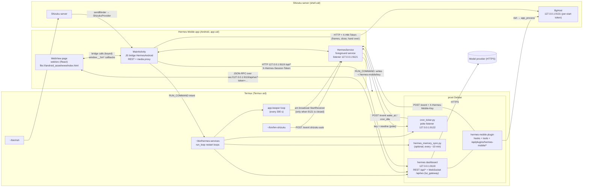
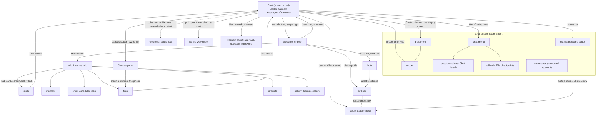

# Hermes Mobile: full specification

This file describes what the code of Hermes Mobile does: the architecture, every feature, every screen and every UI
element, the Android shell, the Hermes plugin, the phone-side scripts, and how the app is built, tested and released.

**How to read this.** Sections 1 and 2 give the big picture: what the app is, which processes run where, and how a
message, an approval or a notification travels between them. Section 3 walks every screen, sheet and panel of the app
(what each element looks like, what a tap, long-press or swipe does, and its empty, loading, error and disabled
states). Sections 4 to 6 describe the parts outside the page: the Android shell, the Hermes plugin, and the scripts on
the phone. Section 7 covers build, tests, CI and releases. Section 8 is a feature index that points to the section
describing each feature; section 9 is a glossary. Identifiers are written in backticks exactly as in the code
(`speak`, `GET /canvas/doc`, `hm.yolo.v1`, `MainActivity`); text the user reads on screen is written as shown, without
backticks (Danger zone, Auto for all chats). References name a file and a symbol (`web/src/components/Composer.tsx`
`Composer`), never a line number.

**How to keep it current.** Everyone who changes the repository, person or coding agent, updates this file in the same commit as the code change it describes ([AGENTS.md](../AGENTS.md) says so for every agent; `CLAUDE.md` imports it). Before pushing, run
`python3 tools/check_spec.py`: it pulls the names out of the code (files, bridge methods, plugin routes, hooks and
tools, gateway RPCs, `localStorage` keys, screens, Settings sections and row titles, aria-labels, service events,
notification channels, manifest permissions) and fails when this file lacks one. CI runs it on every push. Give each
new name a sentence saying what it does; a bare list of names passes the checker but helps nobody.

**Where status lives.** This file says what the code does, not whether it was tested on a phone. What was verified
where, and what is still open, is in [docs/improvements.md](improvements.md) and
[docs/manual-tests.md](manual-tests.md).

## Contents

- [1. What it is](#1-what-it-is)
- [2. Architecture](#2-architecture)
  - [2.1 Processes and ports](#21-processes-and-ports)
  - [2.2 Data flows](#22-data-flows)
  - [2.3 Security model](#23-security-model)
  - [2.4 State and storage](#24-state-and-storage)
  - [2.5 Battery: what wakes the phone](#25-battery-what-wakes-the-phone)
  - [2.6 Core web files](#26-core-web-files)
- [3. Screens and UI elements](#3-screens-and-ui-elements)
  - [3.1 Navigation map](#31-navigation-map)
  - [3.2 Chat screen](#32-chat-screen)
  - [3.3 Messages](#33-messages)
  - [3.4 Composer](#34-composer)
  - [3.5 Chat sheets](#35-chat-sheets)
  - [3.6 Approvals and questions](#36-approvals-and-questions)
  - [3.7 Canvas panel](#37-canvas-panel)
  - [3.8 Gallery](#38-gallery)
  - [3.9 OpenUI cards](#39-openui-cards)
  - [3.10 Background app card and viewer](#310-background-app-card-and-viewer)
  - [3.11 Read-aloud player (and the web side of voice input and Live mode)](#311-read-aloud-player-and-the-web-side-of-voice-input-and-live-mode)
  - [3.12 By the way (/btw)](#312-by-the-way-btw)
  - [3.13 Drawer + session list](#313-drawer--session-list)
  - [3.14 Hermes hub + Skills, Memory, Cron, Files, Projects](#314-hermes-hub--skills-memory-cron-files-projects)
  - [3.15 Settings](#315-settings)
  - [3.16 Bots](#316-bots)
  - [3.17 Model providers + sign-in](#317-model-providers--sign-in)
  - [3.18 Setup flow + Setup check + Welcome](#318-setup-flow--setup-check--welcome)
  - [3.19 Uninstall](#319-uninstall)
  - [3.20 Shared UI kit + hard UI rules](#320-shared-ui-kit--hard-ui-rules)
- [4. Android shell](#4-android-shell)
  - [4.1 Every Java class](#41-every-java-class)
  - [4.2 Manifest: components and permissions](#42-manifest-components-and-permissions)
  - [4.3 Notifications](#43-notifications)
  - [4.4 Service events](#44-service-events)
  - [4.5 Bridge methods](#45-bridge-methods)
  - [4.6 Voice, read-aloud, Live mode, phone assistant](#46-voice-read-aloud-live-mode-phone-assistant)
  - [4.7 Shizuku keeper, Autostart, Uninstall, UpdateNotice, BgHost and the rest](#47-shizuku-keeper-autostart-uninstall-updatenotice-bghost-and-the-rest)
- [5. Hermes plugin](#5-hermes-plugin)
  - [5.1 Hooks (12)](#51-hooks-12)
  - [5.2 Tools (4)](#52-tools-4)
  - [5.3 System-prompt sections (4)](#53-system-prompt-sections-4)
  - [5.4 Dashboard routes (all 46)](#54-dashboard-routes-all-46)
  - [5.5 Files the plugin writes and reads](#55-files-the-plugin-writes-and-reads)
- [6. Phone side and install](#6-phone-side-and-install)
  - [6.1 Every phone/ script (11)](#61-every-phone-script-11)
  - [6.2 hermes-services: the supervisor loops](#62-hermes-services-the-supervisor-loops)
  - [6.3 Install routes](#63-install-routes)
  - [6.4 Hermes pin and patches (3)](#64-hermes-pin-and-patches-3)
  - [6.5 Uninstall (phone/uninstall.sh)](#65-uninstall-phoneuninstallsh)
- [7. Build, test, CI, release](#7-build-test-ci-release)
  - [7.1 Build commands](#71-build-commands)
  - [7.2 Every tools/ file](#72-every-tools-file)
  - [7.3 Browser e2e (tools/web-e2e/)](#73-browser-e2e-toolsweb-e2e)
  - [7.4 Workflows (.github/workflows/)](#74-workflows-githubworkflows)
  - [7.5 Versioning and releases](#75-versioning-and-releases)
  - [7.6 Docs for contributors and agents](#76-docs-for-contributors-and-agents)
- [8. Feature index](#8-feature-index)
- [9. Glossary](#9-glossary)

## 1. What it is

Hermes Mobile is an Android chat app for the Hermes agent (NousResearch). Hermes runs on the same phone, inside
Termux → proot-distro Debian. The app gives the agent a native-feeling front end: streaming replies, thinking,
tool cards, approvals, chats and profiles, skills, memory, cron, files, projects, a canvas, cards in replies,
voice and Live mode, and notifications that keep working while the app is closed (the pinned status chip, which
Android 16 shows as a Live Update). It aims to match Hermes Desktop's behaviour wherever that makes sense on a
phone.

- **Who it is for:** anyone with an Android phone who runs (or wants to run) Hermes on it. It is built for every
  Android phone, not one maker: public/AOSP APIs come first, and vendor-specific handling (for example the
  Autostart pages in `Autostart.java`, 4.7) sits behind a generic fallback.
- **Android versions:** minimum Android 8.0 (API 26, `--min-sdk-version 26` in `android/build.sh`), target API 35,
  compiled against API 36 so Android 16 Live Update calls can be used when present. Some features need more:
  Wireless debugging (Shizuku restarting by itself) needs Android 11 (API 30), the assistant role needs API 29,
  `POST_NOTIFICATIONS` is asked from API 33, saving pictures needs API 29. The page needs an up-to-date Android
  System WebView (4.2, "Version checks").
- **No root.** Everything runs as normal apps. Hermes's adb-level phone access goes through Shizuku and its `rish`
  shell. A rooted phone may use chroot-distro instead of proot-distro (6.3); nothing in the app needs root.
- **What runs where (one line each):**
  - The **app** (`com.omarqaterge.hermesmobile`): a WebView page (the whole UI, `web/src`, built into one
    `index.html` in the APK's assets) plus a small Java shell (`MainActivity`) and a foreground service
    (`HermesService`).
  - **Termux:** the supervisor script `~/bin/hermes-services` and its restart loops, `sshd` if installed, the
    helper scripts `hm-shizuku` and `rish`.
  - **proot Debian (inside Termux):** Hermes itself: its dashboard server on `127.0.0.1:9119`, the `tui_gateway`
    JSON-RPC WebSocket at `/api/ws`, the Hermes Mobile plugin, the cron ticker and the memory sync.
  - **Shizuku** (a separate app whose server runs as the shell user): `rish` and the background-app host `BgHost`.
  - **Your model provider:** the only thing off the phone; Hermes calls it over HTTPS.

Everything between these parts is loopback (`127.0.0.1`) only. Plain HTTP is allowed to `127.0.0.1` and
`localhost` and nowhere else (`android/res/xml/network_security_config.xml`).

## 2. Architecture

### 2.1 Processes and ports

| Process / endpoint | Runs as | Started by | Listens on | Who talks to it | Detail in |
|---|---|---|---|---|---|
| WebView page (`web/src`, entry `main.tsx`) | app uid, WebView renderer | `MainActivity.onCreate` → `loadUrl("file:///android_asset/www/index.html")` | nothing | `MainActivity` (bridge callbacks), Hermes (WebSocket) | 3, 2.6 |
| `MainActivity` (Java shell) | app uid, main process | the launcher, a notification tap, a share, a shortcut (`singleTask`) | nothing; intercepts `https://hm-media.invalid/m` requests inside the WebView | the page through the bridge | 4.1, 4.5 |
| `HermesService` (foreground service, type `specialUse`) | app uid, main process | `MainActivity.onCreate`/`onResume`, `BootReceiver` (boot / app update), `StartReceiver` (Termux app-keeper) | `127.0.0.1:9121`: `POST /event` (key) and `POST /setup` (installer token) | the plugin, `cron_ticker.py`, `hm-shizuku`, `phone/bootstrap.sh` | 4.1, 4.3, 4.4 |
| Termux supervisor `~/bin/hermes-services` (`phone/hermes-services`) | Termux uid | `MainActivity.startHermesNow` (Termux `RUN_COMMAND`), Termux:Boot (`~/.termux/boot/10-hermes`), by hand | nothing | — | 6.1, 6.2 |
| Hermes dashboard (`hermes dashboard --host 127.0.0.1 --port 9119 --no-open`) | Termux uid inside proot Debian | the `dashboard` restart loop (10 s pause between restarts) | `127.0.0.1:9119`: HTML page with the session token, REST `/api/*`, WebSocket `/api/ws` | the page (WebSocket), `MainActivity` and `HermesService` (REST), the plugin's own `/approve` and `/stop` (WebSocket) | 6.2 |
| `tui_gateway` WebSocket `/api/ws` | inside the dashboard process | the dashboard | `ws://127.0.0.1:9119/api/ws?token=<session token>` | the page's `JsonRpcGatewayClient` (`gateway.ts`) | 2.2 (flows), table "Gateway RPCs" below |
| Hermes Mobile plugin (`hermes-plugin/hermes-mobile`) | inside every Hermes process (dashboard, agent runtimes) | Hermes's plugin loader | its REST routes are mounted at `/api/plugins/hermes-mobile/*` on 9119 | Hermes (hooks/tools), the app (REST) | 5 |
| Cron ticker (`phone/cron_ticker.py`) | Termux uid inside proot Debian | the `cron-ticker` restart loop | `127.0.0.1:9122` (poke: the event key plus a newline) | `HermesService.pokeTicker` | 6.1 |
| Memory sync (`phone/hermes_memory_sync.py`) | Termux uid inside proot Debian | the `memory-sync` loop, only if `/root/.hermes/scripts/hermes_memory_sync.py` exists | nothing | — | 6.1 |
| app-keeper loop | Termux uid | `hermes-services` | nothing; probes `127.0.0.1:9121` with bash `/dev/tcp` every 300 s | sends `am broadcast -n com.omarqaterge.hermesmobile/.StartReceiver -f 32` only when 9121 doesn't answer | 6.2 |
| `sshd` | Termux uid | `hermes-services`, if Termux has `sshd` and none runs | Termux's default SSH port | the user | 6.2 |
| Shizuku server + `rish` | shell uid | the Shizuku app; restarted by `ShizukuKeeper` + `hm-shizuku` | Shizuku's binder | `rish` (Hermes's phone commands), `ShizukuProvider` (gets its binder) | 4.7, 6.1 |
| `BgHost` (`android/src/com/omarqaterge/hermesmobile/bg/BgHost.java`) | shell uid via `rish` → `app_process` | the plugin's `phone_app` tool, on demand; exits after 2 idle minutes | `127.0.0.1:9131`, every request carries `X-HM-Token` | the plugin, `MainActivity.bgRequest`, `HermesService.fetchBgThumb` | 4.7, 5.2 |

Other helpers on the phone: Termux:API (the `termux-*` commands, linked into Debian; the plugin's fallback
notification uses `termux-notification`) and Termux:Boot (runs `~/.termux/boot/10-hermes` after a reboot). Both
are installed by the installer (6.3).

One Hermes dashboard serves every Hermes profile. The page adds the open profile to every gateway call
(`rpc` in `gateway.ts` sends `{ profile, ...params }`) and to every REST call (`api` in `api.ts` appends
`profile=` unless told not to).

### 2.2 Data flows

Each flow lists the steps in the order the code runs them. "Page" = the WebView page, "service" =
`HermesService`, "plugin" = the Hermes Mobile plugin inside Hermes.

#### 2.2.1 Send a message and stream the reply

1. The composer calls `sendPrompt(text)` in `gateway.ts` (3.4). Empty text does nothing. While a chat is still
   opening (`opening` set) it throws "Still opening your chat — wait a moment".
2. `rememberPrompt` stores the text in `hm.recent.v1.<profile>` (4–200 characters, newest 20).
3. `targetChat()` picks the chat: it first waits for a chat a model pick is creating (`pendingNew`), then uses
   `active`, else calls `newSession()` (`session.create` with `source: 'mobile'`; this is how a chat is made by
   its first message). `newSession` also applies the Auto default (`defaultAccess()`, see 2.2.1a).
4. `/btw …` opens the side-question sheet (`openBtw`, 3.12) and stops. Any other `/…` goes to `runSlash`:
   `/yolo` and `/fast` are handled with `config.set` (keys `yolo` and `fast`); everything else tries `slash.exec`,
   then `command.dispatch`, and follows its `type` (`exec`, `alias` up to depth 3, `send`, `skill`, `prefill`).
5. If the chat is running, the text steers the running turn (`session.steer`) and a "Steer: …" notice is added.
6. Otherwise the page adds the user bubble at once (with photo previews, image paths, file names and their
   `@file:` refs), sets `running: true`, clears the attachments, waits for a model switch in flight
   (`switching`), and calls `prompt.submit` with `surface: 'mobile'`. Files travel as their `@file:` references in
   front of the text; photos were already queued inside Hermes by `image.attach_bytes`. The answer's
   `user_row_id` is stored on the bubble (needed for edit/retry/branch). On failure the attachments come back and a
   "Send failed: …" notice is added.
7. Hermes streams events on the WebSocket. `client.onEvent` in `gateway.ts` applies them to `active.items`:
   - `message.start` resets the speed counter; `thinking.delta` and `status.update` set the live status line.
   - `reasoning.delta` and `message.delta` are appended to the open reply in batches (`queueDelta` →
     `flushDeltas`, every 60 ms, every 150 ms once the reply is over 6,000 characters). Any other event flushes
     first, so order never changes.
   - `tool.generating` closes the open reply and adds a generating tool card; `tool.start` turns it into a
     running card (or adds one; a replayed start for a card already shown adds nothing); `tool.complete` fills in
     args, duration, summary, result text and inline diff; `tool.output_risk` flags a card. Canvas tool events
     also call `canvasWritingStarted`, `canvasCallStarted` and `canvasToolDone` (3.7).
   - `subagent.start|progress|thinking|tool|complete` keep one card per sub-agent; `todo.updated` sets the task
     list; `session.usage` and `session.info` update the chat; `session.title` renames it.
   - `message.complete` drops leftover generating cards, puts the final text on the reply (`fullReply` keeps the
     streamed text unless the final one is longer and ends with it), adds an error notice on failure, hands the
     reply to Live mode or to auto read-aloud (only while the app is in front), sets `running: false`, and
     `finishTurnStats` writes "~N tok/s · ctx N% · used/max" under the reply and saves it in `hm.stats.v1`.
   - `review.summary`, `background.complete` and an unclaimed `btw.complete` become info notices.
   - Events of other chats only refresh the drawer (`session.title`, `message.complete` → `loadSessionsSoon`);
     `sessions.changed` refreshes it too. `notification.show` becomes a toast; `request.cancel` closes a request
     sheet that was answered elsewhere.
8. A missed `message.complete` can't leave the spinner on: every 15 s, if the chat is running and no event came for
   45 s, `syncRunning` asks `session.resume`; when Hermes says it is no longer running, the stored transcript
   replaces the screen. The same check runs whenever the page becomes visible.
9. In parallel the plugin's hooks post `status` events to the service (throttled to one per second, a beat every
   15 s), which draws the status chip (4.3, 5.1).

#### 2.2.1a Access mode (Auto / Full) on new and resumed chats

- `setAccess(a, mode, remember)` runs through one promise queue (`accessQueue`), so mode changes never overlap.
- Auto: `PUT /api/plugins/hermes-mobile/auto` `{session, mode:'auto'}` first (the plugin's block list, 5),
  then `config.set yolo 1`. If yolo didn't turn on, the plugin entry is removed again.
- Full: `config.set yolo 1`, then the plugin entry is removed. Off: `config.set yolo 0`, entry removed.
- `remember=true` writes the chat's own choice into `hm.yolo.v1` (`true` = Full, `'auto'`, `false` = an explicit
  Off). The Settings default (`hm.defaultAccess.v1`) is applied with `remember=false`, so a chat that never had
  its own choice keeps following the default.
- Hermes forgets yolo when a chat is resumed, so `resumeSession` re-applies `rememberedAccess(storedId)` (the
  chat's own entry, else the default).

#### 2.2.2 Approval while the app is closed

1. Hermes needs approval for a command. Two things happen at once:
   - The gateway sends a server→client request `approval` on the page's WebSocket. `client.onRequest` adds it to
     `requests` (the request sheet, 3.6). The page does not notify for `approval` or `clarify` itself; it only
     posts "Hermes needs your input" for masked prompts (`secret`, `sudo`, `otp`, `connection.request`) and only
     while in the background.
   - The plugin's `pre_approval_request` hook sends an `approval` event (urgent) to `127.0.0.1:9121/event` with
     the command, a cleaned-up description, `request_id`, the session key, the timeout and `allow_session`.
2. If the POST fails (the service isn't listening), the plugin falls back to `termux-notification` with an action
   that opens the app on that chat.
3. The service checks the key, stores the approval as `pendingApproval` with its deadline, puts the buttons on the
   status chip, and holds the CPU awake until the deadline + 5 s (`updateWake`). If the app is on screen
   (`MainActivity.visible`) it stops there: the in-app sheet is the way to answer. Otherwise it also posts a popup
   on the `needs_you` channel with Allow once, Allow session (when allowed) and Deny.
4. A button tap starts the service with `ACTION_APPROVE`. `answerApproval` scrapes the dashboard token
   (`dashboardToken`) and POSTs `{session, key, choice, request_id, profile}` to
   `/api/plugins/hermes-mobile/approve` (retrying once with a fresh token on 401/403).
5. The plugin's `/approve` route refuses an answer without `request_id` (409), opens its own WebSocket to
   `127.0.0.1:9119/api/ws` and sends `approval.respond` for that request. Hermes runs the command or not.
6. The `post_approval_response` hook sends `clear` (`what: approval`); the service drops the popup and the chip's
   buttons. On the page, `request.cancel` closes the sheet if it was still there. If step 4 failed, the service
   posts "Couldn't send your answer" with the reason.
7. When the app comes back to the front, `MainActivity.onResume` cancels any approval popup still shown (the
   in-app sheet takes over).

#### 2.2.3 Reply notification (and answering it)

1. The turn ends. The plugin's `on_session_end` hook sends `reply` (title = the chat title, body = the reply with
   cards replaced by "[card]", `speak_text` = up to 20,000 characters, `platform`) and `flash` with `done: true`.
   A failed turn sends `error`; a cron turn sends `cron`; an interrupted turn sends nothing.
2. The service, for `flash` done: if the app is on screen nothing sticks; otherwise the chat goes into `unseen`
   (saved), the icon badge is updated and the chip shows the sticky Done state (4.3).
3. For `reply` (or `error`): if the app is on screen, nothing is posted. Otherwise a notification goes to the
   `replies` channel with a Reply action (`RemoteInput`) and the badge count; for `reply` the service also reads it
   aloud when read-aloud is on for that chat and the chat was made in the app (`readAloud`, 4.6).
4. Tapping the notification opens `MainActivity` with the extra `session`. `onCreate` or `onNewIntent` stores it as
   `pendingSession`; once the page has loaded, `openPendingSession` (the id filtered to `[A-Za-z0-9_.:-]`) calls
   `window.hermesOpenSession`, which runs `openSessionFromNotification` → `resumeSession`.
5. The page's store subscription calls `chatSeen(storedId)` whenever the chat on screen changes (also for a chat
   created by its first message), so the service drops that chat's Done chip, badge and reply notification.
6. Typing into Reply: the service's `answerFromNotification` hands the text to the page through
   `MainActivity.deliverAnswer`, which first un-freezes the hidden page for 30 s (`wakePage`) and calls
   `window.hermesAnswer('reply', session, text)` (`notif-answer.ts`). The page pings (`connectionAlive`); if the
   socket is dead it queues the text in the outbox and reconnects (`queueAndReconnect`), else it opens that chat
   if needed and calls `sendPrompt`. If the page isn't loaded or says no, the service posts "Couldn't send your
   answer"; tapping it opens the chat with the text in the composer (`draft` extra → `composerPrefill`).
7. A `clarify` question works the same way with kind `ask` (choices become quick replies, up to 5, each cut to 40
   characters).

#### 2.2.4 The app starts Hermes when it isn't running

1. `MainActivity.onCreate` calls `startHermes()`. It does nothing until Termux has accepted one of the app's
   commands once (`termuxOk`: a probe answered, the dashboard answered a token scrape, or the installer reported
   DONE; an app update from an older build counts as yes), nor while the installer runs, nor after Settings →
   Uninstall Hermes started (`Uninstall.started`), nor within 8 s of the last request, nor without the
   `com.termux.permission.RUN_COMMAND` permission.
2. `startHermesNow` sends Termux's `RunCommandService` the path `~/bin/hermes-services`, in the background.
   The script is idempotent: `run_loop` starts each loop only when its pid file's process is gone. A failure is
   kept as `startError` for the Setup check (3.18).
3. In parallel the page renders (`bootMark('painted')`) and calls `connect()` in `gateway.ts`. On a cold start it
   first fills the drawer from `hm.sessions.v1` (the last list).
4. `wsUrl()` in `bridge.ts` asks for a fresh token every connect: `getTokenAsync(id)` → a native thread runs
   `token(true)`, which GETs `http://127.0.0.1:9119/` (2.5 s connect, 4 s read) and reads
   `window.__HERMES_SESSION_TOKEN__` from the HTML; the answer comes back as `window.__hmToken(id, token)`. The
   page gives up after 15 s. A token is never cached across connects because Hermes mints a new one on each start.
5. No token: `conn` becomes `error` with "Hermes is not running yet" and `scheduleReconnect` retries. The delay is
   `min(15 s, 600 ms × 2^min(attempt, 5))`, so 0.6, 1.2, 2.4, 4.8, 9.6, then 15 s. The header detail says
   "Reconnecting…" for the first two tries and "Starting Hermes…" after that. The 2nd try and every 6th try call
   `startHermes()` again (the 8 s throttle still applies).
6. With a token the page opens `ws://127.0.0.1:9119/api/ws?token=…` and runs `afterConnect` (2.2.5).
7. Coming back to the app calls `window.hermesResume`, which reconnects at once (and asks Termux again) when the
   socket isn't open.
8. A fresh install that never reached Hermes opens the setup flow instead (`openFirstRun`, `watchFirstRun`: 3.18).

#### 2.2.5 Reconnect, outbox and chat cache

- **Liveness.** The client's own heartbeat is off. Every 15 s (`BEAT_MS`) `gateway.ts` checks the socket: a gap of
  more than 30 s between beats means the page was frozen, so the 45 s window starts again; otherwise 45 s
  (`DEADLINE_MS`) without any inbound frame drops the socket (`client.invalidate`), and each beat sends
  `gateway.ping`. When the page becomes visible, `checkSocket` pings (10 s) and replaces a dead socket at once.
- **Reconnect.** A closed or failed socket calls `scheduleReconnect` (2.2.4 step 5). `connect()` clears the warm
  list (Hermes reaps the old socket's runtimes itself).
- **After connecting** (`afterConnect`): `session.list`, the default model (`GET /api/model/info` +
  `GET /api/config` for the reasoning level), `profiles.list` 3 s later or right after the resume (it is slow), a
  Hermes-version check after 5 s (`hermes-update.ts`), then the resume:
  1. The chat to resume is the one on screen, else `hm.lastSession` (only when its profile matches).
  2. `resumeSession(id, {keepItemsIfSame: true, auto: true})`. If the socket replays events this chat missed
     (`client.sessionReplayBarrier`), the page waits for them first so they aren't applied twice. If the reloaded
     transcript adds nothing (`addsToScreen`), the items on screen are kept, with the open streaming reply.
  3. "Gone" errors (`not found`, `no such`, `unknown session`, `does not exist`): with no chat on screen,
     `hm.lastSession` is cleared. A chat on screen with nothing sent is a draft Hermes never stored: it is remade
     with the same folder, model, provider and reasoning level (`recreateDraft`), keeps its attachments
     (`carryAttachments`) and takes over its outbox message. Other errors retry once after 4 s.
  4. `flushOutbox()` runs last.
- **Outbox** (`hm.outbox.v1`, one message). While offline the composer calls `queueMessage(text)`: it stores
  `{chat, text}` (chat = the open or opening chat, `null` = a new chat) plus the attachments and their runtime id.
  ✕ on the chip calls `unqueueMessage`, which puts the text back. On connect, `flushOutbox` clears it, opens that
  chat (or a new draft), re-queues its photos when the page reloaded meanwhile, sends it and toasts "Sent the
  message you queued"; on failure the text goes back into the composer with "Couldn't send the queued message: …".
- **Chat cache** (`chatcache.ts`). Memory holds the last 8 chats (60 items each, half-streamed replies frozen).
  Opening a chat draws its cached copy as `preview` at once while `session.resume` is on its way; the resume's
  transcript always replaces it. When the page goes to the background, `saveChatToDisk` writes the open chat to
  `hm.chatcache.v1` (at most 1,500,000 characters; it halves the items until it fits, and drops the entry if even
  5 items don't). On a cold start `store.ts` sets `opening` = `hm.lastSession` and `preview` = that cached chat
  before any network call, so the last chat is on screen before Hermes answers. Deleting a chat forgets its cache.
- **Warm chats.** A chat you leave while it is idle stays live in Hermes (`WARM = 2` most recent); older ones get
  `session.close` 3 s later unless reopened. A chat that is still working is never closed by leaving it.
- **Navigation wins.** `newSession`, `startDraft` and a non-auto `resumeSession` bump `openSeq`; a slower resume
  that finds `openSeq` moved does not replace the chat the user went to (it goes warm instead).

#### 2.2.6 Canvas edit

1. The canvas belongs to the chat on screen. `canvas.ts` follows it through `syncSession` (subscribed to the main
   store; it uses `opening || active.storedId`), and loads the document list with
   `GET /api/plugins/hermes-mobile/canvas?session=…` (no `profile=`).
2. Typing calls `editDoc`; 0.8 s after the last key `flushSave` sends `PUT /api/plugins/hermes-mobile/canvas/doc`
   with `{session, id, content, base_rev}`. The state goes dirty → saving → saved (2 s) → idle.
3. A conflict answer (the document moved past `base_rev`) sets the `conflict` state; the panel offers take theirs
   (`takeTheirs`) or keep mine (`keepMine`, which reloads and saves again over it).
4. Switching chats with an unsaved edit saves it to the chat it belongs to first.
5. Hermes writes through its `canvas` tool; the `tool.complete` event calls `canvasToolDone`, which refreshes or
   opens the panel at once. While the panel is open and the page visible, the list is re-read every 6 s so a
   document changed elsewhere reloads (or is flagged when you have unsaved edits in it).
6. All canvas REST calls go through the bridge (`httpAsync`), never the WebSocket. Panel UI: 3.7; routes: 5.4;
   storage: 2.4.

#### 2.2.7 Media streaming (photos, video, audio from the phone)

1. `Media.tsx` asks the bridge once per page load for `mediaBase()`:
   `https://hm-media.invalid/m?k=<mediaKey>&p=`. A new `mediaKey` (24 random bytes) is made on every page load,
   together with the bridge key.
2. ``, `<video>` and `<audio>` load `mediaBase + encodeURIComponent(path)`. The host `hm-media.invalid`
   never resolves; `MainActivity`'s `shouldInterceptRequest` catches it.
3. `MainActivity.media` checks `k` against `mediaKey` in constant time (403 otherwise), checks the path with
   `safeMediaPath` (absolute, no `..`, no NUL; 400 otherwise) and keeps a `Range` header only if it matches
   `bytes=\d*-\d*`.
4. `mediaGet` → `streamGet` sends `GET /api/plugins/hermes-mobile/media?path=…` to `127.0.0.1:9119` with
   `X-Hermes-Session-Token` and the `Range` header, retrying once with a fresh token on 401/403. The response
   headers are parsed by hand and the socket's body stream is handed straight to the WebView (`Content-Type`,
   `Content-Length`, `Content-Range`, `Accept-Ranges` kept, `Cache-Control: no-store`). A chunked body is
   de-chunked in memory first. Non-2xx answers become an empty response with that status.
5. The plugin's `/media` route serves the file with single-range support (206, or 416 when unsatisfiable), so
   video can seek and nothing goes through the bridge as base64.
6. Outside the app (desktop dev page) there is no `mediaBase`, so `Media.tsx` falls back to
   `GET /api/files/read` (a data URL, size-capped).
7. Save and Share in the image viewer reuse the same route (`mediaBytes`, up to 30 MB) or take base64 from the
   page, write to Pictures/Hermes or a share-cache file, and answer through `window.__hmImage(id, ok)`.

#### 2.2.8 Background app (Hermes uses an app on a hidden screen)

1. The plugin's `phone_app` tool (5.2) starts `BgHost` if it isn't running: through `~/bin/rish` it runs
   `app_process` as the shell user with a fresh token; `BgHost` listens on `127.0.0.1:9131` and drives a virtual
   display.
2. On each open and action the plugin sends a `bgapp` event to the service: `{state, session, pkg, label,
   action, port, token}`. The service keeps it as `HermesService.bgApp` (port 1024–65535, token ≤ 256 characters);
   `pageJson()` strips the port and token before anything reaches the page. A different chat or app drops the old
   thumbnail; 0.7 s after an event the service fetches a 512 px frame for the chip's picture.
3. `setBgApp` pushes the state to the page (`window.__hmBg`, also on every `onResume`); at start the page reads
   `bgState()`. `bgapp.ts` shows the card only in the chat that started it.
4. The card asks for frames with `bgFrameAsync(id, maxW)` (width clamped to 120–1080) at most every 500 ms.
   `MainActivity.bgRequest` GETs `/frame?w=…` from `BgHost` with `X-HM-Token` and answers with a JPEG data URL
   through `window.__hmBgFrame`.
5. Stop and Take over call `bgAction('stop' | 'take_over')`, which POSTs `/close` or `/hand_over` to `BgHost`;
   a 200 clears `bgApp`. The card also goes when the plugin sends `state: done` (the turn ended or the model
   closed the app) or after 130 s without an event (`BG_TTL_MS`). UI: 3.10.

#### 2.2.9 Shizuku keeper (Shizuku restarts by itself)

1. `ShizukuProvider` (an exported provider only the shell/system may call) receives Shizuku's binder whenever
   Shizuku's server starts or this app's process starts while it runs. It links to the binder's death.
2. When the binder dies, `HermesService.shizukuDown` → `ShizukuKeeper.onDown`. Also, 90 s after the service
   starts, a one-time check calls it when Shizuku is installed but no live binder arrived (after a reboot).
3. The keeper acts only when nothing blocks it (`KeeperPlan.blocker`: Shizuku installed, no uninstall or install
   running, Android 11+, `WRITE_SECURE_SETTINGS` granted, Termux accepts commands, Termux's adb paired). It waits for Wi-Fi, turns
   Wireless debugging on, finds its connect port with `NsdManager` (at most 10 s), and asks Termux (`RUN_COMMAND`)
   to run `~/bin/hm-shizuku start <port>`. At most a few attempts per down event (0, 30, 120 s) and a cap per hour.
4. `hm-shizuku` connects Termux's own adb and runs Shizuku's starter, then POSTs a `shizuku-auto` event
   (`{paired, result, detail}`) to `127.0.0.1:9121/event` with the event key.
5. Once the binder is back, `ShizukuKeeper.onUp` stops, turns Wireless debugging off again if it turned it on, and
   clears the notice. When it can't (no Wi-Fi, not paired…), it says why in a notice on the `phone` channel.
   Details: 4.7.

#### 2.2.10 App update

1. Settings → About → check (`update.ts` `checkForUpdate`): one `fetch` of GitHub's
   `repos/omarqaterge/hermes-mobile-app/releases/latest`; newer = dotted-number compare with `appVersion()`. The
   service also checks every 12 h (`UpdateNotice`) and posts a notice whose tap opens the app with an `updateUrl`
   extra.
2. Update → `installUpdate(url)` → `MainActivity.startUpdate`. `updateUrlOk` accepts only
   `https://github.com/omarqaterge/hermes-mobile-app/releases/download/….apk` (no `..`).
3. Without "install unknown apps" permission the shell reports `permission` and opens that system page.
4. The download (`download`) follows at most 6 redirects, each https on `github.com` or `*.githubusercontent.com`,
   and stops above 150 MB. It writes `cache/update/hermes-mobile.apk`.
5. The APK must have this package name and a higher `versionCode` ("You already have this version." otherwise).
6. `commitInstall` opens a `PackageInstaller` session. Android's confirm screen is shown at once if the app is in
   front, else when it next comes to the front (`onResume` → `showUpdatePrompt`). Progress and errors reach the page
   as `window.hermesUpdate(state, pct, msg)`. Android itself refuses an APK signed with a different key. UI: 3.15.

### 2.3 Security model

The WebView page can do a lot (call Hermes, run things in Termux through the shell, read phone files). The rules
below keep that power with the app's own page and away from content it shows.

**Bridge handshake key and the `METHODS` wrapper.**
- Android injects the `HermesAndroid` object into every frame of the WebView, including the sandboxed iframes
  that show untrusted HTML (canvas pages). So every `@JavascriptInterface` method in `MainActivity.Bridge` takes a
  secret key as its first argument and starts with `if (!ok(key)) return …`.
- On every page load `onPageStarted` calls `newBridgeKey()`: 24 random bytes (hex) for the bridge key and another
  24 for the media key; `keyTaken` is reset.
- `handshake()` (synchronized) hands the key to the first caller after a page load, and an empty string to every
  later caller.
- `secure-bridge.ts` is the first import of `main.tsx`, so the app's own script is that first caller. It calls
  `handshake()`, then replaces `window.HermesAndroid` with a wrapper that has exactly the names in its `METHODS`
  list (49 names; full table in 4.5), each adding the key. A frame that only sees the raw object can't make a
  single call. `ok(key)` compares in constant time (`MessageDigest.isEqual`).
- A new bridge method must take the key first, check it, and be added to `METHODS`.

**`safeRequest` / `safeLink`.**
- `safeRequest(method, path)`: the only REST calls the shell makes for the page (`httpAsync`, `streamGet`) are
  `GET`, `POST`, `PUT`, `DELETE` or `PATCH` on a path that starts with `/api/`, is at most 4,096 characters and has
  no control characters or spaces (no header injection). Anything else answers 400 "blocked request". The shell
  adds the dashboard token itself; the page never holds it for REST.
- `safeLink(uri)`: links handed to other apps (`openExternal`, and main-frame navigations in
  `shouldOverrideUrlLoading`) must be `http`, `https`, `mailto` or `tel`; `intent:`, `file:`, `content:`,
  `market:` and the rest are dropped. Sub-frame navigations never leave the app (`!req.isForMainFrame()` → blocked),
  and the page itself only navigates within `file:`.
- Other input checks in the bridge: `openFile` takes only absolute paths without `..` or NUL and passes them as
  arguments, never as script text; chat ids from the page match `[A-Za-z0-9_.:-]*` and are at most 200 characters;
  `setUnseen` keeps at most 500 rows; `setReadAloud` takes valid JSON up to 200,000 characters; `shareText` up to
  400,000 characters; `ttsControl` only `play|pause|toggle|rew|ff|stop`; `installHelperApp` only the four helper
  apps; `uninstallApp` only its fixed list.
- WebView settings: JavaScript and DOM storage on; file access only for the app page itself
  (`setAllowFileAccessFromFileURLs(false)`, `setAllowUniversalAccessFromFileURLs(false)`,
  `setAllowContentAccess(false)`). Cleartext traffic only to `127.0.0.1` and `localhost`.

**Sandboxed canvas iframes.**
- HTML documents (canvas, gallery) run in `<iframe sandbox="allow-scripts allow-forms allow-modals"
  referrerPolicy="no-referrer" srcDoc>` (`Canvas.tsx` `HtmlFrame`). No `allow-same-origin`, so the frame has no
  access to the app page, its storage or its cookies.
- A guard script is injected first (right after the doctype): it deletes `window.HermesAndroid`, reports errors,
  routes `alert()` to an app toast and turns link clicks into a message to the page. The page asks "Open link?"
  before opening an `http(s)` link (the frame could post the message without a tap).
- Unless the document's Online switch is on, a CSP blocks all network (`default-src 'none'`, inline script/style
  only, images and media from `data:`/`blob:`, `form-action 'none'`, `base-uri 'none'`).
- The real isolation is the bridge key: the raw bridge object is visible inside frames even after the guard, but
  useless without the key.

**rehype-sanitize (chat messages).** Markdown from the model may contain raw HTML; `Markdown.tsx` renders it
through `rehype-raw` and then `rehype-sanitize` with an extended schema: a list of safe extra tags, inline SVG with
presentation attributes only (no `script`, `foreignObject`, `use`, `image`, `a`, `style`, animation), `style` on
any element but filtered by `rehypeSafeStyle` to looks-only properties, and the extra link protocol `hermes-chat`.
Links open through `openExternal` (so `safeLink`). OpenUI cards (3.9) are rendered by their own library in the
page; their actions can only call read-only tools through `POST /openui/call`, and their links pass
`safeHttpUrl` (http/https only).

**Event key `~/.hermes-mobile/key`.**
- `HermesService.ensureKey` makes a 24-byte random key once and keeps it in the app's prefs (`hermes` →
  `event_key`).
- Once per service run, and only after Termux has accepted a command, `shareKeyWithTermux` writes it to Termux's
  `~/.hermes-mobile/key` with `umask 077` (a `RUN_COMMAND` running `sh -c`). `shareKeyAgain` repeats this when
  Termux first accepts a command (first good probe, installer DONE).
- Every sender reads that file: the plugin (`_key`, re-read when its mtime changes), `cron_ticker.py`,
  `hm-shizuku`. Each `POST /event` carries it in `X-Hermes-Mobile-Key`. The listener binds to `127.0.0.1` only,
  compares in constant time, allows at most 40 header lines of ≤ 2,048 characters and a body of ≤ 256 KiB, and
  answers 204 or 403. The cron poke on 9122 sends the same key.
- `POST /setup` uses its own one-time token instead (made when the app copies the installer command, body
  ≤ 1 KiB; `SetupLines`, 4.1).

**Dashboard token scrape.**
- Hermes's dashboard puts its session token into its HTML page as `window.__HERMES_SESSION_TOKEN__ = "…"` and
  mints a new one on every start. Everything that talks to the dashboard scrapes it from `http://127.0.0.1:9119/`
  with the same pattern: `MainActivity.token` (cached; refreshed on a new connect and after a 401/403),
  `HermesService.dashboardToken` (for notification answers and Stop), the plugin's `/approve` and `/stop` routes
  (their own WebSocket), and `web/devserver.py` (desktop development).
- REST calls carry it in `X-Hermes-Session-Token` (added by the shell). The WebSocket URL carries it as `?token=`,
  which is how Hermes's gateway accepts a WebSocket; the URL is built fresh for each connect and never stored.
- The background host's token stays in Java (`X-HM-Token` header, never in a URL, never sent to the page).

### 2.4 State and storage

#### 2.4.1 Page storage (WebView `localStorage`)

Nothing secret lives in `localStorage`. "Per profile" means the key ends in `.<profile>` or the value records the
profile. Every read is wrapped in try/catch: a missing or corrupt value gives the default.

| Key | Owned by | What it holds | Per profile? |
|---|---|---|---|
| `hm.autoread` | `voice.ts` (`AUTO`) | Read replies aloud for every chat: `'1'` / `'0'`. Mirrored to the shell with `setReadAloud`. | No |
| `hm.autoread.chats` (inventory name `hm.autoread`) | `voice.ts` (`AUTO_CHATS`) | Per-chat read-aloud override: `{chatId: boolean}`; wins over the global switch. | No (chat ids) |
| `hm.autostartDone` | `components/Setup.tsx` | `'1'` once the user confirmed the Autostart step. | No |
| `hm.boot.v1` | `boot.ts` | The latest start-up's stage marks: `{at, marks: [[stage, ms]…]}` (stages `script`, `token-asked`, `token`, `socket`, `painted`, `resume-start`, `sessions`, `chat-live`; each recorded once per page load). Shown in Settings → About. | No |
| `hm.chatcache.v1` | `chatcache.ts` | One chat for the next cold start: `{profile, storedId, title, items}` (≤ 60 items, ≤ 1,500,000 characters). | Records the profile |
| `hm.cmds.v1` (suffix `.<profile>`) | `commands.ts` | The slash-command and skill catalog `[{name, desc, kind}]` from `commands.catalog`; refreshed when older than 10 minutes. | Yes |
| `hm.connectedOnce` | `components/Setup.tsx` | `'1'` once Hermes ever answered; after that a launch never opens the first-run flow by itself. | No |
| `hm.defaultAccess.v1` | `gateway.ts` (`DEFAULT_ACCESS_KEY`) | Settings → Auto for all chats: `'auto'` or `'full'`; absent = Off. | No |
| `hm.devBase` | `bridge.ts` | Development only, and in `sessionStorage`, not `localStorage`: the dashboard base URL the dev server injects. | No |
| `hm.devToken` | `bridge.ts` | Development only, `sessionStorage`: the dashboard token the dev server injects. | No |
| `hm.draft` | `drafts.ts` | Legacy single draft (before `hm.drafts.v1`); moved into `hm.drafts.v1` as `new:<profile>` and deleted on first read. | No |
| `hm.drafts.v1` | `drafts.ts` | Unsent composer text: `{chatId: text}`, plus `new:<profile>` for the new-chat screen; newest 100 kept. | Mixed (new-chat drafts per profile) |
| `hm.favModels.v1` | `favs.ts` | Starred models `[{p: provider, m: model}]` in starring order. | No (shared by all profiles) |
| `hm.customModels.v1` | `custommodels.ts` | Model ids typed into a model picker and picked once `[{p: provider, m: model}]`; shown as normal rows under their provider. | No (shared by all profiles) |
| `hm.hermesSeen` | `hermes-update.ts` | The Hermes version already warned about ("This Hermes is a different version…"), so the toast shows once per version. | No |
| `hm.lastSession` | `gateway.ts`, `store.ts` | The chat to reopen on start: `{id, profile}`; used only when the profile matches. | Records the profile |
| `hm.live.pause` (inventory name `hm.live`) | `live.ts` (`PAUSE_KEY`) | Live mode: seconds of silence before sending (0.5–10, default 2). | No |
| `hm.oled` | `theme.ts` | Legacy OLED switch (`'1'`), read only when `hm.theme` is absent. | No |
| `hm.openui.v1` | `openui-msg.ts` | Card form/variable state: `{"<chatId>:<hash of card code>": {at, s}}`; newest 150 cards, ≤ 300,000 characters. | No (chat ids) |
| `hm.order.v1` (suffix `.<profile>`) | `order.ts` | Drawer pins and custom order `{pinned, manual, at}`; mirrored to the plugin's `/prefs` (newest `at` wins). | Yes |
| `hm.outbox.v1` | `gateway.ts`, `store.ts` | The one message queued while offline: `{chat, text, atts?, runtime?}`. | No |
| `hm.profile` | `store.ts`, `gateway.ts` (`switchProfile`) | The open Hermes profile (default `default`). | — |
| `hm.recent.v1` (suffix `.<profile>`) | `recent.ts` | Recent prompts for the empty screen, newest 20, 4–200 characters. | Yes |
| `hm.seen.v1` (suffix `.<profile>`) | `unread.ts` | Unread tracking `{chatId: {n: seen, c: listed, t: changed-at}}` plus `#since`; newest 1,500 chats. | Yes |
| `hm.sessions.v1` (suffix `.<profile>`) | `gateway.ts` (`SESSIONS_CACHE`) | The last chat list (first 80 rows), shown while Hermes (re)starts. | Yes |
| `hm.setupFlowDone` | `components/Setup.tsx` | `'1'` once the first-run setup flow finished. | No |
| `hm.shizukuStepDone` | `components/Setup.tsx` | `'1'` once Shizuku was seen running (or the user said it runs). | No |
| `hm.replaceTermux` | `components/Setup.tsx` | Time (ms) the user confirmed Replace Termux; cleared once F-Droid's set is being installed, or after 10 minutes. | No |
| `hm.stats.v1` | `gateway.ts` (`STATS_KEY`) | Turn stats under replies: `{"<chatId>:<user row id>": "~41 tok/s · ctx 2% · …"}`; newest 2,000. | No (chat ids) |
| `hm.tasks.v1` | `tasks.ts` | Ticked task-list boxes in replies: `{<message hash>: {<box index>: bool}}`; newest 300 messages. | No |
| `hm.textScale` | `store.ts`, `components/Settings.tsx` | Text size factor (0.9, 1, 1.1, 1.2, 1.35). | No |
| `hm.theme` | `theme.ts` | `default`, `oled`, `light` or `system`. | No |
| `hm.tts` | `voice.ts` (`TTS`) | Voice settings `{engine, voice, rate, pitch}` (rate and pitch 0.5–2). | No |
| `hm.welcomeDone` | `components/Connect.tsx` | `'1'` once the Welcome screen was finished. | No |
| `hm.yolo.v1` | `gateway.ts` (`YOLO_KEY`) | Each chat's own access choice: `{chatId: true (Full) | 'auto' | false (explicit Off)}`; absent = follows `hm.defaultAccess.v1`. | No (chat ids) |

Settings → Danger zone → Uninstall Hermes can put a settings snapshot into the backup: `uninstall.ts`
`SETTINGS_KEYS` (`hm.theme`, `hm.oled`, `hm.textScale`, `hm.tts`, `hm.autoread`, `hm.autoread.chats`,
`hm.favModels.v1`, `hm.customModels.v1`, `hm.live.pause`, `hm.profile`, `hm.yolo.v1`). Caches, drafts and chat data are left out (3.19).

In-memory page state (`store.ts` `AppState`, not persisted): connection state, the open chat (`active`) and the
one being opened (`opening`, `preview`), pending server requests, open sheet/screen/drawer, toasts, health,
activity, unread list, find-in-chat, background app and the queued message.

#### 2.4.2 App-side native storage (Android `SharedPreferences`)

Owned by the Java side (4); listed here because the flows above depend on them.

| File → key | What it holds |
|---|---|
| `hermes` → `event_key` | The event key shared with Termux (2.3). |
| `hermes` → `termux_ok` | Termux has accepted one of the app's commands; gates every automatic `RUN_COMMAND`. |
| `hermes` → `setup_token` | The installer's progress token while an install runs. |
| `hermes` → `wake_at` | The next cron wake-up time, re-armed after the app restarts. |
| `hermes` → `shizuku_*` | The Shizuku keeper's pairing, last result and whether it turned Wireless debugging on. |
| `hm` → `unseen` | Chats that finished while you weren't looking (Done chip + badge). |
| `hm` → `bg` | The page background colour, so the next launch doesn't flash. |
| `hm` → `readaloud` | Read-aloud mode for the service: `{global, sessions, tts}`. |
| `voice` | `Voice.java`'s own settings (4.6). |

#### 2.4.3 Hermes-side files the app relies on (proot Debian)

Paths are inside Debian; `~` is `/root`. Exact formats are in 5.5.

| Path | Written by | Used for |
|---|---|---|
| `~/.hermes/state.db` (and each profile's own under its `HERMES_HOME`) | Hermes | Chats and messages behind `session.*` and full-text search (`GET /api/sessions/search`); the plugin reads titles from it. |
| `~/.hermes/mobile/activity.json` | plugin (every Hermes process) | What Hermes is doing now; `GET /activity` → the activity banner. |
| `~/.hermes/mobile/auto.json` | `PUT /auto` | Chats in Auto access (the plugin's block rule reads it). |
| `~/.hermes/mobile/prefs.json` | `PUT /prefs` | Drawer pins and order, per profile. |
| `~/.hermes/mobile/openui.json` | `PUT /openui` | Settings → Replies: cards on or off. |
| `~/.hermes/mobile/bgapps.json` | `PUT /bgapps` | Background apps: allow sensitive apps. |
| `~/.hermes/mobile/bots.json`, `bots.heartbeat` | `bots.py`, `PUT /bots/{name}` | Bots on/off (3.16). |
| `~/.hermes/mobile/canvas/<chat id>/<doc id>.json` | `canvas.py` | Canvas documents with version history. |
| `~/.hermes/mobile/library/<id>.json` | `library.py` | Saved canvas copies (gallery). |
| `~/.hermes/mobile/checkpoints/<session>.jsonl` | `checkpoints.py` | File checkpoints per chat (rollback sheet). |
| `~/.hermes/cache/phone_app/` | `phone_app.py` | Background-app screenshots. |
| `~/.hermes/logs/mobile-status.log` | plugin | Status-chip trace (≤ 200 KB, rotated once). |
| `~/.hermes/plugins/hermes-mobile/` | installer | The plugin itself. |
| `/root/.hermes/scripts/cron_ticker.py`, `hermes_memory_sync.py` | installer | Run by the supervisor loops. |

`POST /api/plugins/hermes-mobile/cleanup` (sent by `deleteSession`) removes a deleted chat's photos, attached files
and canvas, keeping whatever is still attached in an open composer.

#### 2.4.4 Termux-side files

| Path (Termux home) | Written by | Used for |
|---|---|---|
| `~/bin/hermes-services` | installer | The supervisor (2.1). |
| `~/bin/hermes-debian` | installer | Runs a command in Debian under proot-distro or chroot-distro; `--open` and `--exists` helpers. Missing on older installs, which use `proot-distro login debian --`. |
| `~/bin/hm-shizuku` | installer | Shizuku pair/start/status (2.2.9). |
| `~/bin/rish`, `~/bin/rish_shizuku.dex` | `phone/phone-access.sh` | Shizuku's shell, taken from Shizuku's own APK. |
| `~/.termux/boot/10-hermes` | `phone/bootstrap.sh` | Termux:Boot runs `~/bin/hermes-services` after a reboot. |
| `~/.hermes-mobile/key` | `HermesService.shareKeyWithTermux` | The event key (mode 600). |
| `~/.hermes-mobile/installed` | `phone/bootstrap.sh` at DONE | The app's Termux probe reads it as "the install finished". |
| `~/.hermes-mobile/distro` | `phone/install.sh` / `bootstrap.sh` | `proot` or `chroot`. |
| `~/.hermes-mobile/todo` | `phone/bootstrap.sh` | What the installer couldn't finish, shown at the end. |
| `~/.hermes-mobile/unlocked` | `hermes-services` | The boot id for which an old Termux wake lock was already released. |
| `~/.hermes-mobile/adb-paired`, `hm-shizuku.log` | `hm-shizuku` | Termux's adb is paired; its log. |
| `~/logs/<loop>.pid`, `~/logs/<loop>.log` | `run_loop` | One pid and log per loop: `dashboard`, `memory-sync`, `cron-ticker`, `app-keeper`. |

Debian's root file system under proot is
`/data/data/com.termux/files/usr/var/lib/proot-distro/containers/debian/rootfs` (`MainActivity.hostPath` maps
`/root/…` there, and `/sdcard…` to `/storage/emulated/0…`, so Termux can open a file Hermes named).

### 2.5 Battery: what wakes the phone

Hermes runs under proot, which roughly doubles the cost of anything that polls, so the design avoids polling and
holds the CPU only while there is work (measurements: `docs/battery.md`, `docs/battery-report.md`).

- **No permanent wake lock.** `hermes-services` releases a Termux wake lock left by older versions once per boot
  and removes `termux-wake-lock` from the boot script.
- **Working wake lock.** `HermesService.updateWake` holds one non-reference-counted partial wake lock
  (`hermes:working`) until the latest of: the last status beat + 55 s while a turn works, an approval's deadline
  + 5 s, the cron alarm's hold. A turn whose beats stop for 50 s (`WORKING_TTL_MS`) is treated as over.
- **Cron.** The ticker reports the next due job (`wake_at`); the service sets an exact (or inexact, if exact alarms
  aren't allowed) `RTC_WAKEUP` alarm, holds the CPU up to 150 s when it fires, pokes the ticker on 9122 and releases
  early on `cron_idle`. The alarm time is saved and re-armed after the app restarts.
- **Service timers** use `Handler.postDelayed` (no CPU wake): the update check every 12 h, the one Shizuku check at
  90 s, the bg-app card's 130 s expiry.
- **Page timers** stop or slow down when the page is hidden: socket beat 15 s (`gateway.ts`), health ping every
  minute while visible and the full `GET /api/status` (~0.26 s of dashboard CPU) every 10 minutes or when the
  status sheet opens (`health.ts`), activity poll 3 s while the banner shows something else 9 s (`activity.ts`),
  canvas list every 6 s only while the panel is open. Chromium freezes the hidden page about a minute in; the
  liveness logic treats that gap as a freeze, not a dead socket.
- **Termux loops:** the app-keeper probes 9121 every 300 s and only starts a Java VM (`am`) when the service is
  down; memory sync runs only if its script exists.

### 2.6 Core web files

These files carry the plumbing every screen uses. Screens are in 3.

- `main.tsx` — entry point; imports `secure-bridge.ts` first, then applies the theme, opens the first-run flow on a
  fresh install and renders `App` (3.1).
- `secure-bridge.ts` — takes the bridge key with `handshake()` and replaces `window.HermesAndroid` with the keyed
  wrapper over `METHODS` (2.3).
- `bridge.ts` — typed wrappers over the native bridge with browser fallbacks: `baseUrl`, `wsUrl` (fresh token per
  connect, `getTokenAsync` with a 15 s limit, `/__token` on the dev server), `startHermes`, `notify` /
  `cancelNotification`, `appInBackground`, `openExternal`, `copyText` / `copyRich`, `haptic`, native image
  save/share (`nativeImage`, `window.__hmImage`), setup facts and fixes (`setupState`, `setupFix`,
  `installHelperApp`, `probeTermux`, `copySetupCommand`, `setupProgress`, `onSetupEvent` fed by
  `window.hermesSetupInstall`, `hermesTermuxProbe`, `hermesSetupLine`, `hermesSetupChanged`), `signInTermux`,
  `installUpdate`, `appVersion`, `openFile`, `sharedItem`, `setLastChat`, `chatSeen`, `setUnseen`, `shareText`
  (≤ 400,000 characters), `bgState`, `bgFrameAsync`, `bgAction`. In a plain browser the dev values come from
  `sessionStorage` (`hm.devBase`, `hm.devToken`), never the URL.
- `api.ts` — `api(method, path, body, {profile})` for dashboard REST. In the app it goes through the bridge
  (`httpAsync` → `window.__hmHttp(id, status, body)`); in a browser through the dev server's `/__api` proxy. It adds
  `profile=` unless `profile: false` or the path has one, parses JSON, throws `ApiError` ("Hermes unreachable: …"
  for status 0, the server's `detail` or "HTTP n" for ≥ 400). Also `qs` and `refreshLogins`
  (`POST /refresh-logins`, never throws).
- `gateway.ts` — the WebSocket client (`JsonRpcGatewayClient`, 120 s request timeout, own heartbeat off) and
  everything about chats: connect/reconnect/liveness, `rpc`, sessions and profiles, open/new/delete/rename/
  archive/branch, send/steer/slash commands, attachments, model and reasoning, access modes, server requests,
  streaming events → chat items, edit/retry, turn stats, compress (2.2.1–2.2.5).
- `store.ts` — the app state (`AppState`) with `getState`, `setState`, `subscribe`, `useStore`, `updateActive`,
  `toast` (one copy per text, at most 3 on screen, 3.5 s), the `ChatItem` kinds (`user`, `assistant`, `tool`,
  `notice`, `subagent`), the `Screen` and `Sheet` types, `hydrate` (stored transcript → items, skipping hidden rows
  and rows a resume repeats), `splitAttachments` (`@file:` / `@image:` back into chips), `addsToScreen` and
  `closeScreen`. The initial state reads `hm.profile`, `hm.textScale`, `hm.lastSession`, `hm.outbox.v1` and the
  cached chat.
- `chatcache.ts` — last-seen items of recent chats (`rememberChat`, `cachedChat`, `forgetChat`, `saveChatToDisk`)
  (2.2.5).
- `boot.ts` — start-up timing marks (`bootMark`, `lastBoot`, `bootSummary`) in `hm.boot.v1`; the shell logs its own
  stages to logcat tag `hmboot`.
- `lazy.ts` — `runLazy(id, global)`: big optional bundles (Mermaid as `hm-mermaid`, OpenUI as `hm-openui`) ship in
  `index.html` as inert `<script type="text/hm-lazy">` text (`vite.config.ts` `lazyBundle`) and are run once, on
  first use; a failed load can be retried.
- `health.ts` — the header dot and status sheet data: `checkHealth` (ping `gateway.ping` with 8 s timeout, plus
  `GET /api/status` without `profile=`), `startHealthPolling` (2.5), `dotState`: `wait` while connecting, `err`
  when not open, `warn` when the status call failed, the dashboard or storage component isn't ok/unknown, or disk
  or memory pressure is critical, else `ok`. Messaging-platform health is ignored on purpose.

#### Gateway RPCs (all calls the page makes)

All go through `rpc` in `gateway.ts`, which adds `profile`. "Used by" = file and function.

| Method | Used by | What for |
|---|---|---|
| `command.dispatch` | `gateway.ts` `runSlash` | Fallback when `slash.exec` refuses a command (skills and other routed commands); its `type` says exec, alias, send, skill or prefill. |
| `commands.catalog` | `commands.ts` `fetchCatalog`; `components/Sheets.tsx` `CommandsSheet` | The slash-command and skill list for autocomplete (cached in `hm.cmds.v1`) and the commands sheet. |
| `config.set` | `gateway.ts` `yoloRpc`, `runSlash` (`/fast`), `setModel`, `setReasoning` | Per-chat settings: `yolo` `'1'`/`'0'`, `fast` (on/off/toggle/status), `model` as `<model> --provider 
 --session` (sent after the agent build finished), `reasoning`. |
| `file.attach` | `gateway.ts` `attachFile` | Copies a non-image file (data URL, ≤ 20 MB) into the chat's workspace; returns its `@file:` reference. |
| `gateway.ping` | `gateway.ts` liveness beat, `checkSocket`, `connectionAlive`; `health.ts` `checkHealth` | Is the socket alive; round-trip time for the status sheet. |
| `image.attach` | `gateway.ts` `carryAttachments`, `resendFrom` | Re-queues a photo Hermes already has (by path) on a new runtime or for an edited turn. |
| `image.attach_bytes` | `gateway.ts` `attachFile` | Queues a new photo (base64, ≤ 20 MB) for the next message. |
| `image.detach` | `gateway.ts` `detachAttachment`, `resendFrom` | Takes a queued photo back out of Hermes's queue. |
| `model.options` | `components/Sheets.tsx` `ModelSheet`; `components/SignIn.tsx` `afterSignIn` | Model list per provider; first the cached list, then `refresh: true` after `refreshLogins`. |
| `profiles.list` | `gateway.ts` `loadProfiles` | Profiles for the drawer's switcher; sent last after connect (slow). |
| `projects.create` | `components/Screens.tsx` `ProjectsScreen` | New project with one folder, made active. |
| `projects.delete` | `components/Screens.tsx` `ProjectsScreen` | Delete a project. |
| `projects.list` | `components/Screens.tsx` `ProjectsScreen`, hub summary | List projects (and the count on the hub). |
| `projects.project_sessions` | `components/Screens.tsx` `ProjectsScreen` | Chats of one project. |
| `projects.set_active` | `components/Screens.tsx` `ProjectsScreen` | Make a project active before starting a chat in it. |
| `prompt.btw` | `btw.ts` | A side question on a snapshot of the chat; the answer comes as `btw.complete` (180 s limit). |
| `prompt.submit` | `gateway.ts` `sendPrompt`, `runSlash`, `resendFrom` | Send a turn (`surface: 'mobile'`); for skills with `display_kind`/`title_preview`; for edit/retry with `truncate_before_row_id`, `confirm_truncate`, `confirm_empty_truncate`. |
| `session.branch` | `gateway.ts` `branchAt` | Fork the chat up to a turn (`count`); renamed "⎇ <title>" (numbered when taken). |
| `session.close` | `gateway.ts` `closeLater`, `closeActiveIfIdle`, `deleteSession`, `setModel` | Close a runtime: warm-chat eviction, profile switch, before delete, an empty chat replaced for a model pick. |
| `session.compress` | `gateway.ts` `compressChat` | Summarise older turns (300 s timeout); adds "Context compressed: a → b messages". |
| `session.context_breakdown` | `gateway.ts` `refreshCtx` | Context fill when the provider reports none. |
| `session.create` | `gateway.ts` `newSession` | New chat: `source: 'mobile'`, optional `cwd` + `cwd_explicit`, `model`, `provider`, `reasoning_effort`. |
| `session.delete` | `gateway.ts` `deleteSession` | Delete a stored chat (after closing its live runtimes). |
| `session.history` | `gateway.ts` `userRowId` | Stored rows, to find a user message's row id for edit/retry/stats. |
| `session.interrupt` | `gateway.ts` `interrupt` | Stop the running turn. |
| `session.list` | `gateway.ts` `loadSessions`, `loadArchived` | Drawer list (limit 80, +100 per Show more); archived = `include_hidden` list minus the normal list (limit 200 each). |
| `session.resume` | `gateway.ts` `resumeSession`, `syncRunning` | Open a stored chat (60 s timeout; `inflight` adds a live turn); check whether a turn is still running (20 s). |
| `session.set_hidden` | `gateway.ts` `setArchived` | Archive / unarchive (Hermes's hidden flag, as Desktop). |
| `session.steer` | `gateway.ts` `sendPrompt` | A message sent while a turn runs steers it. |
| `session.title` | `gateway.ts` `renameSession` | Rename the open chat (any chat: `PATCH /api/sessions/{id}` in `renameStored`). |
| `session.undo` | `gateway.ts` `undoLast` | Undo the last turn, then reload the chat. |
| `setup.runtime_check` | `components/Setup.tsx` `modelConnected` | Can Hermes serve a model (same resolver as a new chat). |
| `setup.status` | `components/Setup.tsx` `modelConnected` (fallback); `components/Connect.tsx` `WelcomeBody` | Is a provider configured. |
| `slash.exec` | `gateway.ts` `runSlash` | Run a slash command; output becomes a notice. |

Server → page requests handled: `approval`, `clarify`, `secret`, `sudo`, `otp`, `connection.request`
(`SERVER_REQUESTS`); answered with `answerRequest` (`req.respond`) or `rejectRequest` (error -32000 "cancelled by
user"). UI: 3.6.

## 3. Screens and UI elements

Every screen, sheet and panel of the page, in the order a user meets them: the navigation map first, then
the chat and everything drawn on it, then the drawer, the Hermes hub, Settings and the setup screens. Each
screen has a block with where it opens from, how it closes, its source, a table of its elements and the
data it reads and writes. The page is one React tree in the WebView (2.1); nothing here is drawn natively.

### 3.1 Navigation map

The page is one React tree (`web/src/App.tsx` `App`). There are no URLs or router. What is on screen is decided by a few fields of the store (`web/src/store.ts` `AppState`):

- `screen` (type `Screen`): a full-screen page drawn over the chat. `null` means the chat itself.
- `sheet` (type `Sheet`): one bottom sheet owned by the chat area.
- `drawer`: the sessions drawer is open.
- `requests`: the queue of questions Hermes asks the user (approval, clarify, password). The first one is drawn as a sheet that cannot be dismissed.
- `screenBack`: where Back from `screen` goes. `null` = the chat. Only the Hermes hub sets it (to `hub`).
- `screenProfile`: the bot (profile) a Settings page is scoped to. `null` = the current profile.

The chat is never unmounted. Screens, the drawer and sheets are drawn on top of it, so the draft text, the scroll position and a running reply survive a trip to Settings.

#### Every `Screen` value

| Value | What it is | Opened from | Closes with | Described in |
|---|---|---|---|---|
| `null` | The chat (no page on top). | Start-up; Back from any screen. | Not closable. | 3.2 to 3.6 |
| `hub` | The Hermes hub: one card per area below, each with a one-line summary. | Drawer tile Hermes (`Drawer.tsx`). | Back, Android Back: goes to the chat. | 3.14 |
| `skills` | Skills list and viewer. | Hub card Skills. | Back: goes to the hub (`screenBack`). The button "Use in chat" fills the composer with `/<skill> ` and returns to the chat. | 3.14 |
| `memory` | Hermes's memory notes. | Hub card Memory. | Back: hub. | 3.14 |
| `cron` | Scheduled jobs. | Hub card Scheduled jobs. | Back: hub. | 3.14 |
| `files` | File browser on the phone. | Hub card Files; Canvas panel row "Open a file from the phone…" (closes the canvas first). | Back: hub (or the chat when opened from the canvas). The preview button "Use in chat" fills the composer with "Look at the file <path> and " and returns to the chat. | 3.14 |
| `projects` | Projects (chat folders). | Hub card Projects. | Back: hub. | 3.14 |
| `gallery` | Canvas gallery of saved documents. | Hub card Canvas gallery. | Back: hub. | 3.8 |
| `bots` | Bots (profiles) list and editor. | Drawer tile Bots; the drawer's profile list entry "New bot / manage bots…". | Back: chat. | 3.16 |
| `settings` | Settings. Keyed by `screenProfile`, so opening it for another bot rebuilds it. | Drawer tile Settings; a bot's page in Bots (sets `screenProfile`). | Back: chat. | 3.15 |
| `setup` | Setup check: permissions, background running, the plugin, Shizuku. | Connection banner button Check setup (shown after 10 s offline); Backend status sheet (button Setup check, and the Shizuku row when it says to set up); Settings row Setup check. | Back: chat. | 3.18 |
| `welcome` | The setup flow (first-run wizard). | `main.tsx` calls `openFirstRun` before the first paint on a fresh install; `watchFirstRun` opens it when Hermes stays unreachable on a first run (after 15 s, at once when Termux is missing or the installer is running); `checkSetupFlow` resumes it after connecting when something is missing. | Finishing or leaving the flow. | 3.18 |

`closeScreen` (`store.ts`) is the one way Back leaves a screen. It sets `screen` to `screenBack` when that differs from the current screen, else to `null`, and clears `screenBack`. An effect in `App` forgets a stale `screenBack` as soon as the chat is showing again.

#### Sheets, panels and overlays

| Name | Kind | Opened from | Closes with | Section |
|---|---|---|---|---|
| `model` | `Sheet` value, `ModelSheet` | Model chip in the composer; the "Add" picker's first row; draft menu "Change model". | Drag down on the top strip, tap outside, Android Back. Picking a model closes it. | 3.5 |
| `chat-menu` | `Sheet` value, `ChatMenuSheet` | Header title (when a chat exists); header Chat options button. | Same. | 3.5 |
| `draft-menu` | `Sheet` value, `DraftMenuSheet` | Chat options on the empty new-chat screen. | Same. | 3.5 |
| `session-actions` | `Sheet` value, `SessionActionsSheet` ("Chat details") | Chat menu row Chat details. | Same. | 3.5 |
| `status` | `Sheet` value, `StatusSheet` ("Backend status") | The status dot in the header; Settings row Status. | Same. | 3.5 |
| `rollback` | `Sheet` value, `RollbackSheet` ("File checkpoints") | Chat menu row File checkpoints. | Same. Inside it, Back first steps from a snapshot to the list. | 3.5 |
| `commands` | `Sheet` value, `CommandsSheet` | No control sets it in the current code. The composer's "/" button opens the inline autocomplete instead (3.4). The sheet is still mounted by `App` if `sheet` is ever `commands`. | Same. | 3.5 |
| Request sheet | `RequestSheet`, driven by `requests[0]` | Hermes asks (approval, question, password, code). | Only by answering (or Skip/Cancel). Not dismissible by tap or drag. | 3.6 |
| Drawer | `Drawer`, `drawer` flag | Header menu button; swipe right on the chat. | Tap the backdrop, Android Back, picking a session or New chat. | 3.13 |
| Canvas panel | `CanvasPanel` | Header canvas button; swipe left on the chat; chat menu row Canvas; code-block button Canvas. | Close canvas (✕), swipe right on its top bar (phones), Android Back (from full size Back first returns to the side size). Not by a tap outside. | 3.7 |
| By the way | `BtwSheet` | Pull up past the end of the chat; the `/btw` command. | Drag down on the top strip, tap outside, Android Back (it has no close button). | 3.12 |
| Read-aloud player | `TtsPlayer` | Starts when something is read aloud. | Close player. | 3.11 |
| Background app card | `BgApp` | Hermes drives an app on the hidden display. | Its own buttons. | 3.10 |
| Dialogs | `DialogHost` (`dialog.tsx`) | `confirmDialog` / `promptDialog` calls. | Cancel, tap outside, Android Back. | 3.20 |
| Picker sheets | `PickerSheet` (`ui.tsx`) | Auto button, Add, Copy reply. | Same as sheets. | 3.20 |
| Lightbox, diagram viewer | `Lightbox` (`Media.tsx`), `DiagramViewer` (`Markdown.tsx`) | Tap an image / a drawn diagram. | Close button, tap the dark area, Android Back. | 3.3 |
| Toasts | `toast()` in `store.ts` | Any code. | Time out after 3.5 s (default). At most three are shown; a toast with the same text as one on screen is dropped. | 3.20 |

#### The Android Back button

The Android shell calls `window.hermesBack` (`App.tsx`). It returns `true` when the page took the press. Order:

1. `backTop()` (`web/src/backstack.ts`): the top layer that registered with `useBackHandler`. Dialogs, picker sheets, the find bar, the lightbox, the diagram viewer, the Rollback snapshot view, Settings sub-pages, the canvas.
2. An open `sheet`: closed.
3. The open drawer: closed.
4. An open `screen`: `closeScreen()`.
5. Otherwise `false`, and the shell does its own thing (leave the app).

`useBackHandler(onBack, active)` pushes a handler on a stack while `active`; later registrations sit on top of earlier ones.

#### Gestures that move between layers

`web/src/swipe.ts` `installSwipeToDrawer` listens on the whole document (started once by `App`):

- Swipe right (finger moves more than 70 px, and more than twice as far across as down): opens the drawer.
- Swipe left (same thresholds): opens the chat's canvas, only when a chat is open or opening and the canvas is closed.
- A move that goes more than 40 px down or up before it qualifies counts as scrolling and cancels the gesture.
- Nothing happens while a drawer, screen or sheet is open, with more than one finger, or when the touch starts inside inputs, dialogs, sheet backdrops, the canvas, the drawer, the lightbox, sliders, the read-aloud player, code blocks, tables, wide formulas, diagrams, OpenUI cards, or any element that scrolls sideways.
- `openChatCanvas` (also used by the header canvas button) opens the canvas. With no chat and none opening it first creates a new chat, because a canvas belongs to a chat. While a chat is still opening (cold start) it does not create one.

Pulling the chat up past its end opens the By the way sheet (`web/src/pullbtw.ts`). The chat view arms that gesture; 3.12 describes it.

#### Wide screens (tablets, unfolded foldables, landscape)

One CSS rule in `web/src/styles.css` (`@media (min-width: 840px)`) turns the layout into columns; no code path is different. The drawer becomes a fixed 320 px column on the left (`--side`) that is always shown, the menu button and the drawer backdrop are hidden, and full-screen pages (`screen`) open to the right of that column. The setup flow ("Set up Hermes", class `takeover`) still covers the whole width. The chat's text column is kept at about 820 px. An open canvas at its side size becomes a right-hand column (`--canvas-w` = `min(46vw, 640px)`); full size still covers everything (3.7).

#### Entry points from outside the page

The Android shell and other code call these globals (declared in `App.tsx`, `share.ts`, `notif-answer.ts`):

| Global | Caller | What it does |
|---|---|---|
| `window.hermesBack()` | Android Back | See above. |
| `window.hermesResume()` | Shell, app returns to the foreground | Reconnects if the socket is not open (`reconnectNow`) and refreshes the background-app card. |
| `window.hermesOpenSession(id, draft?)` | Notification tap | `openSessionFromNotification`: remembers the chat, closes screens, sheets and drawer, resumes it (now, or right after connecting). A `draft` (an answer typed into a notification that could not be delivered) goes into the composer. |
| `window.hermesShared(count, text)` | Android share sheet | `receiveShare` in `share.ts`: see 3.4 "Share to Hermes". |
| `window.hermesShortcut(kind)` | Launcher shortcuts | Closes screens, sheets and drawer, starts a new chat; kind `live` also starts Live mode. |
| `window.hermesAnswer(kind, session, text)` | Notification reply / question answer | `answerFromNotification` in `notif-answer.ts`: see 3.6. Returns `'y'` when the page took the answer, `'n'` otherwise. |

#### Layer order in `App`

Top to bottom in the DOM, which is also the paint order: `Header`, `ConnBanner`, `FindBar`, `Chat`, `ActivityBanner`, `StatusBar`, `CompressHint`, `TtsPlayer`, `BgApp`, `Composer`, the open `screen`, `Drawer`, the open `sheet`, `RequestSheet`, `UninstallResume`, `CanvasPanel`, `BtwSheet`, `DialogHost`, toasts.

---

### 3.2 Chat screen

The chat screen is the home of the app: what the user sees when no `screen` is open. It is made of the pieces in the table. Everything lives in `web/src/App.tsx` unless another file is named.

**Opens from:** app start (it reopens the last chat), Back from any screen, a notification tap, a new chat from the drawer. **Closes with:** not closable; other layers cover it. **Source:** `web/src/App.tsx` `App`, `Header`, `Chat`; `web/src/components/Composer.tsx` `Composer`.

**Layout, top to bottom:**

| Element | Looks like | Tap | Long-press / swipe | States (empty, loading, error, disabled) |
|---|---|---|---|---|
| Menu button `☰` (`Header`) | Icon at the left. A small dot on it when any chat is unread. Its label is Sessions, or Sessions (unread chats). | Opens the drawer. | Swipe right anywhere on the chat does the same. | Always enabled. |
| Title and subtitle (`Header`, `Title.tsx`) | Chat title, and under it: the status dot, a 🔊 badge while read-aloud is on for this chat, then the profile name (or "Hermes Agent" for the default profile). A branched chat shows a branch icon (aria-label Branch) before its title. | Title: opens the chat menu (3.5) when a chat exists, does nothing on the empty screen. While a chat is opening the title shows the cached title. | none | Fallback title is "New chat" (chat exists, no title yet) or "Hermes" (empty screen). |
| Status dot (aria-label Backend status) | Small coloured circle. Green = ok, amber = Hermes up with problems, red = offline, blinking amber = connecting (`dotState` in `health.ts`). | Opens the Backend status sheet (3.5). The tap does not also open the chat menu. | none | none |
| Auto button | Pill labelled Auto. Grey = off, green = Auto access, red with ⚡ = Full access. | Opens the Auto picker (see "Auto button" below). | none | Disabled while Hermes is not connected. |
| Canvas button (aria-label Canvas, or Canvas (Hermes is writing) while Hermes writes a document) | Document icon, with a dot when the chat has canvas documents. | Opens the canvas (3.7). | Swipe left on the chat does the same. | none |
| Chat options (aria-label Chat options) | `⋮` | Opens the chat menu, or the draft menu on the empty screen (3.5). | none | none |
| Connection banner (`ConnBanner`) | Strip with a small spinner and the connection detail ("Connecting to Hermes…" or "Hermes is offline"), plus a seconds counter. | Retry (becomes Restart Hermes after 20 s) calls `reconnectNow()`, which also asks the shell to start Hermes. Check setup (appears after 10 s) opens the `setup` screen. | none | Shown only while the socket is not open. After 3 s it adds " · Ns", after 20 s " · taking long". |
| Find bar (`FindBar`) | Search field "Search in this chat", a count such as `3 / 7` (or "none"), buttons Previous match (↑), Next match (↓), Close search (✕). | Previous match goes to an older hit, Next match to a newer one (wraps). Enter in the field goes to the next older hit, Shift+Enter to the newer. Close search ends the search. | none | Opened from chat menu "Search in chat". Closes by itself when another chat opens. Back closes it. Arrows disabled with no hit. |
| Messages (`Chat`) | The scrolling list of items (3.3). | See 3.3. | Pull up past the end: By the way (3.12). | Skeleton while a chat opens, empty screen when there are no items. |
| Scroll button (aria-label Scroll to the newest message) | Round `↓` button over the list. | Smooth-scrolls to the end. | none | Shown only when the list is more than 80 px away from its end. |
| Pull hint | Text "Release for a side question", hidden until the user pulls up at the end of the list. | n/a (`pullbtw.ts` draws it) | Pull up 110 px past the end (`PULL_TRIGGER_PX`) and release. | Needs a chat on screen. |
| Activity banner (`ActivityBanner`) | Strip with spinner: "<chat title>: <what Hermes does>", and "(+N more)". | Opens that chat. | none | Hidden when empty. Disabled when the item is the open chat's own background review. |
| Status bar (`StatusBar`) | While a turn runs: spinner, the live status text (or "Working…"), `~N tok/s`, `ctx N%`. Below it, a "☑ Tasks done/total" line when Hermes keeps a todo list. | Tasks line toggles the list. Each todo shows ✓ completed, ◐ in progress, ✕ cancelled, ○ pending. | none | Hidden when nothing runs and there are no todos. |
| Compress hint (`CompressHint`) | "Context N% full. Compress older turns so Hermes keeps up?", button Compress, and ✕ (aria-label Not now). | Compress calls `compressChat` (`session.compress`, up to 5 min), then a toast with the result. Not now hides the hint for that chat until the app restarts. | none | Shown from 80 % context fill, not while a turn runs (unless compressing). While busy the button shows a spinner and ✕ is hidden. |
| Read-aloud player, background-app card | See 3.11 and 3.10. | | | |
| Composer | See 3.4. | | | |

**Data:** store fields `active`, `opening`, `preview`, `conn`, `connDetail`, `health`, `activity`, `unread`, `find`, `jump`; RPCs `session.create`, `session.resume`, `session.compress`, `session.context_breakdown`, `gateway.ping`; plugin `GET /activity`; `localStorage` `hm.lastSession` (the chat to reopen), `hm.chatcache.v1` (the last-seen chat for a cold start).
**Rules:** no native `<select>` or `confirm()`; every dialog is an in-app sheet (3.20). The page is the only place the chat is drawn; Android only hosts the WebView.

#### The empty new-chat screen

Shown when there is no open chat and none is opening (`Empty`).

- A ☤ logo, the title "Hermes", and a line: "Your agent, on your phone." for the default profile, or "Profile: <name>".
- Up to four suggestion buttons, built by `suggestions()` in order, without repeats: the three latest prompts this profile sent (`web/src/recent.ts` `recentPrompts`, shortened to 70 characters), then up to two skills ("/<skill> · <description>", from the command catalog, `commands.ts`), then four built-in suggestions (calendar today, summarise unread email, a quiz prompt, files in Downloads).
- Tapping a suggestion does not send it. It puts the text into the composer (a trailing space added) and focuses it.
- Nothing is created on Hermes's side until the first message (or the first attachment, a model pick, or an Auto choice).

#### While a chat opens (skeleton and preview)

`store.opening` holds the stored id of a chat being resumed.

- If the app has the chat's last-seen items (`web/src/chatcache.ts`: 8 chats in memory, the last one also in `hm.chatcache.v1`), they are drawn at once as a read-only preview: no message actions, no editing. The title is the cached title.
- If not, a skeleton appears (aria-label Opening your chat): a spinner with the chat's title (or "Opening your chat…", or "Connecting to Hermes…" when offline) over four grey bubble shapes.
- When `session.resume` answers, the real items replace the preview.

#### Windowing, folding, search jump

- **Windowing.** Only the last 40 items (`WINDOW`) are drawn when a chat opens, because every item parses Markdown. At the top, an "Earlier messages…" line with a spinner is watched by an `IntersectionObserver` with an 800 px margin. When it comes near, the 40 items before are drawn and the scroll position is kept on the message that was first. New items arriving do not move the start index.
- **Stick to the end.** While the user is within 80 px of the end, the list follows new content. Scrolling further up stops the following and shows the scroll button. Switching chat sticks again.
- **Folded tool runs.** `web/src/fold.ts` folds three or more tool cards in a row (`FOLD_MIN`) into one line (see 3.3).
- **Jump from message search.** The drawer's message search sets `store.jump` (`web/src/jump.ts`: chat id, the marked words, the snippet). After the chat opens, `findHit` picks the message whose text holds the most marked words and longest snippet pieces (ties go to the latest), draws earlier items if the hit is above the window, opens a folded run if the hit is inside one, scrolls it to the centre, flashes it for 2.5 s and marks the words for 6 s with the CSS Custom Highlight API (`highlightWords`, name `hm-hit`). If no message matches, a toast says "Opened the chat; the exact message wasn’t found".
- **In-chat search.** `findMatches` lists the items whose text contains the query (case-insensitive), newest first. All hits in drawn messages are marked (`hm-find`), the current one (`hm-hit`) is centred, scrolling only when the query or the chosen match changes. Searched text: user and assistant text, and for tool cards their context and result text.

#### Auto button (header)

`web/src/components/AutoAccess.tsx` `AutoButton`. It sets how much Hermes may do in this chat without asking. Three states:

| State | Button | aria-label starts with | What Hermes does |
|---|---|---|---|
| Off | Grey "Auto" | "Auto is off" | Asks before risky commands (the approval sheet, 3.6). |
| Auto access | Green "Auto" | "Auto access is on" | Runs everything without asking, except commands on Hermes's dangerous list (recursive deletes, overwriting system or config files, force-killing processes, piping downloads into a shell…). Those are blocked by the plugin's `auto_mode.py`. |
| Full access | Red "⚡ Auto" | "Full access is on" | Runs every command without asking. Only Hermes's catastrophic list (wipe the disk, shut down) stays blocked. |

Every label ends with ". Change how much Hermes may do without asking".

- **Which state it shows.** With a chat open: `accessOf(active)` = off when `info.yolo` is false, Auto access when it is true and `autoAccess` is set, else Full. While a chat is opening: off. On the empty screen: `defaultAccess()`, the mode a new chat will start in (Settings, row Auto for all chats, key `hm.defaultAccess.v1`).
- **Tap** opens the picker "Auto: run without asking" with the three options (Off, Auto access, Full access) and a check on the current one. Choosing the current mode does nothing.
- **Full access asks first.** A dialog titled "Give Hermes full access?" warns that every command runs without asking (deleting or overwriting files, killing apps, installing software, changing settings, sending data) and that nothing is checked first. Buttons: Cancel and "Allow full access" (red). Declining changes nothing.
- **On the empty screen** the choice starts the chat first (`newSession`), because access is a property of a chat.
- **Setting it** (`setAccess` in `gateway.ts`; calls are queued one at a time):
  - Auto access: `PUT /auto` (plugin writes the chat id to its block list) first, then `config.set` key `yolo` = `1`. If Hermes does not turn yolo on, the plugin entry is removed again. An old plugin without `/auto` gives the error "Auto access needs the updated Hermes Mobile plugin".
  - Full access: `config.set` `yolo` = `1`, and the plugin entry is removed.
  - Off: `config.set` `yolo` = `0`, and the plugin entry is removed.
  - Order matters: a chat is never briefly in Full access by accident.
  - A toast confirms: "Auto off: Hermes asks before risky commands again", "Auto access on for this chat: dangerous commands are blocked, everything else runs", or "Full access on for this chat: Hermes runs commands without asking". Errors show as an error toast.
- **Remembering.** The user's own choice is stored per chat in `hm.yolo.v1` (`true` = Full, `'auto'` = Auto access, `false` = an explicit Off that beats the default). Hermes forgets yolo when a chat is resumed, so `resumeSession` puts it back from `hm.yolo.v1`, or from the default for a chat with no entry. The default is applied with `remember` false, so it keeps following the default. New chats get the default in `newSession`.
- **Full access chip.** When a chat is in Full access, the composer shows a red "⚡ Full access" chip (aria-label "Full access is on: Hermes runs commands without asking. Tap to turn it off"). Tapping it turns Full access off and toasts "Full access off: Hermes asks before risky commands again". Auto access has no chip; it shows only in the header.
- **`/yolo` command.** Typing `/yolo` (optionally `on` or `off`) in the composer toggles Full access the same way and adds a notice to the chat.
- **Settings row.** `DefaultAccessRow` in the same file is the Settings row Auto for all chats: a `SelectRow` with the same three options. Choosing Full asks "Full access in every chat?" (button "Allow in all chats"). Off removes the key.

#### Unread chats

`web/src/unread.ts` keeps, per profile, the message count the user last saw in each chat and when the count last changed (`hm.seen.v1.<profile>`). After every `session.list`, `noteSessions` updates it. A chat is unread when it has more messages than were seen; the open chat is always read. The first list ever is the baseline (nothing unread); a chat that started after tracking began and has messages counts as unread. `markSeen` runs when a chat opens. The unread list is shown as the dot on the menu button and in the drawer, and mirrored to the Android service (`setUnseen` bridge call) for its Done chip and the icon badge. `ago()` formats the drawer's "5 min" labels. At most 1500 chats are tracked.

#### Activity feed

`web/src/activity.ts` polls the plugin's `GET /activity` while the page is visible and connected: every 3 s while the banner shows something, once 0.3 s after the open chat's turn ends (the background review starts then), otherwise on every third tick (9 s). `bannerItems` hides the open chat's own live turn (it has the status bar), but keeps its background review. When a chat drops out of the list, the session list is refreshed so its unread dot appears.

---

### 3.3 Messages

The chat view draws `store.active.items`, an array of `ChatItem` (`web/src/store.ts`). `ItemView` (`web/src/components/ChatItems.tsx`) draws one item. The kinds:

| Item kind | Made from | Drawn as |
|---|---|---|
| `user` | A sent prompt, or a stored user row. | Right-aligned bubble (below). |
| `assistant` | Streamed `message.delta` / `reasoning.delta`, or a stored assistant row. | Reasoning block, Markdown reply, actions (below). |
| `tool` | `tool.generating`, `tool.start`, `tool.complete`, or a stored tool row. | Tool card (below). |
| `subagent` | `subagent.*` events. | Sub-agent card (below). |
| `notice` | Stored system rows; steer, slash, review, background and compress results; send failures; model errors. | Coloured box with Markdown text. |

There is no separate item kind for approvals, images, files or errors. Approvals are a sheet (3.6). Images and files are parts of user messages (and of Markdown in replies). Errors are `notice` items with level `error`, or a tool card in the error state. Cards written by Hermes in a reply are Markdown code fences (3.9).

#### User message

`UserMsg`. A bubble with the text (web addresses are links, `Linked.tsx`).

- **Attachments.** Photos sent from this phone show as thumbnails (tap: the Lightbox). Photos of a resumed chat show through `Media` from their path; if only a name is known, a chip "🖼 name". Files show as chips "📎 name".
- **Time.** Tapping the bubble (not a link, button, code, table, image, or selected text) toggles the send time under it: "14:05" for today, otherwise weekday, day, month and time.
- **Actions** (row under the bubble, drawn for every user message in the open chat, never in the read-only preview): Copy (copies the text) and Edit.
- **Edit** turns the bubble into an edit box: the text in a textarea that grows with its content, the attached files and photos as chips with ✕ (aria-label "Remove <name>") so they can be dropped from the edit, and Cancel / Send. Send is disabled while a reply runs or the text is empty. It calls `resendFrom` (below).

#### Assistant reply

`AssistantMsg`.

- **Reasoning block** (`Reasoning`): hidden when there is no reasoning text. While the reply streams without text yet it reads "Thinking…" with a spinner and shows the last 160 characters as a peek; once finished it reads "Thought process" with a brain icon. Tap to expand the full reasoning (links work).
- **Text** (`Markdown`, see below), with a blinking caret while streaming. While streaming, Markdown skips language detection for unlabelled code blocks (it waits for the finished reply).
- **Warning line** "⚠ <warning>" when the turn ended with a warning.
- **Actions** (only when the reply is finished and is the last text segment of its turn; `hasActions` in `App.tsx`): Copy, Read aloud, Retry, Branch, and the turn stats.
  - **Copy** opens the picker "Copy reply": "Text only" (plain words, no formatting marks, via `plainText`) or "With formatting" (rendered HTML, with buttons, widgets and classes removed, copied through the `copyRich` bridge call so it pastes as headings, lists and tables into Docs, Gmail, Notes; if the message has no rendered HTML the raw Markdown text is copied).
  - **Read aloud** speaks the reply (`toggleSpeak`); while it is read the button reads "Stop reading". Voice behaviour is 3.11.
  - **Retry** (`retryTurn`): finds the user message the reply belongs to and calls `resendFrom` with its text. Disabled while a reply runs.
  - **Branch** (`branchAt`): calls `session.branch` with a message count so the new chat holds everything up to the end of this turn, renames it "⎇ <original title>" (a later branch of the same chat becomes "⎇ <title> 2", and so on, because Hermes wants unique titles), opens it, and toasts "Branched: <title>". Disabled while a reply runs.
  - **Stats** text such as `~41 tok/s · ctx 2% · 8k/200k`: tokens per second (from the provider's `avg_tps`, else estimated from the stream, else from the turn's wall time) and the context fill. Saved per turn in `hm.stats.v1` (2000 entries), so it returns when the chat is reopened.
- **Time.** Tapping the reply (not on a link or control) shows its time, like a user bubble (not while streaming).

Actions are not drawn on earlier segments of a turn (a reply split by tool calls), on streaming replies, or in a preview.

#### Retry, edit and undo: what they do on Hermes's side

`resendFrom(itemId, text, images, files)` in `web/src/gateway.ts`:

1. Refuses while a reply runs ("Wait for the current reply to finish").
2. Finds the user message's durable row id (`userRowId`: the item's `rowId`, else read from `session.history` by position from the end).
3. Replaces the view from that message onward with the new user message and starts "running".
4. Re-queues the message's photos with `image.attach` (Hermes queued them for the original turn only). Files travel as their `@file:` references in front of the text.
5. Calls `prompt.submit` with `truncate_before_row_id` and `confirm_truncate`. Editing the very first message also sets `confirm_empty_truncate`.
6. If Hermes says the row is "no longer in session history" and it was the last turn (a failed last turn is stored but never entered the live history), it sends the text as a normal prompt. Otherwise it fails with "That message isn't in this chat's history any more. Start a new chat to begin again".
7. On any failure it takes the photos back out of Hermes's queue (`image.detach`), reloads the chat from Hermes (`resumeSession`) and toasts "Send failed: <reason>".

**Undo last turn** (chat menu, 3.5) calls `session.undo`, reloads the chat and toasts "Last turn undone". It is disabled while a reply runs.

#### Tool card

`ToolCard`. One card per tool call, collapsed by default.

- **Header (tap to expand):** an icon for the tool (`TOOL_ICONS`: ⌘ terminal, ▶ execute_code, 📄 read_file, ✎ write_file and patch, 🔍 search_files, 🌐 web_search and web_extract, 🧭 browser_navigate, ✦ skills, 🧠 memory, ☑ todo, ⇶ delegate_task, ? clarify, 👁 vision_analyze, 🎨 image_generate, ✉ send_message, 📱 phone_app, 🔧 anything else), the tool name, a label, and a state mark.
- **Label:** the tool's own context line, else for `phone_app` a plain sentence ("Using Keep", "Tapping in Keep", `phoneAppLabel` in `text.ts`), else the first of `command`, `path`, `query`, `url`, `name`, `goal` from the arguments.
- **State mark:** spinner while `generating` or `running`; the duration (`850ms`, `3.2s`, `1m 5s`) or ✓ when done; ✕ on error.
- **Risk:** a tool flagged by Hermes (`tool.output_risk`) gets a red outline and, expanded, a "⚠ <reason>" note.
- **Expanded body**, in order: Arguments (JSON; the noisy file body and replaced strings are left out when a diff is shown), Summary, Diff (Hermes's inline diff, or a diff built from the `memory` tool's arguments, or a diff found in the result), any image / video / audio path or URL found in the output (drawn with `Media`), Output (readable part of a JSON result, with `exit N` and error in the caption, a Copy button, cut at 20,000 characters).
- **Stored output.** A tool card restored from history has no result text. When opened, the card fetches it from the plugin (`GET /tool-result?id=<tool call id>`), shows "Loading output…", caches it, and says "No output recorded" if there is none. Cards with a locally made id are not fetched.
- **Folding.** `web/src/fold.ts` `toolRuns` finds runs of at least three tool cards with only tool cards and reasoning-only replies between them. A closed run is one line (`ToolRunHead`): up to four tool icons, "Ran 7 tools · 42s" (or "Running 4 tools…"), " · N failed" when some failed, the list of tool names, a spinner while one runs, and a chevron. Tap toggles the run (keyed by its first item's id). A run still working keeps its last card visible. Every item keeps its own element in the list, folded ones as empty placeholders, so message search can find them by position.

#### Sub-agent card

`SubagentView`: "⇶ Sub-agent" and its status (`running`, `done`…), the goal, the latest detail while it is not done, and the summary when finished. Created and updated by the `subagent.*` events.

#### Notice

A box (`notice-info`, `notice-warn`, `notice-error`) with Markdown text. Where notices come from:

- **Info:** system rows of a stored chat; "Steer: <text>" after steering a running turn; results of slash commands (output of `slash.exec`, `/fast` status, `/yolo` result); "Context compressed: 80 → 21 messages"; Hermes's background review summary (`review.summary`); a finished background or side task whose result is not shown elsewhere.
- **Warn:** the `/yolo` on message, a command result that carries a warning.
- **Error:** "Send failed: <reason>"; a turn that ended with an error or failure reason (`message.complete`); a failed slash command ("/name: <reason>"); "/yolo: <reason>", "/fast: <reason>".

#### Markdown inside replies

`web/src/components/Markdown.tsx` `Markdown` renders replies and notices with `react-markdown`: GitHub-flavoured Markdown, math (KaTeX; `$…$`, `$$…$$`, `\(…\)`, `\[…\]`), syntax highlighting, raw HTML, and Obsidian-style extras. Before parsing, `prepare` (`web/src/text.ts`) rewrites a few things outside code: `MEDIA:<path>` lines become images or file links, `[[Note|alias]]` becomes plain text, `==text==` becomes a highlight, a leading `---` YAML block shows as a yaml code block, math fences and `\colorbox` are repaired, and blank lines inside balanced HTML blocks are removed so the block stays whole. `chatLinks` turns a bare session id (`20261029_101500_ab12cd`) into a link that opens that chat.

Rendering rules:

- **Safety.** Raw HTML goes through `rehype-sanitize` with an allow-list. Scripts, event handlers and unknown tags never get through. Inline SVG is allowed with presentation attributes only (no script, `foreignObject`, `use`, image or style elements). Inline `style` is cut down to looks (colour, spacing, borders, type); anything that positions, overlays, hides, or loads a URL is removed. A card with a background and no text colour gets a readable text colour chosen from the background's brightness.
- **Code blocks** (`CodeBlock`): a bar with the language (or "code"), then buttons Wrap (toggle line wrapping), Canvas (for blocks of 3+ lines: creates a canvas document of the right type, `html`, `svg`, `markdown`, `json`, `csv` or `code`, and toasts "Opened in the canvas"), and Copy ("Copied" for 1.2 s). Blocks over 26 lines are collapsed with a button "Show all N lines" / "Show less". A block tagged `diff` or `patch`, or an untagged block that looks like a unified diff, is drawn as a diff (below) without Wrap and Canvas.
- **Diagrams.** A `mermaid` block is drawn as SVG once Mermaid loads (about 250 ms after the text stops changing, theme follows light/dark, strict security level). Tap it (aria-label Open diagram full screen) to open the viewer: buttons Zoom out and Zoom in (steps of 1.35, range 50 % to 600 %), Fit, Copy (the source; toast "Diagram source copied"), and Close; pinch zooms, drag pans, Back closes. A diagram that cannot be drawn stays visible as code with the caption "mermaid (not rendered)".
- **Cards.** A block tagged `openui-lang` (or `openui`) is drawn by `OpenUIBlock` as an interactive card (3.9). If the card cannot be drawn, the source shows with the caption "openui-lang (not shown)". Card buttons can send messages only in chat replies (`interactive`), not in canvas, files or the By the way sheet.
- **Task lists.** `- [ ]` items get tap targets. The tick state is the user's: stored on the phone (`web/src/tasks.ts`, `hm.tasks.v1`, keyed by a hash of the message plus the box position, newest 300 messages kept) and it wins over the `[x]` the model wrote. Tapping the item's text ticks it too. The top-level list shows a bar and "N/M done".
- **Tables.** Tap a column heading to sort (numbers sort as numbers; tap again to reverse; a third tap restores the original order). Copy table copies a Markdown table.
- **Inline code and formulas.** Tap inline code to copy it (toast "Copied"); tap a formula to copy its LaTeX (toast "LaTeX copied"). Inline code that is only a web address opens it. Selecting text suppresses these taps.
- **Links.** Web links open with the phone's default handler (`openExternal` bridge call). `hermes-chat:<id>` links (and bare session ids) open that chat with a chat icon. `#footnote` links scroll inside the message. Links to local paths (`/`, `~/`, `file:`) become a file chip or inline media.
- **Images.** Markdown images are drawn with `Media`.
- **Callouts.** `> [!note] Title` blockquotes become titled boxes; `-` or `+` after the type makes them collapsible (`+` starts open).

#### Media

`web/src/components/Media.tsx`. `Media` draws what a path or URL points to, by extension (`mediaKind` in `text.ts`: image, video, audio, or file).

- **Where the bytes come from.** `http(s)`, `data:` and `blob:` URLs are used as they are. A path on the phone is streamed in the phone app from the plugin's `GET /media` through the shell, with byte ranges so video can seek (`mediaBase` bridge call). Outside the app (desktop test browser) it is read through `GET /api/files/read` as a `data:` URL, up to 25 MB ("too large to show inline" beyond that). `~/` paths map to `/root/`.
- **Image:** lazy-loaded; tap opens the Lightbox. The Lightbox is full screen: pinch to zoom (1× to 6×), drag to pan when zoomed, double-tap to jump between 1× and 2.5×, buttons Save (to Pictures/Hermes; toast "Saved to Pictures/Hermes" or "Couldn't save the image"), Share, Open with…, and Close (✕). Tapping the dark area closes it at 1×. Back closes it. Outside the phone app, Save downloads the file and Share says "Sharing works in the phone app".
- **Video:** the browser's own controls.
- **Audio:** the app's own player: play/pause, a seek slider (aria-label Seek), elapsed and total time, and a speed button (aria-label Playback speed) that cycles 1×, 1.5×, 2×.
- **File chip:** `📎 name`; tap opens the file with the phone's default app (`openFile`; outside the app a toast says "Open works in the phone app").
- **Failures:** a file that cannot load becomes a chip with the reason in brackets. While loading it reads "Loading image…" (or video / audio).

#### Diff view

`web/src/components/Diff.tsx` `DiffView` draws a unified diff in a monospace block: green added lines, red removed lines, blue `@@` hunk headers, bold file-header lines (`diff --git`, `index`, `---`, `+++`, `a/… → b/…`), yellow lines starting with `!`, and dim meta lines (`┊…`, `\ No newline`). ANSI colour codes from Hermes's terminal diffs are stripped, the "┊ review diff" marker line is dropped, and output over 20,000 characters ends with "… (truncated)". `looksLikeDiff` decides whether plain text is a diff (a hunk or git header plus changed lines). The same view is used in tool cards, Markdown code blocks and the File checkpoints sheet.

#### Streaming

Events from Hermes (`client.onEvent` in `gateway.ts`) reach the chat for the open chat only:

- `message.start`: the turn starts; `running` is set.
- `thinking.delta` / `status.update`: the status-bar text.
- `reasoning.delta`, `message.delta`: appended to the open assistant item in batches (every 60 ms, every 150 ms once the reply is over 6000 characters), not per token, because every change reparses Markdown. Any other event flushes the batch first, so order never changes.
- `tool.generating`, `tool.start`, `tool.complete`: the tool card appears when the call starts being written, becomes `running` at `tool.start`, `done` at `tool.complete`. A tool that streams under a generic name takes its real name at start. A replayed start for a card that already exists adds no second card. Starting a tool closes the open assistant segment, so text after tools is a new segment.
- `todo.updated`, `session.usage`, `session.info`, `session.title`.
- `message.complete`: tool cards still "generating" are dropped; errors become a notice; the final text fills a reply whose stream missed some (`fullReply`); the turn stats are computed (`finishTurnStats`); `running` ends. Live mode and automatic read-aloud (Settings or chat menu, when the app is on screen) speak the reply here.
- `review.summary`, `btw.complete`, `background.complete`: notices.
- A silent connection is checked: every 15 s `gateway.ping`; after 45 s without any event during a turn the page asks `session.resume` whether the turn is still running and loads the stored transcript if it finished meanwhile.

#### Loading a stored chat

`hydrate` (`store.ts`) turns Hermes's stored rows into items: user rows (with `@file:` and `@image:` references split off into attachment chips, and Hermes's "--- Attached Context ---" block dropped), assistant rows (text and reasoning), tool rows (with the stored inline diff), and system rows as info notices. Hidden rows are skipped, and a row id or tool call id seen twice is skipped (a resume of a chat that is still answering repeats its tail).

---

### 3.4 Composer

The composer sits at the bottom of the chat (`web/src/components/Composer.tsx` `Composer`).

**Opens from:** always present on the chat screen. **Closes with:** n/a. **Source:** `web/src/components/Composer.tsx` `Composer`; helpers `drafts.ts`, `recent.ts`, `commands.ts`, `share.ts`, `notif-answer.ts`.

**Layout, top to bottom:**

| Element | Looks like | Tap | Long-press / swipe | States (empty, loading, error, disabled) |
|---|---|---|---|---|
| Queued chip | "⏳ Sends when Hermes is back: <text, cut at 80 characters>" with "(📎 N attached)" when files wait. Button ✕ (aria-label Don't send). | Don't send takes the message back: it is put in front of whatever is in the composer and the outbox is cleared. | none | Only while a message waits in the outbox (see "Offline outbox"). |
| Slash menu | Floating list above the composer: `/name`, a "skill" tag for skills, a one-line description. | Tap an item to insert `/name ` at the typed token (the text after the caret is kept). | Does not steal focus from the text box (`onMouseDown` is cancelled). | Shows "Loading commands…" until the catalog first arrives. Hidden when nothing matches. |
| Attachment row | Photo thumbnails (with ✕), chips for files "📎 name" (with ✕), a chip "Attaching…" with a spinner while uploads run, and a small clear button when more than one item is queued. | ✕ (aria-label "Remove <name>") takes one item back out. clear removes all. | none | Hidden when nothing is attached or uploading. |
| Live bar | Replaces the model row and hides the text box during Live mode: a coloured dot, "Live · Listening…" / "Hermes is thinking…" / "Hermes is speaking…" / "Mic muted", the words heard so far, or the hint "Pause for N s to send"; a mute button (aria-label Mute microphone / Unmute microphone) and End. | Mute toggles the microphone (replies are still read aloud). End stops Live mode. | none | Only while Live mode runs. Live mode itself is 3.11. |
| Model row | A chip with a sparkle icon, the model's short name (text after the last `/`, or "Choose a model"), and the reasoning level (`med`, `min`, `off`, or the level's name). aria-label "Model: <name>. Change model". Beside it the "⚡ Full access" chip when a chat is in Full access. | Opens the Model sheet (3.5). The Full access chip turns Full access off. | none | Chip disabled while offline or a chat is opening. Hidden in Live mode and while the slash menu is open. |
| Add button (aria-label Add) | `+` at the left of the text box. | Opens the picker "Add": a row with the current model (taps open the Model sheet), then Camera ("Take a picture now"), Photo ("From your gallery"), File ("PDF, document, spreadsheet, text, code… (up to 20 MB)"). | none | Disabled while offline or opening. |
| Commands button (aria-label Commands) | `/` | Puts a `/` at the caret (with a space before it when the previous character is not whitespace) and focuses the box, which opens the slash menu. If a slash token is already open it only focuses. | none | Disabled while offline or opening. |
| Text box | Multi-line field, grows with its content up to 180 px. Placeholder: "Message Hermes", "Steer the running task…" while a reply runs, "Opening your chat…" while a chat opens, or "Offline: type now, it sends when Hermes is back". | Typing. Enter inserts a new line. Ctrl+Enter or Cmd+Enter sends (hardware keyboard). | none | Never disabled: the user can always type. |
| Live conversation button (aria-label Live conversation) | Waveform icon. Tooltip: "Live: talk, pause N s to send, Hermes answers out loud". | Starts Live mode (3.11). | none | Shown when the text box is empty, no reply runs, dictation is off, and the phone app's voice input exists. Disabled while busy or offline. |
| Dictate button (aria-label Dictate) | Microphone icon. | Starts dictation (below). | none | Same conditions as the Live button. Disabled while busy or offline. |
| Stop dictation (aria-label Stop dictation) | Microphone with a stop square. | Stops listening. | none | Shown while listening. |
| Stop button (aria-label Stop) | Stop square. | Interrupts the running turn (`session.interrupt`). | none | Shown while a reply runs and the text box is empty. |
| Send button (aria-label Send) | Paper-plane icon. The label is "Steer" while a reply runs and "Send when back online" while offline. | Sends. | none | Disabled when the text is blank, a send is in flight, or a chat is opening. |

**Data:** `drafts.ts` (`hm.drafts.v1`, legacy `hm.draft`), `recent.ts` (`hm.recent.v1.<profile>`), `commands.ts` (`hm.cmds.v1.<profile>`), outbox (`hm.outbox.v1`); RPCs `prompt.submit`, `session.steer`, `session.interrupt`, `slash.exec`, `command.dispatch`, `commands.catalog`, `image.attach_bytes`, `image.attach`, `image.detach`, `file.attach`, `config.set`; dashboard `GET /api/skills`.
**Rules:** attaching and the camera use a plain `<input type="file">` (the Android shell supplies the picker and camera), so there is no custom file browser.

#### What the button on the right does

One slot, five faces, decided in this order:

1. Text box empty, no reply running, not listening, and the phone app has voice input: the Live conversation button and the Dictate button (side by side).
2. Listening: Stop dictation.
3. A reply is running and the box is empty: Stop.
4. Otherwise: Send (label Steer while a reply runs).

#### Sending

`send()`:

1. Ignores blank text.
2. If Hermes is not connected: queues the text in the outbox and clears the box (below).
3. Otherwise clears the box, calls `sendPrompt`, and on failure puts the text back and shows an error toast.

`sendPrompt` (`gateway.ts`) in order:

1. Refuses while a chat is opening ("Still opening your chat — wait a moment").
2. Remembers the prompt for the empty-screen suggestions (`rememberPrompt`: 4 to 200 characters after collapsing whitespace, newest first, 20 kept per profile, no case-insensitive duplicates).
3. Gets the target chat; if there is none (or a model pick is still creating one) it waits for it or creates a new chat.
4. `/btw <question>` opens the By the way sheet (3.12) and sends nothing.
5. Any other text starting with `/` goes to `runSlash` (below).
6. If a reply is running: `session.steer` with the text, and a notice "Steer: <text>" is added. The running turn takes the new instruction; no new turn starts.
7. Otherwise a user item is added (with the queued photo thumbnails and file names), `running` is set, any pending model switch is awaited, and `prompt.submit` is called with `surface: 'mobile'`. File attachments go as their `@file:` references in front of the text; photos were already queued inside Hermes. If it fails, a "Send failed: <reason>" notice is added and the attachments reappear in the composer.

`runSlash`: shows the command as a user item, then:

- `/yolo [on|off]` toggles Full access (3.2).
- `/fast [on|off|status]` sets Hermes's fast mode for this chat with `config.set` key `fast` (value `toggle` when no argument), and a notice reports "Fast mode on for this chat" or "off". It is run this way because Hermes's slash worker process is slow to start on a phone.
- Everything else: `slash.exec`; if that fails (skills and routed commands), `command.dispatch`. The answer's type decides: `alias` runs the target command (up to 3 levels), `prefill` puts the message in the composer, `send` or `skill` submits the message as a prompt (`display_kind: 'skill'` for skills), anything else shows the output as a notice.

#### Slash autocomplete and skills

- **Trigger.** The menu opens while the text before the caret ends in `/<letters>` at the start of the text or after whitespace (a `/` in the middle of a word does not count). It follows the caret, so it works anywhere in a message.
- **Catalog.** `web/src/commands.ts`: names come from `commands.catalog`; skill descriptions from `GET /api/skills`, merged in when that slower call lands (a skill without one shows "Skill"). Held in memory and in `hm.cmds.v1.<profile>`, so it is instant. It is refreshed in the background when the app connects or the profile changes, and when a slash token opens, but not more often than every 10 minutes.
- **Which entries show.** All skills. A command only if the app can use it: not the ones the app already has buttons or screens for (`new`, `model`, `reasoning`, `stop`, `profile`, `title`, `memory`, `image`, `voice`, `pet`…), not those Hermes Desktop classes as terminal-only, messaging-only or hidden (`web/vendor/desktop-slash-registry.json`), and not those the catalog flags as desktop-only.
- **Order.** Prefix match on the typed name, case-insensitive. Commands before skills; shorter names first; at most 40 shown.
- **Picking.** Inserts `/name ` at the typed token and moves the caret after it. Nothing is sent.
- **Injected text.** Tapping a suggestion on the empty screen or "Use" on a skill or file (3.14) fills the composer through the `injected` prop: the text, a trailing space, caret at the end, box focused.

#### Drafts

`web/src/drafts.ts`. Each chat keeps its own unsent text in `hm.drafts.v1` (chat id → text); the empty new-chat screen has one per profile (`new:<profile>`). The text is saved on every change and restored when the chat is shown again. At most 100 drafts are kept (the oldest dropped first); an empty text deletes the entry. A one-time migration moves the old single `hm.draft` into the current profile's new-chat draft. When the empty screen turns into a real chat (the first attachment, a share, a model pick that replaces an empty chat), the text moves with it.

#### Attachments and camera

- **Add → Camera** opens the phone's camera (`capture="environment"`), **Photo** the gallery (several allowed), **File** any file (several allowed). All three feed `attachFile`.
- **Photos** (type `image/*`) go to `image.attach_bytes` and are queued inside Hermes for the next prompt. The composer shows a thumbnail. Removing one calls `image.detach`, or the photo would still be sent.
- **Other files** go to `file.attach`, which stores them in the chat's workspace and returns an `@file:` reference. That reference is put in front of the message text when sent. The composer shows a chip.
- **Limit:** 20 MB per file (`MAX_ATTACH_MB`); larger ones fail with "<name>: too large (max 20 MB)".
- **No chat yet:** attaching on the empty screen creates the chat first.
- **Across reconnects:** attachments stay with the chat. After a resume that returns a new runtime, `carryAttachments` queues each photo again (a photo Hermes no longer has is dropped, with a toast "N attachment(s) couldn't be kept").
- **After sending** the attachments are cleared; a message that fails to send gets them back.

#### Dictation

The Dictate button calls the shell's `startListening` bridge method. The composer remembers the text before and after the caret and shows the phrase being recognised between them (partial results); a finished phrase is inserted at the caret. Dictation keeps listening until the user taps Stop dictation. If the user types or moves the caret meanwhile, the anchor moves there, so typed text is never overwritten; moving the caret by hand drops the half-recognised phrase (it comes back whole at the new spot). Errors toast for 8 s with a plain explanation (`voiceErrorText`: microphone not allowed, no speech recognition on the phone, needs internet or a language pack…). Speech recognition itself is Android's; see 3.11.

#### Offline outbox

- **Queueing.** Sending while Hermes is not connected keeps the text: `queueMessage` stores one message `{ chat, text, atts?, runtime? }` in the store (`queued`) and in `hm.outbox.v1`. A second message typed while one waits is joined to it with a blank line. The chip shows it. The send button is labelled "Send when back online".
- **Sending.** After the next successful connection, `flushOutbox` clears the outbox, opens the chat it was typed in (or starts a fresh one if it was typed on the empty screen while another chat is open), restores its attachments if the page reloaded meanwhile, sends it, and toasts "Sent the message you queued". If sending fails, the text is put back in the composer and a toast says "Couldn't send the queued message: <reason>".
- **From a notification.** A reply typed into a notification when the socket is dead takes the same path (`queueAndReconnect`: store, then reconnect).
- **Take it back.** The chip's ✕ (Don't send) returns the text to the composer.

#### Recent prompts

`web/src/recent.ts` keeps the last 20 distinct prompts per profile (`hm.recent.v1.<profile>`). Only the empty screen's suggestions read them.

#### Share to Hermes

`web/src/share.ts`. When the user shares text or files to the app from another Android app, the shell calls `window.hermesShared(count, text)`. The page closes screens and sheets, starts a new chat, puts the text in the composer (not sent), waits up to 60 s for the connection ("Hermes is offline: share the files again once it runs" if it never comes), then fetches the shared files one at a time (`sharedItem` bridge call, so a large PDF does not block the rest) and attaches each. A file that cannot be read gets a toast "<name>: <reason>". Nothing is ever sent by itself.

Launcher shortcuts call `window.hermesShortcut(kind)`: New chat, or `live` which also starts Live mode (toast "Live mode needs the phone app’s voice features" when voice is missing, "Hermes is offline" after 30 s).

---

### 3.5 Chat sheets

All the sheets below share the `Shell` frame in `web/src/components/Sheets.tsx` (except the two menus, which use a smaller frame): a bottom sheet with a grip, a title, and content that scrolls. Dismiss with a tap outside, Android Back, or by dragging down on the top 64 px (`useSheetDrag`: closes after a 110 px drag, or a quick flick over 30 px).

#### Model sheet
**Opens from:** the composer's model chip; the Add picker's model row; the draft menu's "Change model". **Closes with:** picking a model, tap outside, drag down, Back. **Source:** `web/src/components/Sheets.tsx` `ModelSheet`.

**Layout, top to bottom:**

| Element | Looks like | Tap | Long-press / swipe | States (empty, loading, error, disabled) |
|---|---|---|---|---|
| Title | "Model" | | Drag down closes. | |
| Reasoning pills | A row of pills: none, minimal, low, medium, high, xhigh, max, ultra (`REASONING_EFFORT_VALUES`). The current level is highlighted (the chat's level, else the profile default from Settings, else "medium"). | Sets the reasoning level for this chat (`setReasoning`: `config.set` key `reasoning`; toast "Reasoning: <level>"). On the empty screen it first creates the chat. | none | A level picked here wins over the automatic reset below. |
| Search field | "Search models…" | Filters models by model name or provider name. | none | |
| Favourites group | "Favourites" with a row per starred model that this profile can use now and that matches the search. Each row also names its provider. | As a model row. | none | Hidden when empty. |
| Provider groups | Provider name (with a "free" tag for free tiers), then its models. The current provider comes first. A ● marks the current model. | Picks the model, closes the sheet. | none | Providers that are not signed in are left out unless current. A provider with no matching model is hidden. |
| Typed-id block | "Use “<id>”" when the search text is a model id (no spaces) that no provider lists exactly; one row per connected provider (current first, also providers whose list is empty), each naming the provider (aria-label "Use <id> with <provider>"). | Picks that id for that provider like a model row; once the switch succeeded the id is remembered (`hm.customModels.v1`) and shows from then on as a normal row under its provider. | none | Hidden without a search or when the id is listed. |
| Forget button | ✕ on a remembered typed id's row (aria-label "Forget <model>") | Removes the id from `hm.customModels.v1`. | none | Only on remembered ids. |
| Hint | "Missing a model? Type its exact name in the search box to use it." | | | Only without a search. |
| Star button per row | ☆ / ★ (aria-label "Star <model>" / "Unstar <model>") | Toggles the favourite. | none | |
| Status text | "Loading models…" until the first answer; an error box if `model.options` failed. | | | |

**Data:** `model.options` (twice: first the catalog Hermes has cached, so the list shows at once; then, after the plugin's `POST /refresh-logins` has renewed an expired subscription token, again with `refresh: true` for the live list), `config.set` (keys `model`, `reasoning`), `session.create`, `session.close`; `hm.favModels.v1`, `hm.customModels.v1`.
**Rules:** favourites are shared by all profiles and keyed by provider + model (`web/src/favs.ts`); a favourite whose provider is not signed in on this profile simply does not show.

How picking works (`setModel` in `gateway.ts`):

- **Empty chat, or no chat yet:** a model switch on a chat with nothing sent would leave a "model changed" marker as its first history row, which breaks later edits. So the app creates a new chat with the model (and the level) set from the start, closes the old empty one in the background, and toasts "Model: <name>". A chat that is "replaceable" has nothing sent, nothing attached and no reply running. Its folder (project chats) is kept.
- **Chat with messages:** the pick shows at once; `config.set` key `model` with `<model> --provider <provider> --session` is sent after the chat's agent has finished building (a new chat's agent takes about 2 s; a switch before that is lost). Then, unless the user chose a level in the sheet, the level is reset to the profile default (`medium` when none is set) with `config.set` key `reasoning`. A send right after a pick waits for the switch. On failure the old model is shown again and the error toasted.
- **Fast mode** is not in this sheet. It is the `/fast` command (3.4).

#### Commands sheet
**Opens from:** nothing in the current code sets `sheet` to `commands`; the composer's "/" button uses the inline slash menu instead. **Closes with:** tap outside, drag down, Back. **Source:** `web/src/components/Sheets.tsx` `CommandsSheet`.

**Layout, top to bottom:**

| Element | Looks like | Tap | Long-press / swipe | States (empty, loading, error, disabled) |
|---|---|---|---|---|
| Title and search | "Commands"; field "Search commands and skills…", focused. | Filters commands (by name or description) and skills (by name). | none | "Loading…" until `commands.catalog` answers; an error toast if it fails. |
| Command groups | One group per category Hermes reports, rows `/command` + description. | Picks the command: closes the sheet and puts it in the composer (like an injected text). | none | Categories with no match are hidden. |
| Skills group | "Skills (N)" with up to 200 rows `/skill` + description. | As above. | none | Hidden when empty. |

**Data:** `commands.catalog`.
**Rules:** unlike the inline slash menu it does not hide commands the app already covers.

#### Chat menu sheet
**Opens from:** the header title; the header Chat options button. **Closes with:** any item (except Rename, File checkpoints and Chat details which keep the sheet open or swap it), tap outside, drag down, Back. **Source:** `web/src/components/Sheets.tsx` `ChatMenuSheet`.

**Layout, top to bottom:**

| Element | Looks like | Tap | Long-press / swipe | States (empty, loading, error, disabled) |
|---|---|---|---|---|
| Title | The chat title (branch icon for a branch). | | Drag down closes. | "New chat" if untitled. |
| Search in chat | 🔍 | Closes the sheet and opens the find bar (3.2). | none | |
| Rename | ✏️ | The list becomes a form: field "Chat title" and Save. Save renames through the dashboard (`PATCH /api/sessions/<id>`), keeps the branch mark of a branch, and toasts "Renamed". | none | Errors toast. |
| Read every reply aloud | 🔊 with sub-line "On" / "Off", plus " · this chat only" when the chat overrides the global setting or " · all chats" when the global setting is on. | Toggles read-aloud for this chat only (`setAutoReadFor`), toast "Reading every reply aloud in this chat" / "Read-aloud off for this chat". | none | |
| Canvas | 🗒 with sub-line "N document(s)" or "Documents, notes and pages beside the chat". | Opens the canvas (3.7). | none | |
| Share chat | 📤 "As Markdown, to any app" | Shares the whole chat as Markdown through the Android share sheet (`shareText` bridge call, up to 400,000 characters). Outside the app it copies instead and toasts "Copied as Markdown (sharing works in the phone app)". | none | |
| File checkpoints | ⏪ "See and undo Hermes's file changes" | Swaps to the Rollback sheet. | none | |
| Undo last turn | ↶ | Closes the sheet and runs `session.undo`, reloads the chat, toast "Last turn undone". | none | Disabled while a reply runs. |
| Chat details | ℹ️ | Swaps to the Chat details sheet. | none | |
| Delete | 🗑 (red) | Asks "Delete “<title>”?" ("The whole conversation is removed. This cannot be undone."). On confirm: `deleteSession` and toast "Deleted". | none | |

**Data:** `PATCH /api/sessions/<id>`, `session.undo`, `session.delete`, `session.close`, plugin `POST /cleanup` (removes the deleted chat's photos, files and canvas from the phone, keeping what is still attached in the composer), plugin `DELETE /checkpoints`.
**Rules:** deleting a chat first closes its live sessions, because Hermes refuses to delete a chat that still has one. The share text format is `chatMarkdown` (`web/src/export.ts`): `# <title>`, `_Exported from Hermes on <date>_`, then `**You:**` and `**Hermes:**` blocks, attachments as `_Attached: …_`, tool calls as one italic line `_🔧 name: context (failed)_`, sub-agents as `_🤖 Sub-agent: goal_`, error notices as `> ⚠ …` quotes; info notices are left out. Pin and archive are not in this menu; they live on the drawer's session rows (3.13).

#### Draft menu sheet
**Opens from:** Chat options on the empty new-chat screen. **Closes with:** an item, tap outside, drag down, Back. **Source:** `web/src/components/Sheets.tsx` `DraftMenuSheet`.

**Layout, top to bottom:**

| Element | Looks like | Tap | Long-press / swipe | States (empty, loading, error, disabled) |
|---|---|---|---|---|
| Title | "New chat" | | | |
| Read every reply aloud | 🔊 with "On"/"Off · applies once the chat starts" | Sets the choice for the chat that will be created (`setDraftRead`); toast "This chat will read every reply aloud" / "Read-aloud off for this chat". | none | |
| Change model | 🤖 | Opens the Model sheet. | none | |
| Note | "Rename, pin, archive and delete are available once you have sent a message." | | | |

**Data:** `setDraftRead` in `voice.ts`, applied by `applyDraftRead` when the chat gets its id.

#### Chat details sheet
**Opens from:** Chat menu → Chat details. **Closes with:** tap outside, drag down, Back. **Source:** `web/src/components/Sheets.tsx` `SessionActionsSheet`.

Read-only key/value list: Title, Model, Provider, Profile, Working dir (the chat's `cwd`), then when usage is known Tokens ("N in · M out"), Context ("N% used") and Cost (`$0.0000`), and Session id. Tapping the session id copies it (toast "Copied"). Missing values show "—". **Data:** `active.info` and `active.usage`.

#### Backend status sheet
**Opens from:** the header status dot; Settings → Status. **Closes with:** tap outside, drag down, Back. **Source:** `web/src/components/Sheets.tsx` `StatusSheet`.

**Layout, top to bottom:**

| Element | Looks like | Tap | Long-press / swipe | States (empty, loading, error, disabled) |
|---|---|---|---|---|
| Title | "Backend status" | | | |
| Hero | A big dot and a headline: "Everything is working", "Connecting to Hermes…", "Hermes is offline" or "Hermes is up, with problems"; under it "Checked 12s ago · Hermes v<version>". | | | "Checking…" until the first check ends. |
| Connection row | Value: the ping in ms, "Connected", or Offline / Connecting. Note: "Live link to Hermes on this phone", or the connection detail when not open. | | | |
| Dashboard row | Value: OK, Degraded, Failed… or "Unreachable" with the note "Can't reach Hermes's dashboard on the phone". | | | |
| Agents running | Number of agents running now. | | | Only when the dashboard reports it. |
| Memory row | "N GB free", note "N GB swap in use". | | | Only when reported. |
| Storage row | "N GB free". | | | Only when reported. |
| Shizuku row | Value from `shizukuRow` (`web/src/statusrows.ts`): Running (note "Restarts by itself" or "Start it by hand after a restart"), Not installed (note "Lets Hermes see and use the screen. Install it from Setup check."), Not running ("Open Shizuku and start it."), Termux not allowed ("In Shizuku, allow Termux."), Not answering ("Set Shizuku’s and Termux’s Battery to Unrestricted."), Not set up for Hermes ("Run the installer in Termux again."), or "Checking…". | Open Shizuku fixes: opens the Shizuku app (`setupFix('open-shizuku')`). Setup fixes: closes the sheet and opens the `setup` screen. | none | Hidden outside the phone app or with no answer. |
| Check again | Primary button. | Re-runs `checkHealth()` (a `gateway.ping` plus `GET /api/status`) and asks `GET /phone-access` again. | none | Reads "Checking…" and is disabled while running. |
| Reconnect / start Hermes | Button. | `reconnectNow()` (starts Hermes through the shell, then reconnects); toast "Reconnecting…". | none | |
| Setup check | Button. | Closes the sheet and opens the `setup` screen. | none | |

**Data:** `store.health` from `web/src/health.ts` (`gateway.ping` every minute while the app is in front, the full `GET /api/status` every 10 minutes or when this sheet opens), `GET /phone-access` (plugin), the `setupState` bridge call. A late answer after the sheet closes is dropped.
**Rules:** the header dot uses only what the app needs (the gateway socket, the dashboard and storage components, critical memory or disk pressure). Messaging platforms Hermes may also run do not turn it amber.

#### File checkpoints sheet
**Opens from:** Chat menu → File checkpoints. **Closes with:** tap outside, drag down, Back (Back first leaves a snapshot view). **Source:** `web/src/components/Sheets.tsx` `RollbackSheet`; `web/src/checkpoints.ts`.

Hermes snapshots a folder before it edits a file there (once per turn). The plugin (`checkpoints.py`) records which snapshots this chat caused; the sheet lists them and can restore a folder or one file.

**Layout, top to bottom:**

| Element | Looks like | Tap | Long-press / swipe | States (empty, loading, error, disabled) |
|---|---|---|---|---|
| Title | "File checkpoints", or "Snapshot · <date>" inside a snapshot. | | | |
| Folder list | A heading per folder (`~/projects/app`, long paths shortened to the last two folders) and a row per snapshot: date (the newest says "latest"), the reason ("Before patch", "Before a restore") and the files edited. | Opens that snapshot. | none | "No checkpoints yet. Hermes snapshots a folder before this chat first edits a file in it, once per turn." when empty. "Loading…" first. |
| Pruned note | "N older snapshots pruned (Hermes keeps 20 per folder)". | | | Only when some were pruned. |
| All checkpoints | `‹` row inside a snapshot. | Back to the list. | none | |
| Changed files | For each file changed since the snapshot: a tag new / changed / deleted, the name, `+added −removed`, and its diff (header lines cut, `DiffView`). | Restore file puts back that one file. | none | Shown only when the file was edited in that snapshot, can be restored (not "new") and several files changed. "Nothing changed since this snapshot." when empty. |
| Restore button | Red full-width button: "Restore <file>" (one file) or "Restore these N files". | Confirms (dialog "Restore this folder?" or "Restore <file>?" listing each file: "deleted (made after this snapshot)", "brought back", "back to how it was"), then restores. | none | Reads "Restoring…" while busy. |

**Data:** plugin `GET /checkpoints?session=` (list), `GET /checkpoints/diff` (a snapshot compared to now), `POST /checkpoints/restore` (body: session, workdir, snapshot id, file), `DELETE /checkpoints` (when a chat is deleted). Those calls use no profile scoping.
**Rules:** a folder restore keeps files the user changed after the snapshot, and the chat itself stays as it is. After a restore a toast tells what happened ("Restored 3 files · kept 1 file (changed by you or too big)"; amber when something was kept), the snapshot view closes, and the list reloads because Hermes snapshots the state before restoring. A snapshot id is `tree@date`, so it survives Hermes pruning its chain.

#### Pickers used in the chat

- **Add** (composer): see 3.4.
- **Copy reply** (assistant message): see 3.3.
- **Auto: run without asking** (header): see 3.2.

These are `PickerSheet` instances from `web/src/components/ui.tsx` (3.20): a list with an optional icon, a title, a sub-line, and a check on the current choice. Picking closes the picker.

---

### 3.6 Approvals and questions

When Hermes needs the user, it sends a request to the page. `gateway.ts` accepts the methods in `SERVER_REQUESTS` (`approval`, `clarify`, `secret`, `sudo`, `otp`, and `connection.request`) and puts them in `store.requests`. `App` draws the first one as a `RequestSheet`; the next appears when it is answered. Requests are not dismissed by tapping outside (the backdrop has no handler) and the sheet registers no Back handler, so an accidental tap does not leave the agent waiting. Android Back is not routed to it (it would act on the layers behind it).

#### Request sheet
**Opens from:** a request from Hermes for the open session or any session this page is attached to. **Closes with:** answering, skipping or cancelling; or Hermes cancelling the request (`request.cancel`, for example when it was answered from a notification or timed out). **Source:** `web/src/components/RequestSheet.tsx` `RequestSheet`.

**Approval layout (method `approval`):**

| Element | Looks like | Tap | Long-press / swipe | States (empty, loading, error, disabled) |
|---|---|---|---|---|
| Title | "⚠ Approve <tool name>?" (the tool name or "command"). | | | |
| Description | Text explaining why approval is needed (links are tappable). Duplicate warnings are merged: Hermes joins warnings with "; " and its security scan may repeat one finding, so `tidyApprovalText` shows each once, with "(×N)". | | The text scrolls; the buttons stay on screen. | Hidden if none. |
| Command | The command in a monospace block. | | Scrolls. | Hidden if none. |
| Buttons | One per choice: Allow once (primary), Allow this session, Always allow, Deny (red). | Answers with that choice (`{ choice }`) and closes the sheet. | none | The choices are the ones Hermes sends. If it sends none: Allow once, Allow this session (unless `allow_session` is false), Always allow (only if `allow_permanent` is set), Deny. |

**Question layout (method `clarify`):** title "❓ Hermes asks". One block per question: the question text, then either choices (radio-style `○`/`●` for single choice, checkbox-style `☐`/`☑` for multi-select) and a text field "Or type your own answer…", or just a field "Your answer…". Buttons Skip (answers with an empty string) and Answer (disabled until every question has an answer; multi-select answers are joined by new lines). A batch of questions is answered as `{ answers: { <qid>: <text> } }`, a single plain question as `{ answer }`.

**Password, secret and code layout (methods `sudo`, `secret`, `otp`, and also `connection.request`, which uses the same sheet):** title "🔐 Password needed" (`sudo`), "🔑 <variable name>" (`secret`), or "🔢 Code needed" (others). The prompt text, then a field (hidden characters; `otp` shows plain digits with a numeric keyboard). Buttons Cancel (rejects the request with "cancelled by user") and Send (disabled while empty; answers `{ value }`).

**Data:** `answerRequest` / `rejectRequest` in `gateway.ts` answer through the request's own `respond` / `fail`, remove it from `store.requests` and cancel its notification (`cancelNotification` bridge call, id `req-<id>`). Event `request.cancel` removes it too.
**Rules:** "Always allow" is offered only when Hermes allows it; the Always entries live in Hermes's allowlist, not in the app.

#### Approvals while the app is closed or in the background

The page is not the only place an approval shows up. The plugin's `pre_approval_request` hook also sends an `approval` event to the Android service (and sets the chip's status to "Waiting for your approval"); the service shows Allow once, Allow session and Deny on the chip and, when the app is not on screen, on a Needs you popup. A button press reaches the plugin's `POST /approve`, which answers that exact request (no request id, no answer), and the page's sheet closes through `request.cancel`. The full sequence is flow 2.2.2; the notification side is in 4.3. Password, secret and code requests are not sent by the plugin: the page posts its own "Hermes needs your input" notification when one arrives while the app is in the background.

Live mode also hears approvals (`liveBridge.onApproval`) so it can ask by voice.

#### Questions answered from a notification

`web/src/notif-answer.ts` `answerFromNotification`, reached through `window.hermesAnswer(kind, session, text)`. The service hands over a text typed into a notification's reply field.

- **kind `ask`:** finds the pending `clarify` request: the one for that chat; failing that, if exactly one clarify is pending, that one (the plugin may know the chat by another id). Only a single question (plain, or a one-item batch) can be answered this way; a real batch needs the app. The text is the answer. Returns `'y'`.
- **kind `reply`:** sends the text to that chat as a new message. If the socket is dead (timers freeze while the app sleeps), the message goes through the outbox and a reconnect (`queueAndReconnect`); otherwise it resumes the chat when another is open and calls `sendPrompt`. Errors toast.
- It returns `'n'` when the text is blank, Hermes is not connected, or there is no matching request. The service then opens the app with the text prefilled in the composer (`hermesOpenSession(id, draft)`).

#### Auto mode and approvals

With the header Auto button on Auto access or Full access (3.2), Hermes does not ask for most commands, so the sheet appears rarely: Auto access still stops on Hermes's dangerous list (the plugin blocks them, so no approval is possible); Full access stops on nothing but the catastrophic list. With Auto off, every command Hermes flags raises the sheet.

---

#### Source map for sections 3.1 to 3.6

The files behind sections 3.1 to 3.6, and what each one is for (the core files are in 2.6):

| File | Purpose |
|---|---|
| `main.tsx` | Page entry. Imports `secure-bridge` first (it takes the native bridge key), then `share.ts` and `notif-answer.ts` (they register the `window.hermes*` globals), applies the saved theme, calls `openFirstRun`, and renders `App`. |
| `App.tsx` | Root: `Header`, banners, `Chat`, `FindBar`, the layer stack, `window.hermesBack`, `hermesResume`, `hermesOpenSession`. |
| `Title.tsx` | Chat titles; a branched chat is stored as "⎇ <title>" (Hermes keeps only plain text) and drawn with a branch icon (`BranchIcon`); `plainTitle` and `keepBranch` keep the mark when renaming. |
| `AutoAccess.tsx` | `AutoButton` (header) and `DefaultAccessRow` (Settings). |
| `ChatItems.tsx` | `ItemView`, `ToolCard`, `ToolRunHead`, user and assistant messages, sub-agent card, message actions. |
| `Markdown.tsx` | Markdown renderer, code blocks, Mermaid, task lists, tables, link handling, sanitiser. |
| `Media.tsx` | `Media`, `Lightbox`, `FileChip`, audio player. |
| `Diff.tsx` | `DiffView`, `looksLikeDiff`, `stripAnsi`. |
| `Composer.tsx` | The composer. |
| `Sheets.tsx` | Model, Commands, Chat menu, Draft menu, Chat details, Backend status, File checkpoints sheets. |
| `RequestSheet.tsx` | Approval, question and password sheets. |
| `Spinner.tsx` | `Spinner`. Every spinner turns on one shared 8 Hz timer instead of a CSS animation, which would redraw the WebView every frame while Hermes works. The timer runs only while a spinner is mounted. |
| `text.ts` | Pure text helpers: `mediaKind`, `prepare`, `formatOutput`, `memoryDiff`, `plainText`, `parseCsv`, `chatLinks`, `tidyApprovalText`, `linkParts`, `phoneAppLabel`, `formatDuration`, `backgroundLuminance`. |
| `fold.ts` | Folding of tool-call runs. |
| `jump.ts` | Message search jump, in-chat search, word highlighting. |
| `drafts.ts` | Unsent text per chat. |
| `recent.ts` | Recent prompts. |
| `commands.ts` | Slash-command and skill catalog for autocomplete. |
| `favs.ts` | Starred models. |
| `custommodels.ts` | Model ids typed into a model picker (Hermes Desktop's "Custom model"): candidate check, remembered ids per provider. |
| `activity.ts` | Polling of `GET /activity` for the activity banner. |
| `tasks.ts` | Tick state of Markdown task lists. |
| `unread.ts` | Unread chats and "time ago". |
| `checkpoints.ts` | Client for the plugin's checkpoint routes and the labels the File checkpoints sheet shows. |
| `export.ts` | A chat as Markdown for Share chat. |
| `share.ts` | Share-to-Hermes and launcher shortcuts. |
| `notif-answer.ts` | Answers typed into notifications. |
| `backstack.ts` | The Back-button layer stack. |
| `swipe.ts` | Swipe right for the drawer, swipe left for the canvas. |

### 3.7 Canvas panel

**Files:** `Canvas.tsx` (panel, editor, menus, history sheet, sandboxed HTML frame), `canvas.ts` (state, sync with the plugin, the agent's tool events, line diff).

The canvas is a set of documents that belong to one chat. Hermes writes them with its `canvas` tool, you read, edit and run them, and they stay with the chat. The panel is `web/src/components/Canvas.tsx` `CanvasPanel`. Its state and its sync with the phone are in `web/src/canvas.ts` (`useCanvas`, `canvasState`).

#### What the user sees

- A header button (aria-label Canvas, or "Canvas (Hermes is writing)" while a canvas call streams) with a dot when the chat has documents.
- A panel that slides in from the right. On a phone it covers the chat. On a wide screen (min-width 840 px) it is a fixed column beside the chat, `--canvas-w` = `min(46vw, 640px)`, and nothing can be dragged.
- Documents show as tabs. Each has a type icon (`TYPE_ICON`): markdown 📝, html 🌐, code 💻, text 📄, json `{ }`, csv ▦, svg 🖼, mermaid ⛓.

#### Ways to open it

| Gesture / control | What it does |
|---|---|
| Header canvas button (`openChatCanvas` in `web/src/swipe.ts`) | Opens this chat's canvas. On the empty new-chat screen it first starts a chat (`newSession`), then opens, because a canvas belongs to a chat. A chat that is still opening (cold start) counts as a chat: its canvas opens without creating a new one. |
| Swipe left on the chat (`installSwipeToDrawer` in `web/src/swipe.ts`) | Same as the button. Needs finger travel left of more than 70 px and more than twice the vertical travel, a chat on screen (active or opening) and the canvas closed. The swipe is ignored when it starts on an input, a dialog, a sheet, the canvas, the drawer, a lightbox, a slider, the read-aloud player, the find bar, a code block, a table, a formula, a diagram or an OpenUI card, on anything that scrolls sideways, or while the drawer, a screen or a sheet is open. |
| Chat ⋮ menu → Canvas | Opens it. The row's second line says "N documents" or "Documents, notes and pages beside the chat". |
| Code block button "Canvas" (`web/src/components/Markdown.tsx`) | Shown on a code block of 3 lines or more. Makes a document from the block (`createDoc`; type html, svg, markdown, json or csv from the fence language, else code) and shows the toast "Opened in the canvas". |
| Files → a text file → "Open in canvas" | `openFileInCanvas`: opens the file as a document linked to it (`POST /canvas/open-file`). |
| Canvas gallery → "Open canvas" | See 3.8. |
| Hermes writes a document | The panel opens by itself (see "While Hermes writes"). |

#### Ways to close it

- Button ✕ (aria-label Close canvas).
- Android Back (`useBackHandler`): if the panel is full screen it first goes back to the side size; otherwise it closes. While one of the panel's own sheets is open, Back closes that sheet first.
- Swipe right on the top bar (`.canvas-head`, phones only). The panel follows the finger. It closes when you let go past 30 % of its width, or with a flick faster than 0.5 px/ms (slides out in 200 ms); otherwise it slides back. The drag starts only after 10 px of travel, mostly rightwards. A swipe that begins while the tab row is scrolled away from its start is left to the tab row. Leftwards or mostly vertical movement is not a close swipe.
- Closing saves a pending edit first (`flushSave`).

#### Canvas panel (screen block)

**Opens from:** the controls above. **Closes with:** ✕, Back, swipe right on the top bar. **Source:** `web/src/components/Canvas.tsx` `CanvasPanel`, `web/src/canvas.ts`.

**Layout, top to bottom:**

| Element | Looks like | Tap | Long-press / swipe | States |
|---|---|---|---|---|
| Tab row | One chip per document: type icon + title; the active one is highlighted. A last chip "＋" (aria-label New document). | Tab: `selectDoc` (saves a pending edit, clears a conflict flag, loads the document). ＋: opens the New document sheet. | Scrolls sideways. Swipe right at its start closes the panel. | Not shown in full-screen size. |
| ✕ | Round close button, aria-label Close canvas | Closes the panel | Swipe right on the bar closes | |
| Writing state | Replaces the body while Hermes writes a document that is not on a tab yet: spinner, "Hermes is writing a document…" (or "Saving “Title”…" once the call has text), a seconds counter, and the text so far in a box (cut at 40,000 characters) or grey skeleton lines | | | Shown only while the model streams a `canvas` call |
| Loading | Spinner and "Loading the canvas…" | | | While the chat's document list has not arrived (chat still opening, or Hermes unreachable) |
| Empty | 🗒, "Your canvas is empty", "Ask Hermes to write something here, or start your own." and a button New document | New document opens the New document sheet | | No documents |
| Toolbar | Segmented control View / Edit (View is called Run for an HTML document); a status text; for an HTML document in View, a toggle "🚫 Offline" / "🌐 Online"; a button ⛶ (aria-label Fill the whole screen); a button ⋮ (aria-label More) | View: saves, then shows the document. Edit: shows the editor. Offline/Online: lets the page use the network (per document, kept until the app restarts). ⛶: full-screen size. ⋮: document menu. | | Status text: "Saving…", "Unsaved", "Saved ✓" (2 s, then back), "Conflict", "Not saved", otherwise "<when> · Hermes" or "<when> · You" (the age, such as "2 min ago", refreshes every 30 s while the panel is open and the page is visible) |
| Rewrite banner | Spinner and "Hermes is rewriting this document… Ns" | | | While Hermes writes into the open document |
| Conflict banner | "Hermes changed this document while you were editing." with buttons "Use Hermes’s" and "Keep mine" | Use Hermes’s: drops your unsaved text and reloads. Keep mine: reloads, puts your text back and saves it over Hermes's. | | Shown when Hermes changed a document you have unsaved edits in, or a save fails with a conflict |
| Body | The document: a viewer, or the editor in Edit | Tapping links in a text document opens them (`Linked`) | Selecting text in the viewer shows the selection bar | "Loading…" until the full document arrives |
| Selection bar | Label "Ask Hermes about the selection" and chips Rewrite, Shorter, Longer, Fix, Explain, Other… | A chip sends a chat message (see below). Other… asks "What should Hermes do with it?" first. | | Shown in View when more than 2 characters of the document are selected; cleared when the tab or mode changes |
| Ask bar | Text field "Ask Hermes to change “Title”…" and a send button (aria-label Send, disabled while the field is empty) | Sends the text as a chat message about this document | | Hidden in Edit |
| Exit full screen | Round button ⤓ at the top right (aria-label Exit full screen) | Back to the side size | | Only in full-screen size |

In full-screen size (`size` = `max`) the tab row, toolbar, selection bar, ask bar and conflict banner are hidden; only the document and the Exit full screen button show.

Messages sent from the panel (`send` in `CanvasPanel`): the text starts with `About the canvas document “<title>” (id <id>).` followed by the instruction. For a selection the message adds the selected text in triple quotes and "Use the canvas tool: read the document, then patch or write the change." It goes through `sendPrompt` like a typed message. The instructions are: Rewrite ("Rewrite this so it is clearer."), Shorter, Longer, Fix, Explain ("Explain this to me in the chat (do not change the document)").

**Data:** `GET /canvas` (list for a chat), `GET /canvas/doc`, `POST /canvas/doc` (create), `PUT /canvas/doc` (save text, with `base_rev`), `DELETE /canvas/doc`, `POST /canvas/rename`, `GET /canvas/version`, `POST /canvas/restore`, `POST /canvas/open-file`, `POST /canvas/save-file`, all under `/api/plugins/hermes-mobile/canvas`. File export uses `POST /api/files/upload` with `overwrite: true`. Reads the stored chat id from the store: `opening`, else `active.storedId`. No `localStorage` key; the document text lives on the phone, in the plugin's canvas store.

**Rules:** the canvas is for things the user asks to build or write; inline cards are for answers (3.9). No native `<select>` or `confirm()`: the panel uses `confirmDialog` and `promptDialog` (`web/src/dialog.tsx`) and `Sheetish` bottom sheets.

#### Document types and how each shows (`DocView`)

| Type | Viewer |
|---|---|
| `markdown` | Rendered Markdown (`Markdown`) |
| `html` | Sandboxed iframe (see below) |
| `code` | Syntax-highlighted code block in the document's language (`lang`) |
| `json` | Pretty-printed (falls back to the text as written when it does not parse) in a json code block |
| `mermaid` | Rendered diagram (mermaid code block) |
| `csv` | Table; the first row is the header; at most 2,000 rows; "Empty table" when there is no data |
| `svg` | Shown as an image from a `data:` URL |
| `text` | Preformatted text with tappable links |

Code, json and mermaid are wrapped in a fence long enough that backticks inside the document cannot close it (`fenced`).

New documents you create yourself (New document sheet) can be: Notes / document (markdown, "Markdown with a live preview"), Web page (html, "HTML you can run right here"), Code (a source file, language python), Plain text ("Just text"). After the title prompt ("New notes / document" etc., button Create) the document opens in Edit. The other types (json, csv, svg, mermaid) come from Hermes or from a file.

#### HTML runs in a sandbox (`HtmlFrame`)

- The page is an `<iframe sandbox="allow-scripts allow-forms allow-modals" referrerPolicy="no-referrer">` with `srcDoc`. It has no access to the app (no same-origin) and no access to the phone bridge.
- A guard script is inserted first, right after the doctype, before any script of the page: it deletes `window.HermesAndroid`, reports errors (`hmCanvasError`, shown in the page header as "⚠ message"), replaces `alert()` with a message to the parent (`hmCanvasAlert`, shown as an app toast of up to 300 characters for 5 s), and turns link clicks into a message (`hmCanvasLink`). Links inside the frame would otherwise load the site inside the frame, so the parent asks "Open link?" (button Open) and then opens it outside the app with `openExternal`. Only `http` and `https` links are accepted.
- Offline (default): a `Content-Security-Policy` meta tag allows `default-src 'none'`, inline scripts and styles, images from `data:` and `blob:`, fonts from `data:`, media from `data:` and `blob:`, and sets `form-action 'none'` and `base-uri 'none'`. The Online toggle drops this tag for that document.
- The Gallery viewer uses the same frame and always offline (3.8).

#### Editor (`Editor`)

- A text area (monospace unless the document is markdown; spell-check and sentence capitals only for markdown) with a bar above it: Undo and Redo (aria-labels Undo, Redo; a stack of up to 100 states; typing faster than 700 ms apart is one step). For markdown documents it also shows a separator and eight buttons that wrap the selection: Bold, Italic, Heading, Bullet list, Checklist, Quote, Code, Link.
- Every change calls `editDoc`, which saves 0.8 s after you stop typing (`flushSave`, `PUT /canvas/doc` with the revision you started from). Switching to View, switching tab, closing the panel or switching chat saves at once. An edit typed just before switching chats is saved to the chat it belongs to.
- If Hermes (or a restore) changes the document while you are not typing, the editor follows it. If you have unsaved edits, the conflict banner shows instead (see the table above).
- A failed save shows the status "Not saved" and an error toast; a save the server refuses because the revision moved shows "Conflict".

#### Document menu (⋮ More)

A bottom sheet titled with the document's title (`DocMenu`, built on `Sheetish`):

| Row | What it does |
|---|---|
| Rename | Asks "Rename document" (field Title, button Rename), then `POST /canvas/rename` |
| Version history | Sub-line "N version(s)". Opens the history sheet. |
| Section Share and save: Copy | Copies the text; toast "Copied" |
| Share… | Android share sheet (`shareText` bridge call); in a plain browser the toast "Copied (sharing works in the phone app)" shows (the canvas's own helper does not copy; the gallery's does) |
| Save a copy to Downloads | Writes `<title>.<ext>` into `/sdcard/Download` through `POST /api/files/upload`; toast "Saved to Downloads/<name>". Extensions: md, html, txt, json, csv, svg, mmd; for code the language's extension (py, js, ts, sh, rs, go, java, kt, c, cpp, css, sql, yml) or txt. |
| Save to the original file | Only for a document opened from a file (it has a `path`; the sub-line shows the path). Saves a pending edit, then `POST /canvas/save-file`; toast "Saved to <path>". |
| Open a file from the phone… | Closes the canvas and opens the Files screen; there, a text file has "Open in canvas" |
| Close this document | Confirm "Close “Title”?" (the document is removed from the canvas with its history; a saved file on the phone is not touched), then `DELETE /canvas/doc`. When it was the last document, the panel closes. |

#### Version history and restore

- The sheet "Version history" (`HistorySheet`) lists versions newest first. Each row shows who made it (Hermes or You), "Version N" (with " · current" on the newest), the age and an optional note.
- Tapping a row opens its body: "Changes from this version to the current one" as a line diff (`lineDiff`, shown with `DiffView`; two lines of context; a whole-block replace for very large texts). The text of the old version is fetched with `GET /canvas/version`.
- On an older version a button "Restore this version" asks "Restore version N?" ("The current text is kept in the history, so you can come back.", button Restore). Restoring calls `POST /canvas/restore`, reloads the document, closes the sheet and shows the toast "Version restored". It drops any unsaved edit and the writing state.

#### While Hermes writes (events from `web/src/gateway.ts`)

1. `tool.generating` with the name `canvas`, `tool_call` or `mcp__tool_call` calls `canvasWritingStarted`. The panel is not open yet, so after 1.5 s of still writing it opens on the writing state (a short read or list call finishes before that).
2. `tool.start` brings the real name and arguments (`canvasCallStarted`). If it is not a `canvas` call with action `create` or `write`, the guess is undone (the panel closes again if it was opened only for this). Otherwise the title and the document text so far show in the writing state.
3. `tool.complete` for `canvas` calls `canvasToolDone`: it refreshes the list, then opens the document if the tool says it should be shown or the action was `write` or `patch` while the panel is open. If the panel is closed it shows an info toast: "Hermes added a document to the canvas" or "Hermes updated the canvas". A `create` also refreshes the gallery list (`galleryToolDone`).
4. When the turn ends the writing state is cleared (`canvasWritingDone`); a panel opened only for a call that wrote nothing closes again.

#### Sync and per-chat scope

- Each chat has its own canvas. `syncSession` follows the open chat. Switching to a different chat closes the panel and clears its documents; when the chat was the one that was still opening, the id is the same and nothing resets.
- While the panel is open and the page visible, the list is refreshed every 6 s (`startCanvasSync`), because another device or a scheduled job could change a document. Nothing polls while the panel is closed. Hermes's own edits arrive through the tool event, not through polling.
- Creating a document without a chat shows the warning "Send a message first: the canvas belongs to a chat".

**Limits:** needs a plugin new enough to have the `/canvas` routes; with an older plugin calls fail with an error toast.

### 3.8 Gallery

**Files:** `Gallery.tsx` (screen, viewer, item menu), `gallery.ts` (list, search, rename, delete, open the chat).

Every canvas document of every chat and every profile in one list. Nothing is copied: the plugin searches the canvas store. Old "Library" copies (saved by older app versions, nothing new is saved) are listed too.

#### Canvas gallery (screen block)

**Opens from:** Hermes hub → the row Canvas gallery (`HUB` in `web/src/components/Screens.tsx`; `Screen` value `gallery`). **Closes with:** Back in the top bar (`ScreenShell`). **Source:** `web/src/components/Gallery.tsx` `GalleryScreen`, state in `web/src/gallery.ts` (`useGallery`).

**Layout, top to bottom:**

| Element | Looks like | Tap | Long-press / swipe | States |
|---|---|---|---|---|
| Top bar | Back arrow and the title Canvas gallery | Back closes the screen | | |
| Search field | "Search titles and text…" | Typing searches on the server 300 ms after the last key: `GET /gallery?q=<text>`. Hermes searches titles and text. | | The box is empty each time the screen opens; the last search is not kept |
| Type chips | `All N` and one chip per type with its count (HTML, Markdown, Code…). With 3 or fewer chips they show as a segmented control, with more as a scrolling row of pills. | Filters the list to that type (client-side) | | Not shown without items. A filter on a type that has nothing left falls back to All. |
| Status text | Plain text line | | | "Loading…" until the first answer (an unreachable Hermes keeps the loading state and shows its error text, never "empty"); with no items: `Nothing matches “<query>”.` after a search, otherwise "Nothing here yet. Everything Hermes or you put on a chat’s canvas shows up here." |
| Cards | A grid. Each card: type icon, type name, title, a snippet when there is one, and a line "💬 <chat title> · <age>", or "Saved copy · <age>" for an old copy that never had a chat, or "Chat deleted · <age>" | Opens the viewer | | |

Viewer (`Viewer`, a tall sheet titled with the item's title):

| Element | Looks like | Tap | States |
|---|---|---|---|
| Info line | `<icon> <type> · from “Chat title” (archived) · <age>`; "saved copy" for old copies without a chat; "a deleted chat" when the chat is gone | | |
| Open canvas | Primary button | Switches profile if the chat belongs to another one, opens the chat, and opens its canvas on this document (side size) | Not shown for old copies or when the chat is gone |
| Go to chat | Button | Opens the chat the document was made in (same profile switch). If the chat no longer exists: error toast "The chat this was made in no longer exists". | Shown when the chat exists |
| ⋮ | Icon button, aria-label Item options | Opens the item menu | |
| Body | The document through `DocView` (HTML runs offline in the same sandbox as on the canvas, never with network) | | Spinner while loading; error box with the message if it fails |

Item menu (`ItemMenu`, a sheet titled with the item's title):

| Row | What it does |
|---|---|
| Rename | Asks "Rename" (field Title); `POST /canvas/rename`, or `PUT /library/item` for an old copy; then reloads the list |
| Section Share: Copy | Copies the text (shown once the text has loaded) |
| Share… | Android share sheet; in a browser it copies |
| Delete | Confirm `Delete “Title”?` with "This saved copy is removed. The chat is not touched." for an old copy, otherwise "It is removed from the canvas of “Chat title”. The chat itself is not touched." Then `DELETE /canvas/doc` (or `DELETE /library/item`), closes the viewer and reloads. |

**Data:** `GET /gallery` (optional `q`), `GET /library/item?id=` and `DELETE /library/item?id=`, `PUT /library/item` for old copies, plus the `/canvas` routes of 3.7. The list refreshes by itself when Hermes creates a document and the list is already loaded (`galleryToolDone`), and after rename or delete (also the open canvas's list if the item belongs to the open chat). If a newer search is typed while one is in flight, the older answer is dropped. After a search, opening the screen again starts from an empty box and an empty list (so the leftover search result is not shown as "everything").

**Rules:** no native `<select>`; the type filter uses `Segmented` or pills.

### 3.9 OpenUI cards

**Files:** `OpenUIBlock.tsx` (the block in a message), `openui-entry.tsx` (lazy renderer bundle), `openui-lib.ts` (component library and the reference text), `openui-msg.ts` (button text, link check, saved form state), `openui-query.ts` (the live-data tool client).

Hermes may answer with interactive cards (tables, charts, buttons, forms, steps) instead of prose. The reply contains a fenced block with the language `openui-lang` (the language `openui` also works). The app draws it with OpenUI's own chat component library. This is the one place where the app does not use its own native-style controls (owner decision); the canvas stays for things the user asks to build or write.

#### How a card is drawn

1. `CodeBlock` in `web/src/components/Markdown.tsx` sees the fence language and renders `web/src/components/OpenUIBlock.tsx` `OpenUIBlock`, with a fallback: a plain code block whose bar says "openui-lang (not shown)".
2. The renderer is a lazy bundle. `web/src/openui-entry.tsx` (renderer, OpenUI's component library, its own copy of React and its CSS, about 4 MB) is built on its own by `web/vite.config.ts` (`lazyBundle`) into an inert `<script type="text/hm-lazy" id="hm-openui">` inside `index.html`. Nothing parses it at start. The first card calls `runLazy('hm-openui', '__hmOpenUI')` in `web/src/lazy.ts`, which runs the text once with `new Function`. In a development build the module is imported directly instead.
3. Each card gets its own React root inside its own shadow root (`mount` in `openui-entry.tsx`). The app's Markdown CSS cannot leak in, and OpenUI's CSS stays out of the app. One parsed stylesheet is shared by every shadow root and by the document (for popups that Radix portals to `<body>`). `ThemeProvider` follows the app theme (`data-theme` on the root element: light, otherwise dark). A render error inside a card is caught by a boundary and reported as a `render-error`.
4. While the bundle loads the block shows the text "Loading card…". If it cannot load, or the parser reports `parse-failed`, `parse-exception` or `no-root` once the reply has finished streaming, the fallback code block shows instead. Other errors keep the card and add the line "⚠ Part of this card couldn’t be shown". While the reply is still streaming, errors are ignored and the card redraws as text arrives.
5. Taps inside a card belong to the card: the click does not reach the message (no time toggle, no tap-to-copy), and swipes and the pull-up gesture skip it (`.hm-openui` in `SKIP` of `swipe.ts` and `pullbtw.ts`).

#### What the card can do

| Card action | Result |
|---|---|
| Button / list item / follow-up with `@ToAssistant("...")` | Sends that text as the user's next message (`actionMessage` in `web/src/openui-msg.ts`): the words, then, when the button is inside a form, the form's values as lines `- field: value` (booleans as yes/no, lists joined with commas, empty values left out, `$`-variables never sent), then an optional `(context)`. Haptic tap, then `sendPrompt`. |
| Same, while Hermes is still answering | Nothing is sent; toast "Hermes is still answering. Try again when it’s done" |
| Same, in a view that is not a chat reply (canvas, files, /btw) | Toast "Open the chat to use this". Only chat replies are interactive (`interactive` is set in `ChatItems.tsx`). |
| `@OpenUrl` | Opens the link outside the app, only for `http` or `https` (`safeHttpUrl`); otherwise toast "That link can’t be opened" |
| Any other action type | Ignored |

#### Saved form state

What you typed or picked survives leaving and reopening the chat. State is saved in `localStorage` under `hm.openui.v1`, keyed by `<stored chat id>:<hash of the card code>`, 400 ms after the last change. At most the newest 150 cards and 300,000 characters are kept (`saveUiState`). A card that is still streaming has no key and saves nothing. A chat that is still opening uses its own stored id, so a card reopened from another chat finds its state.

#### Live data (Query)

- A card can read live data with `Query(...)`. The tool client is `makeToolClient` in `web/src/openui-query.ts`; each call goes to `POST /openui/call` with `{ name, args }` (`/api/plugins/hermes-mobile/openui/call`).
- Read-only tools only. The allowed list is `hermes-plugin/hermes-mobile/openui_tools.json`: `web_search`, `find_chats`, `read_file`, `search_files`. The plugin enforces the same list: a tool outside it gets 403, a call that takes over 30 s gets 504, a failing tool gets 502. A card can never write; any change goes through a button that asks Hermes in the chat, where the user approves it.
- Bounds: the same call (same chat, tool and arguments) made within 15 minutes (`QUERY_FRESH_MS`) gets the saved answer, also after reopening the chat, but only the card's first call; a Refresh button's repeat call goes to the network. One card instance makes at most 30 network calls (`QUERY_MAX_CALLS`); the 31st returns the error text "This card asked for data too often. Ask Hermes to refresh it." (`QUERY_TOO_OFTEN`). This stops a model-written refresh interval from polling for ever. Errors come back as an error result inside the card.
- Answers are stored through the same `hm.openui.v1` store, under keys starting `q:`.

#### What Hermes is taught (`web/src/openui-lib.ts`)

- `library` is OpenUI's chat library unchanged; the root component is Card. `PREAMBLE`, `RULES` (OpenUI's chat rules without "generate realistic/plausible data", plus the app's own: use only real data, every block is a complete program starting with `root = Card(...)`, buttons use `@ToAssistant`, `@OpenUrl` takes https links only, phone width about 380 px with at most 4 table columns, never give Query a refresh interval, cards only read) and `EXAMPLES` (the two shortest of OpenUI's examples) feed `referenceText()`. That text is what the plugin's `openui_reference` tool returns, also listing the Query tools and the `$variable` bindings. `npm run gen:openui` in `web/` regenerates the file; `openui-lib.ts` is imported only by the lazy bundle and its test, so the 4 MB never enters the main bundle.
- On/off: Settings → Replies, row "Dynamic UI" (`GET` and `PUT /openui`; applies to new chats only, because Hermes freezes the system prompt per chat). Cards already in chats keep showing either way.
- Read aloud: `speakable()` in `web/src/voice.ts` replaces a card by "(card shown in the app)." (and the notification text ends "[card]").

**Rules:** no card ever sends on its own: only a tap sends a message. The card library is the single exception to the native-controls rule.

### 3.10 Background app card and viewer

**Files:** `BgApp.tsx` (card and viewer), `bgapp.ts` (state from the shell, the frame loop).

Hermes can drive an Android app on a hidden display (a "background app"). The shell (see section 4) owns the display and tells the page about it. The page shows a card above the composer and a live viewer.

#### Background app card (screen block)

**Opens from:** appears by itself when the shell reports a background app for the open chat. The viewer opens from the card. **Closes with:** the card disappears when the state is cleared (the turn ends, Stop, Take over); the viewer closes with Back, a drag down on its top strip, a tap outside, or the same events. **Source:** `web/src/components/BgApp.tsx` `BgApp`, `BgViewer`; state and frame loop in `web/src/bgapp.ts`.

**Layout, top to bottom:**

| Element | Looks like | Tap | Long-press / swipe | States |
|---|---|---|---|---|
| Card (between the read-aloud player and the composer) | A row: thumbnail (200 px wide frame, 📱 until the first picture arrives), "Using <app name>", the current action ("Working in the background…" when empty), a chevron › | Opens the viewer | | Aria-label "Using <app>. Open live view". Not rendered when there is no background app, or when it belongs to another chat (`bgForChat` compares the stored chat id; a chat that is still opening counts). |
| Viewer sheet | A tall sheet titled "Using <app name>": the live picture (alt "Live view of <app>"; "Waiting for the first picture…" before the first frame), the action text, and two buttons | | Drag the top strip down to close | |
| Take over | Primary button | Calls `bgAction('take_over')`: the app is brought to the real screen. Toast "<app> is on your screen now"; the viewer closes. | | |
| Stop | Red button | Calls `bgAction('stop')`: stops the background app. Toast "Stopped <app>"; the viewer closes. | | An error from the shell shows as an error toast (its text without the "error:" prefix, or "Could not do that") and the viewer stays open |

**Data:** bridge calls `bgState` (the state as JSON, without port or token; read at start and when the page resumes), `bgFrameAsync(id, maxWidth)` (answers by calling `window.__hmBgFrame(id, dataUrl)`) and `bgAction('stop' | 'take_over')` in `web/src/bridge.ts`; the shell pushes changes by calling `window.__hmBg(state)`. The state has `session` (stored chat id), `pkg`, `label` (falls back to the package name, then "an app"), `action` and `since`; a state without a `session` is ignored. The setting that allows banking, payment, password and 2FA apps is in Settings (`GET` and `PUT /bgapps`, field `allow_sensitive`); it is described in 3.15 (Section Background apps, row Allow banking, payment, password and 2FA apps).

**How frames flow (`bgapp.ts`):**
- One loop serves every consumer (card thumbnail at 200 px, viewer at 540 px); the widest consumer sets the size. Only one request is in flight; the next is scheduled so requests start at most every 500 ms (`FRAME_EVERY_MS`, `frameDelay`); a request not answered in 8 s is dropped and the loop goes on.
- The loop runs only while a consumer exists, the page is visible and a background app is set. It stops when the page is hidden and restarts when it is visible again.
- A frame is accepted only when it is a `data:image/` URL. A change of chat or app clears the old picture; an identical state does not re-render (`setBg`).

**Rules:** the card is a plain `button`; the viewer is a bottom sheet with `useSheetDrag` and `useBackHandler`, like every other sheet.

### 3.11 Read-aloud player (and the web side of voice input and Live mode)

**Files:** `TtsPlayer.tsx` (the player), `voice.ts` (read-aloud, dictation, voice settings, shell events), `live.ts` (the Live mode loop).

Android does the speaking and listening (TextToSpeech, SpeechRecognizer; see section 4.6, `Voice.java`). The web side is `web/src/voice.ts` (read-aloud, dictation, voice settings), `web/src/live.ts` (Live mode loop) and `web/src/components/TtsPlayer.tsx`. In a plain browser read-aloud falls back to the Web Speech API (`speechSynthesis`); dictation and Live mode need the phone app.

#### Reading a reply aloud

- Each assistant message has an icon button (label "Read aloud", "Stop reading" while it is the one being read) calling `toggleSpeak`. `speak(id, markdown)` turns the Markdown into plain speech first (`speakable`): code blocks become "(code omitted).", OpenUI cards "(card shown in the app).", `MEDIA:` lines, images, link targets, markup, list and heading marks, tables and emoji are dropped, bare links are read as "link".
- `say` sends the text to the shell with `speak(text, cfg)`; `cfg` is JSON: the voice settings, `base` (where in the text this stretch starts), `notify` (true except for the Settings voice test; it makes the "Reading aloud" notification card with pause, back/forward 5 s and stop), the chat title and the stored chat id.
- Read-aloud mode: on for every chat (Settings → Voice page, Section Read aloud, row Read every reply aloud), or for one chat (chat ⋮ menu, row "Read every reply aloud", with sub-line On/Off and " · this chat only" or " · all chats"). A per-chat choice wins over the global one; choosing what the global setting already is clears the override. The empty new-chat screen remembers the choice (`setDraftRead`) and gives it to the chat when it gets its id (`applyDraftRead`). Keys: `hm.autoread` (global, "1" or "0") and `hm.autoread.chats` (map from stored chat id to true/false). A 🔊 badge in the header shows when the open chat reads aloud.
- When a turn ends without error, the page reads the reply itself if read-aloud is on for that chat, Live mode is off and the app is on screen. With the app in the background the Android service reads it instead, so replies are read with the phone locked. For that, `syncReadAloud` copies the mode, the per-chat map and the voice settings to the shell (`setReadAloud`) at load and after every change.
- Voice settings, `hm.tts`: `engine` (package name, empty = default engine), `voice` (empty = default for the language), `rate` and `pitch` (0.5 to 2). Edited on the Settings → Voice page (Sections Voice and Sound; `loadVoices` asks the shell with `listVoices`; the answer arrives as the `voices` event and fills `catalog`; the row "Test voice" plays a sample sentence).

#### Read-aloud player (screen block)

**Opens from:** appears above the composer whenever a reply (not Live mode, not the Settings voice test) is being read. **Closes with:** the ✕ button, reading to the end, or stopping from the notification. **Source:** `web/src/components/TtsPlayer.tsx` `TtsPlayer`; state `player` in `web/src/voice.ts`.

**Layout, left to right (`role="region"`, aria-label Reading aloud):**

| Element | Looks like | Tap | Long-press / swipe | States |
|---|---|---|---|---|
| Pause / Resume | Round button with a pause or play icon (aria-label Pause reading / Resume reading) | `pauseSpeaking` / `resumeSpeaking` | | Pause keeps the place; Resume reads on from it |
| Back 5 seconds | Button (aria-label Back 5 seconds) | `jumpSpeaking(-1)`, and the label shows "-5 s" for 700 ms | | |
| Forward 5 seconds | Button (aria-label Forward 5 seconds) | `jumpSpeaking(1)`, label "+5 s" | | |
| Position slider | Range 0 to the text length in characters (aria-label Reading position), with a time label under it: `0:12 / ~1:40` (read so far / estimated total; the `~` marks an estimate from the reading pace) | | Drag to seek (`seekSpeaking`): while playing it re-speaks from there; while paused it only moves the place | |
| Speed | Pill showing `1×`, `1.25×` and so on (aria-label "Reading speed 1×, tap to change") | Cycles to the next of 0.75, 1, 1.25, 1.5, 1.75, 2 (back to 0.75 after 2). Saved like the Settings slider; re-speaks from the current place if playing. | | |
| Close player | ✕ (aria-label Close player) | `stopSpeaking` | | |

The player is skipped by the swipe gestures (`.tts-player` in `SKIP`).

**How position works:** Android's TextToSpeech cannot pause or seek, so the app speaks the rest of the text from a character position whenever you resume after a re-speak, seek or change speed. The shell reports events through `window.__hmVoice(kind, text)`:

| Event | Meaning |
|---|---|
| `tts-seg` | A short stretch started playing: `at,length` in characters (offset by where this speech began). The position then moves at the measured pace until the next stretch, never past the end of the current one. |
| `tts-pace` | The shell's reading pace in characters per second (accepted from 2 to 120). The page uses it so the bar, the time label and the notification card agree. Without it the pace is 14 characters per second times the speed. |
| `tts-paused` | Voice.java paused (button, notification or headset) at this position; the page catches up even if it was frozen. |
| `tts-resumed` | Playing again. |
| `tts-seek` | The notification's back/forward 5 s moved the place. |
| `tts-done` | Finished. `stop` (the notification's ✕ or a headset stop) is final even while paused. A done event while the page itself paused, or right after a re-speak, is ignored. |
| `voices` | The engines and voices list (JSON). |
| `error` with `tts-…` or `voices-failed` | Read-aloud failure: toast with the reason (for `tts-unavailable`: no text-to-speech engine would start; install one and pick it on the Settings → Voice page). It is never passed to dictation. |

Back/forward 5 s use the shell's own path (`ttsControl('rew' | 'ff')`) so the notification and the page share one state; in a browser the page seeks by 5 s × pace. Pause uses `ttsControl('pause')`, resume `ttsControl('play')` when the place is unchanged, otherwise it re-speaks.

**Data:** bridge `speak`, `stopSpeaking`, `ttsControl`, `listVoices`, `setReadAloud`; keys `hm.tts`, `hm.autoread`, `hm.autoread.chats`.

#### Voice input (dictation)

- The composer shows a microphone button (aria-label Dictate) when the shell has speech recognition and the composer is empty. Tapping it calls `startListening(cb)`, which stops any reading aloud first and asks the shell to listen.
- It keeps listening until you stop it: each finished phrase (`final`) is inserted at the cursor, the phrase being recognised (`partial`) is shown there live. While listening the button changes to a stop square (aria-label Stop dictation, calling `stopListening`).
- Events through `__hmVoice`: `ready` (listening started, clears the partial text), `partial`, `final`, `quiet`, `error`, `end` (listening stopped). Errors become toasts (`voiceErrorText`): microphone not allowed ("Allow the microphone to dictate", or "…to use live mode"), no speech recognition on the phone (install the Google app), no internet or language pack, microphone busy, voice-input app lacks the microphone permission, language not downloaded, and a generic "Voice input failed (code)". The Android error codes come from `stt-<SpeechRecognizer error>`, `stt-start` and `stt-unavailable`.

#### Live mode (`web/src/live.ts`)

A hands-free conversation: listen → send what you said → wait for the reply → read it aloud → listen again, until you press End.

**Opens from:** the Live conversation button in the composer (shown when the composer is empty, nothing is running, not dictating, and the shell has voice); the launcher shortcut Live mode (`hermesShortcut('live')` in `web/src/share.ts`, which starts a new draft chat, waits up to 30 s for Hermes to be online, then starts Live; without voice features it toasts "Live mode needs the phone app’s voice features"). **Closes with:** the End button, a recogniser error, 5 minutes without speech, leaving the app, or opening another chat.

**The bar** (replaces the model row above the composer): a dot, the line "Live · Listening…" / "Live · Hermes is thinking…" / "Live · Hermes is speaking…" / "Live · Mic muted", a hint line (the words being recognised, or "Pause for 2 seconds to send", or "Replies are still read aloud" when muted), a mute button (aria-labels Mute microphone / Unmute microphone, `aria-pressed`) and a red End button.

**Loop:**
1. `startLive` sets the phase to listening and calls `listen`. Every `partial` result restarts the send countdown; a `final` result adds a phrase to the buffer.
2. The send countdown is the pause setting: key `hm.live` (stored as `hm.live.pause`), 2 s by default, accepted from 0.5 to 10 s, set with the slider "Pause before sending" in the Section Live mode of the Settings → Voice page (0.5 to 6 s). When it runs out, the phase becomes thinking, the microphone stops (so it never hears itself), and the text goes out through `sendPrompt`. A failed send toasts the error and goes back to listening.
3. `liveBridge.onReply` (called from `gateway.ts` when a turn ends) moves to speaking and reads the reply with `speak('live', text)`. An empty or failed reply goes straight back to listening. If no reply comes within 10 minutes it listens again.
4. When the speech ends (`onTtsDone`), the phase goes back to listening. If the recogniser ends by itself it restarts after 400 ms.
5. The idle timer is 5 minutes without any recognised speech: toast "Live mode ended: no speech for 5 minutes", then Live ends (the app sends what it hears to an agent that can run commands).

**Mute:** `setLiveMute(true)` closes the microphone but keeps the session; what was said but not yet sent is thrown away; replies are still read aloud; unmuting while listening restarts the recogniser.

**Approvals by voice:** when Hermes asks for permission during Live mode (`liveBridge.onApproval`), the app says "Hermes needs your permission. Allow or deny?" and listens (the approval sheet stays on screen, so a tap works too). `voiceChoice` maps the answer: deny words (deny, no, nope, don't, stop, cancel, reject, never) → `deny`; allow words (allow, yes, yeah, yep, ok, okay, sure, approve, go ahead, do it, fine) → `once`, or `session` when it also says "this chat", "session", "for now" or "this conversation" and the request offers it. An unclear answer gets "Sorry. Say allow, or deny." once; after two unclear answers it toasts "Answer the approval on the screen". An answer sends the choice and toasts Denied / Allowed for this chat / Allowed once. If you answered on the screen meanwhile, the voice answer is dropped.

**Leaving the app** ends Live mode (the microphone cannot stay open off screen). A reply that is being read keeps playing; an approval question is cut. Opening another chat calls `liveBridge.stop`.

**Data:** bridge `startListening`, `stopListening`, `speak`, `stopSpeaking`; key `hm.live`.

### 3.12 By the way (/btw)

**Files:** `Btw.tsx` (the sheet), `btw.ts` (side-chat state and calls), `pullbtw.ts` (the pull-up gesture).

A small side chat about the open chat, in a bottom sheet, that does not interrupt the main turn. Hermes sees the conversation so far.

**Opens from:** typing `/btw` or `/btw <question>` in the composer (handled in `sendPrompt` in `web/src/gateway.ts` before any other slash command, so it works while Hermes is answering; the question is asked at once); or the pull-up gesture below. **Closes with:** Back, a drag down on the top strip, or a tap outside. **Source:** `web/src/components/Btw.tsx` `BtwSheet`, `web/src/btw.ts` (`openBtw`, `askBtw`, `btwDone`, `closeBtw`), `web/src/pullbtw.ts` (`installPullToBtw`).

**Layout, top to bottom (sheet, 70 % of the screen height):**

| Element | Looks like | Tap | Long-press / swipe | States |
|---|---|---|---|---|
| Title | By the way | | Drag down closes | |
| Hint | "Ask about this chat without interrupting it. Hermes sees the conversation so far." | | | |
| List | Each exchange: your question as a bubble on the right, the answer under it as Markdown (cards are drawn but not interactive here) | | Scrolls; the newest scrolls into view | A spinner while the answer is pending; the error text in red when it failed |
| Input | A text area "Ask a quick question…" (focused on open) and a send button (aria-label Send, disabled while empty) | Send asks. Enter sends; Shift+Enter makes a new line. | | |

**How it works:**
- `askBtw` calls the gateway RPC `prompt.btw` with `{ session_id: <runtime id>, text }` and gets a `task_id`. The answer arrives later as the event `btw.complete` (handled in `gateway.ts`, which passes it to `btwDone`). A `btw.complete` that is not ours shows as a notice in the chat instead.
- Each question sees a fresh snapshot of the main chat. The last 6 earlier side answers (those without error) travel with the question as "Earlier side questions: Q/A…" followed by "New question: …", so follow-ups make sense.
- No answer within 180 s: the bubble shows "No answer came back." as an error. An empty answer shows "(empty answer)".
- The mini chat is kept per chat while the app runs: reopening it on the same chat shows the earlier exchanges; opening it on another chat starts empty. Asking needs an open chat.

#### Pull-up gesture (`web/src/pullbtw.ts`)

- Pull up past the last message of a chat: the list stretches like a rubber band, a hint "Release for a side question" fades in at the bottom, and a firm pull opens the sheet. Released early, the list springs back and nothing happens.
- **`PULL_TRIGGER_PX` = 110**: the finger must travel 110 px upward to arm the gesture; at that moment the phone gives a haptic tap and the hint turns to the accent colour. Letting go while armed calls `openBtw()`. `PULL_MAX_PX` = 120 is the most the list ever stretches (`rubber(dy)` flattens the travel: about half of the finger movement at first). `shouldOpen` needs: the list was at its bottom when the touch began (within 2 px), a chat is open, and a travel of at least 110 px.
- The gesture starts after 8 px of upward travel. It is cancelled when the finger moves down (more than 8 px) or sideways more than 12 px and more than it moves up (that is the drawer swipe), and if the finger goes back below where it started normal scrolling resumes. It is ignored when the touch starts on an input, a dialog, an OpenUI card, a code block, a table, a formula, a diagram, a slider or the read-aloud player, or while the drawer, a screen, a sheet or the /btw sheet is open, or when no chat is open. `touchmove` is non-passive so the page does not scroll with the pull. `scrollTop` is never changed, so auto-scroll and the scroll-to-newest button are unaffected.
- Installed by the `Chat` list in `web/src/App.tsx`, and installed again when the list element changes (skeleton, empty and list states are different elements).

**Data:** gateway RPC `prompt.btw`, event `btw.complete`; no `localStorage` key.

### 3.13 Drawer + session list

The drawer is the left-hand panel with the profile switcher, the New chat button, three navigation tiles and the list of chats. It is always mounted (`App.tsx` renders `Drawer`); the `drawer` flag in the store (`web/src/store.ts`) slides it in.

**Source files:** `web/src/components/Drawer.tsx` (`Drawer`), `web/src/components/SessionList.tsx` (`SessionList`, `SwipeRow`, `useDrag`, `SessionMenu`), `web/src/chatorder.ts` (`orderChats`, `recentIds`), `web/src/order.ts` (`useOrder`, `updateOrder`), `web/src/unread.ts` (`ago`, `lastActive`; used here for the "time ago" text).

#### Drawer
**Opens from:** the Sessions button in the chat header (`aria-label` "Sessions", or "Sessions (unread chats)" when a chat finished while you were elsewhere); a swipe right on a chat (`web/src/swipe.ts`); switching profile closes it. **Closes with:** tapping the dimmed backdrop, Android Back (`App.tsx` handles Back: it closes the drawer first), opening a chat, New chat, or one of the three tiles. **Source:** `web/src/components/Drawer.tsx` `Drawer`.

**Layout, top to bottom:**
| Element | Looks like | Tap | Long-press / swipe | States (empty, loading, error, disabled) |
|---|---|---|---|---|
| Profile switch | Round avatar with the first letter of the profile's display name (or id), the name, a dim line under it (the profile description, or "Main profile" for `default`), a ▾ / ▴ arrow | Opens / closes the profile list | none | Falls back to the profile id while the profile list has not loaded |
| Profile list (only while open) | One row per profile: small avatar, display name, ` · model` in dim text when the profile has a model. The current profile is highlighted | A profile: haptic, closes the list, calls `switchProfile(name)` (see Data) | none | — |
| ＋ New bot / manage bots… | Dim last row of the profile list | Closes the list and the drawer, opens the Bots screen (3.16) | none | — |
| ＋ New chat | Full-width primary button | `startDraft()`: opens the empty new-chat screen and closes the drawer. The chat is only created when the first message is sent | none | — |
| Navigation tiles | Three tiles in a grid: ☤ Hermes, 🤖 Bots, ⚙ Settings | Haptic, then opens the screen `hub`, `bots` or `settings` (clears `screenProfile` and `screenBack`) and closes the drawer | none | — |
| Search sessions… | Text field (placeholder "Search sessions…") | Filters the list below (see Session list) | none | — |
| Session list | Scrolling area, see below | | | |

**Data:** reads `drawer`, `profiles`, `profile` from the store. `switchProfile` (in `web/src/gateway.ts`) stores the id in `hm.profile`, resets the page size to 80 chats, shows the cached list for that profile (`hm.sessions.v1.<profile>`), then loads the list and the default model from Hermes. The profile list itself comes from the `profiles.list` RPC (`loadProfiles`).
**Rules:** the Hermes tile replaces five separate drawer entries: Skills, Memory, Cron, Files and Projects live on the Hermes hub (3.14). There is no messaging-channel entry anywhere.

#### Session list
**Opens from:** inside the Drawer. **Source:** `web/src/components/SessionList.tsx` `SessionList`.

**Layout, top to bottom** (each part only appears when it has content):
| Element | Looks like | Tap | Long-press / swipe | States |
|---|---|---|---|---|
| "Loading sessions…" / "No sessions yet" | Dim text | — | — | Loading shows while the first list loads; the empty text when Hermes has no chats |
| 📌 Pinned heading + pinned rows | Heading, then the pinned chats in the saved pin order. While a chat is dragged, the block is shown even if empty and says "Drop here to pin" | Row: open the chat | See "Row gestures" | While a pinned row is dragged below the block, the heading gains " · release to unpin" |
| Chats heading + "Sort by recent" | Plain "Chats" heading. Shown only when a custom order is active (after a manual drag). The mini button "Sort by recent" sits on it | "Sort by recent" replaces the custom order with the chats sorted by their last activity right now (one-time snapshot, it stays a custom order) | — | Hidden in the default order |
| Date headings + chat rows | In the default order: Today, Yesterday, This week (under 7 days), This month (under 31 days), Older. The day is the chat's creation day, never its last activity | Row: open the chat | See "Row gestures" | Rows in the default order are newest created first |
| In messages | Appears under the chats when the search text has 2 or more characters and Hermes found matches. Each hit: chat title and a one-line snippet with the matched words highlighted | Opens that chat, then scrolls to the match (`jump` in the store, `web/src/jump.ts`) | — | Search results come 350 ms after the last key press; an error shows no group |
| Show older chats | Button; label "Loading…" while loading | Raises the page size by 100 and reloads the list. Shown only when the list is as long as the current page (80 chats at first) | — | Disabled while loading |
| 🗄 Archived (n) ▸ | Toggle button, the count appears once loaded | Opens / closes the archived list and loads it | — | "Loading…", then the rows, or "Nothing archived. Swipe a chat right to archive it." |

A session row shows, from left to right:
- a working dot (`aria-label` "Working") while the chat is running (the open chat's own turn, or any chat in the plugin's activity feed; a background memory/skills review does not count);
- an unread dot (`aria-label` "Finished, not opened yet") when the chat has more messages than you last saw, it is not the open chat and it is not working;
- 📌 for a pinned chat;
- the title (via `Title`, which also renders the branch marker), else the first-message preview, else "Untitled";
- under it, in dim text: time since last activity (now, N min, N h, N d, N wk, or a date after about two months), then ` · N msgs`, then ` · <source>` when the chat did not come from this app (`source` other than `mobile`);
- a ⋮ button on the right (`aria-label` "Chat options") that opens the item menu. It stops the pointer from starting a swipe or drag.

**Row gestures** (a row is a `SwipeRow`; touch only, no handles, no edit mode):
| Gesture | What happens |
|---|---|
| Tap | Haptic, `resumeSession(id)` opens the chat. A toast shows any error. A tap that moved more than 6 px is ignored. |
| Swipe right | The row slides and a blue "Archive" strip (🗄) shows behind it (label "Unarchive" in the archived list). Past 30 % of the row width the strip is armed and the phone ticks. Release past it: the row slides out and the chat is archived (toast "Archived"; "Restored" when unarchiving). Release earlier: it springs back (220 ms). |
| Swipe left | A red "Delete" strip (🗑) shows. Past 30 % of the width it is armed. Release past it: the row springs back and a confirmation dialog asks `Delete “<title>”?` ("The whole conversation is removed. This cannot be undone.", red Delete button). Only after the user confirms is the chat deleted (toast "Deleted"). |
| Swipe detection | A horizontal move of more than 10 px that is at least 1.3 times the vertical move starts the swipe (the pointer is captured). A vertical move of more than 10 px is a scroll. The row follows the finger up to 90 % of its width. |
| Long-press, then move | After 450 ms without moving, the phone vibrates and the row lifts. Keep the finger down and move: the row follows the finger, the others slide aside to show the gap, and the list auto-scrolls when the finger is within 72 px of the top or bottom edge of the list. Release to drop it in place. Nothing is saved while dragging: the new order is committed on release. A long-press released without moving does nothing. |
| Drag a chat up into Pinned | Drag past the bottom edge of the Pinned block (the block is highlighted and a gap opens where it will land). Release: the chat is pinned at that spot (toast "Pinned"). |
| Drag a pinned chat down out of Pinned | Drag below the block (the heading says "· release to unpin"). Release: the chat is unpinned and lands at that spot in the Chats list (a custom order is created if there was none; toast "Unpinned"). |
| Drag inside a list | Pinned: sets the pin order. Chats: while the drag is lifted the date groups merge into one flat "Chats" list so a chat can cross days; on release the new order is stored as the custom order. Dropping it back where it was restores the date groups. |

Reordering is switched off while the search field has text, and archived rows cannot be dragged. Dragging a chat to Pinned works only from the Chats list.

**Item menu** (⋮ button): a bottom sheet (`SessionMenu`, dismissable by the grip like every sheet) with the chat title and these entries:
| Entry | What it does |
|---|---|
| Rename | Swaps the list for a field "Chat title" and a Save button. Saving calls `renameStored` (`PATCH /api/sessions/<id>`), keeps any branch marker in the title (`keepBranch`) and toasts "Renamed". |
| Pin to top / Unpin | Not shown for archived chats. Pin puts the chat first in Pinned (toast "Pinned"); Unpin removes it (toast "Unpinned"). |
| Archive / Unarchive | Archive calls the `session.set_hidden` RPC with `hidden: true` (the same flag Hermes Desktop uses), drops the chat from Pinned, and starts a new draft if it was the open chat. Unarchive sets it to false. |
| Delete | Same confirmation as the left swipe. Deleting closes the chat's live sessions first (Hermes refuses to delete a live one), calls `session.delete`, removes it from Pinned and the custom order, and asks the plugin to clean up the chat's attachments (`POST /cleanup`). |

**Order and pins.** `web/src/chatorder.ts` `orderChats` sorts the unpinned chats: with no custom order, newest created first (`started_at`); with a custom order, the saved positions, and any chat missing from it goes on top, newest first. A message sent or received never moves a chat. `recentIds` builds the "Sort by recent" snapshot from `lastActive` (the time the chat's message count last changed, tracked in `hm.seen.v1.<profile>`, else its start time). `web/src/order.ts` keeps `{ pinned, manual, at }` per profile under the key family `hm.order.v1` (stored as `hm.order.v1.<profile>`), and mirrors it to the phone with `PUT /prefs` (debounced 1 s). Once per profile and run it reads `GET /prefs`: the copy with the newer `at` wins (the local copy is uploaded when it is newer). Both are routes of the Hermes Mobile plugin under `/api/plugins/hermes-mobile`.

**Search.** The field filters chats by title and first-message preview (case-insensitive substring). With 2 or more characters it also calls `GET /api/sessions/search?q=…&limit=25` after a 350 ms pause for the "In messages" group.

**Data:** RPCs `session.list` (page of 80, then +100), `session.set_hidden`, `session.delete`; archived list = `session.list` with `include_hidden` minus the normal list (limit 200 each); `GET /prefs` / `PUT /prefs`; local keys `hm.order.v1.<profile>`, `hm.seen.v1.<profile>`, `hm.sessions.v1.<profile>`.
**Rules (owner decisions, do not undo):** swipe right = Archive, swipe left = Delete with a confirm, the ⋮ menu has Pin / Archive / Delete (and Rename), reorder is long-press-drag-release with no mode and no handles, pinning is dragging into Pinned. Pin-by-swipe, long-press menus and a rearrange mode were rejected.

---

### 3.14 Hermes hub + Skills, Memory, Cron, Files, Projects

**Source files:** `web/src/components/Screens.tsx` holds `HubScreen`, `SkillsScreen`, `MemoryScreen`, `CronScreen`, `FilesScreen`, `ProjectsScreen` and the shared pieces `ScreenShell`, `Sheet`, `Status`, `useLoader` (see 3.20). `App.tsx` mounts the screen that matches the store's `screen` value (`hub`, `skills`, `memory`, `cron`, `files`, `projects`, `gallery`).

#### Hermes hub
**Opens from:** the ☤ Hermes tile in the drawer. **Closes with:** the Back arrow (`aria-label` "Back") or Android Back. **Source:** `Screens.tsx` `HubScreen`.

**Layout, top to bottom:** title "Hermes", then six cards in this order. Each card has a coloured icon chip, a title, a one-line summary and a › arrow.
| Card | Summary line | Tap | States |
|---|---|---|---|
| ✦ Skills | "N enabled" or "N enabled of M" (from `GET /api/skills`) | Opens Skills | |
| 🧠 Memory | "N notes · P% full · M about you", plus a thin meter bar that turns red at 90 % or more (from `GET /memory`) | Opens Memory | |
| ⏱ Scheduled jobs | "N active", then ", M paused" and " · next <time>" when known; "None yet" with no jobs (from `GET /api/cron/jobs`) | Opens the screen titled "Cron jobs" | |
| 📁 Files | Fixed text "Browse, open and upload on the phone" | Opens Files | |
| 🗂 Projects | "N project(s)" or "None yet" (from the `projects.list` RPC) | Opens Projects | |
| 🖼 Canvas gallery | "N document(s) · M categor(y/ies)" or "Every canvas shows up here" (from `GET /gallery`) | Opens the gallery (3.8) | |

Every card loads on its own, so a slow one does not hold the others: its summary says "Loading…" until it answers, or "Couldn’t load" if its call failed. The cards reload when the profile changes. A tap sets `screen` to the card and `screenBack` to `hub`, so Back from a page returns to the hub (`closeScreen` in the store).

#### Skills
**Opens from:** the hub's Skills card. **Closes with:** Back (returns to the hub). **Source:** `Screens.tsx` `SkillsScreen`.

**Layout, top to bottom:**
| Element | Looks like | Tap | Long-press / swipe | States |
|---|---|---|---|---|
| Title | "Skills · N/M on" (the count is hidden until loaded) | | | |
| Search skills… | Text field | Filters by name, description and category | | |
| Enabled | Pill button; filled when on | Shows only enabled skills | | |
| Category groups | A heading with the category name (default group "general") and its count; groups are sorted A–Z | | | Empty text "No skills"; an error notice; "Loading…" |
| Skill row | Name, description | Opens the skill sheet | | |
| Switch (`aria-label` "Enabled") | Toggle on the right of the row | Flips the skill at once and calls `PUT /api/skills/toggle` with `{ name, enabled, profile }`; if the call fails the switch flips back and a toast shows the error | | |

Skill sheet (title = skill name): a dim line "<category> · <provenance, default local> · used N×", the skill's Markdown (from `GET /api/skills/content`; the YAML front matter is removed) and two buttons: Close, and Use in chat. Use in chat puts `/<skill name> ` into the composer (`onUse`) and returns to the chat.
**Data:** `GET /api/skills`, `PUT /api/skills/toggle`, `GET /api/skills/content` (Hermes dashboard, scoped to the profile).

#### Memory
**Opens from:** the hub's Memory card. **Closes with:** Back. **Source:** `Screens.tsx` `MemoryScreen`.

**Layout, top to bottom:**
| Element | Looks like | Tap | Long-press / swipe | States |
|---|---|---|---|---|
| ＋ (`aria-label` "Add") | Top-bar button | Opens the "New memory" sheet | | |
| Memory / About you | Two-segment switch | Chooses Hermes's notes (`memory`) or the notes about the user (`user`) | | |
| Usage bar | A bar, then "<used> / <limit> characters · N entries" | | | The bar turns red above 92 % |
| Entries | One button per saved entry; entries starting with "Mac:" or "Phone:" get a device style | Opens the "Edit memory" sheet | | "Nothing saved yet" when empty |
| Footnote | "Synced with your Mac. Start an entry with “Phone:” to keep it on this phone only." | | | |

Sheet ("New memory" / "Edit memory"): a text area, a live character count, and buttons. Delete (edit only) asks "Delete this memory?" ("Hermes will forget it.") and removes the entry. Save is disabled while the text is empty, unchanged, or a request is running. Saving calls `POST /memory` with `{ action: add | replace | remove, target, content, old_text }`; the plugin applies it to the profile's Hermes memory store and returns fresh snapshots. Toast "Saved" / "Removed"; if Hermes refuses, its error shows in a toast.
**Data:** `GET /memory` and `POST /memory` (plugin routes under `/api/plugins/hermes-mobile`).

#### Cron jobs
**Opens from:** the hub's Scheduled jobs card. **Closes with:** Back. **Source:** `Screens.tsx` `CronScreen`.

**Layout, top to bottom:**
| Element | Looks like | Tap | Long-press / swipe | States |
|---|---|---|---|---|
| ＋ (`aria-label` "New job") | Top-bar button | Opens the "New scheduled job" sheet | | |
| Job card | Name (else the first 60 characters of the prompt, else the id), an "active" or "paused" tag, the schedule in monospace, "Next: … · Last: …" with the last status, and up to 240 characters of the prompt. A paused job is dimmed | | | Empty text: "No scheduled jobs on this phone yet. Tap ＋ to create one." |
| ▶ Run now | Card button | `POST /api/cron/jobs/<id>/trigger`, toast "Started" | | |
| Pause / Resume | Card button | `POST …/pause` or `…/resume`, toast "Paused" / "Resumed" | | |
| Runs | Card button | Opens the "Runs · <name>" sheet | | |
| Edit | Card button | Opens the sheet "Edit job" filled with the job | | |
| Delete | Red card button | Confirms `Delete “<name>”?` ("The scheduled job is removed."), then `DELETE /api/cron/jobs/<id>`, toast "Deleted" | | |

Create / edit sheet ("New scheduled job" / "Edit job"): fields Name, Schedule, a row of example chips (every 30m, every 2h, 0 9 * * *, 0 8 * * 1-5, tomorrow 9am) that fill the schedule, "What should Hermes do?" (the prompt) and the note "Runs on the phone. Results are saved locally and you get a notification." Buttons: Cancel, and Schedule / Save, disabled until the schedule and the prompt are filled. New jobs are sent with `POST /api/cron/jobs` and `deliver: "local"` (toast "Scheduled"). Edit uses `PUT /api/cron/jobs/<id>` with `{ updates }` (toast "Saved"); when the dashboard answers 404 or 405 it creates a new job and deletes the old one (toast "Saved as a new job"; the old run history stays with the old id).

Runs sheet ("Runs · <name>", `GET /api/cron/jobs/<id>/runs?limit=20`): one card per run with title / status, start time and a preview or "N msgs · reason". "No runs yet" when empty. Tap a run: if it has a chat (the dashboard lists runs as chats with source `cron`) the screen closes and that chat opens; otherwise a sheet shows its saved output (inline text, else the file read through `GET /api/files/read`, else the preview or "This run saved no output.").

#### Files
**Opens from:** the hub's Files card. **Closes with:** Back. Android Back first goes up one folder; at a root chip or `/` it leaves the screen (when a preview or the new-folder field is open it closes that first). **Source:** `Screens.tsx` `FilesScreen`.

**Layout, top to bottom:**
| Element | Looks like | Tap | Long-press / swipe | States |
|---|---|---|---|---|
| ⤒ (`aria-label` "Upload") | Top-bar button | Opens the Android file picker (a hidden file input, several files allowed). Each file is read as a data URL and sent with `POST /api/files/upload` (no overwrite); toast "Uploaded <name>" or the error. The list reloads | | |
| ＋ (`aria-label` "New folder") | Top-bar button | Shows the inline form | | |
| Root chips | Phone (`/sdcard`), Downloads (`/sdcard/Download`), Photos (`/sdcard/DCIM`), Documents (`/sdcard/Documents`), Hermes (`/root/.hermes`), Home (`/root`) | Jump to that folder | | The screen starts at `/sdcard` |
| Breadcrumbs | `/` (`aria-label` "Top folder") and one button per path part | Jump to that folder | | |
| New-folder form | Field "Folder name", Create button, ✕ button (`aria-label` "Cancel") | Create calls `POST /api/files/mkdir`; names containing `/` are ignored | | Enter also creates |
| ".." row | Shown when the folder has a parent | Goes up | | |
| File / folder rows | Icon (📁 folder, 🖼 image, 📄 text, 📦 other), name, then "Folder" or the size, plus the modified time | Folder: enter it. File: open the preview sheet | | "Empty folder", an error notice, "Loading…" |

Preview sheet (title = file name, path in monospace): text files (known text extensions, or a `text/*` type) show as text, up to 200,000 characters; `.md` files render as Markdown; images show inline; files over 3 MB say "Too large to preview (<size>)."; other types say "No preview for this file type." Buttons: Delete (confirms, then `DELETE /api/files`), Open with… (the `openFile` bridge call, which uses `termux-open`; outside the app the toast says "Open works in the phone app"), Open in canvas (text files only: closes the screen and opens the file in the canvas, 3.7) and Ask Hermes (puts "Look at the file <path> and " into the composer and returns to the chat).
**Data:** `GET /api/files`, `GET /api/files/read`, `POST /api/files/upload`, `POST /api/files/mkdir`, `DELETE /api/files` (all sent without the profile scope).

#### Projects
**Opens from:** the hub's Projects card. **Closes with:** Back. **Source:** `Screens.tsx` `ProjectsScreen`.

**Layout, top to bottom:**
| Element | Looks like | Tap | Long-press / swipe | States |
|---|---|---|---|---|
| ＋ (`aria-label` "New project") | Top-bar button | Opens the "New project" sheet | | |
| Project card | 📁 name, an "active" tag on the active project, the description, the folder in monospace | Opens the project sheet | | Empty text: "No projects yet. A project groups chats around a folder — tap ＋ to create one." |

"New project" sheet: Name, Folder (placeholder `/root/projects/<name as slug>`; empty uses that default), Description (optional); Cancel and Create (disabled until there is a name). Create makes the folder (`POST /api/files/mkdir`, errors ignored) and calls the `projects.create` RPC with `use: true`; toast "Project created".
Project sheet (title = name, folder path): a "Chats" list built from `projects.project_sessions` (30 chats, newest first, duplicates removed; "No chats in this project yet"); a chat opens when tapped. Buttons: Remove (confirms `Remove project “<name>”?`, "Its folder and chats are kept.", then `projects.delete`) and New chat here (`projects.set_active`, then a new chat whose working folder is the project's).
**Data:** RPCs `projects.list`, `projects.create`, `projects.project_sessions`, `projects.set_active`, `projects.delete`.

---

### 3.15 Settings

**Source files:** `web/src/components/Settings.tsx` (`SettingsScreen`, the page components, `ModelPicker`, `setProfileModel`, `profileLabel`), `web/src/theme.ts`, `web/src/update.ts`, `web/src/hermes-update.ts`; rows that live in other files are marked below (`AutoAccess.tsx` `DefaultAccessRow`, `Uninstall.tsx` `UninstallSection`, `Providers.tsx` `ProviderList`). Hermes validates and stores every write, exactly as Hermes Desktop would: the app only calls the dashboard's REST routes, scoped with `?profile=`.

**Opens from:** the ⚙ Settings tile in the drawer; the Bots sheet's "API keys & settings" (opens the API keys page for that bot). **Closes with:** Back arrow (a sub-page goes back to the Settings main page first; Android Back does the same). **Source:** `Settings.tsx` `SettingsScreen`.

The screen has one main page and six sub-pages. The top-bar title is the page name: Settings, Appearance, Voice, Default models, Model providers, API keys, Advanced settings. Sub-pages that act on one bot (Model providers, API keys, Advanced settings) start on the open bot and show bot chips (the `ProfileChips` row, headed "Sign-ins for", "Keys for" or "Settings for"); tapping a chip changes the target bot.

**Main page, top to bottom (every Section and row):**
| Section | Row (title) | Shows | Tap changes |
|---|---|---|---|
| Appearance | Appearance | Sub "Theme and text size", value = current theme name | Opens the Appearance page |
| Voice | Read every reply aloud | Switch, sub "In all chats" | `setAutoRead` writes `hm.autoread` (`"1"` / `"0"`) and tells the Android side so replies are read with the screen off. A per-chat choice (chat ⋮ menu, `hm.autoread.chats`) wins over this one |
| Voice | Voice | Sub "Engine, voice, speed and pitch" | Opens the Voice page |
| Hermes | Default models | Sub "Which model each bot starts with" | Opens the Default models page |
| Hermes | Model providers | Sub "Sign-ins, API keys, your own server" | Opens the Model providers page |
| Hermes | API keys | Sub "Providers and tools" | Opens the API keys page |
| Hermes | Advanced settings | Sub "Every Hermes option" | Opens the Advanced settings page |
| Permissions | Auto for all chats | A picker row (`DefaultAccessRow`): Off, Auto access, Full access. Footer: "What new and existing chats start in. A chat you set with its own Auto button keeps that choice." | Writes `hm.defaultAccess.v1` (`setDefaultAccess`). Choosing Full access first shows the dialog "Full access in every chat?" with the button "Allow in all chats" |
| Replies | Dynamic UI | Switch, sub "Tables, charts and forms you can tap. Applies to new chats". The whole section is hidden until `GET /openui` answers (an older plugin has no such route) | `PUT /openui` with `{ enabled }`; on failure the switch flips back and a toast says "Couldn’t save: …". Hermes freezes its system prompt per chat, so it only affects new chats; cards already in chats keep showing |
| Background apps | Allow banking, payment, password and 2FA apps | Switch, sub "Off: Hermes won't open them in the background". Hidden until `GET /bgapps` answers. When the plugin says background apps are not available on this phone the row is not a switch and shows the plugin's reason (or "Hermes can’t use apps in the background on this phone") | `PUT /bgapps` with `{ allow_sensitive }`; flips back with a toast on failure |
| Connection | Status | Value Connected / Connecting… / Offline | Opens the Status sheet (3.5) |
| Connection | Reconnect / start Hermes | | `reconnectNow()` (which first calls `startHermes()`, asking the Android side to start Hermes through Termux, then reconnects) and a toast "Reconnecting…" |
| Connection | Setup check | Sub "Permissions, background running, the plugin" | Opens the Setup check screen (3.18) |
| About | App | The app version (`appVersion()` from the bridge; `web-dev` outside the app) | nothing |
| About | Check for updates / Update to <version> | The in-app update row, described next | See below |
| About | Hermes | Value `v<version>` of the phone's Hermes (from the open chat, else the health check), or "—" | nothing (no update button, see below) |
| About | Last start-up | Sub: the start-up timing marks of the last launch ("script 0.1s · …", from `hm.boot.v1` through `web/src/boot.ts`), or "Not measured yet" | nothing |
| Danger zone | Uninstall Hermes | Only inside the Android app with an app build that has the uninstall bridge. Footer: "Removes Hermes, all chats and every helper app from this phone. You can save a backup first." | Opens the Uninstall sheet (3.19) |

**In-app update row** (`Settings.tsx` `UpdateRow`, `web/src/update.ts`): it asks GitHub once when the page opens (and not again within a minute, no polling): `GET https://api.github.com/repos/omarqaterge/hermes-mobile-app/releases/latest`. It compares the release tag with `appVersion()` (dotted numbers, a leading `v` ignored). The row changes with `phase`:
| Phase | Title | Sub text |
|---|---|---|
| checking | Check for updates | Checking… (row disabled) |
| uptodate | Check for updates | "You're on the latest version (x)", or "You have a, newer than the latest release (x)" |
| available | Update to x | "A newer version is ready. Tap to download and install" (gold icon) |
| downloading | Check for updates | "Downloading… N%" (disabled) |
| installing | Check for updates | "Confirm in the Android installer" (disabled) |
| permission | Update to x | The shell's message, e.g. the "install unknown apps" request; tap again after allowing |
| error | Check for updates | The reason: GitHub rate limit, "Can't reach GitHub. Check your connection.", "Version x has no app file yet.", "Updating works inside the Android app only." |
A tap in `available` or `permission` calls `startUpdate()`, which hands the release's `.apk` URL to the Android shell (`installUpdate` bridge call; the shell only accepts this project's GitHub release URLs), downloads it and opens the system installer, which asks the user to confirm. The shell reports progress by calling `window.hermesUpdate(state, percent, message)`. Any other tap forces a new check.

**Hermes row and the version check** (`Settings.tsx` `HermesRow`, `web/src/hermes-update.ts`): the app talks to a Hermes build it was written against (`__HERMES_TESTED__`, injected at build time). `checkHermes` reads `current_version` from `GET /api/hermes/update/check` (the update fields in that answer are ignored). `compat` compares the git short hash in both version strings: `same`, `newer`, `older` or `unknown`. On `newer` or `older` the row turns gold and says "Different from what this app was made for. Update the app (x)." (or "…If something breaks, update the app."), and a toast is shown once per differing build (the build string is remembered in `hm.hermesSeen`). There is no "update Hermes" button on purpose: Hermes updates ship with an app release, after the app has been adapted to them.

#### Appearance
**Opens from:** Settings main page, row Appearance. **Closes with:** Back to the main page. **Source:** `Settings.tsx` `AppearancePage`, `web/src/theme.ts`.

**Layout, top to bottom:**
| Section | Element | Looks like | Tap | States |
|---|---|---|---|---|
| Theme (footer: "System follows your phone: OLED black when it is in dark mode, Light when it is not.") | Four swatch cards: Default, OLED black, Light, System | A mini preview with bars and a gold bubble, the name and a ✓ on the chosen one | Haptic, `setTheme(id)` saves the choice in `hm.theme` (`default`, `oled`, `light` or `system`), sets `data-theme` on `<html>` (and `data-oled` for the OLED rules) and tells Android the background colour (`#0E1115`, `#000000`, `#FFFFFF`) through the `setBackground` bridge call so the status and navigation bars match | The older key `hm.oled` = `1` is read as OLED black when `hm.theme` is not set |
| Text size | A sample sentence, then five buttons 90 %, 100 %, 110 %, 120 %, 135 % | Segmented control | Sets the store's `textScale` and `hm.textScale`; the whole app rescales | Default 100 % |

System theme: `resolveTheme` asks `isSystemDark` (bridge) or the browser's `prefers-color-scheme`; dark gives OLED black, light gives Light. Android calls `window.__hmSystemTheme()` when the phone switches, and the theme is re-applied if System is chosen.

#### Voice (read-aloud settings)
**Opens from:** Settings main page, row Voice. **Closes with:** Back. **Source:** `Settings.tsx` `VoiceSettings`, `AssistantSection`; state in `web/src/voice.ts` and `web/src/live.ts`.

Outside the Android app (no `listVoices` bridge call) the page shows one section with the footer "Voice options are available in the Android app." and a row Voice with the value "Not available here". Inside the app:
| Section | Row (title) | Shows | Changes |
|---|---|---|---|
| Read aloud | Read every reply aloud | Switch, sub "In all chats. Turn it on for a single chat from its ⋮ menu." | Same as the main page row: `hm.autoread` |
| Voice (footer explains when a non-default engine lists only its own selected voice) | Speech engine | Picker of the installed text-to-speech engines (placeholder "Phone default") | Saves `hm.tts` (`{ engine, voice, rate, pitch }`), clears the chosen voice and asks Android to list that engine's voices again |
| Voice | Voice | Picker: "Default for my language" first, then the engine's voices grouped by language (the phone's language first). Names are tidied ("Voice 1 · on-device", "Voice 2 · online", brand voices as "ElevenLabs voice · …abcde") | Saves `voice` in `hm.tts` |
| Voice | Open <engine> to change its voice | Only for an engine other than the Google one and when the shell has `openTtsEngineApp` | Opens that engine's own app |
| Sound | Speed | Slider 0.5× to 2×, step 0.05 | `rate` in `hm.tts` |
| Sound | Pitch | Slider 0.5 to 2, step 0.05 | `pitch` in `hm.tts` |
| Live mode (footer: "How long you stay silent before Live mode sends what you said.") | Pause before sending | Slider 0.5 s to 6 s, step 0.5, default 2 s | `hm.live.pause`, in the `hm.live` key family (`setLivePause` in `web/src/live.ts`) |
| Phone assistant | Use Hermes as phone assistant | Value On / Off (the `isAssistant` bridge call, re-checked when the app becomes visible again). Footer: how to pick Hermes under "Digital assistant app", and what long-pressing the power button does. The section is hidden when the shell has no `openAssistantSettings` | Opens Android's own assistant picker; the app cannot take that role itself |
| (no title) | Test voice | Sub "Plays a sample sentence with these settings" | Speaks a sample sentence through `speak` |
| (no title) | Reset voice settings | | Sets engine and voice to the defaults, speed and pitch to 1, and reloads the voice list |

#### Default models
**Opens from:** Settings main page, row Default models. **Closes with:** Back. **Source:** `Settings.tsx` `ModelsTab`, `ModelPicker`, `setProfileModel`.

**Layout, top to bottom:** a section (footer "The model each bot starts new chats with. Change the model of a single chat from the chip in its header.") with the row "Set one model for all bots" (✨); then the section Bots with one row per bot: avatar letter, name, sub "<model> · <provider>" or "no model set". Tapping a row opens the model picker for that bot (or for every bot).

**Model picker** (sheet "Model · <bot name | all bots>"): reasoning-level pills (the values of `REASONING_EFFORT_VALUES`, default medium), a search field "Search models…", then the connected providers with their models (a "free" tag on free tiers; the current provider first). A search that is a model id no provider lists exactly (no spaces) adds a block "Use “<id>”" with one row per connected provider, including providers whose list is empty (aria-label "Use <id> with <provider>"); picking one sets that id the same way and, once it succeeded, remembers it in `hm.customModels.v1` (`web/src/custommodels.ts`), so it shows from then on as a normal row under its provider. Without a search, a hint "Missing a model? Type its exact name in the search box to use it." follows the list. Loading shows "Loading models…"; with no connected provider the sheet says "No connected providers. Connect one under Settings → Model providers." Tapping a model calls `setProfileModel`:
1. `POST /api/model/set` with `{ scope: "main", provider, model, profile }`. If Hermes answers `confirm_required` (an expensive model) a dialog "Use <model>?" asks, button "Use it"; confirming repeats the call with `confirm_expensive_model: true`.
2. `PUT /api/config` sets `agent.reasoning_effort` and a per-model `reasoning_overrides` entry to the chosen level, so new chats start at that level.
3. `loadDefaultModel()` refreshes the header of the empty new-chat screen.
For "all bots" the call runs once per profile and failures are gathered into one toast. A toast "<model> → <bot>" confirms. The model list is `GET /api/model/options?profile=` (the cached list first, then a live one with `refresh=true`; `refresh` is forced right after a new sign-in or key, because Hermes caches the list for an hour).

#### Model providers (page)
**Opens from:** Settings main page, row Model providers. **Closes with:** Back. Bot chips "Sign-ins for", then the provider list (3.17) and the note "Every provider this Hermes supports. ChatGPT, Claude, Grok, Nous and MiniMax sign in right here (Claude can also sign in from Termux). Tool keys are under Settings → API keys." **Source:** `Settings.tsx` `SettingsScreen` page `accounts`, `Providers.tsx` `ProviderList`.

#### API keys (page)
**Opens from:** Settings main page, row API keys; the Bots sheet's "API keys & settings". **Closes with:** Back. **Source:** `Settings.tsx` `KeysTab`, `KeySheet`.

**Layout, top to bottom:**
| Element | Looks like | Tap | States |
|---|---|---|---|
| Bot chips "Keys for" | One pill per bot | Chooses whose `.env` is shown | |
| Search keys (e.g. openai, tavily) | Search field | Filters by key name, description and provider label; a search also shows unset keys | |
| Only keys that are set | Switch (on by default), sub "Turn off to see every key Hermes supports" | Toggles between set keys and all keys | Empty text: "No keys set. Turn off “Only keys that are set” to see every key Hermes supports." / "No matches" |
| Add a custom key | Row | Opens the key sheet with an empty name | |
| Groups "<Category> · N" | Model providers first, then Tools, Settings, Custom keys and others A–Z. Each key row: a dot (filled when set), the variable name, sub "<provider> · <redacted value>" or its description / "not set" | Opens the key sheet | |

Messaging keys (`TELEGRAM_`, `DISCORD_`, `SLACK_`, `WHATSAPP_`, `SIGNAL_`, `MATRIX_`, `MATTERMOST_`, anything in the messaging category or marked `channel_managed`) are hidden: the app has no messaging-channel UI.
**Key sheet** (title = variable name, or "Add a key"): the description; a "Get a key ↗" link when Hermes knows a sign-up page; for a new key, a notice that a model provider belongs under Settings → Model providers (or its "Add an OpenAI-compatible endpoint" when it isn't listed), because a key added here puts no models in the model menu, then a Name field (letters, digits and `_`, forced to upper case); "Current" with the redacted value (a Show button asks `POST /api/env/reveal` and shows the real one); the input "Replace with" or "Value" (password type unless Hermes says the value is not secret; placeholder "Paste here"); a section with the switch "Apply to all bots" and the footer "Saved to <bot>’s .env on the phone. New chats pick it up." Buttons: Remove (confirms "Remove <KEY>?"; `DELETE /api/env`; a key already missing on another bot is ignored), Show, Save (`PUT /api/env` with `{ key, value }`, disabled until there is a name and a value). With "Apply to all bots" the call runs for every profile.

#### Advanced settings (page)
**Opens from:** Settings main page, row Advanced settings. **Closes with:** Back. **Source:** `Settings.tsx` `ConfigTab`, `ConfigSheet`.

It lists every option in Hermes's configuration schema (`GET /api/config/schema`, cached for the run) with the values of the chosen bot (`GET /api/config?profile=`).
| Element | Looks like | Tap | States |
|---|---|---|---|
| Bot chips "Settings for" | One pill per bot | Chooses the bot | |
| Search N settings | Search field with the number of options | Searches key and description; matches show in a section Results (at most 80; "No matches") | |
| Category rows | One row per schema category (title-cased) with a count and ⌄ / › | Expands the category in place | Loading / error notice |
| Option rows | Key name and description. A true/false option is a switch that flips at once and saves (it reverts on error); other options show their value on the right and a › | Opens the option sheet | |

Option sheet (title = key): the description; for a choice option a list with a ✓ on the current one; for a list or an object a text area ("JSON, or one item per line"); otherwise a field (a number option checks the value: "Enter a number"). A section with "Apply to all bots" and the footer "Saving to <bot | every profile>. New chats use it." Buttons Cancel and Save. Saving calls `PUT /api/config?profile=` with the value nested under its dotted path. A `model.*` change also reloads the bot list; a `model.*` or `agent.reasoning*` change refreshes the default model.
Hidden on purpose: everything that configures other chat platforms or the messaging gateway (the categories messaging, slack, discord, mattermost, matrix, gateway, bot_desktop; `display.platforms.*`, `agent.gateway_*`, `telegram.*`, `whatsapp.*`, `signal.*`, `email.*`).

---

### 3.16 Bots

A bot is a Hermes profile. The screen works like Hermes Desktop's Profiles page. There is no channel or messaging-gateway UI here, on purpose.

**Opens from:** the 🤖 Bots tile in the drawer; "＋ New bot / manage bots…" in the drawer's profile list. **Closes with:** Back. **Source:** `web/src/components/Bots.tsx` `BotsScreen`.

**Layout, top to bottom:**
| Element | Looks like | Tap | States |
|---|---|---|---|
| ＋ (`aria-label` "New bot") | Top-bar button | Opens the "New bot" sheet | |
| Bot card | Avatar letter, the display name (and the profile id in monospace when it differs), a line "Main profile" or the description ("No description"), a line with the model ("no model") | Opens the bot sheet | "No profiles", error notice, loading |

**New bot sheet:** Name (forced to lower case, spaces become `-`, other characters dropped; must match letters/digits/`-`/`_`, 1–64 characters, shown red when invalid, hint "Lowercase letters, numbers, - and _."); "Start from" chips: Blank, or one chip per existing bot (the hint says what is copied: settings, keys, skills and SOUL.md, not chats or memory); "What is it for? (optional)"; "SOUL.md — personality (optional)". Cancel / Create (disabled without a valid name; "Creating…"). Create calls `POST /api/profiles` with `{ name, clone_from, description }`, then `PUT /api/profiles/<name>/soul` if a personality was typed, then `POST /profiles/link` (plugin route that links the Hermes Mobile plugin into the new profile, whose plugin folder starts empty; failure is ignored). Then the new bot's sheet opens.
**Bot sheet** (title = bot name): a Description field with Save (appears once edited; `PUT /api/profiles/<name>/description`), then Profile id, Model, Skills count, then the menu:
| Entry | What it does |
|---|---|
| 💬 Chat with <name> | Closes the screen, `switchProfile(name)`, then `startDraft()` |
| 🧩 Default model | Opens the model picker for this bot (3.15), via `setProfileModel` |
| ✎ Personality (SOUL.md) | Sheet "SOUL.md · <name>" with a text area loaded from `GET /api/profiles/<name>/soul`; Back / Save (`PUT …/soul`, toast "Saved — new chats use it") |
| 🔑 API keys & settings | Opens Settings with `screenProfile` set to this bot, which starts on the API keys page for it |
| Aa Rename | Sheet "Rename <id>": field "New name"; `PATCH /api/profiles/<id>` with `{ new_name }`. The main profile keeps its id and only changes the name shown; other bots get their folder renamed (chats, memory and skills are kept). If the open bot is renamed the app switches to the new id |
| 🗑 Delete bot | Not shown for the main profile. A prompt "Delete “<id>”?" ("This deletes the bot and ALL its chats, memory, skills and keys. It cannot be undone. Type its name to confirm."); the red button "Delete bot" stays disabled until the typed text equals the id. If the bot is open the app first switches to `default`, then `DELETE /api/profiles/<id>` |

**Profiles in the rest of the app.** The drawer's profile switcher (3.13) and every "Bot" chip use the same list: `profiles.list` RPC (`loadProfiles`) fills the store's `profiles`; `profileLabel` prefers `display_name`, then `bot_title`, then the id. The open profile is kept in `hm.profile`.
**Data:** `GET /api/profiles`, `POST /api/profiles`, `PATCH /api/profiles/<id>`, `DELETE /api/profiles/<id>`, `GET` / `PUT /api/profiles/<id>/soul`, `PUT /api/profiles/<id>/description` (all without the profile scope), `POST /profiles/link`.

---

### 3.17 Model providers + sign-in

Settings → Model providers and the model step of the first-run flow (3.18) share one list. The catalog is read from Hermes at run time, so a provider a newer Hermes adds shows up without an app change.

**Source files:** `web/src/components/Providers.tsx` (`ProviderList`, `ProviderSheet`, `EndpointSheet`), `web/src/providers.ts` (`buildCatalog`, `POPULAR`, `PRESETS`, `matches`, `methods`, `connectedText`, `onlySlugs`), `web/src/components/Connect.tsx` (`DeviceLoginSheet`, `WelcomeBody`), `web/src/components/SignIn.tsx` (`ClaudeSignInSheet`, `loadPool`, `withPoolStatus`, `afterSignIn`).

#### Provider list
**Opens from:** Settings → Model providers; the model step of the setup flow. **Closes with:** Back (it is part of a page). **Source:** `Providers.tsx` `ProviderList`.

The catalog is built from four calls, each scoped to the bot: `GET /api/env` (keys, with provider tags), `GET /api/providers/oauth` (sign-ins), `GET /api/providers/custom-endpoints` (saved own servers) and `GET /api/credentials/pool` (a Claude login lives only in the credential pool). A failure of the last three degrades quietly to empty.

**Layout, top to bottom:**
| Element | Looks like | Tap | States |
|---|---|---|---|
| Search providers (e.g. deepseek, groq) | Search field | Matches name, id, description, sign-in names, key variable names and addresses | "No provider matches. Try your own server below." |
| Section Connected · N | Rows of connected providers | Opens the provider sheet | |
| Section Popular | Not-connected providers from the fixed list Anthropic, OpenAI, Gemini, OpenRouter, xAI, DeepSeek, Mistral, Groq, in that order | Opens the sheet (Mistral and Groq open the endpoint sheet, they are presets) | |
| Section All providers · N (or More while searching) | The rest, A–Z | Opens the sheet | |
| Section Your own server (footer: "Any OpenAI-compatible API: vLLM, llama.cpp, LocalAI, a company gateway…") | Row "Add an OpenAI-compatible endpoint", sub "Its address, and a key if it needs one" | Opens the empty endpoint sheet | Only after the catalog loaded |

A provider row has a dot (filled when connected), the name, a sub line (what is connected, or a short description) and, when not connected, how it connects on the right: Key or sign in, API key, Sign in, Set up, or Your endpoint. A provider counts as connected when any of its key variables is set, or (for providers with no key, such as a cloud account) a setting is set, or a sign-in is active (logged in and not a free tier). A vendor's sign-in is grouped with its API key (for example ChatGPT / Codex under OpenAI, Claude Code under Anthropic). Presets Mistral, Groq and Ollama (local) are OpenAI-compatible services Hermes has no provider for; they are saved as custom endpoints, and are not offered once such an endpoint exists or a newer Hermes has the provider.

#### Provider sheet
**Opens from:** tapping a provider row. **Closes with:** the grip, the backdrop or Back. **Source:** `Providers.tsx` `ProviderSheet`.

**Layout, top to bottom (each section only when it applies):**
| Section / element | Rows | What a tap does |
|---|---|---|
| Intro line | What is connected, or the description | |
| Endpoint (saved own server only) | Address (the base URL), Model, API key ("Saved in Hermes’s .env" or "None"), Remove this endpoint (red) | Remove confirms "Remove <name>?" ("Hermes forgets this endpoint and its key.") and calls `DELETE /api/providers/custom-endpoints/<id>` |
| Sign in (footer when a sign-in only works with the provider's own program: "Some sign-ins need that provider’s own program in Debian: the app copies the command for Termux.") | One row per sign-in with a button Sign in, Copy command, or Sign out (when active and Hermes allows disconnecting: `DELETE /api/providers/oauth/<id>`) | See "Three kinds of sign-in" |
| API key (footer: "Saved in Hermes’s .env on this phone (<VARIABLE>). It never leaves the phone except to call <provider>.") | Saved key (preview + Remove button, confirms "Remove <VARIABLE>?"); a password field ("Paste API key", or "Paste a new key to replace it" when a key is saved; `aria-label` "<provider> API key") with Save (`PUT /api/env`, body `{ key, value }`, toast "<provider> connected"); Get a key ↗ (opens the sign-up page in the browser) | |
| More settings | Row (sub "Base URL and other options") that reveals the section Settings, opened at once for providers that cannot work without it | |
| Settings | One row per non-key variable (base URL, region…): tapping it opens a text dialog (Save; saving an empty value removes it). Secret alias keys that are set show a Remove button | |
| Sign-up / docs ↗ | Only for a provider with no key, no sign-in and no endpoint | Opens the page |
| Bottom button | "Choose a model" (enabled once connected) or "Connect it first, then choose a model" | Opens the model picker limited to this provider's models, then `setProfileModel` and a toast "New chats use <model>" |

**Three kinds of sign-in** (`providers.ts` `kindOf`):
- Device code (ChatGPT / Codex, Nous Portal, xAI Grok, MiniMax): runs in the app (`DeviceLoginSheet`).
- Claude Pro / Max (`anthropic`): runs in the app (`ClaudeSignInSheet`) with Termux as the fallback.
- Command: other providers whose login Hermes only offers in a terminal; the button copies `hermes auth add <id>` (with `-p <profile>` for a non-default bot) and a toast says to run it in Termux inside Debian.

#### Device-code sign-in sheet
**Opens from:** the Sign in button of a device-code provider. **Closes with:** the grip, backdrop or Back. **Source:** `Connect.tsx` `DeviceLoginSheet`. Title "Sign in to <name>".
Steps shown: "1. Copy this code" (the code is a button that copies it, toast "Code copied"); "2. Open the sign-in page, sign in and enter the code" (the primary button "Copy code and open <host>" copies the code and opens the page in the browser); "3. Come back here: this closes by itself once you’re signed in" (with a spinner). While waiting: "Asking <name> for a sign-in code…".
How it works: `POST /api/providers/oauth/<id>/start` returns `session_id`, `user_code`, `verification_url`, `expires_in` and `poll_interval`. The sheet polls `GET /api/providers/oauth/<id>/poll/<session>` every `max(2, poll_interval or 3)` seconds, for at most `min(expires_in, 900)` seconds. `approved` toasts "Signed in to <name>" and closes; `denied`, `expired` and `error` show a message ("The code expired. Close this and try again." and others). Closing early calls `DELETE /api/providers/oauth/sessions/<session>` so Hermes stops waiting and does not save a late login.

#### Claude sign-in sheet
**Opens from:** Sign in on the Claude row. **Source:** `SignIn.tsx` `ClaudeSignInSheet`. Title "Sign in to Claude". Hermes's dashboard has no Claude sign-in of its own, so the app uses the plugin's routes: `POST /claude-login/start` (returns a `claude.ai` link and a session id), `POST /claude-login/finish` (the pasted code), `POST /claude-login/cancel` (when the sheet is closed or restarted before finishing). The login is saved in Hermes's credential pool, like `hermes auth add anthropic`.
Layout: "1. Sign in on claude.ai with your Pro or Max account and allow access" with the button Open claude.ai; "2. Claude shows a code. Copy it, come back and paste it here" with the field "Code from Claude" (placeholder "Paste the code here"; Enter submits); an error notice; the primary button Sign in ("Signing in…" while busy, disabled with no code), which turns into Start again when the error says the sign-in expired or was used up (a code works once and only for 10 minutes); the note about where the login is saved; and the button Use Termux instead. On success the toast says "Signed in to Claude. Its models are in the model menu now." and `afterSignIn()` reloads the default model and asks Hermes for a fresh model list with the `model.options` RPC (`refresh: true`). If the plugin route is missing, the sheet shows a warning and the button "Sign in with Termux" instead.
**Termux fallback:** the `signInTermux` bridge call opens Termux on `hermes auth add anthropic`. When the user comes back to the app (page visible again) the list reloads, and a toast says "Signed in to Claude" or "Claude is not signed in. If Termux showed an error, try again."
**Signed-in detection:** Hermes's `/api/providers/oauth` only sees Claude when a token file or key variable exists, so `withPoolStatus` also counts an OAuth entry in the credential pool (not the Claude Code token, which has its own card) as signed in.

#### Endpoint sheet (your own server)
**Opens from:** "Add an OpenAI-compatible endpoint", or a Mistral / Groq / Ollama preset. **Source:** `Providers.tsx` `EndpointSheet`. Title "Your own endpoint" or "Connect <preset>".
Fields: Name; Address (base URL); API key (marked "(if it needs one)" for presets and own servers that need none); for presets a Get a key ↗ button; the button "Find its models" (disabled until the address starts with http:// or https://); a note with the result; then the Default model picker when models were found, else a plain Model field. The intro says Hermes runs on this phone, so the loopback address is the phone itself. "Find its models" calls `POST /api/providers/custom-endpoints/validate`, shows the model count or the server's message and adopts the address Hermes resolved. Save (disabled until name, a valid address, a model and, for presets that need one, a key are filled) calls `POST /api/providers/custom-endpoints` with `{ name, base_url, model, api_key?, discover_models: true, models? }` and toasts "<name> connected". The key is saved in Hermes's `.env`, not in its config file; keys only travel in a request body, never in a URL.
**Rules:** no native `<select>` (the model choice is a `SelectRow`); no key is ever logged.

---

### 3.18 Setup flow + Setup check + Welcome

Two screens draw the same list of rows from `setupSteps()` (`web/src/setupflow.ts`). The Setup check shows every row with a ✓ or ✕. The first-run flow shows the first missing required row alone, moves on by itself when it turns ✓, then lists the missing recommended rows once. Shizuku working (row 9) and Shizuku starting by itself (row 10) come right after the install and before the model (owner, 2026-10-29).

**Source files:** `web/src/components/Setup.tsx` (`SetupScreen`, `SetupFlow`, `useSetupState`, `AppsStep`, `ShizukuStep`, `InstallerStep`, `HELPERS`, `checkSetupFlow`, `openFirstRun`, `watchFirstRun`), `web/src/setupflow.ts` (pure logic: `setupSteps`, `nextStep`, `flowPages`, `flowNav`, `recommendedGaps`, `shouldOpenFlow`, `probeState`, `progressView`, `INSTALL_STEPS`, `shizukuAutoKind`, `SHIZUKU_WATCH_EVERY_MS`), `web/src/components/Connect.tsx` (`WelcomeBody`, `welcomeDone`, `markWelcomeDone`), `web/src/statusrows.ts` (`shizukuRow`).

#### The rows, in the order the flow walks them
`state` is `ok`, `bad`, `wait` (answer not here yet), `skip` (cannot be known, row hidden) or `info` (a tip). Required rows block the flow; the rest never do.
| # | Row id | Required | Done (✓) when | Shown when / skipped when | Buttons |
|---|---|---|---|---|---|
| 1 | `apps` "Termux, Termux:API, Termux:Boot and Shizuku are installed" | yes | All four helper apps are installed | Skipped in an older app shell that cannot install apps | Install all |
| 2 | `termux` "Termux is installed" | no | Termux is installed | Only in an older shell (the app-first shell uses row 1) | Get Termux |
| 3 | `shizuku-start` "Start Shizuku" | yes | Shizuku was seen running, or the user tapped "Shizuku is running: continue" (`hm.shizukuStepDone`) | Skipped once Hermes answers, the installer ran, or the installer is running | Open Shizuku |
| 4 | `run` "Hermes Mobile may start Hermes" | yes when Termux is there and Hermes is not answering | The app holds Termux's run-command permission | Skipped without Termux | Allow, App settings |
| 5 | `installer` "Hermes is installed in Termux" | yes | Hermes answers, or the installer printed DONE, or the Termux probe found it installed | Skipped when the shell cannot probe Termux. `wait` while the installer runs or the probe has no answer; `bad` without Termux, after a FAIL, or when the probe says it is not installed | Copy the command, Open Termux |
| 6 | `hermes` "Hermes is running" | yes | The connection to the dashboard is open | `wait` while connecting | Start Hermes, Copy installer |
| 7 | `plugin` "The Hermes Mobile plugin is installed" | yes | `GET /api/dashboard/plugins` lists `hermes-mobile` | Skipped while offline | Copy installer, Open Termux |
| 8 | `enabled` "Plugin enabled for “<bot>”" | yes | The bot's `plugins.enabled` config contains `hermes-mobile` | Skipped until the plugin row is ✓ | Enable (`PUT /api/config`, toast "Enabled. New chats use it.") |
| 9 | `shizuku` "Hermes can see and use the screen (Shizuku)" | yes | `GET /phone-access` reports `shizuku` = `ok` | `bad` if Shizuku is not installed. Help text differs for `off`, `denied` (allow Termux in Shizuku), `blocked` (battery Unrestricted for Shizuku and Termux) and `missing` (run the installer again) | Get Shizuku / Open Shizuku / Copy installer / Open Termux settings |
| 10 | `shizuku-auto` "Shizuku starts by itself" | yes | Hermes Mobile can restart Shizuku after a restart: it holds the permission only the installer grants, and Termux is paired with wireless debugging (`shizukuAutoKind` = ok) | Needs Android 11 or newer; skipped until Shizuku works with Hermes | Start pairing (pairs Termux once; the user does the taps, steps in the help text) or Copy installer + Open Termux |
| 11 | `model` "A model is connected" | yes | The `setup.runtime_check` RPC says ok (it runs the same resolver as a new chat; an older Hermes falls back to `setup.status`, where "no answer" counts as yes) | Only in the flow (the Setup check leaves it out); skipped while offline | The model step (Welcome, below) |
| 12 | `notif` "Notifications allowed" | no | Android notification permission granted | | Allow, Settings |
| 13 | `bat-app` "Hermes Mobile may run in the background" | no | The app is exempt from battery optimisation | | Allow |
| 14 | `bat-termux` "Termux may run in the background" | no | Same for Termux | Skipped without Termux | Open Termux settings |
| 15 | `bat-shizuku` "Shizuku may run in the background" | no | Same for Shizuku | Skipped without Shizuku or when the shell does not report it | Open Shizuku settings |
| 16 | `termux-boot` "Termux:Boot was opened once" | no | Termux:Boot is no longer in the "stopped" state | Skipped when it is not installed | Open Termux:Boot |
| 17 | `files` "Hermes can use your files" | no | `GET /phone-access` says `files` | Skipped when the plugin cannot say | Allow, Restart Hermes |
| 18 | `termux-api` "Hermes can use the phone’s features (Termux:API)" | no | The app is installed and `GET /phone-access` says `termux_api` | `bad` if the app is missing | Get Termux:API, or Copy installer + Open Termux |
| 19 | `autostart` "Turn on <name> for Termux and Hermes Mobile" | no | Android cannot tell: it stays a tip (`info`) until the user taps Done (`hm.autostartDone`) | Only on phones whose maker adds an Autostart switch; the shell chooses the page (`Autostart.java`) | The shell's page for Hermes Mobile / Termux (or one button), Done |

Each help text is fixed in `Setup.tsx` `describe`. For example, the installer row says: copy the command, open Termux, long-press, Paste, Enter; it installs Debian and Hermes in about 15 minutes and Termux must stay open.

#### Setup check
**Opens from:** (screen value `setup`) Settings → Connection → Setup check; the Status sheet; the "Check setup" button on the offline banner in the chat (it appears after the connection has been down for 10 s). **Closes with:** Back. **Source:** `Setup.tsx` `SetupScreen`.

**Layout, top to bottom:**
| Element | Looks like | Tap | States |
|---|---|---|---|
| Hero | A coloured circle (! … ✓) and a title: "N thing(s) to fix", "Checking…" or "All set", with a line "Tap a button below; this page checks again by itself." / "Waiting for Hermes to answer." / "Everything Hermes Mobile needs is in place." | | |
| Browser note | "In a browser only the Hermes checks run; the Android ones show in the app." | | Only outside the app |
| Row | A mark, the title, and for ✕ and tip rows the help text and the buttons | Buttons run the fix (`setupFix(...)` opens the right Android page) | Marks: ✓ with label "Done", ✕ "Needs fixing", i "Tip", spinner "Checking". The model row is not listed |

The screen re-checks every 4 s while open, when the connection or profile changes, when the app returns to the foreground, and after a fix (`useSetupState`). Termux is probed (`probeTermux`) only while Hermes is offline, at most once per 2 s, and never from the poll, because each probe is a Termux command.

#### Set up Hermes (the first-run flow)
**Opens from:** `openFirstRun()` (called from `main.tsx` before the first render: shows the flow when none of `hm.connectedOnce`, `hm.welcomeDone`, `hm.setupFlowDone` is set); `watchFirstRun` (when Hermes is still not answering: after 15 s, or at once when Termux is missing or the installer is running); `checkSetupFlow` (after the first connection: opens it if `shouldOpenFlow` finds the plugin, a model, Shizuku or Shizuku's self-start missing or any recommended gap; if nothing is missing it marks the flow done and steps aside). Screen value `welcome`. **Closes with:** Done, or the Back arrow. **Source:** `Setup.tsx` `SetupFlow`.

**Layout, top to bottom:** title "Set up Hermes" (full-screen takeover); a progress bar "Step N of M" (N = the page shown, M = required rows that were missing while the flow was open, from `flowNav`); a row with the buttons ‹ Back (aria-label "Previous step") and Next › ("Next step", class `flow-nav`) once there is a page to go to; ticked rows already finished; then the body of the current step:
| Current step | Body |
|---|---|
| Checking | "Checking what is already set up…" |
| `apps` | App step (below) |
| `shizuku-start` | Shizuku step (below) |
| `installer` | Installer step (below) |
| `model` | Welcome body (below) |
| any other required row | A card with the row title, help, buttons and the note "This page moves on by itself once it is fixed." |
| No required row left | "Almost done" (with the recommended rows and tips, each with its buttons; the model row gets Connect a model) or "All set", and the button Done |

Back and Next: the flow keeps its pages in step order (`flowPages`: the required rows that were missing while it was open, the current step, then the end page). Back shows an earlier page (a finished generic page gets a "✓ Done" line, `.flow-page-done`, and keeps its help and buttons); Next walks forward again but stops at the current step, because required steps can't be skipped; the page then follows the current step again. Android's Back and the header arrow do the same (a `useBackHandler`): they go to the previous page, and on the first page they leave the flow as below.

Done and Back: Done writes `hm.welcomeDone` and `hm.setupFlowDone` and closes. Back on the first page closes the flow and does not reopen it until the app is restarted (on the model step it also writes `hm.welcomeDone`). A flow that showed a step before Hermes answered stays on screen until "All set" instead of vanishing when Hermes connects.

**App step "Get the helper apps":** one row per helper app (from `HELPERS`): Termux (from F-Droid: "Linux on the phone: Hermes runs inside it"), Termux:API ("Lets Hermes use the phone: battery, location, notifications…"), Termux:Boot ("Starts Hermes again after the phone restarts") and Shizuku (from GitHub: "Lets Hermes see and use the screen, without root"). Each shows ✓, a spinner, or a ✕ with Install / Retry, a status line (Downloading N %, "Tap Install on Android’s prompt", "Android’s Install prompt was closed: tap Retry", or the error) and a link "Or install it yourself: F-Droid page / GitHub page". The one primary button is always Install all (it reads "Installing N of 4…" while an app downloads or installs); "Allow installing apps" appears when Android's "install unknown apps" permission is missing. What Install all does comes from `appsPlan` in `web/src/setupflow.ts`: the missing apps in `HELPER_ORDER` (Termux, Termux:API, Termux:Boot, Shizuku), how many are installed, and an action (`install`, `replace-termux` or `none`; no button for `none`). The same `installAll` runs from the Setup check's `apps` row. For `install` the shell downloads and installs one app at a time, Termux first (`installApps`, the queue, `installHelperApp` bridge call); Android asks to tap Install for each. The queue stops on an error or a cancelled prompt and waits for Retry. A Termux older than 0.118 cannot run the installer; the step says to update it.

A Termux that does not come from F-Droid (`termuxSigner` `other`) cannot take F-Droid's Termux:API and Termux:Boot (different signatures). Their rows then say "Can’t join your Termux (it isn’t from F-Droid). Install all replaces Termux first.", and while either is missing Install all is `replace-termux`: a danger dialog "Replace Termux?" (everything inside Termux is deleted, Hermes included if it is there) with the button Uninstall Termux. Confirming stores the time in `hm.replaceTermux` and calls `setupFix('replace-termux')`, which opens Android's uninstall prompt for Termux. The mark is kept in `localStorage` because Android may kill the app while Termux is removed. Each setup refresh (`useSetupState`, no timer of its own) asks `replaceDue`: once Termux is gone it clears the mark and installs the missing set; while the other Termux is still there it waits; after 10 minutes (`REPLACE_TTL_MS`), or when the Termux now on the phone is F-Droid's, it forgets the mark. The user can instead install Termux:API and Termux:Boot from where their Termux came from. The page moves on by itself when all four are installed.

**Shizuku step "Start Shizuku":** the rows Turn on Developer options (About phone → tap Build number 7 times), Turn on Wireless debugging (with the reason: Shizuku uses it to start itself on the phone, locally, with no computer and no root), and Pair and start Shizuku, each ticking by itself (developer options and wireless debugging are read from the shell). The buttons are About phone / Developer options and Open Shizuku. Before Android 11 the step says Shizuku has to be started from a computer, and offers Shizuku’s guide. While the step is on screen and visible, it asks the app every 3 s whether Shizuku runs (for at most 10 minutes); once it runs it shows ✓ and moves on after 1.5 s. The button "Shizuku is running: continue" writes `hm.shizukuStepDone` (it is not a skip: the required row 9 must still turn ✓ after the installer).

**Installer step:** before it starts, the card "Run the installer" has three numbered instructions, the buttons Copy the command (the shell builds the command with a one-time progress token; toast "Copied. In Termux: long-press, Paste, then Enter") and Open Termux, a note ("It takes about 15 minutes, mostly waiting. Its progress shows here."), and, when the shell can probe on a tap, the button "Hermes already installed? Check" (toasts explain if Termux does not take commands yet or Hermes is not installed there). Once the installer prints lines, the card becomes "Installing Hermes": the steps in order — Termux packages, Access to the phone, Android child-process limit, Debian, Hermes Agent (most of the wait), Hermes Mobile plugin, Starting Hermes — each with a mark and its time, the latest "phone:" hint in bold, the total time, the Android limit line, "Still to do after the install:" with the TODO lines, and Open Termux. After a failure the card says "The installer stopped" with the failed step and the same buttons (pasting the command again skips finished steps). The shell feeds the lines (`STEP <id>`, `FAIL <id>`, `DONE`, `phone: …`, `android: …`, `TODO …`) through `window.hermesSetupLine`; `progressView` turns them into the view. On `DONE` the app connects to Hermes at once.

#### Welcome (the model step)
**Opens from:** the flow when the `model` row is the current step; "Connect a model" in the "Almost done" list. **Source:** `Connect.tsx` `WelcomeBody`.
**Layout:** a heading "Connect Hermes to a model" and the text "Hermes runs on this phone, but it thinks with a model in the cloud. Pick a provider: sign in with a subscription you already pay for, or paste an API key."; the provider list (3.17); the primary button "Pick a model" (or "Connect a provider first" while `setup.status` says no provider is set up, button disabled); the button "Keep the current model" (or "Skip for now"). "Pick a model" opens the model picker for new chats and then `setProfileModel` and a toast "New chats use <model>". Any of these finishes the step and writes `hm.welcomeDone`.

#### Status rows (helper for the Status sheet)
`web/src/statusrows.ts` `shizukuRow` turns what the app knows about Shizuku into one row of the Status sheet (3.5): Not installed (wait, "Install it from Setup check"), Not running, Checking…, Running (with "Restarts by itself" or "Start it by hand after a restart"), Termux not allowed, Not answering, Not set up for Hermes. It returns nothing in a desktop browser or with an old plugin, so the row is hidden.

---

### 3.19 Uninstall

**Opens from:** Settings → Danger zone → Uninstall Hermes (only inside the Android app with a shell that has the uninstall bridge); also automatically when the app starts after a cleanup already removed something (`UninstallResume`, mounted in `App.tsx`). **Closes with:** the grip, backdrop, Back, or the Cancel / Close button. **Source files:** `web/src/components/Uninstall.tsx` (`UninstallSection`, `UninstallResume`, `UninstallSheet`), `web/src/uninstall.ts` (pure step logic and the shell calls). The Termux half is `phone/uninstall.sh`, run by `Uninstall.java` (parts 4 and 6).

One flow removes Hermes, Debian, the data and chats, the installer's changes, then Termux:API, Termux:Boot, Shizuku, Termux and this app. Android asks once per app.

**Phases** (`phaseOf`):
| Phase | Shown when | Content |
|---|---|---|
| review | Nothing started yet | A list of what will be removed: Hermes with all chats, memory, skills, settings and API keys; Debian; the installer's files in Termux; the phone setting the installer changed (Android's child-process limit goes back to normal, needs Shizuku running); and each of the five apps (marked "(not installed)" when missing). A note says what is kept: files Hermes saved to the phone's storage (Downloads, Pictures/Hermes) and the backup. Section Backup (only when Termux is installed): switch "Save a backup to Downloads" (on by default; a `hermes-backup-<date>.tar.gz` of chats, memory, skills, Hermes settings and this app's settings) and, when it is on, the switch "Include API keys and sign-ins" (off by default: `.env` and `auth.json` stay out because other apps can read Downloads). Buttons: Cancel and Uninstall… |
| running | The cleanup runs in Termux | A spinner, "Removing Hermes…" and a note that the user may leave the app and come back. Button Close |
| lost | It started but never reported back (the app was closed) | A message to run it again, buttons Continue to the apps and Try again |
| failed | The Termux script ended with a non-zero exit | The step list, the reason ("Stopped before removing anything:" for exit 3, "Termux didn’t run the cleanup:" for -1, otherwise "Something could not be removed:"). Buttons: Cancel (exit 3 with nothing removed; it restarts Hermes) or Continue to the apps, and Try again |
| apps | The cleanup finished (or was skipped) | The five apps in the order Termux:API, Termux:Boot, Shizuku, Termux, Hermes Mobile, each with ✓ Removed or a button "Uninstall <name>" ("Uninstall Hermes Mobile" for this app). The next app's button is red |

Pressing Uninstall… opens a prompt: "Uninstall Hermes?", the text says what is deleted (including "(after saving the backup)" when chosen), and the user must type `uninstall`. Only then does the cleanup start (`uninstallStart` bridge call with the backup and keys choices and a settings snapshot). If the app may not run commands in Termux (`no-permission`), the sheet shows why with the buttons Allow and Skip to the apps (uninstalling Termux also deletes Debian and Hermes, but leaves the phone setting changed).

The cleanup steps, in order, as reported by the script's `HMUNINSTALL …` lines (`parseCleanup`): Stop Hermes; Backup to Downloads; Phone settings the installer changed; Debian, Hermes, chats and keys; The installer’s files in Termux; Termux taking commands from this app. Each shows ✓, – (skipped), ✕ or ·; the saved backup file name appears at the end ("Backup saved: Download/<file>"). Removing an app calls `uninstallApp(id)`, which opens Android's own uninstall screen. Uninstalling Termux before its cleanup finished asks "Uninstall Termux anyway?". Removing Termux makes Android close this app, so the last step happens after reopening it (`resumeOnStart`).
**Data:** bridge calls `uninstallStart`, `uninstallState`, `uninstallApp` and the page callback `window.hermesUninstallDone`; the app settings in the backup are the keys in `SETTINGS_KEYS` (`hm.theme`, `hm.oled`, `hm.textScale`, `hm.tts`, `hm.autoread`, `hm.autoread.chats`, `hm.favModels.v1`, `hm.customModels.v1`, `hm.live.pause`, `hm.profile`, `hm.yolo.v1`; no caches, drafts or chat data).

---

### 3.20 Shared UI kit + hard UI rules

**Source files:** `web/src/components/ui.tsx`, `web/src/dialog.tsx`, `web/src/components/useSheetDrag.ts`, the primitives in `web/src/components/Screens.tsx`, `web/src/components/Linked.tsx`, `web/src/theme.ts`, `web/src/backstack.ts` (the Android Back stack the sheets register with, 3.1).

**`ui.tsx` — the app's own form controls.** Nothing here uses the browser or Android defaults.
| Component | What it is | Behaviour |
|---|---|---|
| `Section` | A grouped card with an optional heading and footer text | Class `set-section`; the title is the heading |
| `Row` | One row of a section: optional icon chip, title, sub line, value, trailing control, › | With `onClick` it is a button (haptic on tap, can be `disabled`, `danger` makes the icon and title red); without it a static row |
| `IconChip`, `Tone` | The small coloured square with an emoji; tones gold, blue, green, purple, red, gray, teal | Colour comes from CSS variables |
| `Toggle` | A switch (`role="switch"`, `aria-checked`) | Haptic; its `aria-label` is the label |
| `ToggleRow` | A row whose whole width flips a `Toggle` | The switch's `aria-label` is the title when it is text, else "Toggle" |
| `PickerSheet`, `Option` | A bottom sheet listing choices with a ✓ on the current one; options may have a group heading, sub text and icon | Picking an option calls `onPick` and closes; registers with Android Back; draggable by its grip |
| `SelectRow` | A row that shows the current choice as its sub line and opens a `PickerSheet` | The replacement for `<select>` |
| `SliderRow` | A title, the formatted value and a styled range slider | The one place a range input is used; it is drawn with the app's CSS (the `--pct` fill) |
| `Segmented` | A row of buttons, one selected | Used for the text-size choice in Appearance (the Memory screen's two tabs are plain styled buttons) |

**`dialog.tsx` — in-app dialogs.** `confirmDialog({ title, message, list, icon, confirmLabel, cancelLabel, danger })` returns a promise of true / false; `promptDialog({ …, placeholder, value, match })` returns the text or `null`. When `match` is set the confirm button stays disabled until the typed text equals it (type-the-name deletes). `DialogHost` (mounted once in `App.tsx`) shows the first queued request as a bottom sheet with `role="alertdialog"`; further requests wait in a queue. Cancel, the backdrop, dragging down and Android Back all answer "no". The danger style uses a 🗑 icon and the red button, labelled Delete unless `confirmLabel` says otherwise. These replace the browser's `confirm()` and `prompt()`.

**`useSheetDrag.ts`.** Every bottom sheet (`Sheet`, `PickerSheet`, the session menu, dialogs) uses this hook. A touch that starts within the top 64 px of the sheet (the grip and title strip) drags it down. Releasing after more than 110 px, or faster than 0.5 px/ms with at least 30 px, slides it off and closes it after 160 ms; otherwise it springs back.

**`Screens.tsx` primitives.** `ScreenShell` is the frame of every full screen: top bar with the Back button (`aria-label` "Back", calls `closeScreen()` or the screen's own `onBack`), the title, optional action buttons, then the body. `Sheet` is the tall bottom sheet used by every form (grip, title, content; backdrop tap, grip drag and Android Back close it). `useLoader(load, deps)` runs an async load, keeps `data`, `error`, `loading`, `reload` and `setData`, and reloads when `deps` change. `Status` shows the shared states: an error notice, "Loading…" while loading with nothing yet, or the screen's empty text.

**`Linked.tsx`.** `Linked` renders plain text with web addresses as links that open through the `openExternal` bridge call (a tap on a link stops the message bubble's own tap). Tool cards and reasoning blocks in the chat use it.

**`theme.ts`.** See Appearance (3.15): `savedTheme`, `resolveTheme`, `applyTheme`, `setTheme`, `systemDark`.

**Hard UI rules (the owner rejected the alternatives):**
- No native form controls (`<select>`, checkbox, radio, date or time inputs) and no browser `confirm()`, `prompt()` or `alert()`. Use `SelectRow` / `PickerSheet`, `SliderRow`, `Toggle` / `ToggleRow`, `Segmented` from `ui.tsx` and `confirmDialog` / `promptDialog` from `dialog.tsx`. The only native-looking inputs are text fields, the password field for keys and the hidden file input behind the Upload button.
- All colours come from CSS variables, never hard-coded, because a Light theme exists (`data-theme="light"`).
- No messaging-channel UI (Telegram and the like). The app is the only front end; the Keys and Advanced settings pages hide those fields.
- Session list gestures stay as in 3.13: swipe right Archive, swipe left Delete with confirm, ⋮ menu, long-press-drag-release reorder with no mode or handles, drag into Pinned.
- No "update Hermes" button: Hermes updates ship with an app release.
- Store selectors must never return a fresh `[]` or `{}`; no periodic loop or wake lock without a bound.

**File index for sections 3.13 to 3.20** (bare file names; all under `web/src/`, the screens and sheets in `components/`):
| File | Role |
|---|---|
| `Drawer.tsx` | The drawer panel: profile switcher, New chat, tiles, search, hosts the session list |
| `SessionList.tsx` | The chat list: groups, swipe rows, long-press-drag reorder, item menu, search hits, archive |
| `chatorder.ts` | Pure ordering of the Chats list (`orderChats`, `recentIds`) |
| `order.ts` | Pins and custom order per profile, in `localStorage` and mirrored to the plugin |
| `Screens.tsx` | The hub and the Skills, Memory, Cron, Files and Projects screens, plus `ScreenShell`, `Sheet`, `useLoader`, `Status` |
| `Settings.tsx` | The Settings screen and its pages, the model picker, key and option sheets |
| `Bots.tsx` | The Bots screen and its sheets (create, bot, SOUL.md, rename) |
| `Providers.tsx` | The provider list, provider sheet and own-endpoint sheet |
| `providers.ts` | Pure provider catalog: merges Hermes's key list, sign-ins and saved endpoints into rows |
| `Connect.tsx` | The device-code sign-in sheet and the Welcome (model step) body |
| `SignIn.tsx` | The Claude sign-in sheet and the credential-pool sign-in check |
| `Linked.tsx` | Text with tappable web addresses |
| `Setup.tsx` | The Setup check screen, the first-run flow and its three step cards |
| `setupflow.ts` | Pure setup logic: the ordered rows, the next step, installer progress parsing |
| `statusrows.ts` | The Shizuku row of the Status sheet |
| `Uninstall.tsx` | The Danger zone section, the uninstall sheet and its resume at start-up |
| `uninstall.ts` | Pure uninstall logic and the shell calls |
| `update.ts` | The in-app app-update check and install request |
| `hermes-update.ts` | The phone's Hermes version and its match with the version the app was made for |
| `theme.ts` | The four themes and how they reach the page and Android |
| `ui.tsx` | Sections, rows, switches, pickers, sliders, segmented control |
| `dialog.tsx` | `confirmDialog`, `promptDialog` and their host |
| `useSheetDrag.ts` | Drag-down-to-close for bottom sheets |

## 4. Android shell

The Android shell is a Gradle-less APK (`android/build.sh`: `aapt2`, `javac`, `d8`, `zipalign`, `apksigner`). Package `com.omarqaterge.hermesmobile`. It has three jobs:

1. It hosts the web UI in a `WebView` (`MainActivity`) and gives that page the few things a web page cannot do (the bridge, 4.5).
2. It keeps a foreground service alive (`HermesService`) that receives events from the Hermes plugin on `127.0.0.1:9121` and turns them into notifications (4.3, 4.4).
3. It starts and watches the helper apps Hermes depends on: Termux (runs Hermes), Termux:API, Termux:Boot and Shizuku (4.7).

**Versions.** `android/build.sh` compiles against Android 16 (`android-36.jar`, because Live Update APIs live there), links with `--min-sdk-version 26` (Android 8.0) and `--target-sdk-version 35`, and runs `d8 --min-api 26`. The shell needs no root.

**Features that need a newer Android than 8.0.** The code guards some of these with `Build.VERSION.SDK_INT`; `tools/api-check.sh` (Android lint, run in CI) fails when a call above API 26 has no such check (see "Version checks" at the end of 4.2).

| Android | API | What needs it | Guard in code |
|---|---|---|---|
| 8.0 | 26 | Everything else: notification channels, `startForegroundService`, `canRequestPackageInstalls`, `WebView.setRendererPriorityPolicy` | none needed |
| 9 | 28 | Reading the signing certificate of other apps (`GET_SIGNING_CERTIFICATES`) for the helper-app signer check; the `FOREGROUND_SERVICE` permission | guarded (falls back to `GET_SIGNATURES`) |
| 10 | 29 | Phone assistant role (`RoleManager.ROLE_ASSISTANT`, bridge `isAssistant`); saving a picture to Pictures/Hermes (`MediaStore` `RELATIVE_PATH`/`IS_PENDING`) | guarded (`saveImageNow` returns false below 29: no Save, Share still works) |
| 11 | 30 | Wireless debugging (`adb_wifi_enabled`), so the Shizuku keeper (4.7) only runs from here (`KeeperPlan.blocker` returns `old-android` below 30); `WindowInsets.Type` and `getInsetsController()` used for edge-to-edge and bar icons in `MainActivity` | guarded (below 30 the old `getSystemWindowInset*` values and `SYSTEM_UI_FLAG_LIGHT_*` flags do the same) |
| 12 | 31 | `AlarmManager.canScheduleExactAlarms()` in `HermesService.scheduleWake` | guarded (below 31 exact alarms need no permission) |
| 13 | 33 | `POST_NOTIFICATIONS` runtime permission (asked at start), `RECEIVER_NOT_EXPORTED` for the app's own receivers, the "sensitive" clipboard flag on the installer command, `USE_EXACT_ALARM` | guarded |
| 14 | 34 | The background app (`BgHost` refuses to run below 34 and prints `needs Android 14+`); the `specialUse` foreground-service type and its permission | `BgHost`: guarded (`@TargetApi(34)`, `main` exits below 34); service type: `startForeground` passes it from 34, older Android uses the plain call and the manifest's type |
| 16 | 36 | Live Updates: `Notification.ProgressStyle` (task segments, tracker icon) and `setShortCriticalText` (the status-bar chip text). `POST_PROMOTED_NOTIFICATIONS` is the permission for it | guarded: below 36 the chip is a normal ongoing notification with `BigTextStyle` and a progress bar |

### 4.1 Every Java class

All sources are under `android/src/com/omarqaterge/hermesmobile` (package `com.omarqaterge.hermesmobile`), plus `bg/BgHost.java` and `android/src/moe/shizuku/api/BinderContainer.java`. There are 17 Hermes classes. They are plain `javac` code with no AndroidX.

| Class | Purpose | Main methods | Who calls it |
|---|---|---|---|
| `MainActivity` | The only activity. Holds the `WebView` that shows `file:///android_asset/www/index.html`, injects the bridge object `HermesAndroid`, starts Hermes in Termux, runs the app-first setup helpers (helper-app installer, probe, installer command), the in-app update, share-in, launcher shortcuts, media streaming, image save/share. | `onCreate`, `onResume`, `onPause`, `onNewIntent`, `onBackPressed`, `startHermes`, `setupState`, `setupFix`, `probeTermux`, `installHelper`, `startUpdate`, `media`, `rawHttp`, `safeRequest`, `safeLink`, inner class `Bridge` (the 49 methods) | Android (launcher, notifications, share sheet, assist gesture); `HermesService` through the static `MainActivity.current` / `MainActivity.visible` and `deliverAnswer`, `pushBg`, `pushSetupLine`; `Voice`, `Uninstall` |
| `HermesService` | Foreground service (type `specialUse`). Runs the loopback listener on port 9121, owns every notification (status chip, approvals, questions, replies, learning, jobs), the wake lock and cron alarm, the unseen-chat list, the installer progress channel, the bg-app card state. | `onCreate`, `onStartCommand`, `serve`, `handle`, `onEvent`, `statusNotification`, `workingNotification`, `approvalNotification`, `askNotification`, `doneNotification`, `flashNotification`, `stopTurn`, `answerApproval`, `answerFromNotification`, `updateWake`, `scheduleWake`, `createChannels` | `MainActivity.onCreate`/`onResume` (`HermesService.start`), `BootReceiver`, `StartReceiver`, `WakeReceiver`, notification `PendingIntent`s, `ShizukuProvider` (`shizukuDown`/`shizukuUp`), `UpdateNotice`, `ShizukuKeeper` (notice) |
| `Voice` | Text-to-speech read-aloud and speech-to-text dictation. One instance per `MainActivity` and one for the service (read-aloud only). Owns the playback state so the media card keeps working while the page is frozen. | `speak`, `pause`, `play`, `jump`, `seekMs`, `control` (static), `listVoices`, `stopSpeaking`, `speakable` (static, Markdown to speech text), `startListening`, `stopListening` | The bridge (`speak`, `listVoices`, `stopSpeaking`, `ttsControl`, `startListening`, `stopListening`); `HermesService.readAloud`; `TtsMedia` callbacks via `Voice.control` |
| `TtsMedia` | The `Reading aloud` media card: a `MediaSession` plus a `MediaStyle` notification with Back 5 s, Pause/Play, Forward 5 s, Stop. | `show`, `hide`; session callbacks (`onPlay`, `onPause`, `onSeekTo`, `onCustomAction`, `onStop`, skip/rewind/fast-forward) | `Voice.publish`/`finished`/`stopSpeaking`/`destroy`; its buttons go to `HermesService.onStartCommand` (action `TtsMedia.ACTION_TTS`), which calls `Voice.control` |
| `ShizukuKeeper` | Restarts Shizuku by itself after it stopped: Wireless debugging on, find its port, ask Termux to run the starter, Wireless debugging off again. No polling. | `onDown`, `onUp`, `stop`, `onEvent`, `state`, `runInTermux` (also used by `AdbPairing`), internal `down`, `attempt`, `discover`, `startInTermux`, `finalCheck` | `HermesService` (`shizukuDown`, `shizukuUp`, the 90 s check, the `shizuku-auto` event, `onDestroy`); `MainActivity.setupState` (`state`) |
| `KeeperPlan` | The keeper's decisions as plain functions with no Android classes (testable on a JVM): blockers, notice texts, attempt timing, rate limit, port picking, the Termux command, event result words. | `blocker`, `userMustAct`, `noticeText`, `opensApp`, `delayBefore`, `runAllowed`, `untrusted`, `pickPort`, `localPorts`, `startScript`, `pairScript`, `parsePairReply`, `pairResult`, `eventLast`; class `PairReply`; constant `ATTEMPTS` | `ShizukuKeeper`; `AdbPairing` |
| `AdbPairing` | Start pairing, done by the user: posts the `Pairing` notification with an Enter code field, opens Settings at Wireless debugging, finds the pairing dialog's port with `NsdManager` (`_adb-tls-pairing._tcp`), asks Termux to run `hm-shizuku pair PORT CODE` and turns the script's `shizuku-auto` answer into "Termux is paired" or "Pairing didn’t work". Nothing taps the screen. | `begin`, `openWirelessDebugging`, `onReply`, `onEvent`, `ask`, `done`, `stopDiscovery` | `MainActivity.setupFix` (`shizuku-pair`); `HermesService` (`ACTION_CODE` in `onStartCommand`, the `shizuku-auto` event) |
| `ShizukuProvider` | A `ContentProvider` that Shizuku's server calls (`sendBinder`) so the app knows Shizuku is running, without the Shizuku library and without asking Shizuku for permission. | `call`, `running` (static: binder alive), death recipient | Shizuku's server; `HermesService`, `ShizukuKeeper`, `MainActivity.setupState` call `running()` |
| `Autostart` | The one table of phone makers that have an "Autostart" switch and the system pages that open it. | `vendor(manufacturer, brand)`, classes `Vendor`, `Page`, table `VENDORS` | `MainActivity.setupState`, `autostartPage`, `openAutostart` |
| `Uninstall` | Native half of Settings → Danger zone → Uninstall Hermes: runs `phone/uninstall.sh` in Termux and starts Android's uninstall prompt for the helper apps. | `run`, `done`, `state`, `uninstallApp`, `started`, `args` | Bridge `uninstallStart`, `uninstallState`, `uninstallApp`; `HermesService`, `MainActivity`, `ShizukuKeeper` call `started()` to stop acting after an uninstall |
| `UpdateNotice` | Tells the user once per release that a newer version is on GitHub. | `check`, `isNewer`, `parts` | `HermesService` (120 s after start, then every 12 h) |
| `SetupLines` | Policy for the installer's progress lines (`POST /setup` on port 9121): one-time token, accepted line shapes, last 50 lines. Plain Java. | `start`, `resume`, `add`, `json`, `parse`, `installing`, `active` | `HermesService.setupPost`; bridge `setupProgress` through `HermesService.setup(...)` |
| `CameraProvider` | A non-exported `ContentProvider` that hands the camera app one file to write and share targets a copy of an image. | `openFile`, `query`, `getType`, `dir`, `shareDir`, `uriFor` | `MainActivity.takePhoto`, `shareImageNow`; the camera app and the share target through a one-off URI grant |
| `BootReceiver` | Starts `HermesService` after a reboot or an app update. | `onReceive` | Android (`BOOT_COMPLETED`, `MY_PACKAGE_REPLACED`) |
| `StartReceiver` | Lets Termux's app keeper restart the service when it died (the service is not exported). Carries no data. | `onReceive` | Termux-side keeper script (exported receiver) |
| `WakeReceiver` | The cron alarm receiver: a scheduled job is due, keep the phone awake for it. | `onReceive` | `AlarmManager` (set by `HermesService.scheduleWake`) |
| `BgHost` | The background-app host. It does not run inside the app: the plugin starts it as the shell user through Shizuku's `rish` (`app_process ... com.omarqaterge.hermesmobile.bg.BgHost <port>`). Owns one hidden virtual display and drives an app on it. | `main`, `handle`, `open`, `capture`, `tap`, `setText`, `type`, `key`, `scroll`, `handOver`, `frame` | The plugin's `phone_app` tool (over HTTP on loopback); `MainActivity.bgRequest` (frame, close, hand over) |

Support files that are not counted as classes:

- `android/src/moe/shizuku/api/BinderContainer.java` is a copy of the parcelable Shizuku's server wraps its binder in (Apache-2.0, RikkaApps). The class name is part of the wire format, so it must keep that package. `ShizukuProvider.call` reads it.
- `android/res/values/strings.xml`: `app_name` is `Hermes`; `sc_new` New chat; `sc_live` Live mode; `sc_live_long` Talk to Hermes (Live mode).
- `android/res/values/styles.xml`: theme `HermesTheme` (Material, no action bar, window/status/navigation bar colour `bg` = `#0E1115`) and the colours `bg`, `gold` (`#D9A441`), `icon_bg` (`#FFFFFF`).
- `android/res/drawable/ic_stat_hermes.xml` (the small notification icon) and `ic_stat_shield.xml` (the approval chip icon).
- `android/res/mipmap-*/ic_launcher_fg.png` and `mipmap-anydpi-v26/ic_launcher.xml`: adaptive launcher icon with a white background, the foreground image, and the same image as the monochrome (themed icon) layer.
- `android/res/xml/shortcuts.xml`: launcher shortcuts New chat and Live mode (4.6).
- `android/res/xml/network_security_config.xml`: cleartext traffic is off except to `127.0.0.1` and `localhost` (the on-device Hermes). Everything else must be TLS.
- `android/assets/www/index.html` is the built web UI and `android/assets/phone/uninstall.sh` is the copy of `phone/uninstall.sh` that `Uninstall` runs; both are copied in by `build.sh`.

### 4.2 Manifest: components and permissions

**Application.** `android:allowBackup="false"`, theme `HermesTheme`, label `Hermes`, network security config as above.

**Components.**

| Component | Exported | What it is |
|---|---|---|
| `.MainActivity` | yes | `launchMode="singleTask"`, `windowSoftInputMode="adjustResize"`, handles `orientation`, `screenSize`, `screenLayout`, `keyboardHidden`, `keyboard`, `uiMode`, `density` itself (no restart on rotate or dark-mode change; `onConfigurationChanged` tells the page to re-resolve the System theme). Intent filters: `MAIN`/`LAUNCHER`; `ASSIST` and `VOICE_COMMAND` with `DEFAULT` (phone assistant, 4.6); `SEND` and `SEND_MULTIPLE` for `*/*` (Share to Hermes: text, links, photos, PDFs, any file). Meta-data `android.app.shortcuts` points at `res/xml/shortcuts.xml`. |
| `.HermesService` | no | `foregroundServiceType="specialUse"` with the property `PROPERTY_SPECIAL_USE_FGS_SUBTYPE` = "Pinned status of the on-device Hermes agent and delivery of its notifications". |
| `.CameraProvider` | no | Authority `com.omarqaterge.hermesmobile.camera`, `grantUriPermissions="true"`. |
| `.ShizukuProvider` | yes | Authority `com.omarqaterge.hermesmobile.shizuku`, `multiprocess="false"`, protected by the permission `INTERACT_ACROSS_USERS_FULL` so only the system or the shell (Shizuku's server) can call it. |
| `.WakeReceiver` | no | Cron alarm. |
| `.StartReceiver` | yes | Termux keeper restarts the service. |
| `.BootReceiver` | no | `BOOT_COMPLETED`, `MY_PACKAGE_REPLACED`. |

**`<queries>`** (package visibility for Android 11+): `com.termux`, `com.termux.api`, `moe.shizuku.privileged.api`, `com.termux.boot`, the twelve phone-maker system apps that `Autostart` knows (`com.miui.securitycenter`, `com.hihonor.systemmanager`, `com.huawei.systemmanager`, `com.coloros.safecenter`, `com.oppo.safe`, `com.oneplus.security`, `com.vivo.permissionmanager`, `com.iqoo.secure`, `com.asus.mobilemanager`, `com.meizu.safe`, `com.letv.android.letvsafe`, `com.transsion.phonemaster`), the intents `TTS_SERVICE` and `RecognitionService` (to bind the system speech services), and `PROCESS_TEXT` with `text/plain` (so the text-selection menu can list other apps' Speak and Translate).

**Permissions.** 16 are named in the manifest as `android.permission.*`; two more are other-package permissions.

| Permission | Kind | Why the app needs it |
|---|---|---|
| `INTERNET` | normal | Loopback sockets to Hermes (`127.0.0.1:9119`), the GitHub update check and APK download (`UpdateNotice`, `MainActivity.startUpdate`), the helper-app downloads from F-Droid and GitHub. |
| `POST_NOTIFICATIONS` | runtime (Android 13+) | Every notification. Asked at start by `MainActivity.requestRuntimePermissions`; also fixable from the Setup check (`setupFix` `notifications`). |
| `VIBRATE` | normal | Declared. The code never calls `Vibrator` and does not turn on channel vibration; the bridge `haptic` uses `performHapticFeedback`, which needs no permission. |
| `FOREGROUND_SERVICE` | normal | `HermesService` runs in the foreground (`startForeground`). |
| `FOREGROUND_SERVICE_SPECIAL_USE` | normal (Android 14+) | The service type `specialUse` that `HermesService` declares. |
| `RECEIVE_BOOT_COMPLETED` | normal | `BootReceiver` starts the service after a reboot. |
| `POST_PROMOTED_NOTIFICATIONS` | normal (Android 16) | Lets the status notification be promoted to a Live Update (status-bar chip, the "island" on some phones). Without it the notification is still posted as a normal ongoing one. |
| `REQUEST_DELETE_PACKAGES` | normal | Android's uninstall prompt for the helper apps and this app (`Uninstall.uninstallApp`, `ACTION_DELETE`). |
| `RECORD_AUDIO` | runtime | Dictation and Live mode (`Voice.startListening`). Asked on first use; denial reports `mic-denied` to the page. |
| `WAKE_LOCK` | normal | `HermesService.updateWake` holds a partial wake lock (`hermes:working`) only while Hermes works, an approval waits, or a cron job is due. |
| `REQUEST_IGNORE_BATTERY_OPTIMIZATIONS` | normal | The Setup check's "let it run in the background" prompt (`setupFix` `battery-app`). |
| `USE_EXACT_ALARM` | normal (Android 13+) | The exact alarm that wakes the phone for a due cron job (`scheduleWake` uses `setExactAndAllowWhileIdle` when `canScheduleExactAlarms()` is true, otherwise `setAndAllowWhileIdle`). |
| `REQUEST_INSTALL_PACKAGES` | special app access | Hands the downloaded release APK and the helper apps to the system installer (`PackageInstaller` sessions). The user confirms each install; `setupFix` `install-permission` opens the "install unknown apps" page for this app. |
| `WRITE_SECURE_SETTINGS` | development, never asked for | Only granted by the installer (adb, or Shizuku's shell `pm grant`). Lets `ShizukuKeeper` turn Wireless debugging (`adb_wifi_enabled`) on and off. |
| `ACCESS_NETWORK_STATE` | normal | `ShizukuKeeper`: is the phone on Wi-Fi, and one `NetworkCallback` while waiting for Wi-Fi. |
| `INTERACT_ACROSS_USERS_FULL` | not requested | Appears only as the `android:permission` of `ShizukuProvider`. It is a permission no ordinary app holds, which keeps other apps from calling the provider. |

Other-package permissions:

- `com.termux.permission.RUN_COMMAND`: starts commands in Termux (`startHermesNow`, the key share, the probe, `Uninstall.run`, the Shizuku keeper). Termux must also have `allow-external-apps=true`. Asked at start together with `POST_NOTIFICATIONS`.
- `moe.shizuku.manager.permission.API_V23`: only listed, never asked for. Shizuku's server calls the providers of apps that list it, which is how `ShizukuProvider` learns Shizuku is running.

**Version checks.** Every call above API 26 is behind a `Build.VERSION.SDK_INT` check; `tools/api-check.sh` (7.2) proves it in CI. Checked on an Android 8.0 emulator: the app starts and its service runs. The page itself needs a WebView that runs ES2022 (`web/vite.config.ts` target): an old, never-updated Android System WebView (for example Chrome 58 on a stock Android 8 image) can't run it, and `web/index.html` then shows "Hermes Mobile can't start" with the WebView version and asks to update Android System WebView or Chrome (only when the app hasn't started after 8 s and the WebView is older than Chrome 100; `main.tsx` sets `window.__hmRan` once it has).

### 4.3 Notifications

#### Channels

`HermesService.createChannels(ctx)` creates all ten. `MainActivity` and `UpdateNotice` call it too, because they post before the service may be running. It also deletes the old channels `hermes`, `learning` and `jobs` (the ids `learning2` and `jobs2` exist because a channel's badge flag cannot change once created).

| Display name | Id | Importance | Badge | What posts there |
|---|---|---|---|---|
| `Status` | `status` | LOW | no | The pinned status notification (id 1) when it is not the idle card: the working Live Update, the approval chip, the question chip, the sticky Done chip, the short flash chip. |
| `Idle` | `idle` | LOW | no | The slim green idle card ("Status: Ready"; also "Status: Setting up: …" during the app-first install). Separate so the user can set it to Minimised and drop its status-bar icon. |
| `Needs you` | `needs_you` | HIGH | yes | Approval and question pop-ups with actions, their 20 s / 40 s re-alerts, "Couldn't send your answer", "Couldn't stop Hermes", and bridge `notify` (masked prompts from the page). |
| `Replies` | `replies` | DEFAULT | yes | `reply` and `error` events: a reply that finished while the app was not on screen, or a failed turn. Has the Reply action. |
| `Learning` | `learning2` | LOW | no | `learning` events (memory and skill updates) and the group summary notification. |
| `Scheduled jobs` | `jobs2` | DEFAULT | no | `cron` events (a scheduled job finished or failed). |
| `Reading aloud` | `playback` | LOW | no | The `TtsMedia` card (id 7). |
| `Phone access` | `phone` | DEFAULT | no | The Shizuku notice (id 9) from `ShizukuKeeper`. |
| `App updates` | `update` | DEFAULT | no | "Hermes Mobile X is available" from `UpdateNotice` (id 10). |
| `Pairing` | `pairing` | HIGH | no | The Pairing notification from `AdbPairing` (tag `pair`, id 1): "Pair Termux: enter the code" with the Enter code field ("6-digit code"), then "Pairing…", "Termux is paired" or what went wrong. Only after the user tapped Start pairing; gone 10 minutes after that tap. |

Notification ids: 1 = status chip (also bridge `notify`, with a tag), 2 = every tagged card (`approval:<chat>`, `ask:<chat>`, `reply:<chat>`, `learn:<id>`, `cron:<id>`, `stop:<chat>`), 3 = group summary, 7 = reading card, 9 = Shizuku notice, 10 = update notice. All cards except the status chip are in the group `hermes` (children alert, the summary does not). The summary is posted with every card and removed when the last card goes (`dropEmptySummary`).

All of them use the small icon `ic_stat_hermes` (the approval chip uses `ic_stat_shield`) and accent colour gold `#D9A441`, green `#3DBE7A`, red `#E5564B` or amber `#E8912D` as noted below.

#### The status notification: which state shows

`HermesService.statusNotification` picks one state, in this order:

| # | State | When | Look |
|---|---|---|---|
| 1 | Flash | `flashUntil` is in the future and no approval or question is pending | Channel `Status`. Title and body from the event, colour from the event (`#2E9E5B` green by default, `#7B61D9` purple for learning), chip text `short` (for example "✅ Done", "🧠 Memory", "🧩 Skill"). Lasts 6 s (`FLASH_MS`), then `expireFlash` re-posts the normal state. A `status` event with `working: true` cancels a flash at once. |
| 2 | Needs approval | `pendingApproval` is set (from an `approval` event) | Shield icon. Title "Hermes wants to run a command". Body: the plain-language "what" in bold, then `$ command` in monospace (clipped to 280 and 400 characters). Sub-text: profile, then "expires in Ns". Chip text: the seconds left. On Android 16 a `ProgressStyle` bar drains from gold to amber (below 50 %) to red (below 20 %) as the timeout runs; below 16 a `BigTextStyle`. Actions: "✓ Allow once" (green), "Allow session" (gold, only when the event's `allow_session` is not false), "✕ Deny" (red). It is re-posted every second until answered or expired. Shown even while the app is on screen, so leaving the app with the sheet unanswered still leaves a way to answer. |
| 3 | Question | `pendingAsk` is set (from an `ask` event; expires after 10 min, `ASK_TTL_MS`) | Title "Hermes asks", the question in bold, up to 5 choices listed with "○". Chip text "Answer?". Actions below. |
| 4 | Done | Not working and the unseen list is not empty | Green. Title: the chat title (one chat) or "N chats finished". Text: the start of the reply (one chat; "Done" if none) or the titles one per line. Sub-text: profile, "Done", "N steps", the turn time ("45s", "2m 14s", "1h 3m"). Chip text "✅ Done" or "✅ N done". Action "Clear". |
| 5 | Working | `status` event with `working: true` | Gold Live Update, see below. |
| 6 | Idle | none of the above | Channel `Idle`, green, "Status: <text>", ongoing, no time, tap opens the last shown chat. |

State 5 in detail. Title: the chat title (`Hermes` if the plugin sent none). Text: the status line in bold, with `code` spans in gold monospace (for example Running `ls`), then "▸ current task" when Hermes keeps a task list, then one line per other busy chat ("<title>: <status>"). Sub-text, joined with " · ": profile (when not `default`), "N of M tasks" or "N steps", "+N chats". The turn clock runs as a chronometer from `since` (the plugin's turn start). Chip text: the `short` word from the plugin (Shell, Web, Files, "Approve?", "Asking", "Using <app>"…; "Hermes" if none). Android 16: a `ProgressStyle` with one segment per task (green done, gold current and to do, faded grey dropped) and the Hermes icon as tracker, or an indeterminate gold bar when there is no task list. Below 16: `BigTextStyle` plus a progress bar (determinate with a task list, otherwise indeterminate). Action "■ Stop" (red); while a stop is in flight the text is "Stopping…" and the button is gone. When Hermes drives an app on the hidden screen for this chat, the expanded card also shows a 256 px picture of that screen as its large icon; the lock-screen version of the card has no picture.

Every state except Idle sets the extra `android.requestPromotedOngoing` and, on Android 16, `setShortCriticalText`, which is what makes it a Live Update / status-bar chip where the system supports it. The Idle card is a plain ongoing notification.

**What expires a working chip.** The plugin repeats a `status` event about every 15 s while something runs. `HermesService` schedules `expireWorking` `WORKING_TTL_MS` (50 s) after each working event. If no beat arrived since (about 3 missed), the chip drops to Ready, so a Hermes that died mid-turn cannot leave it stuck. The wake lock uses the same horizon plus 5 s.

#### The Done chip: rules

- Source: a `flash` event with `done: true` (or a `short` containing "Done") and a non-empty `session`, sent by the plugin when a turn finishes with a reply.
- If `MainActivity.visible` the event is dropped completely (no Done chip, no flash): the in-app unread dots already show it.
- Otherwise the chat is added to the unseen list (a map `id` to title and profile, newest last; an existing entry moves to the end). The list is kept in the `hm` preferences under `unseen` and survives a restart. The reply details (`reply`, `steps`, `secs`) are kept in memory only, for the one-chat text; after a restart the chip shows the title alone.
- The icon badge number equals the number of unseen chats (`updateBadge`). It is set with `Notification.Builder.setNumber` and, by reflection, with the MIUI/HyperOS notification message count where that field exists; elsewhere the reflection finds nothing and does nothing. When the count drops to 0 the open reply cards are removed.
- The chip goes away when: the chat is opened in the app (bridge `chatSeen` → `markSeen`, also `onResume` for the chat shown last); the page reports its own unread list for a profile (bridge `setUnseen` → `replaceUnseenRows`, which only removes entries and refreshes titles, never adds); the user taps Clear (`ACTION_CLEAR_DONE` → `clearUnseen`); or the user taps the chip body (it opens the newest chat with the extra `clearDone`, handled in `MainActivity.onCreate`/`onNewIntent`, which clears the whole list even for chats that no longer exist).
- A working turn wins over the Done chip. Approval and question chips win over both.

#### Every notification action

| Where | Label | What happens |
|---|---|---|
| Working chip | ■ Stop | `ACTION_STOP` with the chat id → `HermesService.stopTurn`: sets `stopping`, re-posts the chip as "Stopping…", then `POST /api/plugins/hermes-mobile/stop` with `{session}` and the dashboard token (token scraped from the dashboard page; on 401/403 it is refreshed once). 404 reads "it isn't running in the app's Hermes", other failures "HTTP n" or the exception text; on failure the chip is restored and a `Needs you` card says "Couldn't stop Hermes — Open the chat to stop it (…)". Success shows nothing: the next `status` event ends "Stopping…". |
| Approval chip and pop-up | Allow once / Allow session / Deny | `ACTION_APPROVE` with `session`, `key`, `request_id`, `profile`, `choice` (`once`, `session`, `deny`) → `answerApproval`: `POST /api/plugins/hermes-mobile/approve`. On success the pending approval is cleared and the card removed. On failure a `Needs you` card says "Couldn't send your answer — Open Hermes to answer (HTTP n)". The pop-up (not the chip) is skipped while the app is on screen; `MainActivity.onResume` also removes any `approval:` card, because the in-app sheet takes over. If unanswered and the app is hidden, the pop-up is re-posted at 20 s and 40 s because some launchers (HyperOS) hide a heads-up after about 5 s. The countdown ends `timeout` seconds (60 if the event gives none) after the event; the chip is dropped 3 s after that if the plugin's `clear` never came. |
| Question chip | one button per choice (up to 3 choices) | `ACTION_ANSWER` with kind `ask` and the choice text as the answer. Choice labels are cut to 18 characters; choices to 40 characters; at most 5 are read. |
| Question chip, more than 3 choices | first two choices, then "More…" | "More…" is a text field whose quick replies are all the choices. |
| Question chip, no choices | Answer | Text field "Your answer". |
| Question pop-up | Answer | Text field; the choices are its quick replies. Not added when the event says the question is part of a batch (`single: false`). |
| Reply and failed-turn card | Reply | Text field "Message Hermes" (`RemoteInput`, generated replies off). Only added when the event has a chat id. |
| Done chip | Clear | `ACTION_CLEAR_DONE` → `clearUnseen`. |
| Reading-aloud card | Back 5 s, Pause / Play, Forward 5 s, Stop | `TtsMedia.ACTION_TTS` with `cmd` `rew`, `pause`/`play`, `ff`, `stop` → `Voice.control`. Swiping the card away while paused sends `stop` (the delete intent); while playing the card is ongoing. Compact view shows the first three buttons. Tapping the card opens the chat. |
| Update notice | tap | Opens the app with the release APK URL; `MainActivity.startUpdateFromIntent` re-checks it is an official release URL and starts the download (same as Settings → About → Update). |
| Shizuku notice | tap | Opens Shizuku, or this app when the reason is `no-permission`, `no-termux` or `unpaired`. |
| Any other card, and the status chip body | tap | Opens the app on that chat (`session` extra); the Done chip also clears the list. |

**How typed answers reach Hermes.** `answerFromNotification` reads the `RemoteInput` text (or a choice button's fixed text). If it is empty, the card is only dismissed. Otherwise it calls `MainActivity.deliverAnswer`, which first calls `wakePage(30 s)` (the page is frozen about a minute after the app is hidden; the call tells the `WebView` its window is visible so timers and sockets run) and then `window.hermesAnswer(kind, session, text)`. The page answers `"y"` when it took the text (it owns the gateway connection Hermes asked on). If the activity is gone or the page says no, a `Needs you` card "Couldn't send your answer" appears; tapping it opens the chat with the text already in the composer (extra `draft`, at most 20,000 characters). For a question, the chip returns to the status once an answer is typed.

**Reply and error cards** (`reply`, `error`): skipped while the app is on screen. The card carries the Reply action, the badge number, and opens the chat. Opening the chat removes it (`markSeen`).

### 4.4 Service events

`HermesService` listens on `127.0.0.1:9121` (`ServerSocket`, loopback only, backlog 16, one connection at a time, 3 s read timeout). The plugin (`hermes-plugin/hermes-mobile/__init__.py` `_post`) and the phone scripts send `POST /event` with the JSON body and the header `X-Hermes-Mobile-Key`. The key is created once (24 random bytes as hex, stored in the `hermes` preferences as `event_key`) and copied into Termux at `~/.hermes-mobile/key` by `shareKeyWithTermux` (a `RUN_COMMAND` `sh -c` with `umask 077`, once per service run, and only after Termux has accepted a command once; `shareKeyAgain` retries when it first does). The key is compared in constant time. The answer is `204` for a good key and `403` for a bad one, written before the event is handled. Limits: at most 40 header lines of 2,048 characters, body at most 256 KB; a body that does not parse is ignored.

The same port also serves `POST /setup` (the app-first installer's progress, 4.7): it uses its own one-time token, body at most 1,024 bytes, answers `204`, `403` (wrong token) or `400` (line not allowed).

`HermesService.onEvent` switches on the `kind` field. The first twelve kinds below are the `case` labels in that switch; `shizuku-auto` is a thirteenth label that comes from a phone script, not the plugin. Common fields on events from the plugin: `title` (default "Hermes"), `body`, `session` (the chat id), `profile`.

| Kind | Fields | Effect |
|---|---|---|
| `status` | `working` (bool), `body` (status text, "Working…" or "Ready" if empty), `short` (chip word), `session`, `profile`, `title` (chat title), `review`, `since` (turn start, epoch seconds), `steps`, `todo` (`{total, done, current, states}` where `states` is one letter per task: `d` done, `a` active, `x` dropped), `others` (up to 3 other busy chats `{session, title, text}`), `more` (count of further chats) | Sets the working or Ready state, restarts the 50 s expiry timer, posts the status notification, updates the wake lock. The plugin sends it about every second at most, and repeats every 15 s while working. Older plugins send none of the progress fields; the chip then has no task bar. `working: false` clears the `stopping` flag. |
| `flash` | `short`, `color`, `done`, `reply` (start of the reply, up to 300 chars), `steps`, `secs`, `title`, `body`, `session` | With `done` and a session: the Done chip rules above (dropped while the app is visible). Otherwise a 6 s coloured chip. |
| `approval` | `body`, `what` (plain-language description), `command`, `key` (session key), `request_id`, `timeout` (seconds, default 60), `allow_session`, `session` | Stores the pending approval, posts the countdown chip, starts the 1 s ticker, extends the wake lock to the deadline. Unless the app is visible, also posts the `Needs you` pop-up with Allow once / Allow session / Deny. |
| `ask` | `body` (the question), `choices` (up to 5), `single` (false for a batch of questions), `session` | Stores the pending question (10 min), posts the "Answer?" chip. Unless the app is visible, also posts the `Needs you` pop-up with the Answer action. |
| `reply` | `title`, `body`, `session`, `platform`, `speak_text` (up to 20,000 chars) | Skipped when the app is visible. Otherwise a `Replies` card with Reply, and read-aloud (4.6) when `platform` is `mobile`. |
| `error` | `title` ("<chat> · failed"), `body` (the reason), `session` | Same card as `reply` (with the Reply action), no read-aloud. Skipped when the app is visible. |
| `learning` | `title` (starts with "Memory ·" or "Skill …"), `body`, `id`, `session` | A 6 s purple chip ("🧩 Skill" if the title starts with "Skill", else "🧠 Memory") and a `Learning` card. |
| `cron` | `title`, `body`, `id`, `session` | A `Scheduled jobs` card, tag `cron:<id or session>`. |
| `clear` | `what` (`ask`, `approval`, or a card kind such as `reply`), `session` | Drops the pending question or approval from the chip and cancels the matching `<what>:<session>` card. The plugin sends it when an approval or question was answered anywhere. |
| `bgapp` | `state` (`open`, `act`, `done`), `session`, `pkg`, `label`, `action`, `port`, `token` | Tracks the app Hermes drives on the hidden screen (`BgApp`). `done` clears it. Other states need a session, a port 1024–65535 and a token of at most 256 characters, otherwise the event is ignored. The port and token never leave Java; the page only sees `{session, pkg, label, action, since}` through `window.__hmBg` and bridge `bgState`. 700 ms after the event a 256 px picture of the hidden screen is fetched for the working chip. If no new event comes in 130 s (`BG_TTL_MS`) the card is dropped (the host itself exits after 2 idle minutes). |
| `wake_at` | `at` (epoch seconds of the next due cron job, 0 = none) | `scheduleWake`: stores `wake_at`, sets an exact (or inexact) wake-up alarm for `WakeReceiver`. Sent by `phone/cron_ticker.py`. |
| `cron_idle` | `since` (epoch seconds the tick cycle started) | `cronIdle`: the ticker ran and no job is running, so the alarm's wake lock ends early. Sent by `phone/cron_ticker.py`. |
| `shizuku-auto` | `cmd` (`pair` or `start`), `paired` (bool), `result` (a lowercase word such as `ok`, `no-port`, `failed`), `detail` | `ShizukuKeeper.onEvent`: stores whether Termux's adb is paired and the last result. Then `AdbPairing.onEvent`: a `cmd` `pair` event answers the code the user typed ("Termux is paired" / "Pairing didn’t work"); other commands, and old scripts without `cmd`, are ignored there. Sent by `phone/hm-shizuku`. |

An unknown `kind` does nothing.

**Cron wake in more detail.** On `wake_at` the alarm broadcasts to `WakeReceiver`. It calls `wakeForCron`: hold the wake lock up to `CRON_WAKE_MS` (150 s), then poke the cron ticker (`127.0.0.1:9122`, the event key as one line) because the ticker sleeps on a clock that stops with the phone. `cron_idle` ends the hold early. The last alarm time is kept in the `hermes` preferences (`wake_at`); `rearmWake` at service start re-arms a future time, or wakes at once for one that passed in the last 6 hours.

**Wake lock.** `updateWake` holds a partial wake lock named `hermes:working` until the latest of: the cron hold, the last working beat plus 55 s, and an approval deadline plus 5 s. It has a timeout and is released when none applies.

### 4.5 Bridge methods

The page reaches Android through the JavaScript interface `HermesAndroid` (class `MainActivity.Bridge`), added with `addJavascriptInterface`. Android injects it into **every** frame of the `WebView`, including the sandboxed iframes that show untrusted HTML on the canvas. So each call needs a secret key:

1. On every `onPageStarted`, `newBridgeKey()` makes a new 24-byte random key (and a new media key).
2. `handshake()` returns that key once to the first caller and `""` to every later caller. `web/src/secure-bridge.ts` is the first import of the app (`main.tsx`); it calls `handshake()`, then replaces `window.HermesAndroid` with a wrapper that passes the key as the first argument of each method in its `METHODS` list. Frames that only see the raw object cannot make a call. The canvas frame also deletes `window.HermesAndroid` from itself.
3. Each `Bridge` method starts with `ok(key)` (constant-time comparison) and does nothing or returns a neutral value if the key is wrong.

`handshake` is the only method that is not in `METHODS`. In the table, "args" are the arguments after the key. Anything marked "async" answers later through a `window` function (see the second table).

| Method | Args | Returns | What `MainActivity` does |
|---|---|---|---|
| `speak` | `text`, `cfg` (JSON: `engine`, `voice`, `rate`, `pitch`, `notify`, `base`, `title`, `session`) | nothing | On the main thread, `Voice.speak`: reads the text aloud (cut at 40,000 characters). 4.6. |
| `setReadAloud` | `json` (`{global, sessions:{id:bool}, tts:{…}}`) | nothing | Stores it in the `hm` preferences as `readaloud` (valid JSON, at most 200,000 characters) for the service's background read-aloud. |
| `openTtsEngineApp` | `pkg` | nothing | Opens the launcher activity of `pkg`, but only if `pkg` has a `TTS_SERVICE` service (a real speech engine), so the user can pick its voice. |
| `shareText` | `title`, `text` | nothing | Android share sheet with `text/plain` (text at most 400,000 characters). Used for canvas documents. |
| `listVoices` | `cfg` | nothing (async) | `Voice.listVoices`: sends the installed engines and voices to the page as the `voices` kind of `window.__hmVoice`. |
| `stopSpeaking` | none | nothing | `Voice.stopSpeaking`. |
| `ttsControl` | `cmd` (`play`, `pause`, `toggle`, `rew`, `ff`, `stop`; anything else is ignored) | nothing | `Voice.control(cmd)`: the in-app player acts on the same reader as the `Reading aloud` card. |
| `startListening` | none | nothing | `Voice.startListening` (dictation). Asks for `RECORD_AUDIO` first if needed. |
| `stopListening` | none | nothing | `Voice.stopListening`. |
| `getToken` | none | token string, `""` on failure | Blocking: fetches `http://127.0.0.1:9119/` and reads `__HERMES_SESSION_TOKEN__` from it. |
| `getTokenAsync` | `id` | nothing (async) | Same, on a thread, always fetching a fresh one; answers `window.__hmToken(id, token)`. A good token also marks Termux as accepting commands (`setTermuxOk`). |
| `httpAsync` | `id`, `method`, `path`, `body` | nothing (async) | Runs a dashboard REST call on a thread pool (`rawHttp` to `127.0.0.1:9119`, with the session token header). `safeRequest` allows only GET/POST/PUT/DELETE/PATCH on a path that starts with `/api/`, has no spaces or control characters and is at most 4,096 long. On 401/403 it takes a new token and retries once. Answers `window.__hmHttp(id, status, body)`; status `0` and the message for a connection error. |
| `openFile` | `path` | nothing | Absolute path without `..` or NUL. Runs a fixed script in Termux: `hermes-debian --open` (maps a path inside Debian) or `termux-open`; the path travels as an argument, never as code. `hostPath` maps `/root/...` and `/sdcard...` to what Termux can open. |
| `getBaseUrl` | none | `http://127.0.0.1:9119` | Returns the dashboard base URL. |
| `startHermes` | none | nothing | `startHermes()` on the main thread: asks Termux to run `~/bin/hermes-services`. Skipped until Termux accepted a command once (`termuxOk`), while the installer runs, and after an uninstall; at most once per 8 s. |
| `notify` | `title`, `body`, `tag` | nothing | Posts a notification on `Needs you` (id 1, the given tag) that opens the app. For prompts the page cannot show while hidden. |
| `setBackground` | `hex` | nothing | Stores the colour (`hm` preferences `bg`) and sets the status bar, navigation bar, root view and `WebView` background, plus light/dark bar icons from the colour's brightness. The next launch starts with this colour, so there is no flash. |
| `isSystemDark` | none | boolean | Is the phone in dark mode (for the System theme). |
| `cancelNotification` | `tag` | nothing | Cancels the bridge `notify` notification with that tag. |
| `openExternal` | `url` | nothing | Opens `url` with another app, only for `http`, `https`, `mailto`, `tel` (`safeLink`); `intent:`, `file:`, `content:`, `market:` are refused. The `WebView` itself does the same for main-frame navigations; sub-frame navigations never leave the app. |
| `copyText` | `text` | nothing | Puts plain text on the clipboard. |
| `copyRich` | `text`, `html` | nothing | Puts HTML with a plain-text fallback on the clipboard. |
| `haptic` | none | nothing | `performHapticFeedback(KEYBOARD_TAP)` on the `WebView`. |
| `isInForeground` | none | boolean | The activity's `foreground` flag. |
| `appVersion` | none | version name, `"?"` if unknown | The installed `versionName`. |
| `sharedItem` | `index` | JSON string | One file shared into the app, as `{name, mime, b64}`, at most 20 MB (`{name, error}` if too large, unreadable, or gone). Names get `/`, `\` and control characters replaced; MIME comes from the provider, then the file name, then the share's own type. Up to 10 files per share. |
| `mediaBase` | none | URL prefix | `https://hm-media.invalid/m?k=<per-page key>&p=`; append the URL-encoded absolute phone path. The `WebView` client intercepts requests to that host (`shouldInterceptRequest` → `media`), checks the key, accepts only absolute paths without `..`, passes through a valid `Range` header, and streams the plugin's `GET /media?path=…` answer (with the session token, renewed once on 401/403) straight into the ``, `<video>` or `<audio>` element. Canvas frames cannot read the key. |
| `setLastChat` | `id`, `title` | nothing | Sets the dynamic launcher shortcut `last_chat` (label cut to 25 characters, long label to 60) that opens that chat; empty `id` removes it. The id must match `[A-Za-z0-9_.:-]*`, at most 200. |
| `setupState` | none | JSON string | The Setup check's Android-side facts (list below). |
| `setupFix` | `what` | nothing | Opens or runs one fixed target (list below). Anything not in the list does nothing. |
| `isAssistant` | none | boolean | Is Hermes the phone's digital assistant (`RoleManager.ROLE_ASSISTANT`). Always false below Android 10. |
| `openAssistantSettings` | none | nothing | Opens the system page where the assistant app is chosen: voice input settings, else default apps, else Settings (the role cannot be requested directly). |
| `signInTermux` | `provider`, `profile` | boolean | For logins Hermes only does in a terminal: opens a Termux session in front that runs `hermes auth add <provider>` inside Debian, with a hint on how to open the link and paste the code. `provider` must match `[a-z0-9][a-z0-9-]{0,39}`, `profile` `[A-Za-z0-9][A-Za-z0-9_-]{0,63}` (or empty); false if invalid or `RUN_COMMAND` is not granted. |
| `installUpdate` | `url` | nothing | `startUpdate(url)`: only an `https://github.com/omarqaterge/hermes-mobile-app/releases/download/….apk` URL is accepted. Needs the "install unknown apps" permission (else it opens that page). Downloads to the cache (redirects only to GitHub hosts, at most 150 MB), checks the file is this package with a higher `versionCode`, then commits a `PackageInstaller` session; the system asks the user to confirm. Progress goes to `window.hermesUpdate(state, pct, msg)`. If the confirm prompt arrives while the app is hidden it waits for `onResume`. |
| `saveImage` | `id`, `name`, `path`, `b64` | nothing (async) | Saves an image (from a phone file or base64, at most 30 MB; format sniffed as jpg/png/webp/gif) to Pictures/Hermes through `MediaStore` (Android 10+; answers false below). Answers `window.__hmImage(id, ok)`. |
| `shareImage` | `id`, `name`, `path`, `b64` | nothing (async) | Writes a copy to `cache/share` (older copies than 1 h are deleted), serves it through `CameraProvider` and opens a share sheet with a one-off URI grant. Answers `window.__hmImage(id, ok)`. |
| `chatSeen` | `id` | nothing | The page opened this chat: sets `HermesService.openChat` and `lastShownChat`, removes its reply card and Done entry. Empty `id` (new-chat screen) means no chat is on screen. |
| `setUnseen` | `profile`, `json` (`[{id, title}]`, up to 500) | nothing | `HermesService.replaceUnseen`: the page's unread list for one profile; only removes or retitles Done-chip entries. |
| `installHelperApp` | `which` (`termux`, `termux-api`, `termux-boot`, `shizuku`; anything else is ignored) | nothing (async) | Downloads the app from its fixed source (F-Droid's suggested version, or Shizuku's pinned GitHub release), checks the package name and the signing certificate (fixed SHA-256 for F-Droid builds and for Shizuku), then installs through `PackageInstaller`. One at a time. If the "install unknown apps" permission is missing it reports `permission` and opens that page. Progress: `window.hermesSetupInstall(which, state, pct, msg)` with state `downloading`, `installing`, `prompt`, `done`, `error`, `permission`. The Android confirm prompt is held until the app is on screen. |
| `probeTermux` | none | nothing (async) | Asks Termux, through `RUN_COMMAND` with a result `PendingIntent`, what is installed (fixed script: `~/bin/hermes-services`, the marker `~/.hermes-mobile/installed`, the dashboard HTTP code). Not sent until Termux has accepted a command once; then the answer is `not-allowed` without asking. At most one in flight (10 s). Answer: `window.hermesTermuxProbe(json)` with `result` `ran`, `not-allowed`, `denied` or `error`. |
| `probeTermuxNow` | none | nothing (async) | Same, but really sends it even before Termux accepted a command (the "Already installed? Check" button). May show Termux's own error. |
| `setupCommand` | none | boolean | Makes a new one-time progress token, registers it with the service, and puts `curl -fsSL <bootstrap.sh URL> -o hm.sh && HM_APP_TOKEN=<token> bash hm.sh` on the clipboard (marked sensitive on Android 13+). The page never sees the token. The URL is `main`'s `phone/bootstrap.sh`; test builds may use `http://10.0.2.2:<port>/…`. |
| `setupProgress` | none | JSON string | `SetupLines.json()`: `{active, lines, times, done, fail}`. |
| `bgState` | none | JSON string or `""` | The background app's state (no port or token), or `""` when none. |
| `bgFrameAsync` | `id`, `maxW` (120–1080) | nothing (async) | Fetches a JPEG of the hidden display from `BgHost` (`GET /frame`) and answers `window.__hmBgFrame(id, "data:image/jpeg;base64,…")`, or `""` on none/error. |
| `bgAction` | `what` (`stop` or `take_over`) | `ok` or `error: …` | Tells `BgHost` `/close` (stop) or `/hand_over` (move the app to the real screen). Returns at once; the card goes away when the host answers 200. |
| `uninstallStart` | `backup`, `keys`, `settings` (JSON text) | `ok`, `busy`, `no-termux`, `no-permission`, `error: …` | `Uninstall.run`. 4.7. |
| `uninstallState` | none | JSON string | `Uninstall.state`: `{started, running, removed, result}`. |
| `uninstallApp` | `which` (`termux-api`, `termux-boot`, `shizuku`, `termux`, `self`) | boolean | `Uninstall.uninstallApp`: opens Android's uninstall prompt for that fixed package; false if unknown or not installed. |

**Calls from Java into the page** (all through `evaluateJavascript`, defined by the web code): `window.hermesResume()` (on resume), `window.hermesBack()` (hardware Back; returns true if the page handled it, otherwise the task moves to the back), `window.hermesOpenSession(id, draft)` (open a chat from a notification or shortcut), `window.hermesShortcut(kind)`, `window.hermesShared(count, text)`, `window.hermesAnswer(kind, session, text)`, `window.hermesSetupLine(line)`, `window.hermesSetupInstall(...)`, `window.hermesSetupChanged()`, `window.hermesTermuxProbe(json)`, `window.hermesUpdate(...)`, `window.hermesUninstallDone()`, `window.__hmVoice(kind, text)`, `window.__hmToken(id, t)`, `window.__hmHttp(id, status, body)`, `window.__hmBg(state)`, `window.__hmBgFrame(id, data)`, `window.__hmImage(id, ok)`, `window.__hmSystemTheme()`.

**`setupState` fields.** `termux`, `runCommand`, `notifications`, `batteryApp`, `batteryTermux`, `batteryShizuku`, `sdk`, `termuxApi`, `shizuku`, `shizukuRunning`, `shizukuAuto` (`{sdk: true on Android 11+, wss, paired, last}`), `maker` (lower-case manufacturer), `autostart` (`""` hidden, `list`, `app`, `settings`, or `info`), `autostartName`, `autostartWhere`, `startError`, `termuxBoot`, `termuxBootStopped` (installed but never opened, so Android withholds `BOOT_COMPLETED`), `termuxSigner` (`fdroid`, `other` or `""`), `termuxVersion`, `canInstall`, `installing` (the helper app in flight), `devOptions`, `wirelessDebugging`, `probe`.

**`setupFix` targets.** `permissions` (asks for `POST_NOTIFICATIONS` and `RUN_COMMAND`), `start` (starts Hermes; skips the Termux-accepted gate and the 8 s limit, but not the uninstall stop), `install-permission`, `about-phone`, `dev-options`, `open-termux-boot`, `notifications` (the app's notification settings), `battery-app` (the ignore-battery-optimizations prompt, falling back to the app's own settings page on ROMs without it), `battery-termux`, `battery-shizuku` (their App info pages), `app-settings`, `autostart` and `autostart-termux` (`openAutostart`, 4.7), `open-termux`, `get-termux`, `get-termux-api` (F-Droid pages), `get-shizuku` (Shizuku's download page), `open-shizuku`, `shizuku-pair` (Start pairing: `AdbPairing.begin`, see 4.7), `storage` (runs `termux-setup-storage` in Termux), `replace-termux` (Android's uninstall prompt for Termux; refused when Termux is missing or signed with F-Droid's key, so it only ever removes a Termux from another source), `restart-hermes` (kills the dashboard so `hermes-services` restarts it within about 10 s). Each target is a fixed intent: nothing from the page ever becomes an intent.

### 4.6 Voice, read-aloud, Live mode, phone assistant

#### Read-aloud (`Voice`, `TtsMedia`)

What the user sees: a reply read out loud, an in-app player, and a `Reading aloud` card in the shade and on the lock screen with a seek bar and Back 5 s / Pause / Forward 5 s / Stop.

How it works:

1. The page calls bridge `speak(text, cfg)`, or the service calls `Voice.speak` itself for background read-aloud. `cfg` carries `engine` (package or empty for the phone default), `voice` (name), `rate` (clamped 0.3–3.0), `pitch` (0.3–2.5), `notify` (show the card; the voice test sets false), `base` (characters of the page text before this text, when the page restarts a reading mid-way), `title`, `session`.
2. Only one reader at a time (`Voice.active`): a new reading stops the other instance.
3. `split` cuts the text into chunks of at most 250 characters, at ". ", a newline or a space. Each chunk is queued with an id `<run>-<index>` (`-last` on the final one). `onStart` of a chunk tells the page `tts-seg` (offset, length), `tts-pace` and `tts-start`; `onDone` of the last one ends the reading (`tts-done`).
4. Pace: the app measures characters per second between the starts of consecutive chunks (used if between 2 and 120, smoothed 50/50); until then `14 × rate`. Position and duration shown on the card are `characters / pace` (an estimate: Android TTS cannot report a position or seek).
5. Pause stops the engine and keeps the place; Play reads the current chunk again. Back/Forward 5 s and the seek bar move the position by that many seconds' worth of characters, re-split the text from there, and speak from the new place (`tts-seek`, or `tts-paused` if paused). `Voice.control(cmd)` accepts `play`, `pause`, `toggle`, `ff`, `rew`, `stop` and `seek:<ms>`.
6. Engine fallback: if the requested or default engine fails to start, the installed engines are tried one by one (Google's first). If none works the page gets `error` `tts-unavailable`.
7. `TtsMedia.show` publishes a `MediaSession` named `hermes-tts` (metadata: chat title or "Reading aloud", artist "Hermes", duration; playback state with position, speed 1 or 0 and the time it was true, so the system draws the bar by itself without a timer) and the `MediaStyle` notification on the `Reading aloud` channel (id 7, public on the lock screen, category transport). Advertised actions: play, pause, play/pause, seek, stop, plus two custom actions Back 5 s and Forward 5 s. Skip next/previous from a headset also run the 5 s jump. The card is native on purpose: the page is frozen about a minute after the app is hidden, so controls that went through it would stop working. It is removed when the reading ends, is stopped, or the reader is destroyed.
8. `Voice.speakable(markdown)` turns a reply into speech text: a card (an `openui` fence or the `[card]` marker the plugin writes) becomes "(card shown in the app).", other code blocks "(code omitted).", `MEDIA:` lines, images and link targets are dropped (link text kept), list/heading/quote/table markup and emphasis marks are removed, URLs become "link", emoji are removed, blank lines become sentence breaks. It is a port of `speakable()` in `web/src/voice.ts`.

**Background read-aloud** (`HermesService.readAloud`): runs for a `reply` event when the app is not on screen, `platform` is `mobile` (only chats made in this app), `speak_text` is not empty, and the stored read-aloud setting (`setReadAloud`) is on for that chat (the per-chat value in `sessions` if present, else `global`). It adds `notify`, `title` and `session` to the stored voice settings so the card appears, and speaks on the main thread with the service's own `Voice`.

Page events (`window.__hmVoice(kind, text)`): `tts-start`, `tts-seg`, `tts-pace`, `tts-seek`, `tts-paused`, `tts-resumed`, `tts-done` (text `stop` when the user ended it from the card or a media button), `voices`, `ready`, `partial`, `final`, `error`, `end`. Error texts: `tts-unavailable`, `voices-failed`, `stt-unavailable`, `stt-<code>`, `stt-start`, `mic-denied`.

#### Dictation (`Voice` speech-to-text)

`startListening` needs `RECORD_AUDIO` (asks, and continues after the answer; on denial the page gets `error` `mic-denied` then `end`). It stops any reading first so Hermes does not hear itself. Listening is continuous: partial results go to the page as `partial`, a finished phrase as `final`, and the recogniser restarts after each result, after "no match" and after speech timeouts, so it stays on until `stopListening`. Silence extras ask for 30 s. A recogniser that fails before it ever listened is replaced by the next installed one (the phone's default, then Google's, then others), and the one that worked is remembered in the `voice` preferences (`recognizer`). Busy or client errors of a working recogniser are retried up to four times on a new instance. `stopListening` lets the current phrase finish and forces the end after 2 s. `MainActivity.onPause` calls it, so the microphone never stays open in the background.

#### Live mode

Live mode (hands-free voice conversation) is page code (`web/src/live.ts`). The Android side supplies how it starts and the microphone/speech engine:

- The launcher shortcut "Live mode" (long-press the app icon; `res/xml/shortcuts.xml`, extra `shortcut` = `live`) and the shortcut "New chat" (`new`). `MainActivity.shortcutOf` reads the extra; `deliverShortcut` waits for the page to be ready and calls `window.hermesShortcut(kind)`. The page starts a new draft and, for `live`, starts Live mode once Hermes is online (waits up to 30 s).
- The assist gesture or a headset voice button (see below) is turned into `live` by the same function.
- The microphone closes when the activity pauses; the page ends Live mode when it is hidden, and lets a reply that is being read finish.

#### Phone assistant role

The manifest gives `MainActivity` an `ASSIST` and `VOICE_COMMAND` filter. When the user picks Hermes as the digital assistant app (system settings; the role cannot be requested by an app, so bridge `openAssistantSettings` opens the page where it is chosen), the assist gesture (long-press power, corner swipe) or a headset's voice button starts the app. `shortcutOf` maps it to Live mode, or to a new chat when the system hints the user wants the keyboard (`EXTRA_ASSIST_INPUT_HINT_KEYBOARD`); an intent that came from Recents (`FLAG_ACTIVITY_LAUNCHED_FROM_HISTORY`) is ignored, and after delivery the intent is reset to `MAIN` so a recreated activity does not start Live mode again. Bridge `isAssistant` reports whether the role is held (Android 10+).

### 4.7 Shizuku keeper, Autostart, Uninstall, UpdateNotice, BgHost and the rest

#### Shizuku keeper (`ShizukuKeeper`, `KeeperPlan`, `ShizukuProvider`)

What it is for: Shizuku gives Hermes the phone-wide shell (the `rish` command) and does not survive a reboot. The keeper restarts it with no root and no computer. Nothing polls.

How Shizuku's state is known: Shizuku's server calls `ShizukuProvider.call("sendBinder")` when it starts, and again when this app's process starts while it runs. The provider keeps the binder and pings it (`running()`); it registers a death recipient. When the binder dies, `HermesService.shizukuDown` runs; when a binder arrives, `shizukuUp` runs.

Steps of one run (`ShizukuKeeper.down`, entered from `onDown`; every constant is in `KeeperPlan`):

1. Entry points: the binder died, or 90 s after the service started Shizuku is installed but not running (a reboot does not start Shizuku, so no binder ever comes; the notice title is then "Shizuku isn’t running" instead of "Shizuku stopped").
2. Stop if Shizuku is running or a run is already under way.
3. `KeeperPlan.blocker` returns the first failing precondition, in this order: `not-installed`, `uninstalling` (an Uninstall was started), `installing` (the app-first installer runs), `old-android` (below Android 11), `no-permission` (`WRITE_SECURE_SETTINGS` not granted), `no-termux` (Termux has not accepted a command yet), `unpaired` (Termux's own adb is not paired with Wireless debugging). The reason is stored as the "last" result. For `old-android`, `no-permission`, `no-termux` and `unpaired` the `Phone access` notice is shown (`KeeperPlan.userMustAct`); for `not-installed`, `uninstalling` and `installing` nothing is shown. The later outcomes `no-wifi`, `untrusted-network`, `failed` and `too-many` also show the notice.
4. Rate limit: at most 5 runs per hour (`MAX_RUNS_PER_HOUR`); more gives `too-many` and the notice "It stopped again right after each start. Tap to open Shizuku and start it."
5. Wi-Fi: if the phone is not on Wi-Fi the result is `no-wifi` ("Not on Wi-Fi. It starts again by itself once the phone is on Wi-Fi.") and one `NetworkCallback` waits for the first Wi-Fi network (it does not need internet). When Wi-Fi comes, the notice is removed and the attempts start after 3 s.
6. Up to 3 attempts, at 0 s, +30 s and +90 s after the previous attempt (so at 0, 30 and 120 s). Each attempt: stop if Shizuku is up; check Wi-Fi again; set the result `starting`; if `adb_wifi_enabled` is not 1, remember that we turned it on (`shizuku_wd_ours`) and set it to 1 (a refused write gives `no-permission` and the notice).
7. After 2 s read it back. If it is not 1, Android is asking the user "Allow wireless debugging on this network?" and the app cannot answer: result `untrusted-network` ("Allow wireless debugging on this network (tick Always allow), then Shizuku starts by itself next time."), the attempts stop, and a `ContentObserver` waits up to 2 min; if the user allows it, one last try goes on at once.
8. Port discovery: `NsdManager` looks for `_adb-tls-connect._tcp` for at most 10 s, resolves each service, keeps only those whose host is one of this phone's own addresses (another phone on the same Wi-Fi advertises the same type), and tries each port on `127.0.0.1` (500 ms) because the service manager may still list the port of an earlier session. The first open port wins. No port: the script scans for it.
9. `startInTermux(port)`: a `RUN_COMMAND` in the background that runs `[ -x ~/bin/hm-shizuku ] && exec ~/bin/hm-shizuku start [PORT]` (only a number is added to a fixed command). Not sent after an uninstall, before Termux accepted a command, or without the `RUN_COMMAND` permission.
10. Termux's `hm-shizuku` connects its own paired adb, runs Shizuku's starter and posts the `shizuku-auto` event; the result word and `paired` are stored (a result must be a lowercase word of at most 24 characters, else it is stored as `failed`).
11. When the new binder arrives (`up`): stop everything, remove the notice, store `ok`, and, if the keeper turned Wireless debugging on, turn it off again 10 s later (`WD_OFF_MS`).
12. If Shizuku is still not running 60 s after the last attempt: result `failed` ("Hermes couldn’t start it by itself. Tap to open Shizuku and start it."), notice, and Wireless debugging goes back off if it was ours.

The result words (`setupState.shizukuAuto.last`) are therefore: the blockers, `no-wifi`, `untrusted-network`, `starting`, `ok`, `failed`, `too-many`, `no-port`, and any word Termux reports. The notice (id 9, channel `Phone access`) opens the Shizuku app, or this app for `no-permission`, `no-termux` and `unpaired` ("Shizuku isn’t set up to start by itself. Open Hermes Mobile → Setup check → Start pairing."). Pairing itself is a user tap: Setup check → `setupFix` `shizuku-pair` (below). The generic message when a reason has no special text is "Hermes can’t see or use the screen until you start Shizuku again."

#### Start pairing (`AdbPairing`)

Termux's own adb must be paired with Wireless debugging once (Android 11+) before the keeper can restart Shizuku. The user does it himself; nothing taps the screen for him and Settings opens only after his tap.

1. Setup → "Shizuku starts by itself" → Start pairing calls `setupFix` `shizuku-pair` → `AdbPairing.begin`. If the app's notifications (or the `Pairing` channel) are off, a toast says "Allow notifications for Hermes Mobile first: the pairing code is typed into one" and the app's notification settings open; nothing else happens.
2. Otherwise it posts "Pair Termux: enter the code" (its own notification group, so it is not folded into the app's other notifications) ("In Wireless debugging tap Pair device with pairing code, then type the 6-digit code here.") on the `Pairing` channel with an Enter code action (RemoteInput "6-digit code", an explicit mutable `PendingIntent` to `HermesService` with `ACTION_CODE`), starts one `NsdManager` discovery for `_adb-tls-pairing._tcp` and opens Settings (`openWirelessDebugging`): first the public Quick Settings tile preferences intent for Settings' Wireless debugging tile (the Wireless debugging page on AOSP), then Developer options (asking Settings to highlight the Wireless debugging row with `:settings:fragment_args_key` `toggle_adb_wireless`; the Android 15 emulator opened the page without highlighting it), then Settings itself. Developer options off: a toast "Turn on Developer options first (tap Build number 7 times)" and About phone opens instead (Settings closes its Developer options pages at once while they are off), with no notification and no discovery. The logcat tag `HermesPair` says which one opened.
3. The pairing service exists only while Settings' "Pair device with pairing code" dialog is open. Each found service is resolved one at a time, kept only if its host is one of this phone's addresses, and its port counts only if it answers on `127.0.0.1` (300 ms; the service list can still hold a closed dialog's port). The latest open port wins.
4. The user pulls down the shade and types the code. `KeeperPlan.parsePairReply` takes the 6 digits (spaces allowed) and an optional port typed with it ("123456 37123", or an `ip:port` pasted). No code: "That wasn’t a 6-digit code". If the known port no longer answers, the services seen so far are resolved once more (a reopened dialog keeps its service name, so discovery does not report it again; one pass, at most 5 s). Still no open port: "Pairing screen not found", which also explains how to type the port.
5. `KeeperPlan.pairScript` builds `[ -x ~/bin/hm-shizuku ] && exec ~/bin/hm-shizuku pair PORT CODE` (only two validated numbers are added) and `ShizukuKeeper.runInTermux` sends it (same rules as the keeper: not after an uninstall, not before Termux accepted a command, not without `RUN_COMMAND`; then "Termux can’t be asked yet"). The notification says "Pairing…".
6. The script's `shizuku-auto` event with `cmd` `pair` (`KeeperPlan.pairResult`): success → "Termux is paired" ("Shizuku now starts by itself after a restart, on Wi-Fi."; auto-cancels after 15 s) and discovery stops; failure → "Pairing didn’t work" with the script's detail (at most 120 characters) and the field again, and discovery starts again. Either way an open Setup screen re-reads `setupState` (`MainActivity.setupChanged`). No event within 40 s (`ANSWER_MS`): "No answer from Termux".

Battery: discovery and the notification end 10 minutes after the tap (`WINDOW_MS`, one `Handler.postDelayed`), plus one 40 s timeout per typed code (`ANSWER_MS`), the 5 s cap of the one re-resolve pass and a single 500 ms resolve retry. No loop, no wake lock.

#### Autostart table (`Autostart`)

Stock Android has no "may start by itself" switch and no API to read or open one (the battery "Unrestricted" setting is enough there). Some makers add their own page in their own system app. `Autostart.VENDORS` is the one place that knows them. `Autostart.vendor(MANUFACTURER, BRAND)` lower-cases both, splits them into words and matches whole words, so `TECNO MOBILE LIMITED` is `tecno` but `Fairphone` and `Google` match nothing.

| Maker words | Name shown | Where to look (user text) | Pages tried, in order |
|---|---|---|---|
| xiaomi, redmi, poco, blackshark (MIUI / HyperOS) | Autostart | Settings → Apps → Background autostart (older phones: Security app → Permissions → Autostart) | `com.miui.securitycenter` `AutoStartManagementActivity` (list); action `miui.intent.action.OP_AUTO_START` in that package (list); the system `APPLICATION_SETTINGS` page (settings) |
| huawei, honor | App launch | Settings → Apps → App launch: switch off Manage automatically, then allow Auto-launch | `com.hihonor.systemmanager` `StartupNormalAppListActivity`; `com.huawei.systemmanager` `StartupNormalAppListActivity`, `StartupAppControlActivity`, `ProtectActivity` (all lists) |
| oppo, realme, oneplus | Auto launch | App info → Battery usage → Allow auto launch (or Settings → Apps → Auto launch) | `com.coloros.safecenter` (two `StartupAppListActivity` classes), `com.oppo.safe` `StartupAppListActivity`, `com.oneplus.security` `ChainLaunchAppListActivity` (lists) |
| vivo, iqoo | Autostart | Settings → Apps → Autostart (or i Manager → App manager → Autostart) | `com.vivo.permissionmanager` `BgStartUpManagerActivity`, `com.iqoo.secure` `BgStartUpManager`, `AddWhiteListActivity` (lists) |
| asus | Auto-start | Mobile Manager → Auto-start manager | `com.asus.mobilemanager` `AutoStartActivity`, `FunctionActivity` (lists) |
| meizu | Auto-start | Security app → Permissions → Auto-start | action `com.meizu.safe.security.SHOW_APPSEC` in `com.meizu.safe` (a per-app page) |
| letv, leeco, lemobile | Autoboot | Security app → Autoboot | `com.letv.android.letvsafe` `AutobootManageActivity` (list) |
| tecno, infinix, itel | Auto-start | Phone Master → App management → Auto-start | `com.transsion.phonemaster` `AutoStartActivity` (list) |

Page kinds: `list` is one list of all apps; `app` is one app's page and gets the package as the extras `packageName` and `package_name`; `settings` is a Settings page to look in.

Generic fallback, in `MainActivity`:

- A phone whose maker is not in the table (Pixel/AOSP, Samsung, Motorola…): `setupState.autostart` is `""` and the Setup flow hides the Autostart step. The battery step is enough there.
- A listed maker: `canOpen(page)` asks the package manager whether the activity resolves, is exported, and needs no permission the app lacks. A `settings` page with no package always counts as there. `autostartPage` returns the first page that passes; its kind goes to the page as `autostart`. If none passes, the value is `info`.
- `openAutostart(pkg)` (setupFix `autostart` for this app, `autostart-termux` for Termux) starts the first page that opens (a page that is listed but refuses, for example with a `SecurityException`, is skipped); if none opens, or the maker is unlisted, it opens that package's App info page (`ACTION_APPLICATION_DETAILS_SETTINGS`).
- The maker's `name` and `where` strings are sent to the page so it can say, in the phone's own words, which switch to turn on.

#### Uninstall (`Uninstall`)

Settings → Danger zone → Uninstall Hermes calls bridge `uninstallStart(backup, keys, settings)`.

1. `Uninstall.run` refuses with `busy` (a run is under way and less than 20 min old), `no-termux`, `no-permission`, or `error: …`.
2. It reads `assets/phone/uninstall.sh` and sends it to Termux's `bash` with `RUN_COMMAND` (background, with a result `PendingIntent`). Arguments are fixed flags only: `hm-uninstall`, and with a backup `--backup`, `--keys` (include secrets), `--settings <JSON>` (the app's settings object, at most 64,000 characters, rejected if it is not a JSON object). The settings are one argv entry, never code.
3. Before sending, the `hermes` preference `uninstall_started` is set, so from then on `startHermesNow`, `shareKeyWithTermux` and the Shizuku keeper do nothing.
4. Termux's answer (`done`) is stored as `uninstall_result` (`exit`, `stdout` last 24,000 characters, `stderr` last 4,000, `err`, `errmsg`). Exit 0 or 1 means something was removed (`uninstall_removed`); otherwise (exit 3, or Termux refused) `uninstall_started` returns to its earlier value. The page is told through `window.hermesUninstallDone()`. A run that never answers counts as lost after 20 min (`LOST_MS`).
5. `uninstallState` returns `{started, running, removed, result}`. `uninstallApp(which)` then opens Android's own uninstall prompt (`ACTION_DELETE`) for `termux-api`, `termux-boot`, `shizuku`, `termux` or `self`.

#### App-first installer progress (`SetupLines`)

The Setup flow copies an installer command with a one-time token (bridge `setupCommand`). `phone/bootstrap.sh` posts each progress line to `POST /setup` on port 9121 with that token. `SetupLines` keeps only the current token (constant-time compare), only lines of a known shape (`STEP <name> [text]`, `TODO <text>`, `FAIL <name> [text]`, `DONE`, `phone: <text>`, `android: <text>`; no control characters), at most 50 lines, and a timestamp per line (the installer's own clock if within a day of now). `STEP` sets the current step; `FAIL` records the step and keeps the token so running the command again keeps reporting; `DONE` ends the token. The service pushes each line to the page (`hermesSetupLine`) and shows the step in the status card ("Setting up: …", "Setup stopped: open Hermes Mobile", "Ready"). On `DONE` it also marks Termux as accepting commands and re-shares the event key. The token is also saved in the preferences (`setup_token`) so a service restart in the middle of an install keeps it. While an install runs (`installing()`), automatic Hermes starts and the keeper stay quiet.

#### UpdateNotice

Once per release, a notification tells the user a newer version exists. `HermesService` calls `UpdateNotice.check` 120 s after start and then every 12 h (`CHECK_MS`, a handler timer that does not wake the CPU). The check runs on a thread, at most one request per 12 h (`update_notice` preferences `checked`): `GET https://api.github.com/repos/omarqaterge/hermes-mobile-app/releases/latest`. If the tag is newer (dotted numbers compared piece by piece, the same rule as `web/src/update.ts`), the release has an `.apk` asset, and this version has not been announced yet (`notified`), it posts "Hermes Mobile <version> is available — Tap to download and install it." on `App updates` (id 10). If the installed version is current or newer, an existing notice is cancelled. Tapping opens the app with `updateUrl`, which `MainActivity` verifies and downloads (see bridge `installUpdate`). Offline or rate-limited checks just try again later.

#### BgHost (the background app)

`BgHost` is the engine behind the `phone_app` tool. It is not part of the app process. The plugin starts it as the shell user through Shizuku's `rish`: `HM_TOKEN=… CLASSPATH=<the app's APK> app_process / com.omarqaterge.hermesmobile.bg.BgHost <port>` (default port 9131). It uses no app classes, resources or `Context` (it builds a system `Context` that reports the package `com.android.shell`).

- It needs Android 14 (it exits with `needs Android 14+` below), and a token of at least 16 characters in `HM_TOKEN`.
- It owns one hidden virtual display, `hermes-bg`, 720 × 1600 at 320 dpi, created on first `open`, with flags that keep focus and the keyboard on the real screen (`STEAL_TOP_FOCUS_DISABLED`, own focus, IME policy local). It releases the display on every exit path.
- It listens on `127.0.0.1` only. Every request needs the header `X-HM-Token` (constant-time compare; 403 otherwise). The command set is fixed, no shell passthrough, request body at most 1 MB.
- It exits after 120 s without a request (`IDLE_MS`) or 30 min in total (`MAX_MS`). At start it closes the pipes inherited from `rish` so the starter command can return.
- Endpoints: `GET /frame?w=` (JPEG, quality 70, width 120–720; 204 if no frame yet); `POST /status`, `/apps` (launchable apps `{pkg, label}`), `/open {pkg}`, `/capture {tree, image, max_w}`, `/tap {n}` or `{x, y}`, `/set_text {n, text}`, `/type {text}`, `/key {name}` (back, enter, del, tab, search, menu, up, down, left, right, space), `/scroll {direction, n}`, `/hand_over`, `/close`.
- `open` takes a package name (`[A-Za-z0-9_.]+`), refuses a package the user has open on the real screen right now, launches it on the hidden display, waits up to 10 s for readable content, and, if another package ended up on top (usually the phone's app lock or a sign-in screen), releases the display and reports that. The accessibility tree (through `UiAutomation`) lists at most 300 visible elements, numbered `n`, with text, description, id, class, click/edit/scroll/checked/focused flags and the centre point. Taps prefer the element's click action, else a touch event at its centre. If the app closes itself, calls answer "the app closed itself … open it again".
- `/hand_over` moves the app's tasks to the real display (display 0) and quits; `/close` quits. The Android side reaches these through `MainActivity.bgRequest` (bridge `bgAction`), and the picture through `bgFrameAsync` and the working chip.

#### CameraProvider

Authority `com.omarqaterge.hermesmobile.camera`, not exported; other apps get access only through a one-off URI grant. It serves two kinds of file and nothing else: `cache/camera/photo-<digits>.jpg` (the camera app writes a full-size photo there; `MainActivity.takePhoto` first deletes older photos) and `cache/share/share-<digits>.<jpg|jpeg|png|webp|gif>` (a copy of a lightbox image for sharing). `query` returns the file name and size; `getType` returns the image MIME type; insert, update and delete do nothing. The Composer's Camera button reaches it through the `WebView` file chooser: `onShowFileChooser` calls `takePhoto` when the page asks for capture, and falls back to the normal picker if there is no camera app.

#### ShizukuProvider and `BinderContainer`

See the Shizuku keeper above. The provider has no data: `query`, `insert`, `update`, `delete` and `getType` return nothing. Its only job is `call("sendBinder")`, which reads the `BinderContainer` extra `moe.shizuku.privileged.api.intent.extra.BINDER`, keeps the binder, links a death recipient and reports up or down. Because the provider is protected by `INTERACT_ACROSS_USERS_FULL`, only the system or the shell can call it.

#### Receivers

- `BootReceiver` (`BOOT_COMPLETED`, `MY_PACKAGE_REPLACED`): `HermesService.start`. On phones with an Autostart switch it must be on for this to run after a reboot (4.7 Autostart).
- `StartReceiver` (exported, no filter, no data): `HermesService.start`. Termux's app keeper sends an explicit broadcast to it to bring the service back.
- `WakeReceiver` (not exported): the cron alarm. If the service is up it calls `wakeForCron`; if not, it starts the service with `ACTION_WAKE`, which does the same. The alarm manager keeps the CPU awake until `onReceive` returns, and by then the service holds its own wake lock.

#### MainActivity: other things it does

- **Start-up.** `onCreate` logs timing marks to logcat tag `hmboot` (create, page started, page finished, load URL, token), sets the window and `WebView` background to the last colour the page chose (preferences `hm`/`bg`, default `#0E1115`) so launch does not flash, pads the root for system bars, cutout and keyboard (edge-to-edge), creates the channels, starts the service, handles the intent (`updateUrl`, `clearDone`, `session`, `draft`, share, shortcut), asks for `POST_NOTIFICATIONS` and `RUN_COMMAND`, calls `startHermes()`, then loads `file:///android_asset/www/index.html`. `WebView` settings: JavaScript and DOM storage on, file access on (the page is a local file) but file-from-file and universal access off, content access off, media playback without a gesture, text zoom 100 %. The renderer keeps the app's priority while hidden so a notification answer finds a live page.
- **Resume and pause.** `onResume` sets `visible`, marks the last shown chat seen, restarts the service if it is not running, removes `approval:` pop-ups, calls `hermesResume`, retries a waiting installer prompt, opens a waiting update prompt, re-checks setup (`hermesSetupChanged`) and pushes the background-app state. `onPause` clears `visible` and the open chat, and stops the microphone.
- **Open a chat.** A notification, the Done chip or the `last_chat` shortcut puts `session` (and maybe `draft`) in the intent; once the page is ready, `window.hermesOpenSession(id, draft)` runs. The id is stripped to `[A-Za-z0-9_.:-]`.
- **Share to Hermes.** `ACTION_SEND` / `SEND_MULTIPLE` text and up to 10 file URIs are kept; once the page is ready, `window.hermesShared(count, text)` runs and the page reads each file with `sharedItem`. The text is cut at 100,000 characters and prefixed with the subject when the text does not already contain it. The intent action is reset to `MAIN` so a re-created activity does not share again.
- **Dashboard access.** `rawHttp` is a small HTTP/1.1 client to `127.0.0.1:9119` (3 s connect, 120 s read) that adds `X-Hermes-Session-Token`. The token is read from the dashboard page's `__HERMES_SESSION_TOKEN__` script; the page cannot do that itself (no CORS), which is why the bridge exists.
- **Sign-in in Termux**, **helper-app install**, **in-app update**: see the bridge rows `signInTermux`, `installHelperApp`, `installUpdate`.

## 5. Hermes plugin

The plugin is the part of Hermes Mobile that runs **inside Hermes** (in the Debian container on the phone). It has two jobs:

1. **Tell the app what Hermes is doing** (hooks, 5.1): status line, replies, approvals, questions, learning, cron results, errors. The app turns these into notifications and the status chip.
2. **Give the app and the model extra abilities** (tools 5.2, prompt sections 5.3, HTTP routes 5.4): canvas documents, chat search, background apps, cards in replies, Auto access, file checkpoints, media streaming, Claude sign-in, and so on.

Source folder: `hermes-plugin/hermes-mobile/`. `phone/install.sh` copies it to `/root/.hermes/plugins/hermes-mobile` in Debian and links it into every Hermes profile (see 6.1). Hermes loads `__init__.py` (`register(ctx)`) in every Hermes process (dashboard, agent runs, cron). The dashboard additionally mounts `dashboard/plugin_api.py` at `/api/plugins/hermes-mobile/`.

#### Plugin files

| File | What it is |
|---|---|
| `__init__.py` | The plugin entry. `register(ctx)` registers 4 tools, 4 prompt sections and 12 hooks. Holds the status loop, the event sender (`_send`, `_post`), the "Using <app>" chip text, tool labels, and loads the other modules by path (`_load`; the folder is not an importable package, each module gets a name like `hm_canvas` in `sys.modules`). |
| `plugin.yaml` | Hermes's plugin manifest: name `hermes-mobile`, version `1.0.0`, description, and a `provides_hooks` list. The list names 9 hooks. `pre_llm_call`, `post_llm_call` and `post_approval_response` are registered in code but missing from the list. |
| `auto_mode.py` | Auto access: the list of chats in Auto mode and the blocking rule for dangerous commands (5.1, `pre_tool_call`). |
| `bots.py` | Always-on bot keeper helpers: state file, parking of profiles, host gateway start/stop. Imported by `plugin_api.py` for `/bots*`. Its `keep` loop is retired (see 6.2); `off` cleans up. |
| `canvas.py` | Canvas storage (documents per chat, versions, locks) and the `canvas` tool. |
| `chat_search.py` | The `find_chats` tool, the leftover-upload cleanup used by `POST /cleanup`, and the profile list over every `state.db`. |
| `checkpoints.py` | Per-chat file checkpoints: ledger, listing, diff, restore, git speed-up shim, daily maintenance. |
| `claude_login.py` | In-app Claude sign-in (two-step PKCE login) behind `/claude-login/*`. |
| `gallery.py` | The canvas gallery: every chat's canvas documents (and old Library items) in one searchable list. |
| `library.py` | The old Library (saved canvas copies from older app versions). Still readable, never written by the app now. |
| `openui.py` | Cards in replies: the system-prompt section, the `openui_reference` tool, the on/off setting, and `strip_ui`. |
| `openui_query.py` | The read-only tool calls cards may make (`POST /openui/call`), limited by `openui_tools.json`. |
| `phone_app.py` | The `phone_app` tool: drives an app on a hidden screen through the app's background host. |
| `plugin_api.py` (in `dashboard/`) | The FastAPI router: all 46 routes (5.4), the battery slow-downs for Hermes Desktop's watchers, and profile linking. |
| `dashboard/manifest.json` | Dashboard plugin manifest: `tab.hidden: true` (no tab in Hermes's web UI), `entry: dist/index.js` (a one-line comment file, the plugin has no UI), `api: plugin_api.py`. |
| `openui_tools.json` | The allow-list of tools cards may call, in OpenUI ToolSpec shape: `web_search`, `find_chats`, `read_file`, `search_files`, each with `annotations.readOnlyHint: true`. Only entries with that hint are allowed. |
| `openui_reference.txt` | The openui-lang reference the `openui_reference` tool returns (generated by `npm run gen:openui` in `web/`). Not a Python file. |

#### How events reach the app

`__init__.py` `_post(event)` sends `POST http://127.0.0.1:9121/event` (the app's `HermesService`) with header `X-Hermes-Mobile-Key`. The key is read from `~/.hermes-mobile/key` in Termux's home (`KEY_FILE`; re-read when its mtime changes). No key file means nothing is sent. The timeout is 2 s. `_send(kind, title, body, session, urgent, **extra)` runs `_post` in a daemon thread, so a turn never waits on a notification. Every event carries `kind`, `title`, `body` (whitespace collapsed, 500 characters at most), `session`, `profile` (the profile name from `HERMES_HOME`, or `default`). If the app does not answer and the event is `urgent` (`approval`, `ask`), `_termux_fallback` posts a plain Termux:API notification (`termux-notification`, priority high, with an `am start` action that opens `MainActivity` on that chat).

Constants: `STATUS_MIN_INTERVAL` 1 s (status updates are at most this often), `HEARTBEAT` 15 s (a working status is re-sent this often; the app expires it after about three missed beats), `STALE_AFTER` 180 s (a chat with no activity is treated as finished), `TOOL_STALE_AFTER` 1800 s (same, but while inside a tool call), `REVIEW_STALE` 60 s (background review), `FAIL_GRACE` 6 s.

### 5.1 Hooks (12)

`register(ctx)` calls `ctx.register_hook(...)` for each of these. Event kinds are the `kind` values `HermesService.onEvent` switches on (section 4.4).

**Status loop.** Most hooks only update an in-memory table (`_active`: chat id → label, short label, time, profile, turn data). A daemon thread (`_status_loop`) turns that table into `status` events: it sleeps until a hook marks a change (no timer while idle), waits at least `STATUS_MIN_INTERVAL` between sends, sends every `HEARTBEAT` while something is active, and reports the **oldest running turn first** so the chip does not jump between chats. A `status` event has `working` (true/false), `body` (the label, or "Ready"), `short` (chip word such as Shell, Files, Web, Thinking, Approve?), `title` (chat title from the profile's `state.db`, read-only, cached, an untitled chat is looked up again every 20 s), `since`, `steps`, `todo` (done/total/current/states), `others` (up to 3 other running chats), `more`, `review`. The same table is written to `~/.hermes/mobile/activity.json` for `GET /activity`.

| Hook | When Hermes fires it | What the plugin does | Event kind sent to the app |
|---|---|---|---|
| `pre_llm_call` | before a model call | If the user message starts with "Review the conversation above", it is Hermes's background self-review: remember the turn id and show "Learning from this chat (memory & skills)" (short "Learning"). Otherwise nothing. | `status` (via the loop, review only) |
| `post_llm_call` | after a model call | If the turn is background work (review or /btw), clear its label. | none (the loop sends the new `status`) |
| `on_stream_start` | a model stream begins | Background turn: label "Learning…" or "Answering a side question (/btw)". Real turn: status "Thinking…" (short "Thinking"). | `status` |
| `on_stream_end` | a model stream ends | Keeps the final reply text per chat (200 chats at most) for the reply notification. A finished background turn clears its label. | none |
| `pre_tool_call` | before each tool call | 1. Asks `auto_mode.check` and returns its block directive if there is one (rule below). 2. For `write_file` and `patch`, `checkpoints.pre_tool` reads the folder's snapshot tip. 3. Sets the status to a label for the tool (for example "Running `ls`", "Reading <path>", "Searching the web: <query>", "Using <app>" for `phone_app`) and counts a step. Tool Search bridge calls (`tool_call`) are unwrapped, so the label names the tool underneath. 4. For `clarify` (Hermes's question tool) it also sends the question. | `status`; `ask` for `clarify` (fields `choices` up to 5, each cut at 80 characters, and `single`; urgent) |
| `post_tool_call` | after each tool call | `write_file`/`patch`: `checkpoints.post_tool` writes the ledger entry. `todo`/`todo_list`: stores the task summary for the chip. Status goes back to "Thinking…". `clarify`: tells the app the question is answered. `memory` (add/replace/remove, success): reports it. | `status`; `clear` with `what: "ask"`; `learning` ("Memory · Saved to memory", "Updated", "Removed from", or "about you") |
| `on_skill_lifecycle` | a skill changes | Only for actions containing creat, patch, edit, updat, archiv, delet, restor, install, renam or improv. | `learning` ("Skill <action>", body = skill name) |
| `subagent_start` | Hermes starts a sub-agent | Remembers the child chat id (its own status is never shown) and sets the parent's status to "Sub-agent: <goal>" (short "Agents"). | `status` |
| `pre_approval_request` | a command needs approval | Sets status "Waiting for your approval" (short "Approve?"). Repeated security-scan warnings are collapsed ("X (×3)"). Looks up the approval's `request_id` (the newest queued approval for this command). | `status`; `approval` (urgent; fields `key`, `timeout`, `what`, `command`, `request_id`, `allow_session`) |
| `post_approval_response` | an approval was answered anywhere | Drops the notification. | `clear` with `what: "approval"` |
| `on_session_end` | a turn ends | Ends any app opened by `phone_app` in that chat, clears the status (the loop then sends `status` working false, body "Ready" once nothing else runs), starts the daily checkpoint maintenance, replaces openui-lang blocks in the reply with `[card]`. Skipped for interrupted turns and sub-agents. Then by outcome: cron platform → cron result; failed → error; completed → reply. | `cron` (title "Scheduled job finished"/"failed"); `error` ("<title> · failed"); `reply` (body = reply text, `speak_text` = up to 20000 characters for read-aloud, `platform`) **plus** `flash` (short "✅ Done", color `#2E9E5B`, `done: true`, `reply` 300 characters, `steps`, `secs`; the app's Done chip) |
| `api_request_error` | a model call failed | Only a final failure counts (`retryable` false, or retries used up). Background turns just lose their label. Otherwise: clear the status, end any `phone_app` session, and after `FAIL_GRACE` (6 s, to let a fallback provider take over) send the error unless the chat is working again or `session_end` already reported it. Body is "HTTP <code> · <message>". | `error` |

Other events the plugin family sends (not hooks): `bgapp` (from `phone_app.py`, section 5.2), `wake_at` and `cron_idle` (from `phone/cron_ticker.py`, 6.1), `shizuku-auto` (from `phone/hm-shizuku`, 6.1).

**Background work detection.** `_is_review(turn_id, session_id)` decides whether a hook belongs to background work on a chat (the self-review after a reply, or a /btw side question). Both run on the same chat id and send no `session_end`. It asks Hermes's `tools.skill_provenance.get_current_write_origin()` (`background_review` or `side_question`); on a Hermes without it, it treats a task id with the form `<x>:<uuid>:<y>` (uuid not equal to the chat) as background. `_bg_status` never overwrites a real turn's status.

**Auto mode blocking rule (`auto_mode.py`).** The app's header Auto button has three states: Off, Auto, Full. Full is Hermes's own `/yolo` (no prompts; Hermes's hard floor still blocks things like `rm -rf /`). Auto is `/yolo` **plus this rule**:

- The app writes the chat id to `~/.hermes/mobile/auto.json` (`PUT /auto`) before it turns `/yolo` on, and turns `/yolo` off before it removes the entry, so a chat is never silently in Full.
- On every `pre_tool_call`, `check(tool_name, args, session_id)` returns `None` unless `mode_of(session_id) == "auto"`.
- For an Auto chat it looks at `terminal` (the `command`) and `execute_code` (the `code`), also inside Tool Search `tool_call` batches. For each one it runs Hermes's own `tools.approval_detection.detect_dangerous_command` (the DANGEROUS_PATTERNS list).
- If the text is dangerous and the user has **not** already allowed that pattern (`_approved`: permanent allowlist, `_is_permanently_approved`, or approved for this chat via `is_approved`), it returns `{"action": "block", "message": ...}`. Hermes does not run the tool and the model receives the message "BLOCKED by Auto access: ... Do not try to get around it ... they can allow it by switching the chat to Full access ... or by turning Auto off".
- If the detector cannot be loaded or raises, it **blocks every** `terminal` and `execute_code` call in that chat ("dangerous-command check is unavailable"). Failing closed is deliberate.
- All other tools pass. The file is re-read when its mtime, inode or size changes. `set_mode` keeps at most `MAX_CHATS` (500) entries, dropping the oldest. The plugin does not remove an entry when a chat is deleted.

### 5.2 Tools (4)

All four are registered with `ctx.register_tool(...)` in toolset `canvas`. Each registration is wrapped in its own `try`, so one failing module never stops the rest of the plugin.

#### `canvas`
Defined in `canvas.py` (`TOOL_SCHEMA`, `tool_handler`). The model shows documents in the app's canvas panel instead of pasting them into chat. Actions: `create`, `write` (replace all content), `patch` (exact find/replace edits, each `find` must match once unless `all: true`), `read` (current content including the user's edits, cut at 60,000 characters), `list`, `open_file` (load a phone text file), `close`, `rename`; the old `save_to_library` returns a note that every document is already in the gallery.

- Types: `markdown`, `html`, `code` (with `lang`), `text`, `json`, `csv`, `svg`, `mermaid`. If `type` is empty it is guessed from the file name, then from the content start.
- Storage: `~/.hermes/mobile/canvas/<chat id>/<doc id>.json`, one file per document with its version list. Limits: 400,000 characters per document, 40 versions kept, 30 documents per chat, 1,500,000 bytes to open a file. Every change takes an exclusive `flock` on `<chat>/.lock` and writes atomically.
- `id` may be the document's exact title; if the canvas has one document, `id` can be left out.
- After writing an `html` or `svg` document it returns `warnings` when the page uses external URLs, `fetch`, `XMLHttpRequest`, `WebSocket`, `localStorage` or `sessionStorage` (the sandbox is offline).
- `open_file` needs an absolute path, rejects binary files (a NUL byte in the first 4 KB) and files over the size limit, and reloads an existing document that is linked to the same path instead of making a copy. `POST /canvas/save-file` writes the document back to that path.

#### `find_chats`
Defined in `chat_search.py`. One call finds chats (all profiles) by words and/or by media. Arguments: `text` (every word must appear in one message or the title), `kind` (`image`, `video`, `audio`, `file`, `media`; with neither text nor kind, `image`), `who` (`user`, `agent`, `any`), `profile` (name or `all`), `limit` (default 30, at most 200). Every database is opened read-only. Media counts: from the user, `@image:` and `@file:` lines; from the agent, `MEDIA:` lines, markdown images, canvas documents that are or embed images, `vision_analyze` calls, `text_to_speech` calls. Results are newest first with a `hermes-chat:<id>` link (`@session:<profile>/<id>` for non-default profiles), snippets, file paths and whether each file still exists. Also used by cards through `POST /openui/call`.

#### `phone_app`
Defined in `phone_app.py`. Hermes uses an app on a **hidden virtual screen** while the user keeps the real one. Registered only if `availability()` is true: `~/bin/rish` exists (Shizuku set up) and the phone's API level is 34 or newer (`MIN_SDK`; an unknown level passes).

- Actions: `list_apps`, `open`, `capture` (modes `ax` element list, `som` list plus screenshot path, `vision` screenshot only), `tap` (element number or `[x, y]` on the 720x1600 screen), `set_text`, `type`, `key`, `scroll`, `wait` (at most 10 s), `hand_over` (put the app on the real screen), `close`. `capture_after` returns a fresh element list.
- How it works: the app's `BgHost` (a small program started through Shizuku's `rish` with `app_process`) listens on `127.0.0.1:9131`. `ensure_host()` starts it with a random per-start token, passed on stdin, never on a command line; it exits after about two idle minutes. If the port is still held by an older host, it is killed and restarted once. Calls carry `X-HM-Token`.
- Rules: the user is asked once per app per chat through Hermes's approval gate (`request_tool_approval`; `/yolo` skips it). Banking, payment, password, 2FA and similar apps are refused (matched by package name or label against the `SENSITIVE` pattern) unless the user switched on the Background apps setting (`GET`/`PUT /bgapps`, file `bgapps.json`). The app itself ("Hermes Mobile") cannot be opened.
- One app at a time on the phone. If another chat owns it and has been silent for 130 s (`STALE_S`), or its turn is over and quiet for 20 s (`STALE_IDLE_S`), it is closed and taken over. `on_session_end` and `api_request_error` call `end_session`, so the app closes when the turn ends.
- It sends `bgapp` events (`state` open / act / done, `pkg`, `label`, `action`, `port`, and `token` while open) so the app can show its card and the viewer. The chip says "Using <app>" while an app is open in that chat.

#### `openui_reference`
Defined in `openui.py`. No arguments. Returns `openui_reference.txt` (about 51,000 characters), the language and component reference for cards. The model calls it once per chat before its first openui-lang block. If the file is missing it returns an error JSON saying to answer without cards.

### 5.3 System-prompt sections (4)

Registered with `ctx.register_system_prompt_section(name, fn, position="after_memory", max_chars=N)`. Hermes freezes sections into a **new** chat's prompt, so changing a setting affects new chats only. Each function returns an empty string unless the chat's `platform` is `mobile` (chats made in the app) or `tui` (the same chats once resumed).

| Section | `max_chars` | Text (summary) | Extra condition |
|---|---|---|---|
| `hermes-mobile.canvas` | 900 | The user's app has a canvas. Put things the user asks to build or write (essay, notes, plan, report, code file, HTML/SVG page or app) on the canvas with the `canvas` tool, keep the chat reply to a sentence or two, read before changing, prefer small patches, HTML must be one self-contained offline file that fits a narrow screen. | none |
| `hermes-mobile.links` | 700 | `[title](hermes-chat:SESSION_ID)` opens that chat in the app; use it when mentioning another chat, and use `find_chats` once instead of searching `state.db`, logs or folders. | none |
| `hermes-mobile.phone` | 1200 | You run on the user's phone (Termux, inside a Debian container): answer phone questions from here. `dumpsys`, `logcat` and `pm` are denied in the container, there is no `adb` device; use `termux-*` commands and `/sdcard` first. | If `~/bin/rish` exists, adds: use `rish -c "<command>"` for system-level access, say so if Shizuku is not running, and use `phone_app` to do things in apps on a hidden screen. |
| `hermes-mobile.openui` | 900 | The app draws interactive UI in replies from fenced `openui-lang` blocks; call `openui_reference` before the first block; buttons send their words back as the next user message with form values; use only real data; documents and built things go on the canvas. | Setting on (`openui.enabled()`; on unless `~/.hermes/mobile/openui.json` says `enabled: false`). |

### 5.4 Dashboard routes (all 46)

Base path: `/api/plugins/hermes-mobile`. Most routes accept a `?profile=` query that the app adds through its `api` helper (routes marked "global" are sent without it). Errors are standard `HTTPException`s. The web page reaches these through `web/src/api.ts` `api`; `HermesService` and `MainActivity` call a few from Java.

| Method and path | What it does | Who calls it |
|---|---|---|
| `GET /memory` | Built-in memory: `memory` and `user` snapshots (`entries`, `used`, `limit`) read through Hermes's own `MemoryStore` for the profile (limits from `config.yaml`, default 2200 / 1375). | Memory screen (`web/src/components/Screens.tsx`) |
| `POST /memory` | Add, replace or remove one entry (`action`, `target` memory or user, `content`, `old_text`); same locks, limits and threat scan as the agent's memory tool. | Memory screen |
| `GET /tool-result` | Stored output of one tool call by `tool_call_id` from the profile's `state.db` (read-only), 60,000 characters at most with `truncated`. 404 when not stored. | Tool cards (`web/src/components/ChatItems.tsx`) |
| `GET /bots` | State of the always-on bots: `keep`, `host_running`, `running`, `parked`, `platforms`, `keeper_alive`. | No caller in the app today (`web/src/components/Bots.tsx` defines the base path but uses `/api/profiles`) |
| `PUT /bots/{name}` | Switch one bot on/off in `bots.json` (`keep`, `restart`); 404 for an unknown profile. | No caller in the app today |
| `GET /bots/log` | Tail of `mobile-gateway.log`. | No caller in the app today |
| `POST /approve` | Answer a pending approval from a notification button: opens Hermes's dashboard WebSocket (token scraped from the dashboard page) and sends `approval.respond` with `choice` once / session / always / deny. Refuses (409) when no `request_id` is given, so it never answers the wrong approval. | `HermesService` (notification actions) |
| `POST /stop` | Interrupt a running turn: finds the live runtime with `session.active_list` and sends `session.interrupt`. 404 when the chat is not running here. | `HermesService` (chip Stop button) |
| `GET /media` | Streams a phone file with HTTP Range support (206/416), so `<video>` can seek. Path is made absolute with `realpath`. | `MainActivity` (`shouldInterceptRequest`) |
| `GET /activity` | Live work reported by the hooks in every Hermes process (from `activity.json`; drops entries older than 300 s, dead pids, and items older than 180 s, or 60 s for background review). Also re-runs the battery slow-down. | Status banner (`web/src/activity.ts`) |
| `GET /phone-access` | What of the phone Hermes can reach: `files` (`/sdcard` readable), `termux_api` (a `termux-battery-status` answer, one retry), `shizuku` (`ok`, `off`, `denied`, `blocked`, `missing` from `rish -c id`, one retry on "Request timeout"). Cached 15 s. Global. | Setup check (`web/src/components/Sheets.tsx`, `web/src/components/Setup.tsx`) |
| `POST /refresh-logins` | Refreshes an expired Claude subscription token (`load_pool("anthropic")`) so the model picker can fetch the live model list. Returns `{ok, anthropic}` or `{ok: false, error}`. Global. | `web/src/api.ts` |
| `GET /prefs` | The saved order of pinned and manually ordered chats for a profile. | `web/src/order.ts` |
| `PUT /prefs` | Saves `pinned`, `manual`, `at` to `prefs.json`; the newest `at` wins (an older one is ignored). | `web/src/order.ts` |
| `GET /bgapps` | Background apps setting: `allow_sensitive`, `available`, and `reason` ("Needs Shizuku (rish isn't set up)" or "Needs Android 14 or newer"). Global. | Settings (`web/src/components/Settings.tsx`) |
| `PUT /bgapps` | Sets `allow_sensitive` in `bgapps.json`. | Settings |
| `GET /openui` | Cards in replies setting: `{enabled}`. Global. | Settings, Replies section |
| `PUT /openui` | Sets `enabled` in `openui.json` (new chats only). | Settings |
| `GET /auto` | Auto mode of one chat (`?session=`): `{session, mode}` where mode is `auto` or empty. | No caller in the web app today |
| `PUT /auto` | Puts a chat in or out of Auto mode (`mode: "auto"` or empty); 400 for an empty or too long id. Global. | `web/src/gateway.ts` (`setPluginAuto`) |
| `GET /canvas` | The chat's canvas documents (metadata, oldest first). | `web/src/canvas.ts` |
| `GET /canvas/doc` | One document with content and version list. | `web/src/canvas.ts` |
| `GET /canvas/version` | Content of one older revision. | `web/src/canvas.ts` |
| `POST /canvas/doc` | Create a document as the user. | `web/src/canvas.ts` |
| `PUT /canvas/doc` | Replace a document's content as the user; `base_rev` makes a stale write fail with 409 "conflict". | `web/src/canvas.ts` |
| `POST /canvas/restore` | Restore an old revision as a new revision. | `web/src/canvas.ts` |
| `POST /canvas/rename` | Rename a document. | `web/src/canvas.ts`, `web/src/gallery.ts` |
| `POST /canvas/open-file` | Load a phone text file into a new (or reloaded) document. | `web/src/canvas.ts` |
| `POST /canvas/save-file` | Write a document back to the file it was opened from. | `web/src/canvas.ts` |
| `DELETE /canvas/doc` | Delete a document (the app's "close"). | `web/src/canvas.ts`, `web/src/gallery.ts` |
| `GET /gallery` | Every chat's canvas documents and old Library items in one list, newest first, with `categories` counts; `?q=` needs every word in the title or text. Global. | Gallery (`web/src/gallery.ts`, `web/src/components/Screens.tsx`) |
| `GET /library` | Old Library items and category counts. | No caller in the web app today |
| `GET /library/item` | One old Library item with content. | `web/src/gallery.ts` |
| `POST /library` | Copy a canvas document into the Library. | No caller in the web app today (nothing new is saved) |
| `PUT /library/item` | Rename or recategorise an old item. | `web/src/gallery.ts` |
| `DELETE /library/item` | Delete an old item. | `web/src/gallery.ts` |
| `POST /cleanup` | Delete uploads (photos, attached files) and canvas folders that no existing chat uses; files newer than 15 minutes and names in `keep` are kept; `?dry_run=true` only reports. | `web/src/gateway.ts` after a chat is deleted |
| `GET /checkpoints` | The chat's file snapshots grouped by folder, newest first. | `web/src/checkpoints.ts` |
| `GET /checkpoints/diff` | Per-file diff between a snapshot and now (`workdir`, `snap`); 404 when pruned. | `web/src/checkpoints.ts` |
| `POST /checkpoints/restore` | Restore a folder or one file to a snapshot (user edits made after Hermes's last write are kept); the restore itself becomes a new snapshot. | `web/src/checkpoints.ts` |
| `DELETE /checkpoints` | Forget a deleted chat's ledger. | `web/src/checkpoints.ts` |
| `POST /openui/call` | A card's live-data call: runs one allow-listed read-only tool. 403 for a tool not allowed, 504 after 30 s, 502 if the tool failed. Global. | Card renderer (`web/src/components/OpenUIBlock.tsx`) |
| `POST /claude-login/start` | Starts the Claude Pro/Max sign-in; returns `session_id`, a claude.ai `url`, `expires_in`. 501 if this Hermes lacks the helpers. | Sign-in sheet (`web/src/components/SignIn.tsx`) |
| `POST /claude-login/finish` | Exchanges the pasted `code#state` and saves the login; 400 with a readable reason for a wrong or expired code. | `web/src/components/SignIn.tsx` |
| `POST /claude-login/cancel` | Forgets a started sign-in. | `web/src/components/SignIn.tsx` |
| `POST /profiles/link` | Links the plugin into every profile now; returns the profiles changed. Global. | Bots page (`web/src/components/Bots.tsx`) after creating a profile |

#### Behaviour notes for the routes

- **Memory.** `_store(profile)` builds a `MemoryStore` subclass whose paths are the profile's `memories/MEMORY.md` and `USER.md`, de-duplicating entries on read.
- **Auto, OpenUI, Background apps** settings live in small JSON files (5.5) written atomically (`tmp` then replace).
- **Canvas errors.** `CanvasError` becomes HTTP 409 when its text starts with "conflict", otherwise 400. `LibraryError` becomes 400.
- **Claude sign-in** (`claude_login.py`): `start` creates a PKCE pair and state and keeps `{verifier, state, profile}` in memory for 600 s (8 sessions at most, oldest dropped). `finish` checks the session exists, belongs to the same profile and that the code's `#state` part matches (constant-time); the session survives a wrong paste but is single-use once the exchange starts. It then exchanges the code with Hermes's own `agent.anthropic_credentials` helpers and adds a pool entry exactly like `hermes auth add anthropic` (`hermes_cli.auth_commands`). Tokens are never returned or logged. These helpers are private to Hermes; recheck them on every Hermes pin move (6.4).
- **Cards.** `openui_query.call_tool(name, args)` raises `PermissionError` for anything not in `openui_tools.json` with `readOnlyHint`. `find_chats` runs in-process; the other tools go through Hermes's `model_tools.handle_function_call` under task id `hm-openui-card` with no session (no chip). After `read_file` and `search_files` the read tracker for that task is cleared, so the same read can be repeated.
- **Checkpoints** (`checkpoints.py`). Hermes snapshots a folder before `write_file`/`patch`, but per folder, not per chat. The hooks read the folder's ref tip before and after the call; a new tip is the snapshot for this edit and is appended to `~/.hermes/mobile/checkpoints/<chat>.jsonl` (a second edit in the same turn reuses the turn's snapshot). Snapshots are identified by tree and author date because Hermes's pruning rewrites commit ids. Diff and restore run Hermes's own `CheckpointManager` (`safe=True` restore). `install_git_env_shim` caches the answer to "does this platform use system git", turning each checkpoint git call from about 1.5 s to cheap under proot. `maintain` runs at most daily (and at most once an hour per process, in a thread after a turn): `git gc` when pending, and drops project entries that never got a snapshot.
- **Battery slow-downs** (`plugin_api.py` `slow_desktop_watchers`, `slow_background_polls`, run when the module loads and on every `GET /activity`). Hermes's dashboard runs Desktop's file watchers; under proot each wake costs CPU even with the app closed. The module raises (never lowers) intervals on `tui_gateway.server`: `sessions.changed` 2 s, `cron.changed` 5 s, every other watcher 30 s, lease poll 5 s, kanban and bot-delivery polls 30 s, the skin check 30 s, the group-chat runtime poll 25 s, and the notification queue wait 2.5 s. The app only listens for `sessions.changed`.
- **Profile linking.** `link_profiles()` runs on module import (every dashboard start) and via `POST /profiles/link`: for each profile it makes `<profile>/plugins/hermes-mobile` a symlink to the main copy, replacing a copied folder (a cloned profile's copy would never be updated). Without it, a profile made later has no status chip, approvals or canvas.

### 5.5 Files the plugin writes and reads

Paths are in Debian unless noted. "Root" is `~/.hermes`.

| Path | Written by | Holds |
|---|---|---|
| `~/.hermes/mobile/activity.json` | hooks (`_publish_activity`) | Per Hermes process (pid): items `{session, text, short, profile, review, ts}`; read by `GET /activity`. |
| `~/.hermes/logs/mobile-status.log` | `_dbg` | Status trace for a chip stuck on "Thinking"; rotated to `.1` above 200,000 bytes. |
| `~/.hermes/mobile/auto.json` | `auto_mode.set_mode` | `{"chats": {chat id: "auto"}}`. |
| `~/.hermes/mobile/canvas/<chat>/<doc>.json` | `canvas.py` | One document with versions; `.lock` file beside them. |
| `~/.hermes/mobile/library/<id>.json` | `library.py` | Old saved copies (500 items at most). |
| `~/.hermes/mobile/checkpoints/<chat>.jsonl` | `checkpoints.py` | Snapshot ledger lines `{ts, turn, tool, file, workdir, base, tree, date, reason}`. The checkpoint store itself is Hermes's (its base folder gets a `.hm_maintained` marker). |
| `~/.hermes/mobile/prefs.json` | `PUT /prefs` | Pinned/manual chat order per profile. |
| `~/.hermes/mobile/bgapps.json` | `phone_app.write_prefs` | `{"allow_sensitive": bool}`. |
| `~/.hermes/mobile/openui.json` | `openui.set_enabled` | `{"enabled": bool}`. |
| `~/.hermes/mobile/bots.json`, `bots.heartbeat`, `~/.hermes/logs/mobile-gateway.log` | `bots.py` | Bot keeper state (retired, see 6.2). |
| `~/.hermes/cache/phone_app/screen-*.jpg` | `phone_app.py` | Screenshots for `capture` modes `som`/`vision`; the last 20 are kept. |
| `/data/local/tmp/hm-bghost.log` (phone shell side) | `BgHost` start | Host start-up log; read back through `rish` on a failed start. |
| `<profile>/memories/MEMORY.md`, `USER.md` | `POST /memory` | Hermes's own memory files. |
| `<profile>/auth.json` credential pool | `claude_login.py` | A new `anthropic` entry from the in-app sign-in. |
| `~/.hermes-mobile/key` (Termux home) | read only | The shared key for `POST /event` on the app. |

## 6. Phone side and install

Everything on the phone side runs in **Termux** (the Android side) or in **Debian** (Termux's proot-distro container, or chroot-distro on a rooted phone). The scripts in `phone/` are shell/Python files; most are copied into Termux's `~/bin` or into Debian's `/root/.hermes/scripts`.

### 6.1 Every `phone/` script (11)

| Script | Runs in | Run by | What it does |
|---|---|---|---|
| `bootstrap.sh` | Termux | the user, the app (pasted command), the computer scripts | The whole phone-side install, no questions (steps below). Also `bash hm.sh model <provider> <model> [ENV_NAME=key]` to set a model. |
| `install.sh` | Termux | `bootstrap.sh`, or by hand to repair/refresh | Plugin, supervisor scripts, patches, phone access, enabling the plugin; downloads the APK unless `HM_NO_APK` is set. |
| `phone-access.sh` | Termux | `bootstrap.sh` (early) and `install.sh` | Hermes's access to the phone: files, Termux:API links, Shizuku `rish`. |
| `hermes-services` | Termux | Termux:Boot, the app (`startHermes`), the installer, by hand | The supervisor (6.2). Idempotent. |
| `hermes-debian` | Termux | `hermes-services`, installers, the app | One front for "run something in Debian" that hides proot vs chroot. |
| `hermes-patches.sh` | Debian | `install.sh`, `bootstrap.sh`, `tools/build-image.sh` | Applies, checks or reverts `hermes/patches` (6.4). |
| `hm-shizuku` | Termux | the app (pair, from the code the user typed; start) | Lets Shizuku start again by itself without root. |
| `cron_ticker.py` | Debian | `hermes-services` loop `cron-ticker` | Runs Hermes's cron scheduler and tells the app when to wake the phone. |
| `hermes_memory_sync.py` | Debian | `hermes-services` loop `memory-sync` (only if the file exists) | Two-device memory sync through a private git repo. |
| `keep_note.py` | Debian or Termux | the model/skills by hand | Creates a Google Keep note by driving Keep's share sheet. |
| `uninstall.sh` | Termux | the app (Settings → Danger zone → Uninstall Hermes), or by hand | Removes what the installers put on the phone (6.5). |

#### `bootstrap.sh` in order

Runs in Termux with `set -eE -o pipefail`. It reports each line with `say` to the screen, to Android's log (tag `hmsetup`, read with `adb logcat -s hmsetup`), and, when `HM_APP_TOKEN` is set, as `POST http://127.0.0.1:9121/setup` with `{token, line, ts}` (2 s timeout, never fails the install). The last line is `HMSETUP DONE` or `HMSETUP FAIL <step> (line N)`. `DONE` also creates `~/.hermes-mobile/installed`, the marker the app's probe reads. Safe to run again: finished steps are skipped.

Inputs: `HM_DISTRO=chroot` (rooted phones; stored in `~/.hermes-mobile/distro`), `HM_NO_APK=1` (a computer route installs the app and lifted the child-process limit already), `HM_APP_TOKEN` (set by the app's copied command), `HM_IMAGE=0` (skip the ready-made image), `HM_IMAGE_URL`, `HM_IMAGE_MB`.

1. **`model` sub-command** (only when the first argument is `model`): `hermes config set` for each `ENV_NAME=value`, then `model.provider` and `model.default`; restarts a running dashboard (exact PIDs, or `hermes-debian --restart`), waits for port 9119, prints `MODEL SET`. The key is never echoed.
2. `termux-wake-lock` (released on success and on failure).
3. **STEP packages**: `apt-get update/upgrade`, then `proot-distro git curl termux-api unzip android-tools` (chroot: `python git curl termux-api unzip android-tools` plus `pip install chroot-distro`). Chroot also has **STEP root**: `su -c id` must say `uid=0` or it fails with a clear message.
4. **STEP access**: runs `phone-access.sh` (from the clone, or downloaded as `~/hm-phone-access.sh`); never fails.
5. **STEP android**: on Android 12+ (SDK 31), if Shizuku answers (`rish -c id` gives `uid=2000`), lifts Android's phantom-process limit with `device_config` and `settings` commands; otherwise prints a hint about Developer options → Disable child process restrictions. Skipped when `HM_NO_APK` is set.
6. **Ready-made image** (`image_restore`, new Debian only; proot only): finds the image by the pin alone (`HERMES_IMAGE_BASE/hermes-image-<first 12 of HERMES_COMMIT>/hermes-debian-<12>-arm64.tar.zst` plus `.sha256`). Any problem (no image for this pin, `HM_IMAGE=0`, chroot, not arm64, less than `HERMES_IMAGE_MB` 5200 MB free, download or sha256 failure, restore failure) logs one line, cleans up and the normal install runs. On success it runs `hermes-patches.sh revert` inside Debian so `install.sh` can apply this installer's own set.
7. **STEP debian**: `proot-distro install debian` (or `chroot-distro install --name debian debian:trixie`) unless the image restored it. Writes `/etc/profile.d/zz-no-termux-path.sh` so Debian's PATH drops Termux's bionic binaries. `apt` installs `curl git ca-certificates xz-utils procps libatomic1` plus the Chromium libraries Hermes's browser needs.
8. **STEP hermes**: removes empty launchers an interrupted install left, moves a half-installed `~/.hermes/hermes-agent` (no `.git`) aside, then, unless `hermes --version` works and `install-stamp.json` exists, downloads the **pinned** installer (`raw.githubusercontent.com/NousResearch/hermes-agent/$HERMES_COMMIT/scripts/install.sh`) to a file and runs it with `--non-interactive --commit $HERMES_COMMIT` (one retry with uv's Python on PATH, a proot workaround). Then checks `hermes --version`, and tries `hermes pm install agent-browser` again if the browser tools are missing (only a TODO line if that fails).
9. **STEP plugin**: runs `install.sh` with `HM_NO_APK=1` (from the clone, or downloaded as `~/hm-install.sh`), then writes `~/.termux/boot/10-hermes` which calls `~/bin/hermes-services` at boot.
10. **STEP start**: runs `~/bin/hermes-services`, waits up to 90 x 4 s for `127.0.0.1:9119`; otherwise `FAIL start`.
11. Prints each line of `~/.hermes-mobile/todo` as `TODO <text>`. If neither `HM_NO_APK` nor `HM_APP_TOKEN` is set (the phone-only route), downloads `releases/latest/download/hermes-mobile.apk` and opens Android's installer with `termux-open`. Then `say DONE`.

#### `install.sh` in order

Its own five numbered steps (it is also the repair script and runs after Hermes exists):

1. Picks the distro (`HM_DISTRO`, the stored choice, or chroot-distro when there is no proot Debian and chroot-distro exists) and stores it. If not run from a clone it clones or updates `~/hermes-mobile` from the public repo.
2. **1/5** adds `allow-external-apps = true` to `~/.termux/termux.properties` (lets the app run commands in Termux) and reloads Termux settings.
3. **2/5** copies `hermes-services`, `hermes-debian` and `hm-shizuku` into `~/bin`. Dies with a clear message if Debian or `/root/.hermes` is missing.
4. **3/5** copies the plugin folder to `/root/.hermes/plugins/hermes-mobile` and `phone/cron_ticker.py` to `/root/.hermes/scripts/cron_ticker.py` (through `hermes-debian --put`), symlinks the plugin into every existing profile, copies `hermes/patches` to `/root/.hermes/hermes-mobile-patches` and `hermes-patches.sh` to `/root/.hermes/scripts/`, and runs `hermes-patches.sh apply`. A patch that does not fit is skipped, never half-applied, and Hermes runs unchanged.
5. Runs `phone-access.sh` (before the restart below, so a restarted Hermes sees `/sdcard`).
6. **4/5** `hermes plugins enable hermes-mobile` (and for `-p default` when Hermes's active profile is another one), then `hermes-debian --restart` so a running dashboard loads the new plugin and patched files. Adds Debian's `python3-googleapi` packages for Hermes's Google skill (optional).
7. With `HM_NO_APK` set it stops here. Otherwise **5/5** downloads the APK and opens Android's installer.

`hermes_memory_sync.py` and `keep_note.py` are **not** copied by `install.sh` or `bootstrap.sh`; the `memory-sync` loop starts only if someone put `hermes_memory_sync.py` at `/root/.hermes/scripts/`.

#### `phone-access.sh`

Never fails the install; what is missing goes to `~/.hermes-mobile/todo`, one line each (printed at the end by the installers, shown by the app's Setup check).

1. Installs `termux-api`, `unzip`, `android-tools` if missing (refreshes the package index once on failure).
2. **Files**: if `/storage/emulated/0` is not readable, asks for `termux-setup-storage` and waits up to 2 minutes.
3. **Termux:API**: links every `termux-*` command into Debian's `/usr/local/bin` (Debian's PATH drops Termux's dirs); a `termux-battery-status` check decides the TODO.
4. **Shizuku `rish`**: downloads Shizuku 13.6.0's release APK, extracts `assets/rish` (with `"PKG"` replaced by `"com.termux"`) and `rish_shizuku.dex` (read-only, Android 14 refuses a writable dex) into `~/bin`. Calls `rish -c id` up to 3 times (the first call makes Shizuku ask whether Termux may use it).
5. If Shizuku answers: grants Shizuku `WRITE_SECURE_SETTINGS`, takes Shizuku off the battery limits (`dumpsys deviceidle whitelist`), grants the app `WRITE_SECURE_SETTINGS` (so it can turn Wireless debugging on), warns when Shizuku saved its "allow Termux" entry without the package name, and does nothing about pairing Termux's adb (the user does that once in the app after the install; the installer never opens or taps the screen and prints no TODO for it). If Shizuku does not answer it adds a TODO that says how to start it.

#### `hm-shizuku`

`pair PORT CODE`, `start [port]`, `status`. One run at a time (a lock folder). Every `adb` call is bounded (`timeout`) and gets `</dev/null`. No `rish` and no screen code at all.

- `pair PORT CODE` (PORT 1-65535, CODE exactly 6 digits, leading zeros kept; anything else exits 64 without calling adb): needs `adb` and Android 11+; runs `adb start-server`, then `adb pair 127.0.0.1:<port> <code>` (20 s), and records the key in `~/.hermes-mobile/adb-paired`. The user opened Settings → Wireless debugging → "Pair device with pairing code" and typed the code into the app; the app found the port. A bare `pair` (an older app) exits 64 with the detail "update Hermes Mobile: pairing is done from the app now".
- `start [port]` connects Termux's adb to `127.0.0.1:<port>` (scans loopback ports 32768-60999 if no port or no answer), checks for the shell user, and starts Shizuku's server with its own `libshizuku.so`. Exit 0 only when `shizuku_server` runs.
- After `pair`/`start` it posts `{"kind":"shizuku-auto","cmd":"pair|start","paired":bool,"result":...,"detail":...}` to the app (`ok`, `no-port`, `failed`, `not-paired`). Exit codes: 0 ok, 2 missing adb or Android 10 and older, 6 pair failed, 7 no port, 8 server did not start, 9 not paired, 10 busy, 64 usage. Log: `~/.hermes-mobile/hm-shizuku.log` (last 300 lines).

#### `hermes-debian`

Reads `~/.hermes-mobile/distro` (`proot` unless `chroot`). Options: `--which` (prints proot or chroot), `--rootfs` (Debian's root folder as Termux sees it), `--exists PATH`, `--put SRC DEST` (copy into Debian, replacing DEST), `--restart` (kill the dashboard by its exact command line; the supervisor starts it again; under chroot through `su`), `--open PATH` (open a Debian file in an Android app; `/sdcard` paths map to `/storage/emulated/0`). With a command it runs it as root in Debian; with nothing it opens a shell. Under chroot-distro it binds `/dev/__properties__` and `/dev/socket` and links the binder devices so Termux:API works, and passes the exit code back in a file because chroot-distro 3.2 reports 0 for failures on a terminal.

#### `cron_ticker.py`

The phone runs `hermes dashboard`, not the messaging gateway, so cron jobs would never fire without this. It loads Hermes's launch bootstrap in the main thread (a re-exec from a worker thread kills it under proot), then starts Hermes's own `_start_desktop_cron_ticker` (a tick every 60 s over every served profile). For battery it adds:

- `WakeReporter`: every 60 s it finds the earliest `next_run_at` of runnable jobs in every profile's `cron/jobs.json` and sends `wake_at` (seconds since epoch, or 0) to the app when it changed, plus a resend every 1200 s. The app sets an alarm for it.
- A poke listener on `127.0.0.1:9122`: the app connects with the shared key when its alarm fires, and the ticker runs a cycle at once (Hermes's own timer stops while the phone sleeps).
- `Ticker` (the stop event Hermes's loop waits on): while a job runs it looks every 2 s; once nothing runs after a poke or a job it sends `cron_idle` (with the cycle start time) so the app drops its cron wake lock.

#### `hermes_memory_sync.py`

Two-way, conflict-free sync of `USER.md` and `MEMORY.md` between devices through a private git repo. One immutable file per entry (`<created_ms>-<sha256[:16]>.md`) under `<home>/<scope>/<target>/` where scope is `shared`, `mac` or `phone`; a three-way merge per file against the last agreed state; entries prefixed `Mac:` or `Phone:` stay on that device. A sync that would delete more than half of a non-trivial memory is refused. Commands: `init --device mac|phone --remote URL`, `sync` (default), `status`. It takes Hermes's own file locks and writes files the way Hermes does.

#### `keep_note.py`

`keep_note.py "title" "body" [account]` creates a Google Keep note (Keep's API is Workspace-only): sends Keep a share intent through `rish`, waits for its Save button via `uiautomator`, picks the account, taps Save, checks the dialog closed and returns to Home. Exit 0 saved, 1 failed (message on stderr).

### 6.2 `hermes-services`: the supervisor loops

`~/bin/hermes-services` is idempotent: run it from boot, the app, a widget or by hand. It starts one background loop per job with `run_loop name command...`. Each loop is `while true; do command; sleep 10; done` in a subshell, with its pid in `~/logs/<name>.pid` and output in `~/logs/<name>.log`; a loop whose pid is alive is not started twice. There is **no permanent wake lock** (battery): the script releases a lock left by older versions once per boot (`boot_id` marker `~/.hermes-mobile/unlocked`) and strips a bare `termux-wake-lock` line from the boot script.

| Loop (pid file) | Command | Purpose |
|---|---|---|
| `sshd` (no loop) | `sshd` if installed and not running | Optional remote shell. |
| `dashboard` | `hermes dashboard --host 127.0.0.1 --port 9119 --no-open` in Debian | Hermes's web server and WebSocket gateway; the app talks to it. Restarted 10 s after it dies (also how `hermes-debian --restart` works). |
| `memory-sync` | `hermes_memory_sync.py sync`, then `sleep 590` | Only if `/root/.hermes/scripts/hermes_memory_sync.py` exists in Debian. |
| `cron-ticker` | `cron_ticker.py` with Hermes's own venv Python | Cron jobs and wake reporting (6.1). |
| `app-keeper` | If `127.0.0.1:9121` does not accept a connection, `am broadcast -n com.omarqaterge.hermesmobile/.StartReceiver -f 32`; then `sleep 300` | Revives the app's service after a force stop or a Recents clean-up. Flag 32 is `FLAG_INCLUDE_STOPPED_PACKAGES`; stock Android drops the broadcast without it. Costly (a Java VM per call), so only when the port does not answer. |
| `bot-keeper` (retired) | none | If an old `~/logs/bot-keeper.pid` exists, kills that loop and runs `bots.py off` once (parks every bot, stops the keeper and the host gateway). The always-on bot keeper is no longer started: the app is the only front end. |

### 6.3 Install routes

All routes end with the same result: Termux, Termux:API, Termux:Boot and Shizuku installed; Debian with the pinned Hermes and the plugin; `hermes-services` running; the app installed with its permissions. Android 8 (API 26) or newer, arm64, about 6 GB free, no root needed. Every route runs the same `phone/bootstrap.sh`.

#### Computer route (`tools/setup-phone.sh`, `tools/setup-phone.ps1`)

For macOS/Linux (`.sh`) and Windows PowerShell (`.ps1`, same steps). It drives the phone over `adb` and types into Termux with `adb shell input text`. Environment: `HM_PROVIDER`, `HM_MODEL`, `HM_KEY_NAME`, `HM_KEY` (set a model without questions), `HM_SKIP_MODEL=1` (leave the model to the app), `HM_DISTRO=chroot`, `HM_WORK` (work folder, default `~/.hermes-mobile-setup`), `-s <serial>` or `ANDROID_SERIAL` (`HM_SERIAL` in the `.ps1`) to pick a device. It prints Xiaomi-specific hints (Install via USB, USB debugging (Security settings)) where those settings are needed.

1. **1/9 adb**: uses `adb` from the path, or downloads Google's platform-tools.
2. **2/9 phone**: waits for one authorized device; checks arm64, API 26+, free space (6 GB, 2 GB when Termux is already installed).
3. **3/9 Termux**: installs Termux (must be 0.118 or newer if present), Termux:Boot, Termux:API from F-Droid (version from F-Droid's API `suggestedVersionCode`) and Shizuku 13.6.0 from GitHub; opens Termux:Boot once.
4. **4/9 Android settings**: screen stays on, Termux exempt from background limits, Shizuku exempt, files permission for Termux, starts Shizuku over adb, grants Shizuku `WRITE_SECURE_SETTINGS`, and on API 31+ lifts the phantom-process limit.
5. **5/9 Termux ready**: opens Termux and types a probe line until it appears in the log.
6. **6/9 install**: types `curl -fsSL .../phone/bootstrap.sh -o hm.sh && [HM_DISTRO=chroot ]HM_NO_APK=1 bash hm.sh` and follows `HMSETUP` lines from `adb logcat` until `DONE`; on `FAIL` it saves a Termux screenshot and stops (2-hour limit).
7. **7/9 model**: types `bash hm.sh model ...` with the key, then `history -c && clear`. Key characters are checked first.
8. **8/9 app**: downloads and installs the latest release APK, grants `com.termux.permission.RUN_COMMAND`, `POST_NOTIFICATIONS`, `WRITE_SECURE_SETTINGS`, whitelists the app, starts it.
9. **9/9 check**: forwards a port and looks for the dashboard.

#### Agent route (`AGENT_INSTALL.md`)

A prompt-sized instruction file for the user's own coding agent (Claude Code, Codex, Cursor...). The human plugs the phone in and gives the agent one line: read the raw `AGENT_INSTALL.md` and follow it. The file's fast path runs `tools/setup-phone.sh`/`.ps1` in the background and reads its log; if that fails on a step, the file gives the manual steps for the same nine stages (get adb, connect, install the four helper apps, prepare Android, start Termux and type the installer, follow `hmsetup` log lines, choose the model, install the app, check). Rules in the file: tell the user what each step does, ask before uninstalling anything or changing an existing Termux, never repeat or store an API key, keep the phone unlocked with Termux in front while typing, never handle a subscription login (the user signs in inside the app). It also holds a failure table (signal 9, "bootstrap Python lookup failed", Illegal instruction on the emulator, dashboard not answering).

#### App-first route (phone only, Android 11+)

The user installs only the APK; the app walks them through the rest (`docs/install.md`, "On the phone, no computer"). Design record: `docs/app-setup-design.md`.

1. The app installs Termux, Termux:API, Termux:Boot (F-Droid) and Shizuku (GitHub) one by one with Android's package installer (after the "Install unknown apps" toggle), checking each file's package name and signer first.
2. The user starts Shizuku (Developer options, Wireless debugging, Shizuku's pairing notification, Start). The app cannot start Shizuku itself before Hermes exists.
3. The app copies a command to the clipboard (`setupCommand` bridge method): `curl -fsSL .../phone/bootstrap.sh -o hm.sh && HM_APP_TOKEN=<token> bash hm.sh`. A fresh random token per copy. The user opens Termux and pastes it (Termux has no "type this" intent). `HM_NO_APK` is not set, `HM_APP_TOKEN` is.
4. `bootstrap.sh` posts every line to `POST /setup` on the app's `HermesService`, which accepts only lines of a fixed shape carrying the current token and shows them in the setup flow (4.7, "App-first installer progress"). `DONE` clears the token.
5. A fixed probe command run through Termux's RUN_COMMAND (`MainActivity` `PROBE_SCRIPT`: `services=yes`, `installed=yes`, `dash=<http code>`) tells the app whether the install finished and whether the dashboard answers. The marker `~/.hermes-mobile/installed` is written at `DONE`.
6. Because `HM_APP_TOKEN` is set the script does not download the APK (the app is already installed). The model is connected inside the app ("Connect Hermes to a model").

Without the app's help the user can paste `curl -fsSL .../phone/bootstrap.sh -o hm.sh && bash hm.sh` into Termux; at the end the script opens Android's installer for the APK.

#### Ready-made image

An optional speed-up for **new** proot installs on arm64 phones. `tools/build-image.sh` builds a Debian 13 image with the pinned Hermes already installed (using the same commands as `bootstrap.sh`, read out of it so they cannot drift), the browser tools and the patches, scrubbed (`tools/pack_image.py`) and packed as proot-distro backup format with `zstd`. `.github/workflows/image.yml` (manual, run it after moving the pin) publishes it plus a `.sha256` file to the release `hermes-image-<first 12 of the pin>` (a prerelease, never "latest"). `bootstrap.sh` `image_restore` downloads it (about 900 MB), checks the sha256, runs `proot-distro restore`, and the Debian and Hermes install steps are skipped. Any failure falls back to the normal install. It is not used with chroot-distro. The image's patches are reverted after the restore; `install.sh` applies the current set, so a patch change does not need a new image.

#### Rooted phones: chroot-distro

Set `HM_DISTRO=chroot` in front of the install command (`bootstrap.sh`, or the computer scripts, which pass it through). `bootstrap.sh` then installs `chroot-distro` with pip, checks that Termux can get root (`su -c id`; the user taps Grant in the root manager), and installs Debian 13 with `chroot-distro install --name debian debian:trixie` (an existing container named `debian` is used as is). Debian runs at native speed instead of under proot. The choice is stored in `~/.hermes-mobile/distro` and used by `install.sh`, `hermes-debian`, `hermes-services`, `uninstall.sh` and the app, so later runs behave the same. The image restore is not used. Shizuku is still needed for the screen and other apps. Moving an existing proot install over is not automatic. The cost: Hermes then runs as the phone's real root user.

### 6.4 Hermes pin and patches (3)

**The pin.** The Hermes that gets installed is one exact commit: `HERMES_COMMIT` (40 characters) at the top of `phone/bootstrap.sh`. It must equal the build the app is written against: `web/vendor/hermes-shared/.hermes-commit` (short SHA) and `.hermes-version`. `tools/test_bootstrap_pin.sh` (run by CI) fails when they differ or when the Hermes installer is not called with `--commit $HERMES_COMMIT`. `bootstrap.sh` also uses the pinned commit's own `scripts/install.sh`, not the hosted one, so installs are reproducible.

**The patches.** `hermes/patches/*.patch` are plain `git format-patch` files applied on top of the pinned build. They are offered upstream, so the list should shrink as Hermes merges them. `phone/hermes-patches.sh status|apply|revert [dir]` (run in Debian, in the checkout `$HERMES_AGENT_DIR`, default `~/.hermes/hermes-agent`) classifies each patch as `upstream` (the commit in its `From <sha>` line is already in Hermes), `applied` (reverse-applies cleanly), `pending` (applies) or `conflict`. `apply` is all or nothing: a conflict undoes what this run applied and exits 2. `revert` removes applied patches in reverse order. The edits are ordinary uncommitted changes in the checkout, so `git diff` shows them. `hermes update` stashes them and puts them back.

| Patch | What it fixes | Upstream |
|---|---|---|
| `0001-fix-agent-keep-marker-merged-user-rows-addressable.patch` | A message merged into a model-switch marker could not be edited or retried ("target user message is no longer in session history"): alternation repair dropped its row id. | Already on Hermes main (commit 696f6e9); a backport for the pinned build. |
| `0002-fix-tui_gateway-keep-the-prompt-a-model-switch-marker-absorbed.patch` | The message sent right after a model switch (or the first message when the model was picked first) disappeared from the model's history at the next switch, while the chat still showed it. | Offered upstream. |
| `0003-perf-yaml-reuse-a-per-thread-reader-in-safe_load.patch` | Every YAML read built a new parser (about 7 ms on a phone), so a skill scan took about 1.8 s and held up other requests at start-up; now one reader per thread and mode. | To be offered upstream. |

**Workflow.**

- *New fix:* commit it in a `hermes-agent` clone at the pinned build with a test that fails without it, `git format-patch -1 --no-signature -o hermes/patches`, number it after the last, open the same fix as an upstream PR, and add it to the table in `hermes/README.md`.
- *Moving to a newer Hermes:* change `web/vendor/hermes-shared` and `HERMES_COMMIT` in `phone/bootstrap.sh` together; delete patches that now read `upstream`; re-make any that read `conflict`; recheck the Hermes-private helpers the plugin uses (`claude_login.py`, `checkpoints.py`, `auto_mode.py`, `phone_app.py`); update `hermes/README.md`; run the image workflow to publish a new image for the new pin.
- *Checks:* `tools/test_hermes_patches.sh` (CI) checks that every patch applies to the pinned build and reverts cleanly and shows how each fares on upstream main. `tools/hermes_repro_model_switch.py` reproduces the 0002 bug with a fake model; `tools/probe_model_switch.py` runs the same story against a real Hermes.
- *On the phone:* `install.sh` copies the patches to `/root/.hermes/hermes-mobile-patches` and applies them; check them with `bash ~/.hermes/scripts/hermes-patches.sh status ~/.hermes/hermes-mobile-patches`.

### 6.5 Uninstall (`phone/uninstall.sh`)

Started by the app (Settings → Danger zone → Uninstall Hermes, through Termux's RUN_COMMAND; the app's `Uninstall` class then asks Android to remove the apps) or by hand: `bash uninstall.sh [--backup [--keys]] [--settings JSON]`. Every line it prints starts with `HMUNINSTALL ` (also sent to Android's log, tag `hmuninstall`): `STEP`, `OK`, `SKIP`, `FAIL`, `RM <path>`, `BACKUP <file>`, `DONE`. Exit 0 done, 3 stopped before removing anything, 1 something could not be removed, 2 usage. Safe to run again.

Safety: it refuses to run unless `HOME` and `PREFIX` look like Termux's (each at least two levels deep, neither inside the other), and it only deletes listed paths inside them; a symlink is removed, never what it points to.

Order:

1. **stop**: kills each `hermes-services` loop from its pid file (only if that pid is still a `hermes-services` loop; freezes it first so it cannot restart its command), then the dashboard by exact command line and any proot process of Hermes's Debian (chroot: `hermes-debian --restart`).
2. **backup** (only with `--backup`): writes `Download/hermes-backup-<date>.tar.gz` with Hermes's folder minus program files, caches and logs (`hermes-agent installs tools node vendor cache ... logs`, `*.lock`, `*.pid`, `*.log`), per profile; API keys and sign-ins (`.env`, `auth.json`, `*token*.json`, `*client_secret*.json`, `*.pem`) are left out unless `--keys`; `--settings` adds the app's `hermes-mobile-settings.json`. Verifies the archive. If anything fails, **nothing is removed** (exit 3).
3. **android**: if Shizuku answers, deletes the phantom-process settings the installer set (back to Android's defaults); otherwise a `SKIP` that says it is harmless.
4. **debian**: `proot-distro remove debian` (a half-installed one without a manifest is removed by path); chroot: `chroot-distro kill debian` then `remove`, never by hand because a chroot can have the phone's folders mounted. Removes proot-distro's cached download.
5. **files**: removes `~/.hermes-mobile`, `~/bin/hermes-services hermes-debian hm-shizuku rish rish_shizuku.dex`, the boot script `~/.termux/boot/10-hermes`, the loops' pid and log files, `hm.sh`, `hm-install.sh`, `hm-phone-access.sh`, the downloaded APK and image, `~/.cache/hermes-open`, and `~/hermes-mobile` only when its git config is this project's.
6. **termux**: last, removes `allow-external-apps = true` from `~/.termux/termux.properties` (skipped after any failure so the app can run the script again).

It does not uninstall any app: the Hermes Mobile app asks Android to remove Termux:API, Termux:Boot, Shizuku, Termux and itself last. Files Hermes saved to shared storage (Downloads, Pictures/Hermes) are kept.

## 7. Build, test, CI, release

### 7.1 Build commands

| Step | Command | What it does |
|---|---|---|
| Web UI | `cd web && npm run build` | Runs `tsc --noEmit`, then `vite build`. Output is one self-contained `web/dist/index.html` (`vite-plugin-singlefile`; Mermaid and OpenUI are built as separate bundles and embedded as inert text, started on first use by `web/src/lazy.ts`). |
| APK | `cd android && VERSION_NAME=0.8.62 VERSION_CODE=862 ./build.sh` | Builds the app without Gradle (see below). Always pass both versions. |
| Install | `adb install -r android/build/hermes-mobile.apk`, then `adb shell am start -n com.omarqaterge.hermesmobile/.MainActivity` | `adb install` kills the app; starting the activity starts the service again. |

**`web/package.json` scripts** (package `hermes-mobile-web`, `"type": "module"`):

| Script | Runs | Use |
|---|---|---|
| `dev` | `vite --host 127.0.0.1` | Vite dev server, loopback only. |
| `build` | `tsc --noEmit && vite build` | Typecheck, then the single-file build. CI and `android/build.sh` depend on it. |
| `typecheck` | `tsc --noEmit` | Types only. |
| `test` | `vitest run` | The unit tests in `web/src/*.test.ts(x)` (22 files; `happy-dom` is the test DOM). |
| `gen:openui` | `OPENUI_TELEMETRY_DISABLED=1 DO_NOT_TRACK=1 UPDATE_OPENUI=1 vitest run src/openui-lib.test.ts` | Regenerates the OpenUI prompt/library snapshot after the OpenUI packages are bumped. The two env vars stop OpenUI's script from sending telemetry. |

Runtime dependencies are pinned or caret-ranged in `web/package.json`: React 19, `zustand` (state), `react-markdown` with `remark-gfm`, `remark-math`, `rehype-katex`, `rehype-highlight`, `rehype-raw`, `rehype-sanitize`, `mermaid`, `katex`, `zod`, and the three `@openuidev/*` packages (card renderer).

**`android/build.sh`** (a build step; Android internals are in section 4). Environment: `ANDROID_HOME` (default is a Homebrew path), `JAVA_HOME` (default JDK 17), `VERSION_NAME` (default `0.1.0`), `VERSION_CODE` (default `1`), `KEYSTORE` (default `~/.android/hermes-mobile.keystore`, created with `keytool` if missing; CI passes the release key). Steps, in order:
1. Build the web UI with `npx vite build`; copy `web/dist/index.html` to `android/assets/www/index.html`; copy `phone/uninstall.sh` to `android/assets/phone/uninstall.sh` (Settings → Danger zone → Uninstall Hermes runs it in Termux, so it ships inside the APK).
2. `aapt2 compile` the resources, then `aapt2 link` the manifest with `--min-sdk-version 26`, `--target-sdk-version 35`, the version name and code. Compile target is Android 16 (`android-36.jar`) because Live Update APIs live there; build-tools 35.0.0.
3. `javac` (source/target 11) all of `src` plus the generated `R.java`, then `d8 --min-api 26` into `classes.dex`, zipped into the APK.
4. `zipalign -p 4`, `apksigner sign`, `apksigner verify`. Output: `android/build/hermes-mobile.apk`.
Emulator-only switch: when `HM_TEST_BOOTSTRAP_URL` is set, a string resource `hm_test_bootstrap` is added so the setup flow's installer command fetches that URL instead of `main`'s `bootstrap.sh`; `MainActivity` accepts only `http://10.0.2.2:<port>/…`. Never set for a release.

### 7.2 Every `tools/` file

`tools/` holds 45 plain files (plus the folders `tools/web-e2e`, `tools/battery`, `tools/fixtures`, described after the table). "Phone needed" means it uses `adb` and a connected device or emulator. Tests that say "CI" run in `.github/workflows/ci.yml` (see 7.4). Every Python test prints `[PASS]`/`[FAIL]` lines and exits 1 on any failure; the shell tests print `PASS`/`FAIL` lines and `ALL PASSED`.

**Install and setup**

| File | What it is for |
|---|---|
| `setup-phone.sh` | Mac/Linux install route over `adb`: installs Termux, Termux:Boot and Termux:API from F-Droid and Shizuku from GitHub, sets Android settings, types the bootstrap into Termux, installs the APK, optionally sets a model key (`HM_PROVIDER`, `HM_MODEL`, `HM_KEY_NAME`, `HM_KEY`, `HM_SKIP_MODEL`), `-s <serial>` picks a device, `HM_DISTRO=chroot` for rooted phones. Safe to run again. Details in 6.3. |
| `setup-phone.ps1` | The same route for Windows PowerShell, in 9 numbered steps (adb, connect, Termux, Android settings, open Termux, install Debian + Hermes, model, app, check). `HM_SERIAL` picks a device. |
| `build-image.sh` | Builds the ready-made Debian + Hermes image that `phone/bootstrap.sh` restores on new installs. Runs in an arm64 `debian:trixie` Docker container (`--inside` is its in-container half), applies the same apt line / profile file / Hermes installer call read out of `bootstrap.sh` so they cannot drift, adds browser tools and `hermes/patches`, packs with `pack_image.py`, compresses with `zstd -19 --long=27`, writes `<name>` and `<name>.sha256` (name `hermes-debian-<first 12 of the pin>-arm64.tar.zst`). `--name` only prints the name; `HM_KEEP=1` keeps a failed container. Prints the free space a restore needs, which `HERMES_IMAGE_MB` in `bootstrap.sh` must cover. |
| `pack_image.py` | Helper of `build-image.sh`. `pack --manifest FILE` turns a `docker export` tar on stdin into proot-distro's backup layout (`debian/manifest.json`, `debian/rootfs/…`), scrubs secrets/ids/logs/caches/history, sets owners to root and drops PAX path headers. `check` reads the packed tar and exits 1 if it is not exactly one container named `debian`, a scrubbed path is inside, or a file the restore needs is missing. |

**Talking to a real phone (developer helpers; need `adb`)**

| File | What it is for |
|---|---|
| `phone` | Shell script: `ssh` into Termux on the phone (key-only sshd on port 8022, reached through `adb forward`). `tools/phone '<cmd>'` runs a Termux command; wrap in `proot-distro login debian -- bash -lc '…'` for Debian. |
| `api` | `tools/api GET /api/profiles` calls the phone's Hermes dashboard REST API (same as the app's `httpAsync`): forwards port 9119 over `adb`, scrapes the session token from the dashboard page, sends it in `X-Hermes-Session-Token`. Writes change the real Hermes setup. |
| `gw` | `tools/gw <method> ['<json>']` makes one `tui_gateway` JSON-RPC call on the phone: pipes `gw_rpc.py` into Debian through `phone`. |
| `gw_rpc.py` | The part of `gw` that runs inside Debian: reads the dashboard token, opens `ws://127.0.0.1:9119/api/ws`, sends one request, prints the result or error. |
| `e2e.py` | End-to-end checks on the real phone through `adb`, the app's loopback event service (`127.0.0.1:9121/event`) and the plugin API. Groups: event listener (good key 204, bad key 403), status chip (appears when working, clears on Ready, expires in ≤65 s unless `--quick`), review feed + replay, canvas, approval, and with `--live` one real tiny Hermes turn that drops the WebSocket mid-turn (creates one "e2e" chat and deletes it). Sends the app to the background for the run and brings it back. |
| `e2e_review_replay.py` | Runs on the phone (fed over stdin by `e2e.py`): loads the installed plugin and replays real background-work event sequences (memory/skills review after a reply, `/btw` side questions) with turn ids as Hermes logs them, each hook under the write origin Hermes binds for that turn kind. |
| `probe_model_switch.py` | Live check of `hermes/patches/0002` on a phone: throwaway chat, model picked before the first message, two switches, an edit, then asks the model for each code word. Spends a little model quota; deletes the chat. |
| `hermes_repro_model_switch.py` | Offline repro of the same bug on any Hermes checkout: a fake OpenAI-compatible server plus `python -m tui_gateway.entry` over stdio. Prints `LOST: ['PROMPT-2']` without patch 0002 and `LOST: nothing` with it. No network or key. |
| `stats.sh` | Read-only `gh api` snapshot of the public repo: APK download total, 14-day clones/views, stars, forks, as one CSV line. `--append DIR` also keeps `stats.csv` and a merged `traffic-daily.csv`. `HM_REPO` overrides the repo. |

**Test fixtures and generators**

| File | What it is for |
|---|---|
| `hermes-provider-fixture.py` | Writes `tools/web-e2e/fixtures/hermes-providers.json` from a real Hermes source tree (empty `HERMES_HOME`): the `GET /api/env` provider rows and `GET /api/providers/oauth`, with sign-ins reset to signed-out. The web-e2e mock and the unit tests answer with it. Regenerate after moving the Hermes pin. |
| `check_spec.py` | The spec checker. `inventory(root)` pulls names out of the code (files, bridge methods, plugin routes/hooks/tools/prompt sections, gateway RPCs, `localStorage` keys, screens, Settings section and row titles, aria-labels, service events, notification channels, permissions); `missing(spec, inv)` lists the ones `docs/SPEC.md` lacks (identifiers must be in backticks, UI copy as plain text); `main` prints the gaps and exits 1. Run `python3 tools/check_spec.py` before every commit that adds a name. |
| `test_check_spec.py` | Unit test of the checker on a tiny fake repo: reads each kind, complete spec passes, missing items are listed, identifiers need backticks, a route prefix is not enough, missing `docs/SPEC.md` fails. Run in CI. |

**Plugin tests (Python, no phone; CI job `plugin` unless noted)**

| File | What it covers |
|---|---|
| `test_canvas.py` | `hermes-plugin/hermes-mobile/canvas.py`: document storage and the `canvas` tool in a temp `HOME`. |
| `test_library.py` | `library.py`: the old Library storage (categories, items). |
| `test_gallery.py` | `gallery.py`: the canvas gallery listing across chats, with a fake chat database. |
| `test_media.py` | The `/media` endpoint of `dashboard/plugin_api.py`: byte ranges for the app's players. Needs `fastapi`, `httpx`. |
| `test_chat_search.py` | `chat_search.py`, the `find_chats` tool, on a fake `~/.hermes`. |
| `test_checkpoints.py` | `checkpoints.py`: per-chat file checkpoints over a shadow git store built the way Hermes builds it. |
| `test_battery.py` | Battery behaviour: cron ticker next-wake calculation, status loop asleep while idle, long-tool stale window, dashboard watcher slow-down, `bots.py off`. |
| `test_approval.py` | The approval event carries the id of the exact request, so a notification button cannot answer a different waiting approval. |
| `test_chip.py` | What the plugin tells the app about a running turn (title, steps, task list, other busy chats, how it ended) and the `/stop` endpoint behind the chip's Stop button. |
| `test_phone_app.py` | The `phone_app` tool (`phone_app.py`) against a fake background host. |
| `test_auto_mode.py` | `auto_mode.py` (Auto access) with Hermes's approval modules faked. |
| `test_openui.py` | `openui.py` and its wiring in `__init__.py` (cards in replies). |
| `test_openui_query.py` | `openui_query.py`: the read-only allow-list and `call_tool` behind `POST /openui/call`. |
| `test_claude_login.py` | `claude_login.py`, the in-app Claude sign-in. Part 1 fakes Hermes; part 2 runs only when Hermes is importable and uses its real credential pool on a throwaway `HERMES_HOME`. |
| `test_phone_access.py` | The phone-access probe (`phone_access_now`): one retry so a sleeping Termux:API app does not flash red. Skipped without `fastapi`. |
| `test_profile_link.py` | `link_profiles`: the plugin is linked into every Hermes profile. Skipped without `fastapi`. |

**Phone-script and install tests (shell, no phone unless noted; CI job `hermes-patches` unless noted)**

| File | What it covers |
|---|---|
| `test_hermes_patches.sh` | `hermes/patches` apply to the pinned Hermes (`web/vendor/hermes-shared/.hermes-commit`) and revert cleanly; reports how they fare on upstream `main` (information only). Clones Hermes unless given a checkout. |
| `test_hermes_debian.sh` | `phone/hermes-debian` (the proot-distro / chroot-distro switch) with fake `proot-distro`, `chroot-distro`, `su`: `--which`, `--rootfs`, `--put`, `--exists`, `--restart`, exit codes. |
| `test_bootstrap_pin.sh` | The Hermes commit in `phone/bootstrap.sh` equals the app's vendored pin, and the installer is called with `--commit`. |
| `test_bootstrap_image.sh` | The ready-made-image path of `bootstrap.sh` with fake `curl`, `proot-distro`, `uname`, `df`; the image name matches `build-image.sh --name`; the packer's scrub. |
| `test_say_hook.sh` | `say()` in `bootstrap.sh` and `phone-access.sh`: posts each line to `127.0.0.1:9121/setup` only when `HM_APP_TOKEN` is set, JSON escaping, 2 s timeout, failing `curl` never fails the install, `DONE` writes `~/.hermes-mobile/installed`. |
| `test_install_routes.sh` | Static check that every install route takes Shizuku off battery limits (`dumpsys deviceidle whitelist +moe.shizuku.privileged.api`) after installing it, and that the phone-side installer does it through `rish` without failing. |
| `test_uninstall.sh` | `phone/uninstall.sh` on a fake Termux: deletes exactly the installer's paths, safe to repeat, failed backup removes nothing, backup leaves keys out unless asked, stops loops by exact PID, refuses a non-Termux `HOME`, partial states still finish. |
| `test_hm_shizuku.sh` | `phone/hm-shizuku` with fake `adb`, `curl`, `getprop` and a `rish` that fails the test if called. Covers `pair PORT CODE` (adb call, no screen, usage errors, wrong code, Android 10, no adb), start with port / scan / not paired, exit codes, the `shizuku-auto` event JSON, and that the installer has no pairing code. |
| `test_bghost.sh` | Needs `adb`: smoke test of the background host `bg/BgHost` on an emulator or phone (token check, status, display lifecycle). Not in CI. |

**Android tests (plain JDK, no Android SDK)**

| File | What it covers |
|---|---|
| `java-check.sh` | Compiles all of `android/src` with `javac` against Robolectric's `android-all-16.jar` (downloaded from Maven Central and cached in `~/.cache/hermes-mobile`) and a stub `R.java` generated from `res/`. Proves it compiles; builds no APK. Needs JDK 21+. Then runs `test_shizuku_keeper.sh`. CI job `android`. |
| `api-check.sh` | Runs Android lint's `NewApi`/`InlinedApi` checks on `android/src` (a copy with `<uses-sdk>` set to the minimum from `android/build.sh`, since the build passes it to `aapt2` instead of the manifest). Fails when a call above that minimum has no `Build.VERSION.SDK_INT` check. Needs the Android SDK's command-line tools (`ANDROID_HOME` or the Homebrew path). |
| `test_shizuku_keeper.sh` | `KeeperPlan.java` decisions: when the app may restart Shizuku, the notice text when it cannot, the bounded attempt schedule, the NsdManager port choice, the Termux command. |
| `test_setup_lines.sh` | `SetupLines.java`: token check, line filter, 50-line buffer, FAIL/DONE handling and the JSON that `say()` posts. CI job `android`. |
| `test_autostart.sh` | `Autostart.java`: which makers get the step, every maker has a page list, every package the table opens is in the manifest `<queries>` (Android 11+ hides other packages otherwise). CI job `android`. |

**Battery tools (`tools/battery/`, a folder, not counted in the 45)**: `bench.py` (idle / chat / cron benchmarks and a `report` mode; method in `docs/battery-report.md`), `hmsamp.sh` (sampler run as the adb shell user: wake lock and `/proc` ticks per process and thread), `hmreport.py` (summarises a sampler capture), `hmnet.sh` (network bytes per UID), `reqcost.py` (CPU cost of one request to the dashboard), `wschat.py` (one benchmark chat turn over the gateway WebSocket, then deletes the chat).

### 7.3 Browser e2e (`tools/web-e2e/`)

Headless Chromium drives the built web UI against a mock Hermes, with no phone. It is the check to extend for every web change; it does not replace a test on a device.

| File | What it is |
|---|---|
| `run.sh` | Entry point. Installs `node_modules` if missing, picks `$CHROMIUM` (or a Playwright browser under `/opt/pw-browsers`), runs `npm run build` in `web/`, starts `mock.cjs` (port 9119) and `web/devserver.py` (port 5180), waits 1.5 s, runs `test.cjs`, stops both on exit. Port 9119 must be free: remove any `adb forward tcp:9119` first. |
| `mock.cjs` | Mock Hermes on `127.0.0.1:9119`: HTTP dashboard routes (including the plugin's) and a `tui_gateway` WebSocket at `/api/ws`. Serves a page containing `MOCK-HERMES`, 150+ fake sessions plus named ones (`s-run`, `s-card`, `s-stale`, `s-panel`, `s-slowstart`), canvas documents, library items and provider fixtures. Logs every RPC and REST call as a JSON line to `$HM_E2E_LOG` (default `hm-web-e2e-calls.jsonl` in the temp dir) so tests can assert what the app sent. `POST /__mock` changes its behaviour mid-test (phone-access state, fresh install, restart, slow resume and so on). |
| `test.cjs` | About 600 `check(...)` assertions in one Playwright script. Takes the shell's place: it injects a fake `window.HermesAndroid` (handshake key `K`, every call must carry the key, install/probe/setup/uninstall/background-app calls recorded or simulated). Refuses to run unless `127.0.0.1:9119` answers with `MOCK-HERMES` (so it never drives a real phone), fails on any page error, pages are 375×812. Prints `PASS`/`FAIL` per check, then `ALL PASSED` or `N FAILED`; exit 3 = not the mock, 2 = crash. Screenshots go to `$HM_E2E_SHOTS`. |
| `coldstart.cjs` | `node coldstart.cjs [index.html]`: loads the built page from `file://` (as the phone does, no backend) with the CPU slowed 4×, five times; prints the median time to a visible composer, `DOMContentLoaded` and `load`. |
| `package.json`, `package-lock.json` | Dev dependencies `playwright` and `ws`. |
| `fixtures/hermes-providers.json` | Real provider answers from the pinned Hermes, made by `tools/hermes-provider-fixture.py`. Do not edit by hand. |

**`web/devserver.py`** (used by `run.sh`): serves `web/dist/index.html` on `127.0.0.1:5180`, injects the Hermes session token into `sessionStorage` (the job the Android shell's bridge does) and proxies `/__api/<path>` to the dashboard with the token. Loopback only; the token never appears in a URL. For a manual run against the phone: `adb forward tcp:9119 tcp:9119`, `python3 web/devserver.py`, open `http://127.0.0.1:5180` at 375×812.

Other test layers: `cd web && npm test` (vitest, 22 files); the Python and shell tests in 7.2; `python3 tools/e2e.py --quick` on a phone after touching the plugin, the service or the event flow.

### 7.4 Workflows (`.github/workflows/`)

Three files. Two environment variables, `OPENUI_TELEMETRY_DISABLED=1` and `DO_NOT_TRACK=1`, are set in `ci.yml` and `release.yml` because OpenUI's install script sends telemetry otherwise.

**`ci.yml`, workflow "CI"**, runs on every push and pull request. Four jobs, all on `ubuntu-latest`:

| Job | Name in the Actions list | Steps |
|---|---|---|
| `web` | Web (typecheck, unit tests, build, browser e2e) | Node 22 with npm cache; `npm ci`, `npm test`, `npm run build` in `web/`; then in `tools/web-e2e`: `npm ci`, `npx playwright install --with-deps chromium`, `./run.sh`. |
| `plugin` | Plugin (canvas + media) | Python 3.12; `pip install fastapi httpx`; runs `test_canvas.py`, `test_library.py`, `test_gallery.py`, `test_media.py`, `test_chat_search.py`, `test_checkpoints.py`, `test_battery.py`, `test_approval.py`, `test_chip.py`, `test_phone_app.py`, `test_auto_mode.py`, `test_openui.py`, `test_openui_query.py`, `test_claude_login.py`, `test_phone_access.py`, `test_profile_link.py`, then `python3 tools/test_check_spec.py` and `python3 tools/check_spec.py` (the second one fails the build when the code has a name `docs/SPEC.md` lacks). |
| `hermes-patches` | Hermes patches apply to the pinned Hermes | `tools/test_hermes_patches.sh`, then `test_hermes_debian.sh`, `test_bootstrap_pin.sh`, `test_bootstrap_image.sh`, `test_say_hook.sh`, `test_install_routes.sh`, `test_uninstall.sh`, `test_hm_shizuku.sh`. |
| `android` | Android Java compiles | Temurin JDK 21; caches `~/.cache/hermes-mobile` (key `android-all-16`); `tools/java-check.sh` (which also runs `test_shizuku_keeper.sh`), `tools/api-check.sh`, `tools/test_setup_lines.sh`, `tools/test_autostart.sh`. |

Not in CI: `e2e.py` and the other phone tools, `test_bghost.sh`, `tools/web-e2e/coldstart.cjs`.

**`release.yml`, workflow "Release"**, runs on a pushed tag matching `v*`. One job `apk` (ubuntu-latest, `contents: write`):
1. Node 22, JDK 17 (Temurin), `npm ci` in `web/`.
2. `sdkmanager "platforms;android-36" "build-tools;35.0.0"`.
3. Build: fails with "Set the KEYSTORE_B64 secret first" if the secret is empty; decodes `KEYSTORE_B64` into `$RUNNER_TEMP/release.keystore`; takes the version from the tag (`v0.8.62` → `0.8.62`), computes `VERSION_CODE = a*10000 + b*100 + c` from `a.b.c`, runs `android/build.sh` with `KEYSTORE`, `VERSION_NAME`, `VERSION_CODE`; deletes the keystore.
4. `gh release create <tag> android/build/hermes-mobile.apk --title "Hermes Mobile <tag>"` with notes that point to the README install steps.
The release APK must always be signed with the same key, or phones cannot update.

**`image.yml`, workflow "Ready-made Debian image"**, manual only (`workflow_dispatch`, input `publish`, default false). Run it after moving the Hermes pin in `phone/bootstrap.sh`. One job `image` on `ubuntu-24.04-arm`, 90 min limit, `contents: write`:
1. Runs `test_bootstrap_pin.sh` and `test_bootstrap_image.sh`.
2. Installs `zstd`; runs `tools/build-image.sh image-out`; checks `sha256sum -c`.
3. Computes the file name (`build-image.sh --name`) and the release tag `hermes-image-<first 12 of the pin>`.
4. If `publish` is off: uploads the image, its `.sha256` and `build.log` as a workflow artifact (7 days). If on: creates the release `hermes-image-<pin12>` when missing (prerelease, `--latest=false`, so the app's update check and the APK download keep pointing at the app release), then uploads the image first and the `.sha256` second (a half-replaced pair fails `bootstrap.sh`'s hash check, which falls back to a normal install).

### 7.5 Versioning and releases

- **Version name** `a.b.c` (for example `0.8.62`) is shown in Settings → About and read by the app with `appVersion`. `web/src/update.ts` `isNewer` compares dotted numbers part by part (a leading `v` is ignored; non-numbers count as 0).
- **versionCode = a*10000 + b*100 + c**. `0.8.62` gives `862`. The number must stay above every earlier build's code (the rule in this project is that it stays above `821`), because Android refuses to install a lower code over a higher one, and `MainActivity` refuses a downloaded update whose `versionCode` is not higher than the installed one ("You already have this version.").
- **Local builds** pass both values to `android/build.sh` (`VERSION_NAME=… VERSION_CODE=…`) and are signed with the local keystore; a phone can only update from a build signed with the same key.
- **Releases** are made by pushing a tag `v*` (for example `v0.8.62`) to `main`. `release.yml` builds and signs the APK and attaches `hermes-mobile.apk` to the GitHub release. The signing keystore is the repository secret `KEYSTORE_B64` (base64 of the keystore file). `releases/latest` is what the in-app update (Settings → About), `UpdateNotice` and the installers (`phone/install.sh`, `setup-phone.sh`, `setup-phone.ps1`) download.
- **`CHANGELOG.md`** has an `## Unreleased` section on top; each release section `## vX.Y.Z (date)` collects what shipped since the previous tag, user-facing wording, with a line saying what was tested on which device. Released versions are not always consecutive tags (some build numbers were never tagged).
- The ready-made Debian image has its own release tag, `hermes-image-<pin12>` (7.4), never "latest".

### 7.6 Docs for contributors and agents

| File | For whom | What it holds |
|---|---|---|
| `README.md` | users | Features, install routes, the "Android versions" table (what needs which Android, up-to-date WebView), uninstall, how to build. |
| `AGENTS.md` | every coding agent | Read this spec first; update it in the same commit as each change and run `tools/check_spec.py`; every-Android-phone rules and `tools/api-check.sh`; checks before committing; UI, public-repo, attribution and commit rules; no `v*` tags. |
| `CLAUDE.md` | Claude Code | Imports `AGENTS.md` (`@AGENTS.md`). |
| `CONTRIBUTING.md` | people sending PRs | Checks to run, the spec and CHANGELOG rule, what to do after a Hermes update, project rules. |
| `AGENT_INSTALL.md` | a user's own coding agent | How to set up a phone (6.3). |
| `CHANGELOG.md` | users, release notes | What's new per release (7.5). |
| `docs/improvements.md`, `docs/manual-tests.md` | maintainers | Backlog with what was verified where; hand-test list. |

---

## 8. Feature index

One line per user-visible feature, with the section that describes it. Sources: README "Highlights" and every `CHANGELOG.md` entry, each checked against the code.

**Chat and rendering**

| Feature | Section |
|---|---|
| Streaming chat with live tool cards, reasoning, sub-agents, to-do list, speed and context per reply | 3.2, 3.3 |
| Stop or steer a running reply | 3.4 |
| Edit, retry or branch any turn; edit and retry keep photos and files | 3.3, 3.5 |
| `/` autocomplete for skills and commands; `/yolo` and `/fast` switch instantly for the chat | 3.4, 2.2.1 |
| Per-chat drafts; messages typed offline are queued and sent on reconnect (outbox) | 3.4 |
| Scroll to the newest message button | 3.2 |
| Models: picker, favourites (starred models on top), reasoning level per chat | 3.4, 3.5 |
| KaTeX equations, sortable tables with "Copy table", task lists, Obsidian-style callouts, coloured diffs, collapsing long code, inline SVG and HTML cards | 3.3 |
| Mermaid diagrams, full screen with pinch zoom | 3.3 |
| Photo viewer: pinch and double-tap zoom, save to Pictures/Hermes, share, open with another app | 3.3, 2.2.7 |
| Links open in the default app everywhere (messages, tool cards, thinking, sheets, canvas) | 3.3, 2.3 |
| Every memory write shown as a diff | 3.3 |
| File checkpoints: folders a chat changed, diff per file, restore (undoable) | 3.5 |
| Header Auto button: Off / Auto access / Full access per chat, with a warning dialog for Full | 3.2, 2.2.1a |
| Default Auto mode for all chats (Settings → Permissions → Auto for all chats) | 3.15 |
| Approvals and questions with long warnings scrolling and repeats shown once with a count | 3.6 |
| `/btw` side questions, opened by pulling up past the last message (about 110 px) | 3.12 |
| Share to Hermes from any app; attach photos, camera shots and files; share a chat as Markdown | 3.4, 3.5, 4.2, 4.7 |
| Cards in replies (tables, charts, tabs, buttons, forms) drawn by OpenUI, with live read-only data; off switch in Settings → Replies | 3.9, 3.15, 5.4 |

**Canvas, gallery, apps**

| Feature | Section |
|---|---|
| Canvas shared with Hermes: sandboxed HTML, versions with diff and restore | 3.7 |
| Canvas opens as a panel from the right (tap button or swipe left; swipe right on its top bar, ✕ or Back closes); wide screens keep it beside the chat | 3.7 |
| Canvas gallery of every document from every chat and profile, type chips, search, rename/copy/share/delete; old Library items shown as "Saved copy" | 3.8 |
| Hermes uses an app on a hidden screen (`phone_app`), with a card, live thumbnail, Take over and Stop; sensitive apps refused unless allowed in Settings → Background apps | 3.10, 2.2.8, 3.15, 4.7, 5.2 |

**Voice**

| Feature | Section |
|---|---|
| Read-aloud player: pause, seek bar, 5-second back and forward, speed, any installed speech engine; card in the notification shade with real position | 3.11, 4.6 |
| Read-aloud says "card shown in the app" for a card | 4.6 |
| Dictation and hands-free Live mode; approvals asked and answered by voice in Live mode | 3.11, 4.6 |
| Hermes as the phone's Digital assistant (long-press power opens Live mode) | 4.6 |

**Navigation and settings**

| Feature | Section |
|---|---|
| Drawer: search inside every message, pin, archive, delete, stable order by creation time, Sort by recent | 3.13 |
| Links from one chat to another (`hermes-chat:` links in replies, bare chat ids become links) | 3.3, 5.3 |
| Skills, memory screen, cron jobs, files, projects | 3.14 |
| Settings: Dark / OLED black / Light theme, every Hermes setting | 3.15 |
| Last start-up timings (Settings) and faster start-up (the last chat drawn from its cache before Hermes answers) | 3.15, 2.2.5 |
| Bots (profiles) with their own default model, keys and SOUL.md; the plugin is linked into every profile | 3.16, 6.1 |
| Model providers: every provider Hermes supports, Paste API key, Sign in (ChatGPT, Grok, Nous Portal), search | 3.17 |
| Claude signs in inside the app (claude.ai code), Use Termux instead | 3.17, 5.4 |
| Launcher shortcuts (New chat, Live mode, last chat) | 4.2, 4.6, 3.1 |
| Two-column layout on tablets and foldables | 3.1, 3.7 |
| One-tap app update (Settings → About) and the "App updates" notification | 2.2.10, 3.15, 4.7 |
| Uninstall Hermes (Settings → Danger zone), with a backup offer | 3.19, 4.7, 6.5 |

**Notifications and background**

| Feature | Section |
|---|---|
| Status chip as an Android 16 Live Update (older Android: normal notification); tap for progress, Stop button | 4.3 |
| Approvals and questions answered from the chip or notification (Allow once/session/Deny, choices, reply) | 2.2.2, 2.2.3, 4.3, 3.6 |
| Done chip listing chats that finished while the app was closed; a tap clears it all | 4.3 |
| App-icon badge with the number of unseen chats | 4.3 |
| Notifications while the app is closed: replies, questions, cron results, a "failed" note | 4.3, 4.4 |
| "Learning" (memory/skills review) and "Answering a side question" statuses | 4.3, 5.1 |
| No permanent wake lock; phone sleeps while Hermes is idle | 2.5, 6.2 |
| Hermes Mobile service revived after a force stop (app keeper) | 6.2 |

**Setup and install**

| Feature | Section |
|---|---|
| App-first install: Install all (Termux, Termux:API, Termux:Boot, Shizuku; replaces a Termux from another source), copy the command, step times, resumes after leaving the app | 3.18, 6.3 |
| Setup opens full screen on a fresh install; first-run flow picks up at the first missing step | 3.18 |
| Hermes already installed? Check; no Termux error popups before the first install | 3.18 |
| Setup check with a fix button per row; Backend status sheet (Shizuku row) | 3.18, 3.5 |
| Shizuku: required step, runs in background, restarts by itself via Wireless debugging (Android 11+), "Shizuku stopped" notice | 3.18, 2.2.9, 4.7, 6.1 |
| Autostart step with the phone maker's page and a Done button | 3.18, 4.7 |
| Install from a computer (`setup-phone.sh`, `setup-phone.ps1`) or by your own coding agent (`AGENT_INSTALL.md`) | 6.3, 7.2 |
| Rooted phones: Debian through chroot-distro | 6.3 |
| Ready-made Debian + Hermes image, restored instead of building on the phone (falls back to the normal install) | 6.3, 7.4 |
| New installs get the Hermes build the app is tested against (pin) plus `hermes/patches` | 6.4 |
| Installer works in any Hermes profile and after an interrupted install | 6.1 |

---

## 9. Glossary

- **Android 16 Live Update**: the Android 16 notification kind (promoted ongoing, `Notification.ProgressStyle`) that shows on the lock screen and status bar. See *Live Update*.
- **app keeper**: a loop (`app-keeper`) in `phone/hermes-services` that checks every 300 s whether the app's event listener answers on `127.0.0.1:9121`; if not it broadcasts `StartReceiver` (with `FLAG_INCLUDE_STOPPED_PACKAGES`) to restart the app's service, also after a force stop or a Recents clean-up. See 6.2.
- **Approval**: a request from Hermes to run a dangerous command. It reaches the app as a sheet, or as buttons on the chip/notification when the app is closed. Each answer applies to exactly the request it shows. See 3.6.
- **Auto access / Full access / yolo**: the three levels of how much a chat may do without asking. Off asks before risky commands. Auto access runs everything except commands on Hermes's dangerous-command list. Full access (`/yolo`) asks nothing. The header Auto button sets it per chat. `/yolo` is the Hermes slash command behind Full access.
- **bot**: the Settings/Hermes-hub name for a Hermes profile (Bots screen).
- **BgHost**: the Java process (`bg/BgHost`) that runs a virtual hidden display so Hermes can use an app without taking the screen. See 4.7.
- **/btw**: "by the way", a side question about the current chat that does not interrupt a running reply.
- **canvas**: the document panel beside the chat where Hermes and the user edit HTML, Markdown or code together; each change is a version.
- **card (OpenUI)**: interactive UI (table, chart, tabs, buttons, form) that a reply draws with an `openui-lang` fence; not the same as a tool card.
- **chip**: the status notification (Android Live Update from Android 16, a normal notification before) that shows what Hermes is doing and carries buttons.
- **dashboard**: Hermes's own web server (`hermes dashboard`, `127.0.0.1:9119`). The app talks to it for REST calls and for the `tui_gateway` WebSocket; the plugin adds routes to it.
- **Debian**: the Debian 13 userland that runs Hermes inside Termux (through proot-distro, or chroot-distro on rooted phones).
- **Done chip**: the sticky green notification listing chats that finished while the app was closed.
- **gallery**: the Hermes-hub list of every canvas document of every chat and profile (it replaced the Library).
- **Hermes pin**: the exact Hermes commit the app is tested against (`web/vendor/hermes-shared/.hermes-commit`, mirrored in `phone/bootstrap.sh`).
- **island**: the status chip as shown in a phone's pill/island area; the README calls answering from it "Answer from the island".
- **Live Update**: Android 16's promoted ongoing notification; the app uses it for the status chip.
- **Live mode**: hands-free voice conversation (listen, send, read the reply, listen again).
- **plugin**: the `hermes-mobile` Hermes plugin (`hermes-plugin/hermes-mobile`): hooks that send events to the app, tools (`canvas`, `find_chats`, `phone_app`, …) and dashboard routes. See section 5.
- **profile**: a Hermes profile (own model, keys, `SOUL.md`, memory); the app calls them bots.
- **proot-distro**: the Termux tool that runs Debian without root.
- **chroot-distro**: its rooted counterpart, used when `HM_DISTRO=chroot`.
- **read-aloud**: speaking a reply through Android text-to-speech with a player (in the app and in the notification shade).
- **ready-made image**: the prebuilt Debian + Hermes archive (`hermes-debian-<pin12>-arm64.tar.zst`) that `bootstrap.sh` restores instead of installing Debian and Hermes on the phone.
- **rish**: Shizuku's shell wrapper; Hermes and the installer use it to run commands with shell permissions (extracted from Shizuku's APK by `phone/phone-access.sh`).
- **Shizuku**: an app that gives other apps shell-level access through Wireless debugging, no root. Hermes Mobile needs it for the screen, hidden-display apps and battery settings.
- **ShizukuKeeper**: the Java class that starts Shizuku again by itself when it stops (on Wi-Fi, through Wireless debugging).
- **tui_gateway**: Hermes's JSON-RPC backend (the one its TUI and Desktop use). The app speaks to it over the WebSocket `/api/ws` of the dashboard.
- **Termux**: the Android terminal app where Hermes runs. **Termux:API** gives Hermes phone functions (battery, files); **Termux:Boot** starts it after a restart. Install all of them from F-Droid.
- **tool card**: the chat item that shows one tool call and its output.
- **versionCode**: the integer Android compares to decide an update; here `a*10000 + b*100 + c` of `a.b.c` (7.5).
- **Wireless debugging**: Android's developer setting that Shizuku (and the Shizuku keeper) use to start without a computer.
