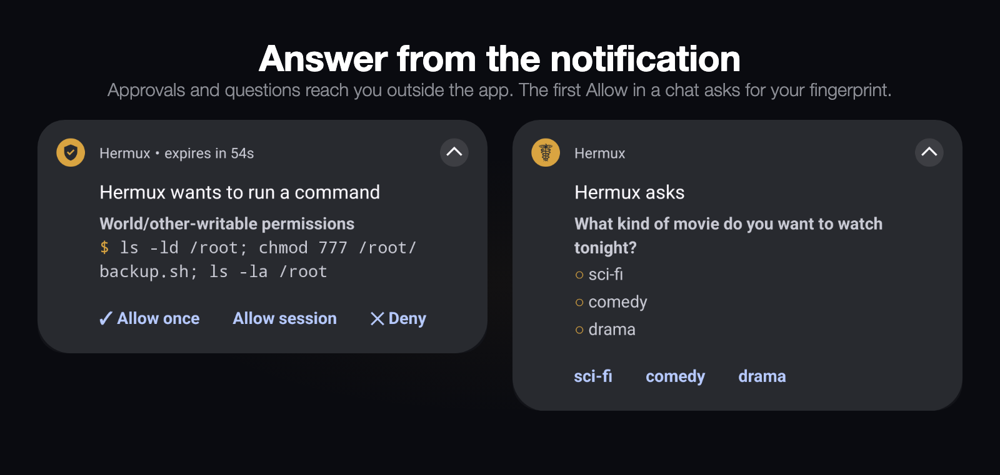
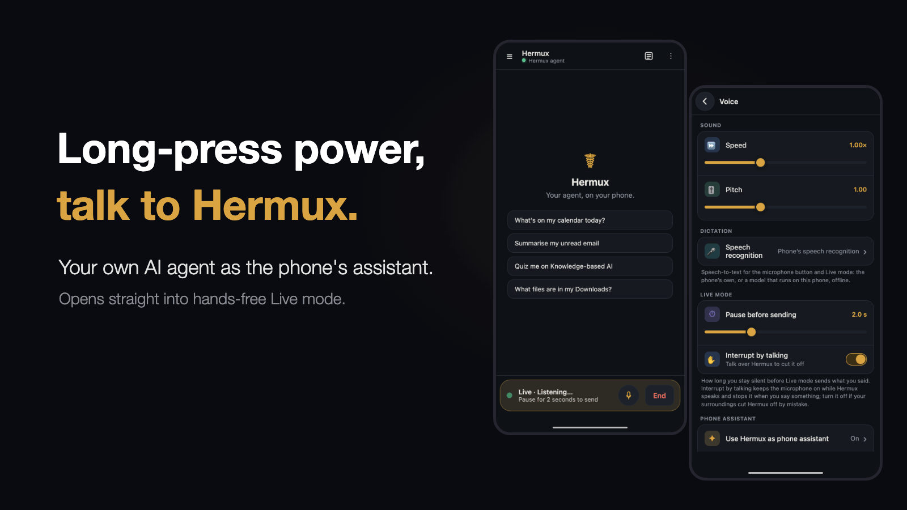

# What Hermux can do

The [README](../README.md) has the overview. This page has every feature.

## Hermes in a terminal, and Hermes in Hermux

| | Hermes in a terminal | Hermes in Hermux |
|---|---|---|
| Talking to it | Typing in Termux | A chat app with voice, dictation and hands-free Live mode |
| Seeing the work | Scrolling text | Live tool cards, reasoning, sub-agents, to-do list, file diffs |
| Approvals | Only while the terminal is open | From the status chip or a notification, app closed |
| Replies | Plain text | Equations, tables, diagrams, interactive cards and a shared canvas |
| Your phone | Termux commands you type | It opens and uses your apps, and reads battery, storage, files and settings |
| Coming back later | Scroll back | Searchable chats, pins, links between chats, a memory screen |

## Things to ask

Anything you can describe in words, Hermux can try: it has a Linux computer, the web, your apps and your phone to work
with. A few ideas, from one-liners to whole projects.

**Quick things**

- *"How much battery and storage do I have left, and what's taking the space?"*
- *"Add milk, eggs and coffee to my Keep shopping list."*
- *"Find the chat where I sent the receipt photo."*
- *"Read this article to me"*, shared from your browser, while you walk.
- *"What does this error mean?"* with a screenshot attached.

**Everyday help**

- *"Every morning at 8, check the weather and the news I care about and send me a short summary."* It runs as a cron job
  and the result lands in your notifications.
- *"Open my notes app and copy today's to-do list into a checklist here."*
- *"Turn off the living room lights"*, once Home Assistant is connected in Settings → Connectors.
- *"Sort my Downloads folder into folders by type. Show me what you'll move first."* File checkpoints let you undo it.
- Long-press the power button and just talk: Live mode listens, answers aloud and can take approvals by voice.

**Big projects**

- *"Build me a 3D model of the solar system I can spin and zoom."* It appears in the canvas beside the chat, and every
  change is a version you can compare and restore.
- *"Turn the bank export CSV in my Downloads into an interactive spending dashboard, by category and month."*
- *"Write a Python script that renames my photos by the date they were taken, test it on five of them, then run it."*
- *"Compare the price of these headphones in two shopping apps and put the results in a table."* It opens both apps on
  a hidden screen, one after the other, while you keep using your phone.
- *"Plan a three-day trip to Lisbon with a map page, a day-by-day schedule and a packing checklist."*
- Give each job its own bot: a coding bot on one model, a writing bot on another, each with its own keys and SOUL.md.

Hermux remembers what you tell it, learns notes about each app it uses, and can connect to any MCP server, so the list
grows with you.

## Uses your apps without taking your screen

Ask Hermux to do something in an app and it opens that app on a hidden screen, reads it, taps, scrolls and types,
while you keep using your phone. The status chip says **Using <app>**, a card in the chat shows a live thumbnail, and
**Take over** brings the app to your screen. It asks once per app per chat; banking, payment, password and 2FA apps stay
off unless you allow them. It keeps its own notes about each app, so it gets better at the apps you use most. Needs
Android 14+ and Shizuku.

## Answer from the island

Approvals and questions show up on the status chip (an Android 16 Live Update; older versions get a normal notification).
Pick an answer or tap Deny, and the app does not need to be open. The first Allow in a chat opens the app to ask for your fingerprint.

## A canvas you and Hermux share

Ask for an interactive page, a game, a chart or a 3D scene and Hermux builds it live in a document beside the chat. You
can edit it too, and Hermux reads your edits. HTML runs in a sandbox that is offline unless you allow it. Every change
is a version with a diff you can restore, and the gallery keeps every document from every chat.

## Renders everything, natively

KaTeX equations, sortable tables with "Copy table", tick-able task lists, Obsidian-style callouts, Mermaid diagrams (full screen,
pinch to zoom), coloured diffs, long code that collapses, inline SVG and HTML cards. Hermux can also answer with
interactive cards (tables, charts, tabs, buttons, forms) that show live data.

## Your phone's assistant

Pick Hermux as your *Digital assistant app* (under Default apps) and long-pressing the power button opens it in hands-free
Live mode. Replies can be read aloud with a full player, and dictation can run on the phone, offline.

## Knows your phone

Hermux runs on the phone it talks about, so you can just ask: battery, storage, files in Downloads, what's installed. It uses
Termux's phone commands, and with Shizuku it gets system-level access (settings, apps, logs) through `rish`. If Shizuku has
stopped, it tells you instead of guessing.

If you switch it on in Settings → "Phone data for the agent", it can also read your contacts, calendar, call log,
messages, approximate location and the date and size of your latest photos, read-only. It is off by default, each kind
has its own switch, and every read asks first. [Privacy](privacy.md) says what this does and does not protect.

## Connects to everything

Add MCP servers by address or command, or pick them from Hermes's catalog, test them and sign in to their accounts in
the browser. Switch on tools that need a key (web search, Home Assistant, image generation and more) and paste the key
once. Sign in with ChatGPT, Claude, Grok or Nous Portal, or use any provider Hermes supports; set fallback models and
several keys per provider, so a rate limit doesn't stop the chat.

## Your chats, your memory, your look

Search inside every message, pin, archive, link chats to chats, or ask Hermux to find "the chat where I sent the receipt photo". Every memory write is shown as a diff, and there is a screen to see
what Hermux remembers. Dark, OLED black or light.

## Built to be safe

An agent that can run commands and use your apps needs guard rails, and Hermux has them built in:

- **You choose how much it may do, per chat:** Off (it asks before risky commands and before opening an app), Auto
  access (it runs everything except a list of dangerous commands, which are blocked) or Full access (it asks for
  nothing). Your fingerprint or screen lock confirms the first Allow in a chat (a setting, on by default), and a locked phone asks you to unlock before anything
  is allowed.
- **Sensitive apps are off by default:** banking, payment, password and 2FA apps can't be opened until you allow them.
- **Pages it builds can't reach the app:** canvas pages run in a sandbox with no access to the app, its keys or your
  chats, and offline unless you switch them online; a link a page tries to open by itself asks first. Cards in replies
  can only call read-only tools.
- **The app's own controls are locked to the app:** every call into Android needs a secret key that changes on each page
  load, so content Hermux shows can't call them.
- **No debugging back door:** remote debugging is off by default; turning it on needs Android's Developer options and
  your screen lock, and it switches itself off after an hour.

More, including what Hermux cannot protect you from, in [Privacy and security](security.md).

## Everyday use

| | |
|---|---|
| **Chat** | Stop or steer a running reply, or queue follow-ups that send when it ends; edit, retry or branch any turn; quote part of a reply or ask to explain it; `/btw` side questions (pull up past the last message); per-chat drafts and stashed drafts |
| **Long chats** | A rail on the right edge to jump between your messages; a "New Messages" line where unread messages start; several questions asked one at a time |
| **Voice** | Read replies aloud with a player (pause, seek, speed, any installed speech engine), dictation and hands-free Live mode, optionally over the lock screen. Dictation can run on the phone, offline: built-in English models (Moonshine, NeMo, Zipformer) or your own sherpa-onnx model |
| **Notifications** | Reply, answer questions and allow commands right from the notification (a locked phone asks you to unlock first); a Done chip and app-icon badge for chats that finished while you were away; cron results; a "failed" note when a model call fails |
| **Share** | "Share to Hermux" from any app; attach photos, camera shots and files; share a chat as Markdown |
| **Offline-friendly** | Messages typed offline send on reconnect; the last chat list is cached |
| **Shortcuts & big screens** | Launcher shortcuts (New chat, Live mode, last chat); a two-column layout on tablets and foldables |

## For power users

| | |
|---|---|
| **See the work** | Reasoning, live tool cards, sub-agents, the to-do list, how long the turn has run and the chat's `/goal`; a card with the files a turn changed and their diffs; file checkpoints to undo them; a ring showing how full the context is, with Compress |
| **Commands** | `/` autocomplete for every skill and command; `/yolo` and `/fast` switch the chat at once |
| **Models & bots** | Switch model and reasoning level per chat, star favourites; bots (Hermes profiles) with their own default model, keys and SOUL.md |
| **Cards in replies** | Interactive cards drawn by OpenUI, with live, read-only data (off switch: Settings → Replies → Dynamic UI). HTML and SVG code blocks get a Preview button |
| **Screens** | Skills, memory, cron jobs, projects, a canvas gallery, every Hermux setting in plain words, and files with previews (tables for CSV, code, JSON, Mermaid, HTML, audio and video) |
| **Setup check** | One screen that checks Termux, permissions, the plugin and battery settings, with a fix button for each |
| **Battery** | No permanent wake lock: the phone sleeps while Hermux is idle |
| **Updates** | A notification when a new release is out; one tap in Settings → About installs it |
