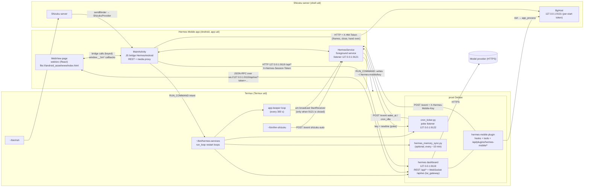

### 2.1 Processes and ports

| Process / endpoint | Runs as | Started by | Listens on | Who talks to it | Detail in |
|---|---|---|---|---|---|
| WebView page (`web/src`, entry `main.tsx`) | app uid, WebView renderer | `MainActivity.onCreate` → `loadUrl("file:///android_asset/www/index.html")` | nothing | `MainActivity` (bridge callbacks), Hermes (WebSocket) | 3, 2.6 |
| `MainActivity` (Java shell) | app uid, main process | the launcher, a notification tap, a share, a shortcut (`singleTask`) | nothing; intercepts `https://hm-media.invalid/m` requests inside the WebView | the page through the bridge | 4.1, 4.5 |
| `HermesService` (foreground service, type `specialUse`) | app uid, main process | `MainActivity.onCreate`/`onResume`, `BootReceiver` (boot / app update), `StartReceiver` (Termux app-keeper) | `127.0.0.1:9121`: `POST /event` (key) and `POST /setup` (installer token) | the plugin, `cron_ticker.py`, `hm-shizuku`, `phone/bootstrap.sh` | 4.1, 4.3, 4.4 |
| Termux supervisor `~/bin/hermes-services` (`phone/hermes-services`) | Termux uid | `MainActivity.startHermesNow` (Termux `RUN_COMMAND`), Termux:Boot (`~/.termux/boot/10-hermes`), by hand | nothing | — | 6.1, 6.2 |
| Hermes dashboard (`hermes dashboard --host 127.0.0.1 --port 9119 --no-open`) | Termux uid inside proot Debian | the `dashboard` restart loop (10 s pause between restarts) | `127.0.0.1:9119`: HTML page with the session token, REST `/api/*`, WebSocket `/api/ws` | the page (WebSocket), `MainActivity` and `HermesService` (REST), the plugin's own `/approve` and `/stop` (WebSocket) | 6.2 |
| `tui_gateway` WebSocket `/api/ws` | inside the dashboard process | the dashboard | `ws://127.0.0.1:9119/api/ws?token=<session token>` | the page's `JsonRpcGatewayClient` (`gateway.ts`) | 2.2 (flows), table "Gateway RPCs" below |
| Hermes Mobile plugin (`hermes-plugin/hermes-mobile`) | inside every Hermes process (dashboard, agent runtimes) | Hermes's plugin loader | its REST routes are mounted at `/api/plugins/hermes-mobile/*` on 9119 | Hermes (hooks/tools), the app (REST) | 5 |
| Cron ticker (`phone/cron_ticker.py`) | Termux uid inside proot Debian | the `cron-ticker` restart loop | `127.0.0.1:9122` (poke: the event key plus a newline) | `HermesService.pokeTicker` | 6.1 |
| Memory sync (`phone/hermes_memory_sync.py`) | Termux uid inside proot Debian | the `memory-sync` loop, only if `/root/.hermes/scripts/hermes_memory_sync.py` exists | nothing | — | 6.1 |
| app-keeper loop | Termux uid | `hermes-services` | nothing; probes `127.0.0.1:9121` with bash `/dev/tcp` every 300 s | sends `am broadcast -n com.omarqaterge.hermesmobile/.StartReceiver -f 32` only when 9121 doesn't answer | 6.2 |
| `sshd` | Termux uid | `hermes-services`, if Termux has `sshd` and none runs | Termux's default SSH port | the user | 6.2 |
| Shizuku server + `rish` | shell uid | the Shizuku app; restarted by `ShizukuKeeper` + `hm-shizuku` | Shizuku's binder | `rish` (Hermes's phone commands), `ShizukuProvider` (gets its binder) | 4.7, 6.1 |
| `BgHost` (`android/src/com/omarqaterge/hermesmobile/bg/BgHost.java`) | shell uid via `rish` → `app_process` | the plugin's `phone_app` tool, on demand; exits after 2 idle minutes | `127.0.0.1:9131`, every request carries `X-HM-Token` | the plugin, `MainActivity.bgRequest`, `HermesService.fetchBgThumb` | 4.7, 5.2 |

Other helpers on the phone: Termux:API (the `termux-*` commands, linked into Debian; the plugin's fallback
notification uses `termux-notification`) and Termux:Boot (runs `~/.termux/boot/10-hermes` after a reboot). Both
are installed by the installer (6.3).

One Hermes dashboard serves every Hermes profile. The page adds the open profile to every gateway call
(`rpc` in `gateway.ts` sends `{ profile, ...params }`) and to every REST call (`api` in `api.ts` appends
`profile=` unless told not to).
