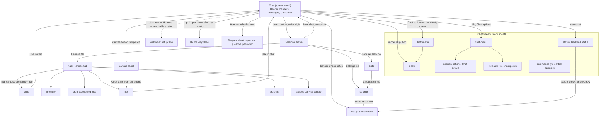

### 3.1 Navigation map

The page is one React tree (`web/src/App.tsx` `App`). There are no URLs or router. What is on screen is decided by a few fields of the store (`web/src/store.ts` `AppState`):

- `screen` (type `Screen`): a full-screen page drawn over the chat. `null` means the chat itself.
- `sheet` (type `Sheet`): one bottom sheet owned by the chat area.
- `drawer`: the sessions drawer is open.
- `requests`: the queue of questions Hermes asks the user (approval, clarify, password). The first one is drawn as a sheet that cannot be dismissed.
- `screenBack`: where Back from `screen` goes. `null` = the chat. Only the Hermes hub sets it (to `hub`).
- `screenProfile`: the bot (profile) a Settings page is scoped to. `null` = the current profile.

The chat is never unmounted. Screens, the drawer and sheets are drawn on top of it, so the draft text, the scroll position and a running reply survive a trip to Settings.

#### Every `Screen` value

| Value | What it is | Opened from | Closes with | Described in |
|---|---|---|---|---|
| `null` | The chat (no page on top). | Start-up; Back from any screen. | Not closable. | 3.2 to 3.6 |
| `hub` | The Hermes hub: one card per area below, each with a one-line summary. | Drawer tile Hermes (`Drawer.tsx`). | Back, Android Back: goes to the chat. | 3.14 |
| `skills` | Skills list and viewer. | Hub card Skills. | Back: goes to the hub (`screenBack`). The button "Use in chat" fills the composer with `/<skill> ` and returns to the chat. | 3.14 |
| `memory` | Hermes's memory notes. | Hub card Memory. | Back: hub. | 3.14 |
| `cron` | Scheduled jobs. | Hub card Scheduled jobs. | Back: hub. | 3.14 |
| `files` | File browser on the phone. | Hub card Files; Canvas panel row "Open a file from the phone…" (closes the canvas first). | Back: hub (or the chat when opened from the canvas). The preview button "Use in chat" fills the composer with "Look at the file <path> and " and returns to the chat. | 3.14 |
| `projects` | Projects (chat folders). | Hub card Projects. | Back: hub. | 3.14 |
| `gallery` | Canvas gallery of saved documents. | Hub card Canvas gallery. | Back: hub. | 3.8 |
| `bots` | Bots (profiles) list and editor. | Drawer tile Bots; the drawer's profile list entry "New bot / manage bots…". | Back: chat. | 3.16 |
| `settings` | Settings. Keyed by `screenProfile`, so opening it for another bot rebuilds it. | Drawer tile Settings; a bot's page in Bots (sets `screenProfile`). | Back: chat. | 3.15 |
| `setup` | Setup check: permissions, background running, the plugin, Shizuku. | Connection banner button Check setup (shown after 10 s offline); Backend status sheet (button Setup check, and the Shizuku row when it says to set up); Settings row Setup check. | Back: chat. | 3.18 |
| `welcome` | The setup flow (first-run wizard). | `main.tsx` calls `openFirstRun` before the first paint on a fresh install; `watchFirstRun` opens it when Hermes stays unreachable on a first run (after 15 s, at once when Termux is missing or the installer is running); `checkSetupFlow` resumes it after connecting when something is missing. | Finishing or leaving the flow. | 3.18 |

`closeScreen` (`store.ts`) is the one way Back leaves a screen. It sets `screen` to `screenBack` when that differs from the current screen, else to `null`, and clears `screenBack`. An effect in `App` forgets a stale `screenBack` as soon as the chat is showing again.

#### Sheets, panels and overlays

| Name | Kind | Opened from | Closes with | Section |
|---|---|---|---|---|
| `model` | `Sheet` value, `ModelSheet` | Model chip in the composer; the "Add" picker's first row; draft menu "Change model". | Drag down on the top strip, tap outside, Android Back. Picking a model closes it. | 3.5 |
| `chat-menu` | `Sheet` value, `ChatMenuSheet` | Header title (when a chat exists); header Chat options button. | Same. | 3.5 |
| `draft-menu` | `Sheet` value, `DraftMenuSheet` | Chat options on the empty new-chat screen. | Same. | 3.5 |
| `session-actions` | `Sheet` value, `SessionActionsSheet` ("Chat details") | Chat menu row Chat details. | Same. | 3.5 |
| `status` | `Sheet` value, `StatusSheet` ("Backend status") | The status dot in the header; Settings row Status. | Same. | 3.5 |
| `context` | `Sheet` value, `ContextSheet` ("Context window") | The context ring in the composer's model row. | Same. | 3.5 |
| `rollback` | `Sheet` value, `RollbackSheet` ("File checkpoints") | Chat menu row File checkpoints. | Same. Inside it, Back first steps from a snapshot to the list. | 3.5 |
| `commands` | `Sheet` value, `CommandsSheet` | No control sets it in the current code. The composer's "/" button opens the inline autocomplete instead (3.4). The sheet is still mounted by `App` if `sheet` is ever `commands`. | Same. | 3.5 |
| Request sheet | `RequestSheet`, driven by `requests[0]` | Hermes asks (approval, question, password, code). | Only by answering (or Skip/Cancel). Not dismissible by tap or drag. | 3.6 |
| Drawer | `Drawer`, `drawer` flag | Header menu button; swipe right on the chat. | Tap the backdrop, Android Back, picking a session or New chat. | 3.13 |
| Canvas panel | `CanvasPanel` | Header canvas button; swipe left on the chat; chat menu row Canvas; code-block button Canvas. | Close canvas (✕), swipe right on its top bar (phones), Android Back (from full size Back first returns to the side size). Not by a tap outside. | 3.7 |
| By the way | `BtwSheet` | Pull up past the end of the chat; the `/btw` command. | Drag down on the top strip, tap outside, Android Back (it has no close button). | 3.12 |
| Read-aloud player | `TtsPlayer` | Starts when something is read aloud. | Close player. | 3.11 |
| Background app card | `BgApp` | Hermes drives an app on the hidden display. | Its own buttons. | 3.10 |
| Dialogs | `DialogHost` (`dialog.tsx`) | `confirmDialog` / `promptDialog` calls. | Cancel, tap outside, Android Back. | 3.20 |
| Picker sheets | `PickerSheet` (`ui.tsx`) | Auto button, Add, Copy reply. | Same as sheets. | 3.20 |
| Lightbox, diagram viewer | `Lightbox` (`Media.tsx`), `DiagramViewer` (`Markdown.tsx`) | Tap an image / a drawn diagram. | Close button, tap the dark area, Android Back. | 3.3 |
| Toasts | `toast()` in `store.ts` | Any code. | Time out after 3.5 s (default). At most three are shown; a toast with the same text as one on screen is dropped. | 3.20 |

#### The Android Back button

The Android shell calls `window.hermesBack` (`App.tsx`). It returns `true` when the page took the press. Order:

1. `backTop()` (`web/src/backstack.ts`): the top layer that registered with `useBackHandler`. Dialogs, picker sheets, the find bar, the lightbox, the diagram viewer, the Rollback snapshot view, Settings sub-pages, the canvas.
2. An open `sheet`: closed.
3. The open drawer: closed.
4. An open `screen`: `closeScreen()`.
5. Otherwise `false`, and the shell does its own thing (leave the app).

`useBackHandler(onBack, active)` pushes a handler on a stack while `active`; later registrations sit on top of earlier ones.

#### Gestures that move between layers

`web/src/swipe.ts` `installSwipeToDrawer` listens on the whole document (started once by `App`):

- Swipe right (finger moves more than 70 px, and more than twice as far across as down): opens the drawer.
- Swipe left (same thresholds): opens the chat's canvas, only when a chat is open or opening and the canvas is closed.
- A move that goes more than 40 px down or up before it qualifies counts as scrolling and cancels the gesture.
- Nothing happens while a drawer, screen or sheet is open, with more than one finger, or when the touch starts inside inputs, dialogs, sheet backdrops, the canvas, the drawer, the lightbox, sliders, the chat scrubber rail, the read-aloud player, code blocks, tables, wide formulas, diagrams, OpenUI cards, or any element that scrolls sideways.
- `openChatCanvas` (also used by the header canvas button) opens the canvas. With no chat and none opening it first creates a new chat, because a canvas belongs to a chat. While a chat is still opening (cold start) it does not create one.

Pulling the chat up past its end opens the By the way sheet (`web/src/pullbtw.ts`). The chat view arms that gesture; 3.12 describes it.

#### Wide screens (tablets, unfolded foldables, landscape)

Two CSS blocks in `web/src/styles.css` turn the layout into columns. From `@media (min-width: 700px)` (upright tablets, unfolded foldables) an open canvas is a column beside the chat with a draggable divider, and a pull tab and swipe at the right edge bring it in (3.7, `web/src/splitview.ts`); the chat list stays a slide-over there. From `@media (min-width: 840px)` the chat list docks too. The drawer becomes a docked 320 px column on the left (`--side`) and full-screen pages (`screen`) open to the right of that column, above it (z-index 22 over the drawer's 21), so a sheet or dialog a page opens (they sit inside the page's stacking context, e.g. Settings → Uninstall Hermes) covers the whole width instead of being cut off by the column. The user can hide the column: the menu button `☰` (`aria-label` "Hide chat list" / "Show chat list" on wide screens) toggles it, and a `«` button at the top of the docked column (`aria-label` "Hide the chat list", class `side-hide`, shown only while docked) hides it from any page. `web/src/sidepanel.ts` (`setSideHidden`, `toggleSide`, `useSidePanel`) keeps the choice in localStorage `hm.sideHidden.v1` and sets `html[data-side="hidden"]` at start-up, before the first paint; every docked rule is scoped to `html:not([data-side='hidden'])`, so a hidden column means the phone layout (swipe right opens the drawer over the chat, its backdrop closes it). The setup flow ("Set up Hermes", class `takeover`) still covers the whole width. While docked, `--side-w` is the column's width (0 otherwise); the canvas width is computed from the room beside it. The chat's text column is kept at about 820 px, with at least 52 px on the right so the scrubber stays out of the 24 px edge strip. An open canvas at its side size becomes a right-hand column (`--canvas-w`, 3.7 "Divider and width on wide screens"); full size still covers everything.

#### Entry points from outside the page

The Android shell and other code call these globals (declared in `App.tsx`, `share.ts`, `notif-answer.ts`):

| Global | Caller | What it does |
|---|---|---|
| `window.hermesBack()` | Android Back | See above. |
| `window.hermesResume()` | Shell, app returns to the foreground | Reconnects if the socket is not open (`reconnectNow`), refreshes the background-app card, and tells the open chat it is back (`noteBack`, for the "New since your last visit" divider). |
| `window.hermesPause()` | Shell, app leaves the foreground (`onPause`) | Notes that the open chat was seen until now (`noteAway`); messages arriving meanwhile get the "New since your last visit" divider on return. |
| `window.hermesOpenSession(id, draft?)` | Notification tap | `openSessionFromNotification`: remembers the chat, closes screens, sheets and drawer, resumes it (now, or right after connecting). A `draft` (an answer typed into a notification that could not be delivered) goes into the composer. |
| `window.hermesShared(count, text)` | Android share sheet | `receiveShare` in `share.ts`: see 3.4 "Share to Hermes". |
| `window.hermesShortcut(kind)` | Launcher shortcuts | Closes screens, sheets and drawer, starts a new chat; kind `live` also starts Live mode. |
| `window.hermesLockView(on)` | Assist gesture over the lock screen | `lockview.ts`: true while the app shows over a locked phone's lock screen (talking only, see 4.6 "Talking on the lock screen"); false once unlocked or hidden again. |
| `window.hermesAnswer(kind, session, text)` | Notification reply / question answer | `answerFromNotification` in `notif-answer.ts`: see 3.6. Returns `'y'` when the page took the answer, `'n'` otherwise. |

#### Layer order in `App`

Top to bottom in the DOM, which is also the paint order: `Header`, `ConnBanner`, `FindBar`, `Chat`, `ActivityBanner`, `StatusBar`, `CompressHint`, `TtsPlayer`, `BgApp`, `Composer`, the open `screen`, `Drawer`, the open `sheet`, `RequestSheet`, `UninstallResume`, `CanvasPanel`, `BtwSheet`, `DialogHost`, toasts.

---
